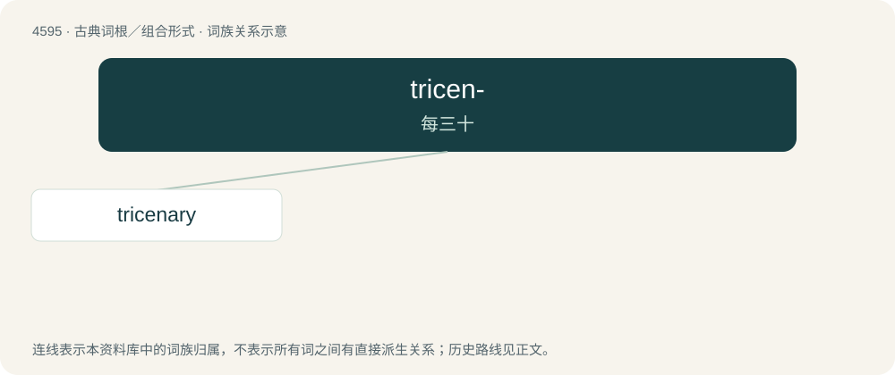

# 4595 · tricen- — 每三十

[总目录](../00_总目录_按常用程度.md)

**类型**：古典词根／组合形式　｜　**来源语言**：拉丁语

## 核心含义与来源

- 核心含义：每三十
- 英文含义：thirty each
- 词形：tricen-

**来源词形**：triceni

## 词族图

## 单词速览（常用到不常用）

| 单词 | 音标 | 释义 |
|---|---|---|
| [tricenary](#w-1) |  | 【英文】Of or related to the number thirty. |

## 逐词详解

### 1. tricenary

**词性**：形容词

**英文义项**：Of or related to the number thirty. / Lasting thirty days.

**词源与演化**：

From Latin trīcēnārius, from trīcēnus (“thirty each”) + -ārius (“-ary: forming adjectives and related nouns”).
