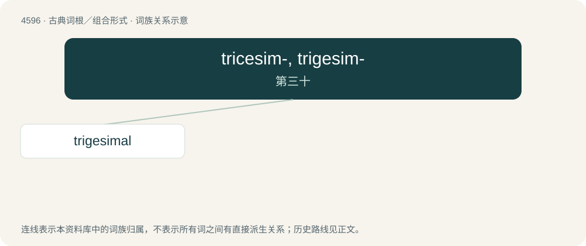

# 4596 · tricesim-, trigesim- — 第三十

[总目录](../00_总目录_按常用程度.md)

**类型**：古典词根／组合形式　｜　**来源语言**：拉丁语

## 核心含义与来源

- 核心含义：第三十
- 英文含义：thirtieth
- 词形：tricesim-, trigesim-

**来源词形**：tricesimus

## 词族图

## 单词速览（常用到不常用）

| 单词 | 音标 | 释义 |
|---|---|---|
| [trigesimal](#w-1) |  | 【英文】Thirtieth. |

## 逐词详解

### 1. trigesimal

**词性**：形容词

**英文义项**：Thirtieth. / Containing thirty of something.

**词源与演化**：

From Latin trigesimus (“thirtieth”) + -al (“forming adjectives”).

**例句**：

> Each month is a roughly trigesimal period.

该用例对应义项：Containing thirty of something.
