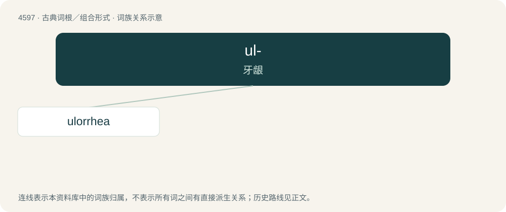

# 4597 · ul- — 牙龈

[总目录](../00_总目录_按常用程度.md)

**类型**：古典词根／组合形式　｜　**来源语言**：古希腊语

## 核心含义与来源

- 核心含义：牙龈
- 英文含义：gums
- 词形：ul-

**来源词形**：οὖλον (oûlon)

## 词族图

## 单词速览（常用到不常用）

| 单词 | 音标 | 释义 |
|---|---|---|
| [ulorrhea](#w-1) |  | 【英文】Bleeding from the gums. |

## 逐词详解

### 1. ulorrhea

**词性**：名词

**英文义项**：Bleeding from the gums.
