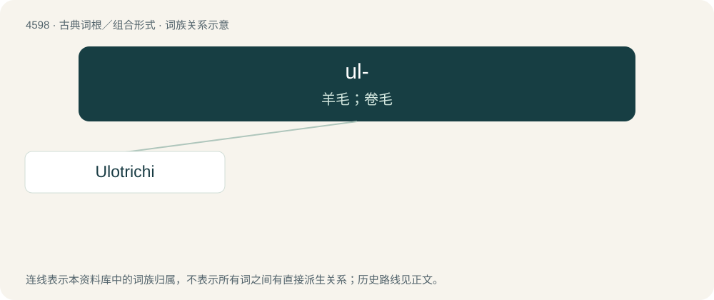

# 4598 · ul- — 羊毛；卷毛

[总目录](../00_总目录_按常用程度.md)

**类型**：古典词根／组合形式　｜　**来源语言**：古希腊语

## 核心含义与来源

- 核心含义：羊毛；卷毛
- 英文含义：woolly
- 词形：ul-

**来源词形**：οὖλος (oûlos)

## 词族图

## 单词速览（常用到不常用）

| 单词 | 音标 | 释义 |
|---|---|---|
| [Ulotrichi](#w-1) |  | 【英文】Human races that have "crisp" or "woolly" hair, according to a system by Jean-Baptiste Bory de Saint-Vincent of classifying different races of humans as separate species. |

## 逐词详解

### 1. Ulotrichi

**词性**：专有名词

**英文义项**：Human races that have "crisp" or "woolly" hair, according to a system by Jean-Baptiste Bory de Saint-Vincent of classifying different races of humans as separate species.

**词源与演化**：

From Ancient Greek οὖλος (oûlos) and θρίξ (thríx).
