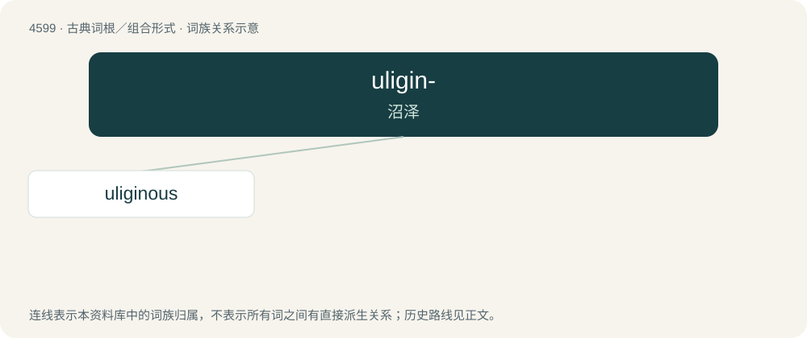

# 4599 · uligin- — 沼泽

[总目录](../00_总目录_按常用程度.md)

**类型**：古典词根／组合形式　｜　**来源语言**：拉丁语

## 核心含义与来源

- 核心含义：沼泽
- 英文含义：in marshes
- 词形：uligin-

**来源词形**：uligo, uliginis

## 词族图

## 单词速览（常用到不常用）

| 单词 | 音标 | 释义 |
|---|---|---|
| [uliginous](#w-1) | /juːˈlɪd͡ʒɪnəs/ | 多泥的, 泥泞的 |

## 逐词详解

### 1. uliginous

**词性**：形容词　｜　**音标**：/juːˈlɪd͡ʒɪnəs/

**中文释义**：多泥的, 泥泞的

**英文义项**：Slimy. / Marshy, swampy, waterlogged.

**词源与演化**：

From Latin ūlīginōsus (“swampy”).
