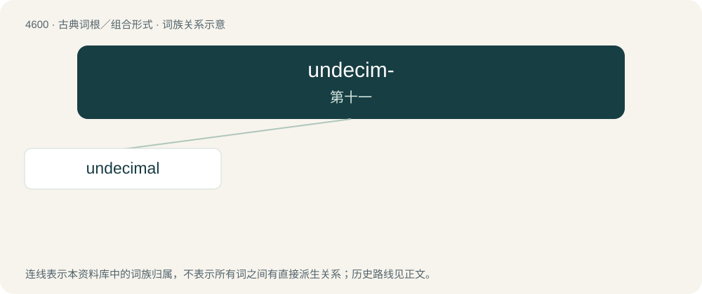

# 4600 · undecim- — 第十一

[总目录](../00_总目录_按常用程度.md)

**类型**：古典词根／组合形式　｜　**来源语言**：拉丁语

## 核心含义与来源

- 核心含义：第十一
- 英文含义：eleventh
- 词形：undecim-

**来源词形**：undecimus

## 词族图

## 单词速览（常用到不常用）

| 单词 | 音标 | 释义 |
|---|---|---|
| [undecimal](#w-1) | /ʌnˈdesiməl/ | 十一进制的 |

## 逐词详解

### 1. undecimal

**词性**：形容词　｜　**音标**：/ʌnˈdesiməl/

**中文释义**：十一进制的

**英文义项**：Based upon the number eleven
