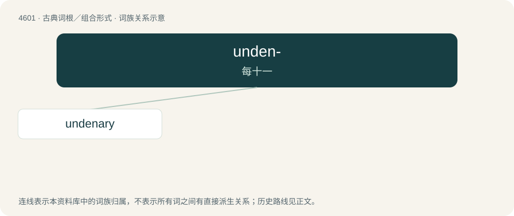

# 4601 · unden- — 每十一

[总目录](../00_总目录_按常用程度.md)

**类型**：古典词根／组合形式　｜　**来源语言**：拉丁语

## 核心含义与来源

- 核心含义：每十一
- 英文含义：eleven each
- 词形：unden-

**来源词形**：ūndēni

## 词族图

## 单词速览（常用到不常用）

| 单词 | 音标 | 释义 |
|---|---|---|
| [undenary](#w-1) |  | 【英文】In base (radix) eleven. |

## 逐词详解

### 1. undenary

**词性**：形容词

**英文义项**：In base (radix) eleven.

**词源与演化**：

From Latin ūndēnī (“eleven each, eleventh”) + -ary, from ūndēnus.
