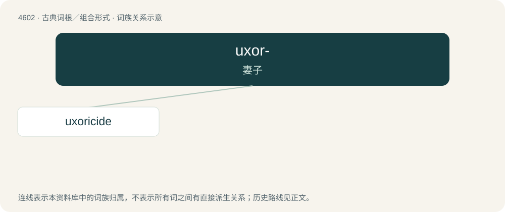

# 4602 · uxor- — 妻子

[总目录](../00_总目录_按常用程度.md)

**类型**：古典词根／组合形式　｜　**来源语言**：拉丁语

## 核心含义与来源

- 核心含义：妻子
- 英文含义：wife
- 词形：uxor-

**来源词形**：uxor

## 词族图

## 单词速览（常用到不常用）

| 单词 | 音标 | 释义 |
|---|---|---|
| [uxoricide](#w-1) | /ʌkˈsɔː.ɹɪˌsaɪd/ | n. 杀妻, 杀妻者；\[法\] 杀妻, 杀妻者, 杀妻罪 |

## 逐词详解

### 1. uxoricide

**词性**：名词　｜　**音标**：/ʌkˈsɔː.ɹɪˌsaɪd/

**中文释义**：n. 杀妻, 杀妻者；\[法\] 杀妻, 杀妻者, 杀妻罪

**英文义项**：One who murders one's wife.

**词源与演化**：

Borrowed from French uxoricide or Latin uxor + English -icide.

**例句**：

> Having sold him the murder weapon makes you an accessory to uxoricide.
