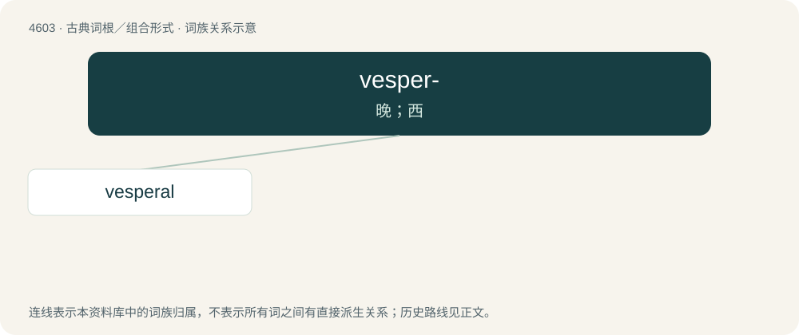

# 4603 · vesper- — 晚；西

[总目录](../00_总目录_按常用程度.md)

**类型**：古典词根／组合形式　｜　**来源语言**：拉丁语

## 核心含义与来源

- 核心含义：晚；西
- 英文含义：evening, western
- 词形：vesper-

**来源词形**：vespera

## 词族图

## 单词速览（常用到不常用）

| 单词 | 音标 | 释义 |
|---|---|---|
| [vesperal](#w-1) | /ˈvespərəl/ | a. 黄昏的, 薄暮的；n. 晚祷书 |

## 逐词详解

### 1. vesperal

**词性**：形容词　｜　**音标**：/ˈvespərəl/

**中文释义**：a. 黄昏的, 薄暮的；n. 晚祷书

**英文义项**：vesper; evening

**例句**：

> The pale glow of the vesperal twilight is a balm for my weary eyes.
