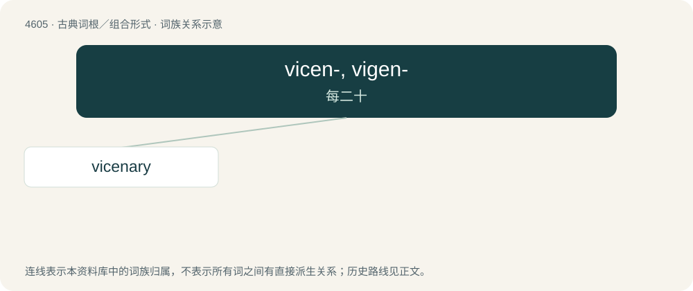

# 4605 · vicen-, vigen- — 每二十

[总目录](../00_总目录_按常用程度.md)

**类型**：古典词根／组合形式　｜　**来源语言**：拉丁语

## 核心含义与来源

- 核心含义：每二十
- 英文含义：twenty each
- 词形：vicen-, vigen-

**来源词形**：viceni

## 词族图

## 单词速览（常用到不常用）

| 单词 | 音标 | 释义 |
|---|---|---|
| [vicenary](#w-1) | 英 /ˈvɪsən(ə)ɹi/；美 /ˈvɪsəˌnɛɹi/ | \[计\] 二十进制的 |

## 逐词详解

### 1. vicenary

**词性**：形容词　｜　**音标**：英 /ˈvɪsən(ə)ɹi/；美 /ˈvɪsəˌnɛɹi/

**中文释义**：\[计\] 二十进制的

**英文义项**：Of, pertaining to, or based on the number twenty.

**词源与演化**：

From Latin vīcēnārius, from vīcēnus (“twenty each”) + -ārius (“-ary: forming adjectives and related nouns”). Doublet of vicenarious. Ultimately cognate with English vigenary.

**用法示例／搭配（非完整句）**：

> vicenary numeration

该用例对应义项：Of, pertaining to, or based on the number twenty.
