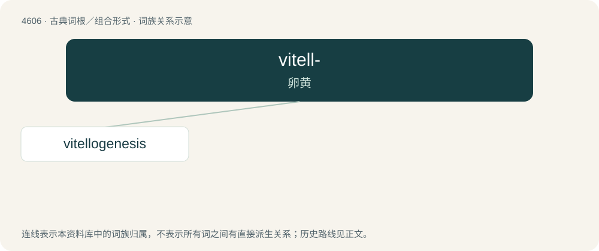

# 4606 · vitell- — 卵黄

[总目录](../00_总目录_按常用程度.md)

**类型**：古典词根／组合形式　｜　**来源语言**：拉丁语

## 核心含义与来源

- 核心含义：卵黄
- 英文含义：yolk
- 词形：vitell-

**来源词形**：vitellus

## 词族图

## 单词速览（常用到不常用）

| 单词 | 音标 | 释义 |
|---|---|---|
| [vitellogenesis](#w-1) | /vi,teləjˈdʒenisis, vai-/ | n. \[动\]卵黄生成作用 |

## 逐词详解

### 1. vitellogenesis

**词性**：名词　｜　**音标**：/vi,teləjˈdʒenisis, vai-/

**中文释义**：n. \[动\]卵黄生成作用

**英文义项**：yolk deposition; the process of yolk formation via nutrients being deposited in the oocyte, or female germ cell involved in reproduction

**构词拆分**：vitello- + -genesis

**词源与演化**：

From vitello- + -genesis.
