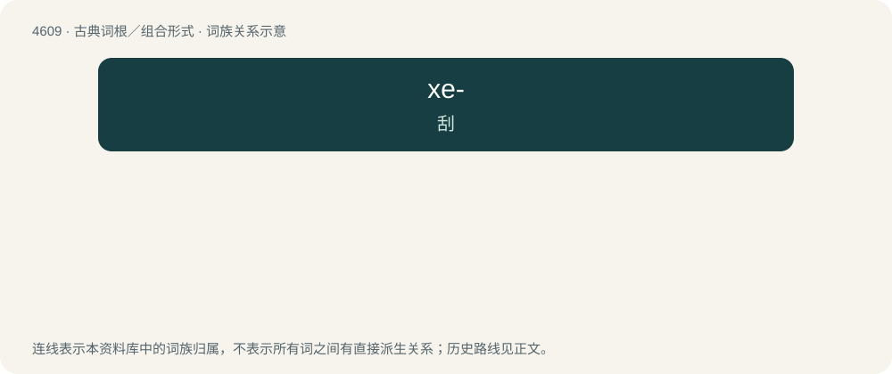

# 4609 · xe- — 刮

[总目录](../00_总目录_按常用程度.md)

**类型**：古典词根／组合形式　｜　**来源语言**：古希腊语

## 核心含义与来源

- 核心含义：刮
- 英文含义：scrape, shave
- 词形：xe-

**来源词形**：ξεῖν/ξέειν (xéein), ξέσις (xésis), ξέσμα (xésma)

## 词族图

## 其他候选词

- arthroxesis
