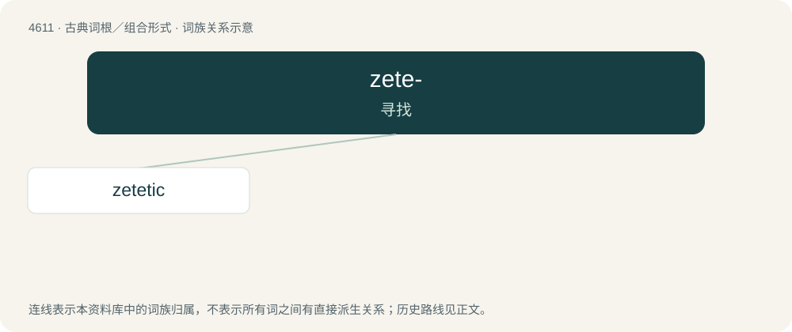

# 4611 · zete- — 寻找

[总目录](../00_总目录_按常用程度.md)

**类型**：古典词根／组合形式　｜　**来源语言**：古希腊语

## 核心含义与来源

- 核心含义：寻找
- 英文含义：seek
- 词形：zete-

**来源词形**：ζητεῖν (zēteîn), ζητητός (zētētós), ζητητικός (zētētikós)

## 词族图

## 单词速览（常用到不常用）

| 单词 | 音标 | 释义 |
|---|---|---|
| [zetetic](#w-1) | 英 /zəˈtɛt.ɪk/ | a. 调查的, 考究的 |

## 逐词详解

### 1. zetetic

**词性**：形容词　｜　**音标**：英 /zəˈtɛt.ɪk/

**中文释义**：a. 调查的, 考究的

**英文义项**：Proceeding by inquiry or investigation. / Of or pertaining to zetetic astronomy (which employs zetetic principles to argue that the earth is flat).

**词源与演化**：

From Ancient Greek ζητητικός (zētētikós, “inquisitive, keen”), from ζητέω (zētéō, “I seek”).
