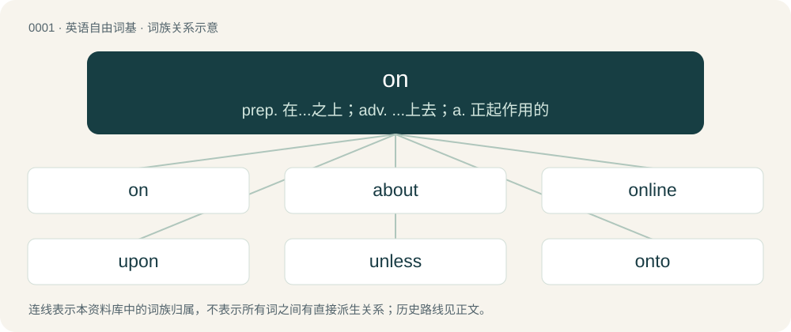

# 0001 · on — prep. 在...之上；adv. ...上去；a. 正起作用的

[总目录](../00_总目录_按常用程度.md)

**类型**：英语自由词基　｜　**来源语言**：见词源记录

## 核心含义与来源

- 核心含义：prep. 在...之上；adv. ...上去；a. 正起作用的
- 英文含义：In the state of being active, functioning or operating.
- 词形：on

**多个词源／构词路径**：同一拼写可能有不同来源；以下按词性和含义分别列出。

**来源记录 1**（形容词；In the state of being active, functioning or operating.）

From Middle English on, from Old English on, an (“on, upon, onto, in, into”), from Proto-West Germanic \*ana, from Proto-Germanic \*ana (“on, at”), from Proto-Indo-European \*h₂en- (“on, onto”). Cognates Cognate with Yola a, an, ana, on (“on”), Saterland Frisian an (“on; at”), West Frisian oan (“on; to, towards”), Cimbrian aan, å (“on, onto”), Dutch aan (“on; at”), Low German an (“on; at, to”), German an (“at, in; on”), Luxembourgish un (“on; at, to”), Yiddish אָן (on, “on, onward”), Danish, Norwegian Nynorsk, and Swedish å (“on”), Elfdalian ą̊ (“on”), Faroese and Icelandic á (“in; on”), Gothic 𐌰𐌽𐌰 (ana, “at, on”); also Umbrian 𐌀𐌌- (am-), 𐌀𐌍- (an-, “up, upon”), Ancient Greek ἀνά (aná, “on, upon”) (whence Greek ανά (aná, “by, through, per”)), Albanian në (“in; on”), Latvian no (“from; out of; for; of; with”), Lithuanian nuo (“from, off; for, of”), Belarusian, Bulgarian, Macedonian, Russian, and Ukrainian на (na, “on”), Czech, Polish, Slovak, and Slovene na (“on”), Serbo-Croatian на, na (“on”), Old Armenian ան- (an-, “at, on, unto”); and from Old Norse upp á: Danish, Norwegian Bokmål, and Swedish på (“on”), Norwegian Nynorsk paa, på (“on”), see upon.

**来源记录 2**（介词；Without.）

From Old Norse ón, án (“without”), from Proto-Germanic \*ēnu, \*ēno, \*ino (“without”), from Proto-Indo-European \*ḗnu (“without”). Cognate with North Frisian on (“without”), Middle Dutch an, on (“without”), Middle Low German āne (“without”), German ohne (“without”), Gothic 𐌹𐌽𐌿 (inu, “without, except”). Unlikely to be related to Ancient Greek ἄνευ (áneu, “without”), which is likely akin to Proto-Germanic \*sundraz instead (whence sunder).

**来源记录 3**（名词；In the Japanese language, a pronunciation, or reading, of a kanji character that was originally based on the character's pronunciation in Chinese, contrasted with kun.）

From Japanese 音読み (on'yomi, literally “sound reading”).

## 词族图

## 单词速览（常用到不常用）

| 单词 | 音标 | 释义 |
|---|---|---|
| [on](#w-1) | 英 /ɒn/；/än/ | prep. 在...之上；adv. ...上去；a. 正起作用的 |
| [about](#w-2) | 英 /əˈbaʊ̯t/；/əˈbɐʊ̯t/ | prep. 在...周围, 大约, 有关, 关于；adv. 大约, 四处, 在附近, 周围 |
| [online](#w-3) | 英 /ˈɒnlaɪn/；/ˈɑnlaɪn/ | \[计\] 联机 |
| [upon](#w-4) | 英 /əˈpɒn/；/əˈpɑn/ | prep. 在...之上, 迫近, 紧接着 |
| [unless](#w-5) | /ənˈlɛs/ | conj. 除非；prep. 除...之外 |
| [onto](#w-6) | 英 /ˈɒn.tuː/；/ˈɔn.tu/ | prep. 在...之上 |
| [ongoing](#w-7) | 英 /ɒnˈɡəʊ.ɪŋ/；/ɔnˈɡoʊ.ɪŋ/ | a. 前进的, 进行的, 不间断的；n. 前进, 发展 |
| [onwards](#w-8) | /ˈɔnwəːdz/ | adv. 向前, 在前面 |
| [onboard](#w-9) | 英 /ɒnˈbɔːd/；/ɑnˈbɔɹd/ | adv. 在板上, 在船上, 在车上, 在飞机上 |
| [onstage](#w-10) | /ˈɔnˈsteidʒ/ | adv. 在前台；a. 在前台的 |
| [onward](#w-11) | 英 /ˈɒnwəd/；/ˈɑnwɚd/ | a. 向前的, 前进的；adv. 向前, 前进, 在先 |
| [onscreen](#w-12) | /ɒnskˈriːn/ | adv. & adj. 在银幕上（的） |
| [onshore](#w-13) | 英 /ˈɒnʃɔː/；/ˈɔnʃoɹ/ | a. 向陆的, 陆上的, 在国内的；adv. 向陆地, 在陆上, 在国内 |
| [onsite](#w-14) | /ˈɔnsait/ | a. 在场的, 就地的 |
| [onside](#w-15) | /ˈɒnˈsaid/ | n. 不越位 |
| [thereon](#w-16) | 英 /ðɛəˈɹɒn/；/ðeɹˈɑn/ | adv. 在那上面, ...之后立即 |

## 逐词详解

### 1. on

**词性**：形容词　｜　**音标**：英 /ɒn/；/än/

**中文释义**：prep. 在...之上；adv. ...上去；a. 正起作用的

**英文义项**：In the state of being active, functioning or operating. / Happening; taking place; being or due to be put into action.

**词源与演化**：

From Middle English on, from Old English on, an (“on, upon, onto, in, into”), from Proto-West Germanic \*ana, from Proto-Germanic \*ana (“on, at”), from Proto-Indo-European \*h₂en- (“on, onto”). Cognates Cognate with Yola a, an, ana, on (“on”), Saterland Frisian an (“on; at”), West Frisian oan (“on; to, towards”), Cimbrian aan, å (“on, onto”), Dutch aan (“on; at”), Low German an (“on; at, to”), German an (“at, in; on”), Luxembourgish un (“on; at, to”), Yiddish אָן (on, “on, onward”), Danish, Norwegian Nynorsk, and Swedish å (“on”), Elfdalian ą̊ (“on”), Faroese and Icelandic á (“in; on”), Gothic 𐌰𐌽𐌰 (ana, “at, on”); also Umbrian 𐌀𐌌- (am-), 𐌀𐌍- (an-, “up, upon”), Ancient Greek ἀνά (aná, “on, upon”) (whence Greek ανά (aná, “by, through, per”)), Albanian në (“in; on”), Latvian no (“from; out of; for; of; with”), Lithuanian nuo (“from, off; for, of”), Belarusian, Bulgarian, Macedonian, Russian, and Ukrainian на (na, “on”), Czech, Polish, Slovak, and Slovene na (“on”), Serbo-Croatian на, na (“on”), Old Armenian ան- (an-, “at, on, unto”); and from Old Norse upp á: Danish, Norwegian Bokmål, and Swedish på (“on”), Norwegian Nynorsk paa, på (“on”), see upon.

**例句**：

> He'd like to play the red next to the black spot, but that shot isn't on.

该用例对应义项：Possible; capable of being successfully carried out.

### 2. about

**词性**：形容词　｜　**音标**：英 /əˈbaʊ̯t/；/əˈbɐʊ̯t/

**中文释义**：prep. 在...周围, 大约, 有关, 关于；adv. 大约, 四处, 在附近, 周围

**英文义项**：Moving around or in motion; astir. / In existence; being in evidence; apparent.

**构词拆分**：on + be + out；on + but

**例句**：

> After my bout with Guillan-Barre Syndrome, it took me 6 months to be up and about again.

该用例对应义项：Moving around or in motion; astir.

### 3. online

**词性**：形容词　｜　**音标**：英 /ˈɒnlaɪn/；/ˈɑnlaɪn/

**中文释义**：\[计\] 联机

**英文义项**：Of a generator or power plant: connected to the grid. / Of a computer: actively connected to the Internet or to some other communications service.

**构词拆分**：on + line

**词源与演化**：

1950, from on + line.

**例句**：

> Once this factory comes online, it will double car production in our country!

该用例对应义项：Of a system: active, particularly building facilities (such as power) or a factory or power plant.

### 4. upon

**词性**：介词　｜　**音标**：英 /əˈpɒn/；/əˈpɑn/

**中文释义**：prep. 在...之上, 迫近, 紧接着

**英文义项**：alternative to on in most, though not all, prepositional uses.

**构词拆分**：up (“adverb”) + on (“preposition”)

**词源与演化**：

From Middle English upon, uppon, uppen, from Old English upon, uppon, uppan (“on, upon, up to, against, after, in addition to”), equivalent to up (“adverb”) + on (“preposition”). Cognate with Old Saxon uppan (“upon”), Old High German ūfan, ūffan (“upon”), Icelandic upp á, upp á (“up on, upon”), Swedish uppå (“up on, upon”) (thence Swedish på), Danish på (“up on, upon”), Norwegian på (“up on, upon”).

**例句**：

> Let us stop to think how much we depend upon atomic energy.

### 5. unless

**词性**：连词　｜　**音标**：/ənˈlɛs/

**中文释义**：conj. 除非；prep. 除...之外

**英文义项**：Except on a specified condition; if not. / If not; used with counterfactual conditionals.

**构词拆分**：of + on + upon + in + un- + less

**词源与演化**：

From Middle English unlesse, earlier on lesse (modern on + less), from (not) on lesse (than) (“(not) on a less compelling condition (than)”). The quality of negation in the word and the lack of stress changed on to un-.

**例句**：

> Unless part of the staff, you are not allowed beyond this point.

该用例对应义项：Except on a specified condition; if not.

### 6. onto

**词性**：形容词　｜　**音标**：英 /ˈɒn.tuː/；/ˈɔn.tu/

**中文释义**：prep. 在...之上

**英文义项**：Attaining each of the values in its codomain; having its image equal to its codomain.

**构词拆分**：on + to

**词源与演化**：

From on + to, after into. Compare Saterland Frisian antou (“up to”).

**例句**：

> Considered as a function on the real numbers, the exponential function is not onto, as it never takes on values less than or equal to zero.

该用例对应义项：Attaining each of the values in its codomain; having its image equal to its codomain.

### 7. ongoing

**词性**：形容词　｜　**音标**：英 /ɒnˈɡəʊ.ɪŋ/；/ɔnˈɡoʊ.ɪŋ/

**中文释义**：a. 前进的, 进行的, 不间断的；n. 前进, 发展

**英文义项**：Continuing, permanent, lasting. / Presently or currently happening; being in progress.

**构词拆分**：on + going

**词源与演化**：

From on + going, related to the phrasal verb go on.

**例句**：

> An ongoing economic crisis.

该用例对应义项：currently happening

### 8. onwards

**词性**：副词　｜　**音标**：/ˈɔnwəːdz/

**中文释义**：adv. 向前, 在前面

**英文义项**：Onward.

**构词拆分**：on + -wards

**词源与演化**：

From on + -wards.

**例句**：

> She looked him in the eye unwaveringly from the first word onwards.

### 9. onboard

**词性**：形容词　｜　**音标**：英 /ɒnˈbɔːd/；/ɑnˈbɔɹd/

**中文释义**：adv. 在板上, 在船上, 在车上, 在飞机上

**英文义项**：Carried or used on or in a vehicle or vessel. / Being a part of, being included in, participating in.

**构词拆分**：on + board；on- + board

**词源与演化**：

on + board, from on board (“phrase”), equivalent to on- + board.

**例句**：

> When it comes to security, everybody seems to be as onboard as I am.

该用例对应义项：Being a part of, being included in, participating in.

### 10. onstage

**词性**：形容词　｜　**音标**：/ˈɔnˈsteidʒ/

**中文释义**：adv. 在前台；a. 在前台的

**英文义项**：On the part of a stage that is visible to the audience.

**构词拆分**：on + stage

**词源与演化**：

From on + stage.

**例句**：

> Rising from his seat, Tom made his way to the onstage lectern to applause.

### 11. onward

**词性**：形容词　｜　**音标**：英 /ˈɒnwəd/；/ˈɑnwɚd/

**中文释义**：a. 向前的, 前进的；adv. 向前, 前进, 在先

**英文义项**：Moving forward. / Advanced in a forward direction or toward an end.

**构词拆分**：on + -ward

**词源与演化**：

From on + -ward.

**例句**：

> There was an onward rush as the gates opened.

该用例对应义项：Moving forward.

### 12. onscreen

**词性**：形容词　｜　**音标**：/ɒnskˈriːn/

**中文释义**：adv. & adj. 在银幕上（的）

**英文义项**：As seen on a screen (as of television, film, or computer) rather than in real life.

**构词拆分**：on + screen

**词源与演化**：

From on + screen.

**例句**：

> The two actors had a very realistic onscreen romance, but in reality they couldn't stand each other.

该用例对应义项：As seen on a screen (as of television, film, or computer) rather than in real life.

### 13. onshore

**词性**：形容词　｜　**音标**：英 /ˈɒnʃɔː/；/ˈɔnʃoɹ/

**中文释义**：a. 向陆的, 陆上的, 在国内的；adv. 向陆地, 在陆上, 在国内

**英文义项**：Moving from the sea towards the land. / Positioned on or near the shore.

**构词拆分**：on + shore

**词源与演化**：

From on + shore.

**用法示例／搭配（非完整句）**：

> an onshore breeze

该用例对应义项：Moving from the sea towards the land.

### 14. onsite

**词性**：形容词　｜　**音标**：/ˈɔnsait/

**中文释义**：a. 在场的, 就地的

**英文义项**：On or at a site.

**构词拆分**：on + site

**词源与演化**：

From on + site.

### 15. onside

**词性**：形容词　｜　**音标**：/ˈɒnˈsaid/

**中文释义**：n. 不越位

**英文义项**：Not in an offside position; in the part of the playing area where one can legally play the ball, puck, etc. / Within bounds.

**构词拆分**：on + side

**词源与演化**：

From on + side.

**例句**：

> The goal was allowed because the attacker was onside.

该用例对应义项：Not in an offside position; in the part of the playing area where one can legally play the ball, puck, etc.

### 16. thereon

**词性**：副词　｜　**音标**：英 /ðɛəˈɹɒn/；/ðeɹˈɑn/

**中文释义**：adv. 在那上面, ...之后立即

**英文义项**：On that: on (top of) it. / About that: about it (concerning it, regarding it).

**构词拆分**：there + on

**词源与演化**：

From Old English þǣron, equivalent to there + on.

**例句**：

> Text and commentary thereon.

该用例对应义项：on that
