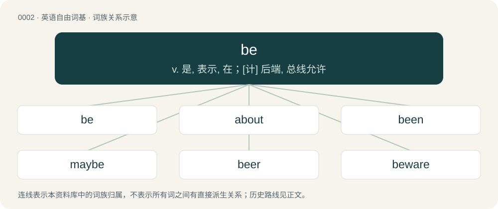

# 0002 · be — v. 是, 表示, 在；\[计\] 后端, 总线允许

[总目录](../00_总目录_按常用程度.md)

**类型**：英语自由词基　｜　**来源语言**：见词源记录

## 核心含义与来源

- 核心含义：v. 是, 表示, 在；\[计\] 后端, 总线允许
- 英文含义：Used with past participles of verbs to form the passive voice.
- 词形：be

**多个词源／构词路径**：同一拼写可能有不同来源；以下按词性和含义分别列出。

**来源记录 1**（动词；Used with past participles of verbs to form the passive voice.）

From Middle English been (“to be”). See below for more. Further etymology of be and its conjugated forms The various forms have three separate origins, which were mixed together at various times in the history of English. \* The forms beginning with b- come from Old English bēon (“to be, become”), from Proto-Germanic \*beuną (“to be, exist, come to be, become”), from Proto-Indo-European \*bʰuH-yé-ti (“to grow, become, come into being, appear”), from the root \*bʰuH-. In particular: \*\* Now-dialectal use of been as an infinitive of be is either from Middle English been (“to be”) or an extension of the past participle. \*\* Now-obsolete use of been as a plural present tense (meaning "are") is from Middle English been, be (present plural of been (“to be”), with the -n leveled in from the past and subjunctive; compare competing forms aren/are). \*\* Use of been as a past participle is from Middle English been, ybeen, from Old English ġebēon. \* The forms beginning with w- come from the aforementioned Old English bēon, which shared its past tense with the verb wesan, from Proto-West Germanic \*wesan, from Proto-Germanic \*wesaną, from Proto-Indo-European \*h₂wes- (“to reside”). \* The remaining forms (am, are, is) are also from Old English wesan (“to be”), Proto-West Germanic \*wesan, from Proto-Germanic \*wesaną, the present tense of which comes from Proto-Indo-European \*h₁és-ti, from the root \*h₁es-.

**来源记录 2**（名词；The name of the Cyrillic script letter Б / б）

Borrowed from Russian бэ (bɛ).

## 词族图

## 单词速览（常用到不常用）

| 单词 | 音标 | 释义 |
|---|---|---|
| [be](#w-1) | /ˈbiː/ | v. 是, 表示, 在；\[计\] 后端, 总线允许 |
| [about](#w-2) | 英 /əˈbaʊ̯t/；/əˈbɐʊ̯t/ | prep. 在...周围, 大约, 有关, 关于；adv. 大约, 四处, 在附近, 周围 |
| [been](#w-3) | /ˈbɪn/ | be的过去分词 |
| [maybe](#w-4) | /ˈmeɪ.bi/ | adv. 也许, 大概；n. 可能性 |
| [beer](#w-5) | 英 /ˈbiː.ə/；美 /ˈbi.ɚ/ | 【英文】One who is or exists. |
| [beware](#w-6) | /biˈwɛɚ/ | v. 小心, 谨防 |
| [abe](#w-7) | 英 /əˈbi/ | n. 亚伯（男子名, 等于Abraham） |
| [wannabe](#w-8) | /ˈwɒnəbi/ | n. 赶超崇拜者, 赶超崇拜者的人 |
| [bist](#w-9) | /bist/ | n. 阿拉伯学者 |

## 逐词详解

### 1. be

**词性**：动词　｜　**音标**：/ˈbiː/

**中文释义**：v. 是, 表示, 在；\[计\] 后端, 总线允许

**英文义项**：Used with past participles of verbs to form the passive voice. / Used with present participles of verbs to form the continuous aspect.

**词源与演化**：

From Middle English been (“to be”). See below for more. Further etymology of be and its conjugated forms The various forms have three separate origins, which were mixed together at various times in the history of English. \* The forms beginning with b- come from Old English bēon (“to be, become”), from Proto-Germanic \*beuną (“to be, exist, come to be, become”), from Proto-Indo-European \*bʰuH-yé-ti (“to grow, become, come into being, appear”), from the root \*bʰuH-. In particular: \*\* Now-dialectal use of been as an infinitive of be is either from Middle English been (“to be”) or an extension of the past participle. \*\* Now-obsolete use of been as a plural present tense (meaning "are") is from Middle English been, be (present plural of been (“to be”), with the -n leveled in from the past and subjunctive; compare competing forms aren/are). \*\* Use of been as a past participle is from Middle English been, ybeen, from Old English ġebēon. \* The forms beginning with w- come from the aforementioned Old English bēon, which shared its past tense with the verb wesan, from Proto-West Germanic \*wesan, from Proto-Germanic \*wesaną, from Proto-Indo-European \*h₂wes- (“to reside”). \* The remaining forms (am, are, is) are also from Old English wesan (“to be”), Proto-West Germanic \*wesan, from Proto-Germanic \*wesaną, the present tense of which comes from Proto-Indo-European \*h₁és-ti, from the root \*h₁es-.

**例句**：

> I was being deadly serious when I made that suggestion.

该用例对应义项：Used with present participles of verbs to form the continuous aspect.

### 2. about

**词性**：形容词　｜　**音标**：英 /əˈbaʊ̯t/；/əˈbɐʊ̯t/

**中文释义**：prep. 在...周围, 大约, 有关, 关于；adv. 大约, 四处, 在附近, 周围

**英文义项**：Moving around or in motion; astir. / In existence; being in evidence; apparent.

**构词拆分**：on + be + out；on + but

**例句**：

> After my bout with Guillan-Barre Syndrome, it took me 6 months to be up and about again.

该用例对应义项：Moving around or in motion; astir.

### 3. been

**词性**：动词　｜　**音标**：/ˈbɪn/

**中文释义**：be的过去分词

**英文义项**：remote past form of be.

**构词拆分**：By surface analysis, be + -en

**词源与演化**：

From Middle English been (past participle), from Old English (ġe)bēon. By surface analysis, be + -en.

**例句**：

> We been knew they was doing this.

该用例对应义项：remote past form of be.

### 4. maybe

**词性**：名词　｜　**音标**：/ˈmeɪ.bi/

**中文释义**：adv. 也许, 大概；n. 可能性

**英文义项**：Something that is possibly true. / An answer that shows neither agreement nor disagreement.

**构词拆分**：may + be

**词源与演化**：

From an ellipsis of Middle English it may be, equivalent to may + be. Compare mayhap.

**例句**：

> The results of the poll were inconclusive. We got two yeses, three nos, and four maybes.

该用例对应义项：An answer that shows neither agreement nor disagreement.

### 5. beer

**词性**：名词　｜　**音标**：英 /ˈbiː.ə/；美 /ˈbi.ɚ/

**英文义项**：One who is or exists.

**构词拆分**：be + -er

**词源与演化**：

From Middle English beere, equivalent to be + -er.

### 6. beware

**词性**：动词　｜　**音标**：/biˈwɛɚ/

**中文释义**：v. 小心, 谨防

**英文义项**：To use caution, pay attention to (used both with and without of).

**构词拆分**：be + ware；be + aware

**词源与演化**：

From Middle English bewar, be war, be ware, forms of Middle English ben ware (“to be on one's guard, be vigilant”, literally “be ware”), equivalent to be + ware or be + aware. Compare Old English bewarian.

**例句**：

> And Abraham said: Beware thou never bring my son back again thither.

### 7. abe

**词性**：动词　｜　**音标**：英 /əˈbi/

**中文释义**：n. 亚伯（男子名, 等于Abraham）

**英文义项**：To be.

**构词拆分**：a- + be

**词源与演化**：

Probably a- + be.

**例句**：

> Shinzo Abe has to get some help from the natalist authoritarians.

### 8. wannabe

**词性**：名词　｜　**音标**：/ˈwɒnəbi/

**中文释义**：n. 赶超崇拜者, 赶超崇拜者的人

**英文义项**：Someone who wishes to be someone or do something, but lacks the qualifications or talent; an overeager amateur; an aspirant. / Someone who wishes to be part of, or to assimilate to, a majority group of which they are not a member.

**构词拆分**：wanna + be

**词源与演化**：

Written form of a reduction of want to be, analyzable as wanna + be. Wannabe can be considered a conversion, category change, or functional shift. While occasionally appearing in print, usually as a less reduced phrase, the popularity of the word took off in the mid-1980s following the Madonna wannabe fashion trend: “wannabe”, in Google Books Ngram Viewer.

**例句**：

> Hollywood's restaurants are full of wannabe actors waiting to be discovered.

该用例对应义项：Someone who wishes to be someone or do something, but lacks the qualifications or talent; an overeager amateur; an aspirant.

### 9. bist

**词性**：动词　｜　**音标**：/bist/

**中文释义**：n. 阿拉伯学者

**英文义项**：Used to form the second person singular of be.

**构词拆分**：be + -est

**词源与演化**：

From Middle English bist, beest, best, from Old English bist ("(thou) art"; second person singular of bēon (“to be”)), from Proto-Germanic \*biusi (“(thou) art”), equivalent to be + -est. Cognate with West Frisian bist (“(thou) art”), Low German büst (“(thou) art”), German bist (“(thou) art”).
