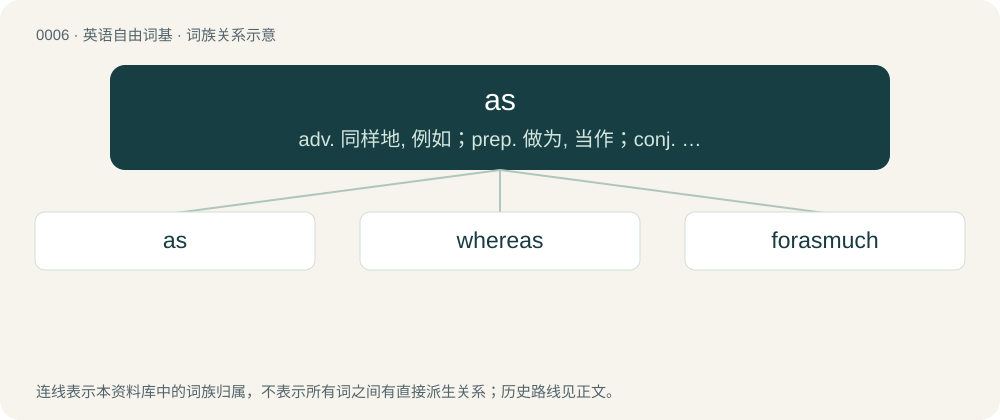

# 0005 · as — adv. 同样地, 例如；prep. 做为, 当作；conj. 当...之时, 以...的方式, 像...一样, 因为

[总目录](../00_总目录_按常用程度.md)

**类型**：英语自由词基　｜　**来源语言**：见词源记录

## 核心含义与来源

- 核心含义：adv. 同样地, 例如；prep. 做为, 当作；conj. 当...之时, 以...的方式, 像...一样, 因为
- 英文含义：To such an extent or degree; to the same extent or degree.
- 词形：as

**多个词源／构词路径**：同一拼写可能有不同来源；以下按词性和含义分别列出。

**来源记录 1**（副词；To such an extent or degree; to the same extent or degree.）

From Middle English as, als(a), alswa, from Old English eallswā (“just so; as”), thus representing a reduced form of also. Compare German Low German a(l)s, German als, Dutch als.

**来源记录 2**（名词；A libra, a Roman pound.）

Borrowed from Latin as. Doublet of ace.

**来源记录 3**（副词；Used to intensify an adjective; very much; extremely.）

Shortening of as hell or as fuck or similar.

## 词族图

## 单词速览（常用到不常用）

| 单词 | 音标 | 释义 |
|---|---|---|
| [as](#w-1) | /əz/ | adv. 同样地, 例如；prep. 做为, 当作；conj. 当...之时, 以...的方式, 像...一样, 因为 |
| [whereas](#w-2) | 英 /wɛəɹˈaz/；美 /(h)wɛɹˈæz/ | conj. 然而, 鉴于；\[法\] 考虑到, 鉴于, 就...而论 |
| [forasmuch](#w-3) | 英 /fɒɹəzˈmʌtʃ/ | conj.鉴于..., 所以 |

## 逐词详解

### 1. as

**词性**：副词　｜　**音标**：/əz/

**中文释义**：adv. 同样地, 例如；prep. 做为, 当作；conj. 当...之时, 以...的方式, 像...一样, 因为

**英文义项**：To such an extent or degree; to the same extent or degree. / Considered to be, in relation to something else; in the relation (specified).

**词源与演化**：

From Middle English as, als(a), alswa, from Old English eallswā (“just so; as”), thus representing a reduced form of also. Compare German Low German a(l)s, German als, Dutch als.

**例句**：

> You’re not as tall as I am, but you are definitely as happy as can be.

该用例对应义项：To such an extent or degree; to the same extent or degree.

### 2. whereas

**词性**：连词　｜　**音标**：英 /wɛəɹˈaz/；美 /(h)wɛɹˈæz/

**中文释义**：conj. 然而, 鉴于；\[法\] 考虑到, 鉴于, 就...而论

**英文义项**：In contrast; whilst on the contrary; although. / It being the fact that; inasmuch as. (Often used to begin recitals; sometimes emboldened or emphasized as a signifier.)

**构词拆分**：where + as (“that”)

**词源与演化**：

From where + as (“that”); first attested in the meaning of "where" in the 14th century. Compare thereas.

**例句**：

> He came first in the race, whereas his brother came last.

该用例对应义项：In contrast; whilst on the contrary; although.

### 3. forasmuch

**词性**：副词　｜　**音标**：英 /fɒɹəzˈmʌtʃ/

**中文释义**：conj.鉴于..., 所以

**英文义项**：Inasmuch, seeing (that).

**构词拆分**：for + as + much

**词源与演化**：

From Middle English for-as-moche, vor asemoche, for as miche, equivalent to for + as + much.
