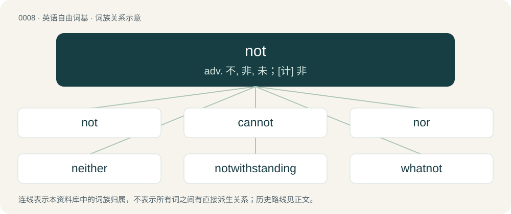

# 0008 · not — adv. 不, 非, 未；\[计\] 非

[总目录](../00_总目录_按常用程度.md)

**类型**：英语自由词基　｜　**来源语言**：见词源记录

## 核心含义与来源

- 核心含义：adv. 不, 非, 未；\[计\] 非
- 英文含义：Negates the meaning of the modified verb.
- 词形：not

**来源记录 1**（副词；Negates the meaning of the modified verb.）

From Middle English not, nat, a variant of noght, naht (“not, nothing”), from Old English \*nōht, nāht (“nought, nothing”), shortening of nōwiht, nāwiht (“nothing”, literally “not anything”), from Proto-West Germanic \*naiwwiht, corresponding to ne (“not”) + ōwiht, āwiht (“anything”), corresponding to ā (“ever, always”) + wiht (“thing, creature”). Cognate with Scots nat, naucht (“not”), Saterland Frisian nit (“not”), West Frisian net (“not”), Dutch niet (“not”), German nicht (“not”). Compare nought, naught and aught. More at no, wight, whit.

## 词族图

## 单词速览（常用到不常用）

| 单词 | 音标 | 释义 |
|---|---|---|
| [not](#w-1) | 英 /nɒt/；美 /nɑt/ | adv. 不, 非, 未；\[计\] 非 |
| [cannot](#w-2) | 英 /ˈkænɒt/；/ˈkænɑt/ | aux. 无法, 不能 |
| [nor](#w-3) | 英 /nɔː/；美 /nɔɹ/ | conj. 也不, 也没有；\[计\] 或非 |
| [neither](#w-4) | 英 /ˈnaɪ.ðə/；美 /ˈnaɪ.ðɚ/ | adv. 皆不, 两个都不；a. (两者)都不的；pron. 两者都不 |
| [notwithstanding](#w-5) | 英 /ˌnɒtwɪðˈstændɪŋ/；美 /ˌnɑtwɪθˈstændɪŋ/ | adv. 虽然, 尽管；prep. 尽管；conj. 虽然 |
| [whatnot](#w-6) | 英 /ˈwɒt.nɒt/；美 /ˈwʌt.nɑt/ | n. 放古董的架子 |

## 逐词详解

### 1. not

**词性**：副词　｜　**音标**：英 /nɒt/；美 /nɑt/

**中文释义**：adv. 不, 非, 未；\[计\] 非

**英文义项**：Negates the meaning of the modified verb. / To no degree.

**词源与演化**：

From Middle English not, nat, a variant of noght, naht (“not, nothing”), from Old English \*nōht, nāht (“nought, nothing”), shortening of nōwiht, nāwiht (“nothing”, literally “not anything”), from Proto-West Germanic \*naiwwiht, corresponding to ne (“not”) + ōwiht, āwiht (“anything”), corresponding to ā (“ever, always”) + wiht (“thing, creature”). Cognate with Scots nat, naucht (“not”), Saterland Frisian nit (“not”), West Frisian net (“not”), Dutch niet (“not”), German nicht (“not”). Compare nought, naught and aught. More at no, wight, whit.

**例句**：

> Did you take out the trash? — No, I did not. I do not think it was my turn, was it?

该用例对应义项：Negates the meaning of the modified verb.

### 2. cannot

**词性**：动词　｜　**音标**：英 /ˈkænɒt/；/ˈkænɑt/

**中文释义**：aux. 无法, 不能

**英文义项**：Can not; be unable to (whether due to physical inability, logical impossibility, etc.). / Be forbidden or not permitted to.

**构词拆分**：can + not

**词源与演化**：

From Middle English can not, cannot, cannouȝt, etc. (compare Old English ne cann), equivalent to can + not.

**例句**：

> The butler cannot be the murderer, he cannot have killed her, because he was in another city at the time.

该用例对应义项：Can not; be unable to (whether due to physical inability, logical impossibility, etc.).

### 3. nor

**词性**：连词　｜　**音标**：英 /nɔː/；美 /nɔɹ/

**中文释义**：conj. 也不, 也没有；\[计\] 或非

**英文义项**：And... not (introducing a negative statement, without necessarily following one). / A function word introducing each except the first term of a series, indicating none of them is true.

**构词拆分**：By surface analysis, not + or

**词源与演化**：

From Middle English nauther, from nother. Cognate with neither. By surface analysis, not + or.

**例句**：

> She had no way of knowing, nor did we, that he’d done it.

该用例对应义项：Used to introduce a further negative statement.

### 4. neither

**词性**：限定词　｜　**音标**：英 /ˈnaɪ.ðə/；美 /ˈnaɪ.ðɚ/

**中文释义**：adv. 皆不, 两个都不；a. (两者)都不的；pron. 两者都不

**英文义项**：Not one of two; not either; not one or the other.

**构词拆分**：By surface analysis, not + either

**词源与演化**：

Alteration (after either) of nauther, from Middle English neiþer, from Old English nāwþer, contraction of nāhwæþer, corresponding to no + whether. Compare Latin neuter (“neither”). By surface analysis, not + either.

**例句**：

> with the help of neither you nor either of our sons.

该用例对应义项：Not one of two; not either; not one or the other.

### 5. notwithstanding

**词性**：副词　｜　**音标**：英 /ˌnɒtwɪðˈstændɪŋ/；美 /ˌnɑtwɪθˈstændɪŋ/

**中文释义**：adv. 虽然, 尽管；prep. 尽管；conj. 虽然

**英文义项**：Nevertheless, all the same.

**构词拆分**：not + withstanding

**词源与演化**：

From Middle English notwithstandinge, notwithstondyng, natwithstandyng, equivalent to not + withstanding. Compare Middle English notgainstonding, not aȝenstondynge, of similar meaning and formation.

**例句**：

> He, notwithstanding, persisted in his inquiries.

该用例对应义项：Nevertheless, all the same.

### 6. whatnot

**词性**：名词　｜　**音标**：英 /ˈwɒt.nɒt/；美 /ˈwʌt.nɑt/

**中文释义**：n. 放古董的架子

**英文义项**：A small unspecified object; bric-a-brac (in plural). / Other related objects or ideas.

**构词拆分**：what + not

**词源与演化**：

From what + not.

**例句**：

> All of the cakes and whatnot have been laid out, ready for the children's birthday party this afternoon.

该用例对应义项：Other related objects or ideas.
