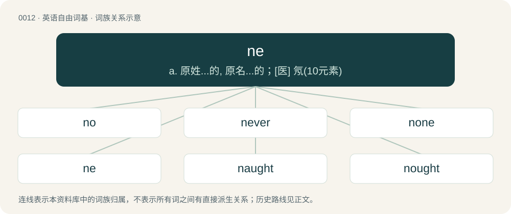

# 0015 · ne — a. 原姓...的, 原名...的；\[医\] 氖(10元素)

[总目录](../00_总目录_按常用程度.md)

**类型**：英语自由词基　｜　**来源语言**：见词源记录

## 核心含义与来源

- 核心含义：a. 原姓...的, 原名...的；\[医\] 氖(10元素)
- 英文含义：Not.
- 词形：ne

**多个词源／构词路径**：同一拼写可能有不同来源；以下按词性和含义分别列出。

**来源记录 1**（副词；Not.）

From Middle English ne, from Old English ne, from Proto-West Germanic \*ne, from Proto-Germanic \*ne, from Proto-Indo-European \*né. Cognates include Gothic 𐌽𐌹 (ni), Latin nē, Sanskrit न (na), Bulgarian, Serbo-Croatian and Russian не (ne), Lithuanian ne, Irish ní.

**来源记录 2**（副词；"Isn't that so?" (used in representations of Maori English).）

From Māori nē.

## 词族图

## 单词速览（常用到不常用）

| 单词 | 音标 | 释义 |
|---|---|---|
| [no](#w-1) | 英 /nəʊ/；美 /noʊ/ | n. 不, 拒绝, 否决票；a. 没有, 不是, 绝非；adv. 不 |
| [never](#w-2) | 英 /ˈnɛv.ə/；美 /ˈnɛv.ɚ/ | adv. 从不, 决不, 不曾；\[法\] 永不, 决不, 从来没有 |
| [none](#w-3) | 英 /nʌn/ | adv. 一点也不, 毫不；pron. 没有人, 无一物, 并无一个；a. 没有的 |
| [ne](#w-4) | /nə/ | a. 原姓...的, 原名...的；\[医\] 氖(10元素) |
| [naught](#w-5) | 英 /nɔːt/；/nɔt/ | n. 无, 零；a. 无价值的, 无用的 |
| [nought](#w-6) | 英 /nɔːt/；美 /nɔt/ | n. 没有, 零, 无 |

## 逐词详解

### 1. no

**词性**：限定词　｜　**音标**：英 /nəʊ/；美 /noʊ/

**中文释义**：n. 不, 拒绝, 否决票；a. 没有, 不是, 绝非；adv. 不

**英文义项**：Not any. / Hardly any.

**构词拆分**：ne (“not”) + a

**词源与演化**：

Inherited from Middle English no, noo, na, a reduced form of none, noon, nan (“none, not any”) used before consonants (compare a to an), from Old English nān (“none, not any”), from Proto-West Germanic \*nain, from Proto-Germanic \*nainaz (“not any”, literally “not one”), equivalent to ne (“not”) + a. Piecewise doublet of none. Cognate with Scots nae (“no, not any, none”), Old Frisian nān, nēn ("no, not any, none"; &gt; Saterland Frisian naan, neen (“no, not any, none”), North Frisian nian (“no, not any, none”)), Old Dutch nēn ("no, not any, none"; &gt; Dutch neen (“no”)), Old Norse neinn (“no, not any, none”). Compare also Old Saxon nigēn ("not any"; &gt; Low German nen), Old Dutch nehēn (Middle Dutch negheen/negeen, Dutch geen), West Frisian gjin, Old High German nihein (&gt; German kein). More at no, one.

**例句**：

> There's no stopping her once she gets going.

该用例对应义项：Not any possibility or allowance of (something).

### 2. never

**词性**：副词　｜　**音标**：英 /ˈnɛv.ə/；美 /ˈnɛv.ɚ/

**中文释义**：adv. 从不, 决不, 不曾；\[法\] 永不, 决不, 从来没有

**英文义项**：At no time; on no occasion; in no circumstance. / Not at any other time; not on any other occasion; not previously.

**构词拆分**：ne + ever

**词源与演化**：

From Middle English nevere, navere, nævere, from Old English nǣfre (“never”), equivalent to ne + ever.

**例句**：

> You said you were going to mow the lawn today. – I never!

该用例对应义项：Negative particle (used to negate verbs in the simple past tense; also used absolutely).

### 3. none

**词性**：代词　｜　**音标**：英 /nʌn/

**中文释义**：adv. 一点也不, 毫不；pron. 没有人, 无一物, 并无一个；a. 没有的

**英文义项**：Not any of a given number or group. / No one, nobody.

**构词拆分**：ne (“not”) + one

**词源与演化**：

From Middle English none, noon, non (“not one”), from Old English nān (“not one, not any, none”), from Proto-West Germanic \*nain, from Proto-Germanic \*nainaz (“none, nought, nothing”), equivalent to ne (“not”) + one. (Regarding the different phonological development of only and one, see the note in one.) Cognate with Scots nane (“none”), Saterland Frisian naan, neen (“no, not any, none”), West Frisian neen & gjin (“no, none”), Dutch neen & geen (“no, none”), Low German nēn, neen, keen (“no, none, no one”), German nein & kein (“no, none”), Latin nōn (“not”).

**例句**：

> None of those is a good example. None are even acceptable.

该用例对应义项：Not any of a given number or group.

### 4. ne

**词性**：副词　｜　**音标**：/nə/

**中文释义**：a. 原姓...的, 原名...的；\[医\] 氖(10元素)

**英文义项**：Not.

**词源与演化**：

From Middle English ne, from Old English ne, from Proto-West Germanic \*ne, from Proto-Germanic \*ne, from Proto-Indo-European \*né. Cognates include Gothic 𐌽𐌹 (ni), Latin nē, Sanskrit न (na), Bulgarian, Serbo-Croatian and Russian не (ne), Lithuanian ne, Irish ní.

**例句**：

> In the presence of another negative word, the word "ne" is omitted.

### 5. naught

**词性**：代词　｜　**音标**：英 /nɔːt/；/nɔt/

**中文释义**：n. 无, 零；a. 无价值的, 无用的

**英文义项**：Nothing.

**构词拆分**：ne + aught

**词源与演化**：

From the Middle English naught, nought, naht, nawiht, from Old English nawiht. Cognate with West Frisian neat (“nothing, naught”). Doublet of nought. Equivalent to ne + aught.

**例句**：

> Naught can come of this, you mark my words.

该用例对应义项：Nothing.

### 6. nought

**词性**：名词　｜　**音标**：英 /nɔːt/；美 /nɔt/

**中文释义**：n. 没有, 零, 无

**英文义项**：A thing or person of no worth or value; nil. / Not any quantity of number; zero; the score of no points in a game.

**构词拆分**：ne + ought；ne + a + wight

**词源与演化**：

From Middle English nought, noght, noȝt, from Old English nōwiht, nāwiht, which in turn comes from ne-ā-wiht, which was a phrase used as an emphatic "no", meaning "not anything". Equivalent to ne + ought or ne + a + wight. Doublet of naught and not.

**例句**：

> 0.335 cm is nought/zero point three three five of a centimeter.

该用例对应义项：Not any quantity of number; zero; the score of no points in a game.
