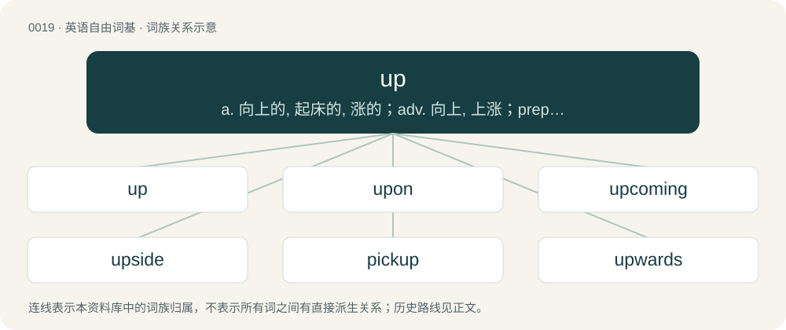

# 0023 · up — a. 向上的, 起床的, 涨的；adv. 向上, 上涨；prep. 在...上面, 向...的较高处

[总目录](../00_总目录_按常用程度.md)

**类型**：英语自由词基　｜　**来源语言**：见词源记录

## 核心含义与来源

- 核心含义：a. 向上的, 起床的, 涨的；adv. 向上, 上涨；prep. 在...上面, 向...的较高处
- 英文含义：Away from the surface of the Earth or other planet; in opposite direction to the downward pull of gravity.
- 词形：up

**来源记录 1**（副词；Away from the surface of the Earth or other planet; in opposite direction to the downward pull of gravity.）

From Middle English up, op, oup, from Old English upp, up, ūp (“up”), from Proto-West Germanic \*upp, \*ūp, from Proto-Germanic \*upp, \*eup (“up”). Cognate with Saterland Frisian ap (“up”), West Frisian op (“up”), Dutch op (“up”), German Low German up, op (“up”), German auf (“up”), Danish op (“up”), Swedish upp (“up”), Icelandic upp (“up”), Gothic 𐌹𐌿𐍀 (iup, “up”).

## 词族图

## 单词速览（常用到不常用）

| 单词 | 音标 | 释义 |
|---|---|---|
| [up](#w-1) | 英 /ʌp/；美 /ʌp/ | a. 向上的, 起床的, 涨的；adv. 向上, 上涨；prep. 在...上面, 向...的较高处 |
| [upon](#w-2) | 英 /əˈpɒn/；/əˈpɑn/ | prep. 在...之上, 迫近, 紧接着 |
| [upcoming](#w-3) | /ˈʌp.kʌmiŋ/ | a. 即将来临的, 即将出现的 |
| [upside](#w-4) | /ˈʌpˌsaɪd/ | n. 上侧, 上段, 上部；\[机\] 上侧, 上部 |
| [pickup](#w-5) | /ˈpɪkʌp/ | n. 拾起, 加速, 刺激, 猎物的收集, 好转, 恢复健康, 搭车者, 兴奋剂, 电视摄像；\[电\] 拾音器 |
| [upwards](#w-6) | 英 /ˈʌpwədz/；美 /ˈʌpwɚdz/ | adv. 以上, 向上 |
| [upward](#w-7) | 英 /ˈʌpwəd/；美 /ˈʌpwɚd/ | a. 向上的；adv. 以上 |
| [sup](#w-8) | /sʌp/ | n. 一口；vt. 啜, 呷；vi. 啜饮, 进晚餐 |
| [uphill](#w-9) | /ˈʌphɪl/ | a. 上坡的, 向上的；adv. 往上坡, 向上地 |
| [upstate](#w-10) | 英 /ˈʌp.steɪt/ | a. 偏僻的, 州的北部的；n. 州的北部；adv. 在州的北部 |
| [upscale](#w-11) | /ˈʌpskeɪl/ | a. 迎合高层次消费者的；质优价高的 |
| [upkeep](#w-12) | 美 /ˈʌpkip/ | n. 维持, 维修费；\[经\] 维修费, 养护费, 保养 |
| [uproar](#w-13) | 英 /ˈʌpɹɔː/；美 /ˈʌpɹɔːɹ/ | n. 骚动, 喧嚣 |
| [layup](#w-14) | 美 /ˈleɪˌʌp/ | 接头\[合\]处 |
| [uptime](#w-15) | /ˈʌptaim/ | \[计\] 可用时间, 正常运行时间 |
| [uplink](#w-16) | /ˈʌp,liŋk/ | \[计\] 上行链路 |
| [getup](#w-17) |  | n. 式样, 打扮 |
| [uppity](#w-18) | /ˈʌpəti/ | a. 自负的, 傲慢的,不易控制的 |
| [upskirt](#w-19) | 英 /ˈʌpskəːt/ | 【英文】An image of this kind. |
| [upmost](#w-20) | 美 /ˈʌpmoʊst/ | a. 最高的, 最上面的 |
| [linkup](#w-21) | /ˈliŋkʌp/ | n. 结合, 连结, 联合 |

## 逐词详解

### 1. up

**词性**：形容词　｜　**音标**：英 /ʌp/；美 /ʌp/

**中文释义**：a. 向上的, 起床的, 涨的；adv. 向上, 上涨；prep. 在...上面, 向...的较高处

**英文义项**：Facing upwards. / On or at a physically higher level.

**词源与演化**：

From Middle English up, op, oup, from Old English upp, up, ūp (“up”), from Proto-West Germanic \*upp, \*ūp, from Proto-Germanic \*upp, \*eup (“up”). Cognate with Saterland Frisian ap (“up”), West Frisian op (“up”), Dutch op (“up”), German Low German up, op (“up”), German auf (“up”), Danish op (“up”), Swedish upp (“up”), Icelandic upp (“up”), Gothic 𐌹𐌿𐍀 (iup, “up”).

**例句**：

> Is your new video up yet? I looked on the website, but I couldn't find it.

该用例对应义项：Available to view or use; made public; posted.

### 2. upon

**词性**：介词　｜　**音标**：英 /əˈpɒn/；/əˈpɑn/

**中文释义**：prep. 在...之上, 迫近, 紧接着

**英文义项**：alternative to on in most, though not all, prepositional uses.

**构词拆分**：up (“adverb”) + on (“preposition”)

**词源与演化**：

From Middle English upon, uppon, uppen, from Old English upon, uppon, uppan (“on, upon, up to, against, after, in addition to”), equivalent to up (“adverb”) + on (“preposition”). Cognate with Old Saxon uppan (“upon”), Old High German ūfan, ūffan (“upon”), Icelandic upp á, upp á (“up on, upon”), Swedish uppå (“up on, upon”) (thence Swedish på), Danish på (“up on, upon”), Norwegian på (“up on, upon”).

**例句**：

> Let us stop to think how much we depend upon atomic energy.

### 3. upcoming

**词性**：形容词　｜　**音标**：/ˈʌp.kʌmiŋ/

**中文释义**：a. 即将来临的, 即将出现的

**英文义项**：Happening or appearing in the relatively near future. / Eggcorn of up-and-coming.

**构词拆分**：up + coming

**词源与演化**：

From up + coming.

**例句**：

> The Federal budget lays out government spending for the upcoming budget year.

该用例对应义项：Happening or appearing in the relatively near future.

### 4. upside

**词性**：名词　｜　**音标**：/ˈʌpˌsaɪd/

**中文释义**：n. 上侧, 上段, 上部；\[机\] 上侧, 上部

**英文义项**：The highest or uppermost side or portion of something. / A favourable aspect of something that also has an unfavourable aspect.

**构词拆分**：up + side

**词源与演化**：

From up + side.

**例句**：

> What was the idea of leaving the cup upside down last time?

### 5. pickup

**词性**：名词　｜　**音标**：/ˈpɪkʌp/

**中文释义**：n. 拾起, 加速, 刺激, 猎物的收集, 好转, 恢复健康, 搭车者, 兴奋剂, 电视摄像；\[电\] 拾音器

**英文义项**：In a record player, an electromagnetic component that converts the needle vibrations into an electrical signal. / Electromagnetic coil receiver of metal string oscillations.

**构词拆分**：pick + up

**词源与演化**：

From pick + up.

**例句**：

> Hey, thanks for the drink, but if this is a pickup, I'm not interested.

该用例对应义项：An instance of approaching someone and engaging in romantic flirtation and courting with the intent to pursue romance, a date, or a sexual encounter.

### 6. upwards

**词性**：副词　｜　**音标**：英 /ˈʌpwədz/；美 /ˈʌpwɚdz/

**中文释义**：adv. 以上, 向上

**英文义项**：Towards a (higher) position closer to the sky than the ground. / To a higher figure or amount.

**构词拆分**：up + -wards

**词源与演化**：

From Middle English upwardes, from Old English upweardes, equivalent to up + -wards. Cognate with Dutch opwaarts (“upwards”), German aufwärts (“upwards”).

**例句**：

> The balloon drifted upwards into the sky.

该用例对应义项：Towards a (higher) position closer to the sky than the ground.

### 7. upward

**词性**：形容词　｜　**音标**：英 /ˈʌpwəd/；美 /ˈʌpwɚd/

**中文释义**：a. 向上的；adv. 以上

**英文义项**：Directed toward a higher place.

**构词拆分**：up + -ward

**词源与演化**：

From Old English upweardes, equivalent to up + -ward.

**用法示例／搭配（非完整句）**：

> with upward eye; with upward course

该用例对应义项：Directed toward a higher place.

### 8. sup

**词性**：形容词　｜　**音标**：/sʌp/

**中文释义**：n. 一口；vt. 啜, 呷；vi. 啜饮, 进晚餐

**英文义项**：Being or relating to the squark that is the superpartner of an up quark.

**构词拆分**：s- + up

**词源与演化**：

From s- + up.

**例句**：

> When you sup with the Devil, use a long spoon.

### 9. uphill

**词性**：形容词　｜　**音标**：/ˈʌphɪl/

**中文释义**：a. 上坡的, 向上的；adv. 往上坡, 向上地

**英文义项**：Located up a slope or on a hill. / Going up a slope or a hill.

**构词拆分**：up + hill

**词源与演化**：

From up + hill.

**例句**：

> My efforts felt like a constant uphill battle that I couldn't win.

### 10. upstate

**词性**：形容词　｜　**音标**：英 /ˈʌp.steɪt/

**中文释义**：a. 偏僻的, 州的北部的；n. 州的北部；adv. 在州的北部

**英文义项**：Of the northern section of a state.

**构词拆分**：up + state

**词源与演化**：

From up + state.

**例句**：

> They went hunting in upstate New York.

该用例对应义项：Of the northern section of a state.

### 11. upscale

**词性**：形容词　｜　**音标**：/ˈʌpskeɪl/

**中文释义**：a. 迎合高层次消费者的；质优价高的

**英文义项**：Expensive and designed to appeal to affluent consumers.

**构词拆分**：up + scale

**词源与演化**：

From up + scale, 1966 (adjective), 1963 (verb).

**例句**：

> Shall we go to a little more upscale restaurant?

### 12. upkeep

**词性**：名词　｜　**音标**：美 /ˈʌpkip/

**中文释义**：n. 维持, 维修费；\[经\] 维修费, 养护费, 保养

**英文义项**：Maintenance; the act or effort of keeping something in good and working condition.

**构词拆分**：up + keep

**词源与演化**：

From up + keep.

**例句**：

> I would enjoy having a swimming pool, but I don't want to deal with the upkeep.

该用例对应义项：Maintenance; the act or effort of keeping something in good and working condition.

### 13. uproar

**词性**：名词　｜　**音标**：英 /ˈʌpɹɔː/；美 /ˈʌpɹɔːɹ/

**中文释义**：n. 骚动, 喧嚣

**英文义项**：Tumultuous, noisy excitement. / Loud, confused noise, especially when coming from several sources.

**构词拆分**：up + roar

**词源与演化**：

Calque of Dutch oproer or German Aufruhr, as up + roar.

**例句**：

> The archbishop caused an uproar with his dismissive comments about the nuns' concerns.

### 14. layup

**词性**：名词　｜　**音标**：美 /ˈleɪˌʌp/

**中文释义**：接头\[合\]处

**英文义项**：A close-range shot in which the shooter banks the ball off the backboard from a few feet away. / A relatively easy task.

**构词拆分**：lay + up

**词源与演化**：

From lay + up.

**例句**：

> The caboose, long decrepit, rested on a forgotten layup just north of the dry riverbed.

该用例对应义项：A track used to store train cars.

### 15. uptime

**词性**：名词　｜　**音标**：/ˈʌptaim/

**中文释义**：\[计\] 可用时间, 正常运行时间

**英文义项**：The period of time a computer has functioned since last requiring a reboot. / The amount of time, or the proportion of total time, during which some system or machinery is operable.

**构词拆分**：up + time

**词源与演化**：

From up (“(computing) functional, working”, adjective) + time.

**例句**：

> The regular upkeep of our servers is paramount to ensuring high uptime.

### 16. uplink

**词性**：名词　｜　**音标**：/ˈʌp,liŋk/

**中文释义**：\[计\] 上行链路

**英文义项**：The portion of a communications link used for the transmission of signals from a ground station to a satellite or to an airborne platform. / The communication path from a mobile device to a base station, a consumer to the network backbone, a client device to a server, etc.

**构词拆分**：up + link

**词源与演化**：

From up + link.

### 17. getup

**词性**：名词

**中文释义**：n. 式样, 打扮

**英文义项**：Clothes, costume or outfit, especially one that is ostentatious or otherwise unusual. / A fight or altercation.

**构词拆分**：get + up

**词源与演化**：

From get + up.

### 18. uppity

**词性**：形容词　｜　**音标**：/ˈʌpəti/

**中文释义**：a. 自负的, 傲慢的,不易控制的

**英文义项**：Presumptuous, above oneself, self-important; arrogant, snobbish, haughty. / Exceeding one's station or position, assuming prerogatives to which one is not entitled.

**构词拆分**：up + -ed + -y

**词源与演化**：

From earlier uppedy, equivalent to up + -ed + -y; compare blackity, biggity, and hippity (and possibly also persnickety, pernickety). First attested around 1880 in Uncle Remus by Joel Chandler Harris to describe Jack Sparrer (Jack Sparrow), who tattled on Br'er Rabbit (see quotations below). Compare uppish.

**例句**：

> Getting a little uppity and needed to be slapped down.

该用例对应义项：presumptuously arrogant

### 19. upskirt

**词性**：名词　｜　**音标**：英 /ˈʌpskəːt/

**英文义项**：An image of this kind. / The area inside a skirt, as viewed from below and while being worn.

**构词拆分**：up + skirt

**词源与演化**：

From up + skirt. First attested in 1997. As a verb, in 2008.

**例句**：

> Her upskirt is very frilly.

该用例对应义项：The area inside a skirt, as viewed from below and while being worn.

### 20. upmost

**词性**：形容词　｜　**音标**：美 /ˈʌpmoʊst/

**中文释义**：a. 最高的, 最上面的

**英文义项**：Uppermost.

**构词拆分**：up + -most

**词源与演化**：

From Middle English upmest; equivalent to up + -most.

### 21. linkup

**词性**：名词　｜　**音标**：/ˈliŋkʌp/

**中文释义**：n. 结合, 连结, 联合

**英文义项**：A connection. / The act of connecting.

**构词拆分**：link + up

**词源与演化**：

From link + up.

**例句**：

> The linkup between the devices broke and we lost control.

该用例对应义项：A connection.
