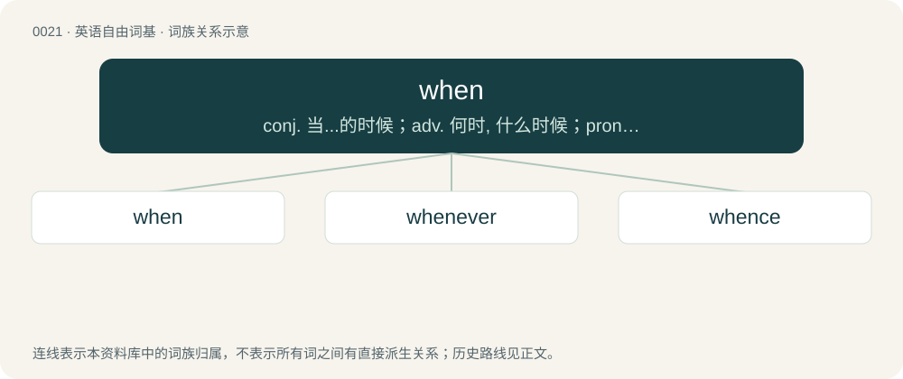

# 0025 · when — conj. 当...的时候；adv. 何时, 什么时候；pron. 什么时侯

[总目录](../00_总目录_按常用程度.md)

**类型**：英语自由词基　｜　**来源语言**：见词源记录

## 核心含义与来源

- 核心含义：conj. 当...的时候；adv. 何时, 什么时候；pron. 什么时侯
- 英文含义：At what time? At which time? Upon which occasion or circumstance? Used to introduce direct or indirect questions about time.
- 词形：when

**来源记录 1**（副词；At what time? At which time? Upon which occasion or circumstance? Used to introduce direct or indirect questions about time.）

From Middle English when(ne), whan(ne), from Old English hwonne, from Proto-West Germanic \*hwannē, from Proto-West Germanic \*hwan, from Proto-Germanic \*hwan (“at what time, when”), from Proto-Indo-European \*kʷís (interrogative base). Cognate with Scots whan (“when”), Dutch wanneer (“when”), wan (“when”) and wen (“when, if”), Low German wannehr (“when”), wann (“when”) and wenn (“if, when”), German wann (“when”) and wenn (“when, if”), Gothic 𐍈𐌰𐌽 (ƕan, “when, how”), Latin quandō (“when”). More at who. Interjection sense: a playful misunderstanding of "say when" (i.e. say something / speak up when you want me to stop) as "say \[the word\] when".

## 词族图

## 单词速览（常用到不常用）

| 单词 | 音标 | 释义 |
|---|---|---|
| [when](#w-1) | /ˈwɛn/ | conj. 当...的时候；adv. 何时, 什么时候；pron. 什么时侯 |
| [whenever](#w-2) | 英 /wəˈnɛvə/；美 /wəˈnɛvɚ/ | conj. 每当；adv. 不论何时, 每逢 |
| [whence](#w-3) | /ʍɛns/ | adv. 从何处, 出于什么原因, 从哪个；n. 来处, 根源 |

## 逐词详解

### 1. when

**词性**：名词　｜　**音标**：/ˈwɛn/

**中文释义**：conj. 当...的时候；adv. 何时, 什么时候；pron. 什么时侯

**英文义项**：The time at which something happens.

**词源与演化**：

From Middle English when(ne), whan(ne), from Old English hwonne, from Proto-West Germanic \*hwannē, from Proto-West Germanic \*hwan, from Proto-Germanic \*hwan (“at what time, when”), from Proto-Indo-European \*kʷís (interrogative base). Cognate with Scots whan (“when”), Dutch wanneer (“when”), wan (“when”) and wen (“when, if”), Low German wannehr (“when”), wann (“when”) and wenn (“if, when”), German wann (“when”) and wenn (“when, if”), Gothic 𐍈𐌰𐌽 (ƕan, “when, how”), Latin quandō (“when”). More at who. Interjection sense: a playful misunderstanding of "say when" (i.e. say something / speak up when you want me to stop) as "say \[the word\] when".

**例句**：

> A good article will cover the who, the what, the when, the where, the why and the how.

该用例对应义项：The time at which something happens.

### 2. whenever

**词性**：连词　｜　**音标**：英 /wəˈnɛvə/；美 /wəˈnɛvɚ/

**中文释义**：conj. 每当；adv. 不论何时, 每逢

**英文义项**：At any time that. / At the (single) time that, no matter when.

**构词拆分**：when + -ever

**词源与演化**：

From Middle English whan evere, whanne ever, whanne evere, whener, when ever; equivalent to when + -ever.

**例句**：

> Income must be reported in the period in which it is earned, whenever payment is actually received.

该用例对应义项：Regardless of the time that.

### 3. whence

**词性**：连词　｜　**音标**：/ʍɛns/

**中文释义**：adv. 从何处, 出于什么原因, 从哪个；n. 来处, 根源

**英文义项**：Used for introducing the result of a fact that has just been stated; thence

**构词拆分**：when + -s

**词源与演化**：

From Middle English whennes, from Old English hwanon (with adverbial genitive -s), related to hwonne (whence when). Analyzable as when + -s.

**例句**：

> I scored more than you in the exam, whence we can conclude that I am better at the subject than you are.

该用例对应义项：Used for introducing the result of a fact that has just been stated; thence
