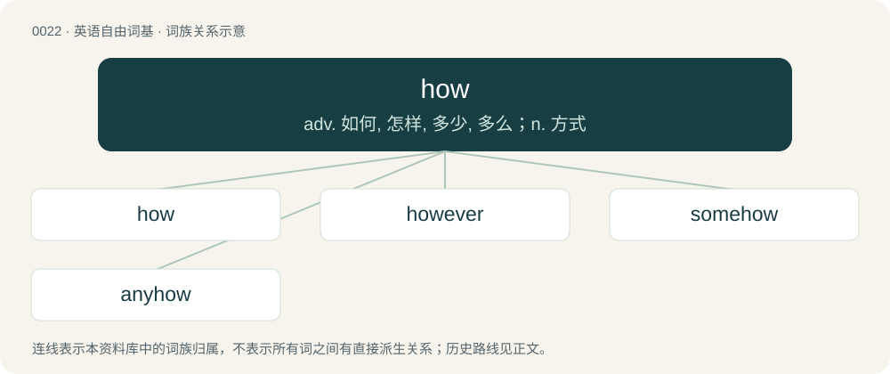

# 0028 · how — adv. 如何, 怎样, 多少, 多么；n. 方式

[总目录](../00_总目录_按常用程度.md)

**类型**：英语自由词基　｜　**来源语言**：见词源记录

## 核心含义与来源

- 核心含义：adv. 如何, 怎样, 多少, 多么；n. 方式
- 英文含义：To what degree or extent.
- 词形：how

**多个词源／构词路径**：同一拼写可能有不同来源；以下按词性和含义分别列出。

**来源记录 1**（副词；To what degree or extent.）

From Middle English how, hou, hu, hwu, from Old English hū, from Proto-West Germanic \*hwō, from Proto-Germanic \*hwō (“through what, how”), from the same root as hwæt (“who, what”). /hw/ &gt; /h/ due to wh-cluster reduction in Old English; compare who, which underwent this change later, and thus is spelt wh (Middle English spelling of /hw/) but pronounced /h/ (it previously had a different vowel, hence avoided the spelling and sound change in Old English). Vowel change per Great Vowel Shift. Akin to Scots hoo, foo (“how”), North Frisian ho, hü, hur (“how”), Saterland Frisian wo (“how”), West Frisian hoe (“how”), Dutch hoe (“how”), Low German ho, wo, wu (“how”), German wie (“how”), Swedish hur (“how”). See who and compare why.

**来源记录 2**（名词；An artificial barrow or tumulus; in later folklore, associated with fairies.）

From Middle English howe, hough, hogh, partly from Old English hōh (“promontory”), and partly from Old Norse haugr (“a how, mound”). Compare Old French höe (“hillock, hill”), from the same Germanic source.

**来源记录 3**（感叹词；A greeting, used in representations of Native American speech.）

From a Siouan language; compare Lakota háu. Alternatively from Wyandot haau.

## 词族图

## 单词速览（常用到不常用）

| 单词 | 音标 | 释义 |
|---|---|---|
| [how](#w-1) | 英 /haʊ/；美 /haʊ/ | adv. 如何, 怎样, 多少, 多么；n. 方式 |
| [however](#w-2) | 英 /haʊˈɛvə/；美 /haʊˈɛvɚ/ | adv. 然而, 无论如何, 究竟怎样；conj. 然而, 可是 |
| [somehow](#w-3) | /ˈsʌmhaʊ/ | adv. 不知何故 |
| [anyhow](#w-4) | 美 /ˈɛn.i.haʊ/ | adv. 无论如何, 至少 |

## 逐词详解

### 1. how

**词性**：名词　｜　**音标**：英 /haʊ/；美 /haʊ/

**中文释义**：adv. 如何, 怎样, 多少, 多么；n. 方式

**英文义项**：The means by which something is accomplished.

**词源与演化**：

From Middle English how, hou, hu, hwu, from Old English hū, from Proto-West Germanic \*hwō, from Proto-Germanic \*hwō (“through what, how”), from the same root as hwæt (“who, what”). /hw/ &gt; /h/ due to wh-cluster reduction in Old English; compare who, which underwent this change later, and thus is spelt wh (Middle English spelling of /hw/) but pronounced /h/ (it previously had a different vowel, hence avoided the spelling and sound change in Old English). Vowel change per Great Vowel Shift. Akin to Scots hoo, foo (“how”), North Frisian ho, hü, hur (“how”), Saterland Frisian wo (“how”), West Frisian hoe (“how”), Dutch hoe (“how”), Low German ho, wo, wu (“how”), German wie (“how”), Swedish hur (“how”). See who and compare why.

**例句**：

> I am not interested in the why, but in the how.

该用例对应义项：The means by which something is accomplished.

### 2. however

**词性**：副词　｜　**音标**：英 /haʊˈɛvə/；美 /haʊˈɛvɚ/

**中文释义**：adv. 然而, 无论如何, 究竟怎样；conj. 然而, 可是

**英文义项**：Nevertheless; yet, still; in spite of that. / In contrast.

**构词拆分**：how + -ever

**词源与演化**：

From Middle English however, how-ever, how-evere; equivalent to how + -ever. Compare howsoever.

**例句**：

> Any rule of thumb, however true (it is), is useless unless you understand its underlying logic.

该用例对应义项：Regardless of how; no matter how

### 3. somehow

**词性**：副词　｜　**音标**：/ˈsʌmhaʊ/

**中文释义**：adv. 不知何故

**英文义项**：In one way or another; in a way not yet known or explained; by some means

**构词拆分**：some + how

**词源与演化**：

From some + how.

**例句**：

> We don't know how he's still alive after the accident, but somehow he is.

该用例对应义项：In one way or another; in a way not yet known or explained; by some means

### 4. anyhow

**词性**：副词　｜　**音标**：美 /ˈɛn.i.haʊ/

**中文释义**：adv. 无论如何, 至少

**英文义项**：In any way or manner whatever. / In any case. Used to indicate that a statement explains or supports a previous statement.

**构词拆分**：any + how

**词源与演化**：

From any + how.

**例句**：

> I think they’re asleep; anyhow, they’re quiet.

该用例对应义项：In any case. Used to indicate that a statement explains or supports a previous statement.
