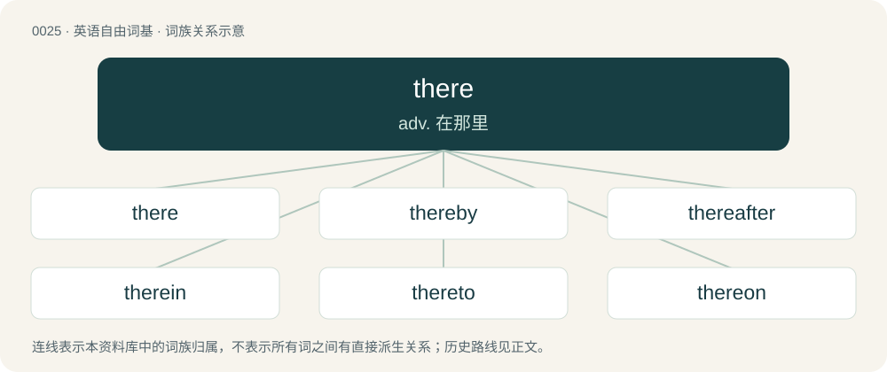

# 0031 · there — adv. 在那里

[总目录](../00_总目录_按常用程度.md)

**类型**：英语自由词基　｜　**来源语言**：见词源记录

## 核心含义与来源

- 核心含义：adv. 在那里
- 英文含义：In or at a place or location (stated, implied or otherwise indicated) that is perceived to be away from, or at a relative distance from, the speaker (compare here).
- 词形：there

**来源记录 1**（副词；In or at a place or location (stated, implied or otherwise indicated) that is perceived to be away from, or at a relative distance from, the speaker (compare here).）

From Middle English there, ther, thare, thar, thore, from Old English þēr, þǣr, þār (“there; at that place”), from Proto-West Germanic \*þār, from Proto-Germanic \*þar (“at that place; there”), from Proto-Indo-European \*tó-r (“there”), from demonstrative pronominal base \*to- (“the, that”) + adverbial suffix \*-r. Cognate with Scots thar, thair (“there”), North Frisian dear, deer, där (“there”), Saterland Frisian deer (“there”), West Frisian dêr (“there”), Dutch daar (“there”), Low German dar (“there”), German da, dar- (“there”), Danish der (“there”), Norwegian der (“there”), Swedish där (“there”), Icelandic þar (“in that place, there”).

## 词族图

## 单词速览（常用到不常用）

| 单词 | 音标 | 释义 |
|---|---|---|
| [there](#w-1) | /ðə(ɹ)/ | adv. 在那里 |
| [thereby](#w-2) | 英 /ðɛəˈbaɪ/；美 /ðɛɹˈbaɪ/ | adv. 因此 |
| [thereafter](#w-3) | 英 /ˌðɛəɹˈɑːf.tə(ɹ)/；美 /ˌðɛɹˈæf.tɚ/ | adv. 其后, 从那时以后 |
| [therein](#w-4) | 英 /ˈðɛəɹˈɪn/ | adv. 在其中, 在那里, 在那一点上 |
| [thereto](#w-5) | 英 /ˌðɛəˈtuː/；美 /ˌðɛɚˈtuː/ | adv. 往那边, 到那 |
| [thereon](#w-6) | 英 /ðɛəˈɹɒn/；/ðeɹˈɑn/ | adv. 在那上面, ...之后立即 |
| [thereupon](#w-7) | 英 /ˌðɛəɹəˈpɒn/；美 /ˌðɛɹəˈpɑn/ | adv. 在其上, 关于那, 因此, 由此, 随即, 于是, 立即；\[法\] 于是, 因此, 遂即 |
| [therewith](#w-8) | /ðɛəˈwɪθ/ | adv. 随即, 与此, 此外 |
| [therefrom](#w-9) | /ˌðeəˈfɹɒm/ | adv. 从那里, 从此 |
| [thereunder](#w-10) | /.ðєərˈʌndə/ | adv. 在那下面, 据此 |

## 逐词详解

### 1. there

**词性**：名词　｜　**音标**：/ðə(ɹ)/

**中文释义**：adv. 在那里

**英文义项**：That place (previously mentioned or otherwise implied). / That situation; that position.

**词源与演化**：

From Middle English there, ther, thare, thar, thore, from Old English þēr, þǣr, þār (“there; at that place”), from Proto-West Germanic \*þār, from Proto-Germanic \*þar (“at that place; there”), from Proto-Indo-European \*tó-r (“there”), from demonstrative pronominal base \*to- (“the, that”) + adverbial suffix \*-r. Cognate with Scots thar, thair (“there”), North Frisian dear, deer, där (“there”), Saterland Frisian deer (“there”), West Frisian dêr (“there”), Dutch daar (“there”), Low German dar (“there”), German da, dar- (“there”), Danish der (“there”), Norwegian der (“there”), Swedish där (“there”), Icelandic þar (“in that place, there”).

**例句**：

> You rinse and de-string the green beans; I'll take it from there.

该用例对应义项：That situation; that position.

### 2. thereby

**词性**：副词　｜　**音标**：英 /ðɛəˈbaɪ/；美 /ðɛɹˈbaɪ/

**中文释义**：adv. 因此

**英文义项**：By it; by that; by that means, or as a consequence of that.

**构词拆分**：there + by

**词源与演化**：

From Middle English therby, from Old English ðǣrbig, equivalent to there + by. Compare the parallel formation of German dabei.

**例句**：

> I enrolled in Old English classes and thereby learned much about Germanic languages.

该用例对应义项：By it; by that; by that means, or as a consequence of that.

### 3. thereafter

**词性**：副词　｜　**音标**：英 /ˌðɛəɹˈɑːf.tə(ɹ)/；美 /ˌðɛɹˈæf.tɚ/

**中文释义**：adv. 其后, 从那时以后

**英文义项**：After that time, from then on; thenceforth. / After that (the thing aforementioned).

**构词拆分**：there + after

**词源与演化**：

From Middle English therafter, theraftir, þerefter, þerafter, þeræfter, from Old English þǣræfter (“after that; thereafter”), equivalent to there + after. Cognate with Saterland Frisian deerätter (“thereafter”), West Frisian dêrefter (“behind that; thereafter”), Dutch daarachter (“behind that; thereafter”), German Low German daarachter (“behind that”), Danish derefter (“thereafter”), Swedish därefter (“thereafter”).

**例句**：

> The little dog was off like a shot, and the children went running thereafter.

该用例对应义项：After that (the thing aforementioned).

### 4. therein

**词性**：副词　｜　**音标**：英 /ˈðɛəɹˈɪn/

**中文释义**：adv. 在其中, 在那里, 在那一点上

**英文义项**：in that; in that place; in him/her/it.

**构词拆分**：there + in

**词源与演化**：

From Middle English theryn, ther-inne, þer-in, from Old English þǣrin, þǣrinne, from Proto-West Germanic \*þārin, \*þārinna, from Proto-Germanic \*þarin, \*þarinna, equivalent to there + in. Cognate with Saterland Frisian deerin (“therein”), West Frisian dêryn (“therein”), Dutch daarin (“therein”), German Low German daarin (“therein”), German darin, drin (“therein”), Danish deri (“therein”), Swedish däri (“therein”), Icelandic þar í (“therein”).

**例句**：

> They can read therein what our plans are.

该用例对应义项：(formal) in or into that thing or place

### 5. thereto

**词性**：副词　｜　**音标**：英 /ˌðɛəˈtuː/；美 /ˌðɛɚˈtuː/

**中文释义**：adv. 往那边, 到那

**英文义项**：To that.

**构词拆分**：there + to

**词源与演化**：

From Middle English therto, from Old English þǣrtō (“thereto”), equivalent to there + to. Cognate with Scots tharto, thereto (“thereto”), Saterland Frisian deertou (“thereto”), West Frisian dêrta (“thereto”), Dutch daartoe (“thereto; for that”), German Low German daarto (“to that; for that; thereto”), German dazu (“to that; for that; thereto”).

**例句**：

> Each web acts as a balloon, and the spider attached thereto is a little aeronaut.

### 6. thereon

**词性**：副词　｜　**音标**：英 /ðɛəˈɹɒn/；/ðeɹˈɑn/

**中文释义**：adv. 在那上面, ...之后立即

**英文义项**：On that: on (top of) it. / About that: about it (concerning it, regarding it).

**构词拆分**：there + on

**词源与演化**：

From Old English þǣron, equivalent to there + on.

**例句**：

> Text and commentary thereon.

该用例对应义项：on that

### 7. thereupon

**词性**：副词　｜　**音标**：英 /ˌðɛəɹəˈpɒn/；美 /ˌðɛɹəˈpɑn/

**中文释义**：adv. 在其上, 关于那, 因此, 由此, 随即, 于是, 立即；\[法\] 于是, 因此, 遂即

**英文义项**：Upon that; thereon. / In consequence, or by reason, of that; therefore.

**构词拆分**：there + upon

**词源与演化**：

From Middle English therupon, theruppon. Equivalent to there + upon. Compare German darauf.

**例句**：

> Thereupon he let the cat out of the bag.

### 8. therewith

**词性**：副词　｜　**音标**：/ðɛəˈwɪθ/

**中文释义**：adv. 随即, 与此, 此外

**英文义项**：With this, that or those. / In addition to that; besides, moreover.

**构词拆分**：there + with

**词源与演化**：

c. 1200, from Middle English therwith, from Old English þǣrwiþ (“therewith, in return, in exchange, against”), equivalent to there + with. Cognate with Danish derved (“therewith”), Swedish därvid (“therewith, thereby”). Parallel with Dutch daarmee, German damit (“therewith”), Swedish därmed (“therewith”), though etymologically different. See also theremid.

**例句**：

> I have learned that whatever state I am, therewith to be content.

该用例对应义项：with that or this or it

### 9. therefrom

**词性**：副词　｜　**音标**：/ˌðeəˈfɹɒm/

**中文释义**：adv. 从那里, 从此

**英文义项**：From that.

**构词拆分**：there + from

**词源与演化**：

From Middle English therfrom, þærfrom, þarvram (also as ther-fro, þer-fro, þarfra), equivalent to there + from. Cognate with Danish derfra, Swedish därifrån, Norwegian Bokmål derfra, Norwegian Nynorsk derifrå, derfrå, Icelandic þarfrá. Compare Saterland Frisian deerfon, West Frisian dêrfan, Dutch daarvan, German Low German daarvan, German davon.

**例句**：

> Roads that lead therefrom.

该用例对应义项：from that place or from there

### 10. thereunder

**词性**：副词　｜　**音标**：/.ðєərˈʌndə/

**中文释义**：adv. 在那下面, 据此

**英文义项**：Under that; under it.

**构词拆分**：there + under

**词源与演化**：

From Middle English therunder, þer-under, þar under, from Old English þǣrunder, equivalent to there + under. Cognate with Dutch daaronder (“thereunder”), German darunter (“thereunder”), Swedish därunder (“thereunder”).

**例句**：

> The headings and the items listed thereunder.

该用例对应义项：under that
