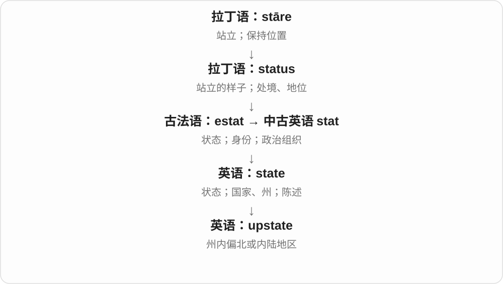

# 0031 · up — 上；起来；增加与完成

[逐词精讲目录](../00_逐词精讲目录.md) · [总目录](../00_总目录_按常用程度.md)

## 核心词根与来源

up 是古英语本族方向词。upward、upwards 保持方向最清楚；uphill 把上坡扩展为艰难；upkeep、pickup、getup 等则联系整个固定短语，不能只逐字译向上。

**UP：从低到高，也让事情推进、接上或完成**

人站起来、数字升上去、东西用完，不同短语给 up 不同作用。

- **方向与时间**：up · upon · upward · upwards · upcoming
- **有利与困难**：upside · uphill
- **接取、维护与使用**：pickup · upkeep · uptime
- **通信与连接**：uplink · linkup
- **装束、运动与喧闹**：getup · layup · uproar
- **地理和档次**：upstate · upscale
- **带来、带大与成长中的教养**：bring · brought · upbringing
- **bring → bringing：携带到参照点、带来结果**：bring · bringing
- **bring → brings：带来人与物，也带来结果**：bring · brings

## 词形与演化规律

短语动词常分开写，形成名词后可连写：pick up／pickup、get up／getup、link up／linkup。upcoming 是将要发生，uptime 是可用运行时间。uproar 有荷兰语或德语表达的仿译背景。sup 另有进食等来历，不能因为像 up 就归在这里。

bring 的标准过去式、过去分词都是 brought；bring up 抚养，与较早 upbring、名词 upbringing 的历史相连。这里 bring 是理解复合所需的基础词，不来自 up。

bring 继承古英语 bringan；bringing 直接加 ing，过去 brought 另有变化。

brings 词尾在 ng 音后读 z；继承古英语携带、带来的词族。

## 单词速览（按词族由简到繁）

同一基础词的相关扩展放在一起，先读基础形式，再读扩展；各组之间优先读常用的。具体词源关系见各词讲解。

| 单词 | 音标 | 核心意思 |
|---|---|---|
| [up](#w-1) | /ʌp/ | 向上；起来；增加；完全；发生着的 |
| [upon](#w-2) | 英 /əˈpɒn/；美 /əˈpɑːn/ | 在……上；一……就；基于 |
| [upcoming](#w-3) | /ˈʌpkʌmɪŋ/ | 即将到来的 |
| [upside](#w-4) | /ˈʌpsaɪd/ | 上面；有利方面；潜在收益 |
| [upwards](#w-6) | 英 /ˈʌpwədz/；美 /ˈʌpwərdz/ | 向上；以上；往较高处 |
| [upward](#w-7) | 英 /ˈʌpwəd/；美 /ˈʌpwərd/ | 向上的；向上地 |
| [uphill](#w-9) | /ˌʌpˈhɪl/〔副词〕；/ˈʌphɪl/〔形容词常见〕 | 向山上；上坡的；艰难的 |
| [upstate](#w-10) | /ˈʌpsteɪt/；副词也读 /ʌpˈsteɪt/ | 州北部的；往州内偏北地区 |
| [upscale](#w-11) | /ˈʌpskeɪl/，也 /ˌʌpˈskeɪl/ | 高档的；面向高价位的；扩大、提升规模 |
| [upkeep](#w-12) | /ˈʌpkiːp/ | 维护；保养；维持费用 |
| [uproar](#w-13) | 英 /ˈʌprɔː/；美 /ˈʌprɔːr/ | 喧嚣；哗然；强烈抗议 |
| [uptime](#w-15) | /ˈʌptaɪm/ | 正常运行时间；可用时间 |
| [uplink](#w-16) | /ˈʌplɪŋk/ | 上行链路；向上级系统传输 |
| [pickup](#w-5) | /ˈpɪkʌp/ | 接人、取件；小货车；改善；拾音器 |
| [layup](#w-14) | /ˈleɪʌp/ | 上篮；停用、封存；叠层〔专业〕 |
| [getup](#w-17) | /ˈɡetʌp/ | 装束；一身打扮〔口语〕 |
| [linkup](#w-21) | /ˈlɪŋkʌp/ | 连接；汇合；合作 |
| [bring](#w-22) | /brɪŋ/ | 带来、拿来；引起、带来某种结果 |
| [brought](#w-23) | 英 /brɔːt/；美 /brɔːt/ 或 /brɑːt/ | 带来了、带来的；bring 的过去式、过去分词 |
| [bringing](#w-25) | /ˈbrɪŋɪŋ/ | 正在带来、带到；引起、带来某种结果；bring 的 -ing 形式 |
| [brings](#w-26) | /brɪŋz/ | 带来、带到；引起、带来结果；bring 的第三人称单数 |
| [upbringing](#w-24) | /ˈʌpbrɪŋɪŋ/ | 成长中的养育、家庭教育、教养 |

## 逐词讲解

### 1. up — 向上；起来；增加；完全；发生着的

**音标**：/ʌp/

**先抓住这个画面**

先想从低处抬到高处，再把这个方向用来表达增加、醒来、集中或完成。

**怎么拆**

接古英语 upp、up，经中古英语延续，是本族方向词。现代短语动词中的 up 有多种固定搭配，不是所有都可按“向上”逐字猜。

**怎么变成今天的意思**

**古英语 upp／up → 中古英语 up**  
向上、在高处

↓

**英语 up**  
上；增加；起来；到完成等方向性用法

stand up 是站起，prices go up 是价格上涨，use up 是用尽，stay up 是不睡觉。What’s up? 是怎么了、最近怎样。Time is up 是时间到了。

**常见搭配与例句**

get up；go up；use up；stay up；What’s up?。

> She looked up when I entered.

我进来时，她抬头看了看。

> We used up all the paint.

我们把油漆都用完了。

> Why are you still up?

你怎么还没睡？

**别混淆**

upward 强调朝上的方向，up 在短语中还可表达完成、增强等；look up a word 是查词，不是抬头看一个词。

### 2. upon — 在……上；一……就；基于

**音标**：英 /əˈpɒn/；美 /əˈpɑːn/

**先抓住这个画面**

一个东西落在另一个上面，某个动作也可以一触到另一个时点就发生。

**怎么拆**

接古英语 upon／uppan 等形式，材料相当于 up + on，后来固定为介词，不能在每句里拆成“向上再在”。

**怎么变成今天的意思**

**古英语 upp／up → 中古英语 up**  
向上、在高处

↓

**古英语 upon 等 → 英语 upon**  
在……上；随……发生时

once upon a time 是从前；upon arrival 是一到达时；depend upon 与 depend on 相近。许多用法较书面，普通位置句常直接用 on。

**常见搭配与例句**

upon arrival；once upon a time；depend upon；based upon。

> Upon arrival, please report to reception.

到达后请到前台报到。

> The decision was based upon the available evidence.

决定依据了现有证据。

**别混淆**

upon 不总是字面空间的上面：upon hearing the news 指听到消息时，不是骑在消息上。

### 3. upcoming — 即将到来的

**音标**：/ˈʌpkʌmɪŋ/

**先抓住这个画面**

日程表里还没发生、但已经排在前面等着到来的事。

**怎么拆**

up + coming，现代组合形容词；coming 接 come 的分词，整体已常用来修饰未来事件。

**怎么变成今天的意思**

**英语 up；coming**  
组合时并列的材料

↓

**up + coming → upcoming**  
即将发生、到来的

an upcoming meeting 是即将举行的会议，an upcoming release 是将发布的版本。并不表示事件在物理上往高处来。

**常见搭配与例句**

an upcoming event；the upcoming election；an upcoming release。

> We are preparing for the upcoming conference.

我们正在准备即将举行的会议。

> The newsletter lists upcoming events.

简报列出了近期将举办的活动。

**别混淆**

upcoming 是即将到来，ongoing 是已经开始且仍在进行。两者都带 -ing，时间位置却不同。

### 4. upside — 上面；有利方面；潜在收益

**音标**：/ˈʌpsaɪd/

**先抓住这个画面**

把一件事翻看各面，朝好的那一面就是比喻中的 upside。

**怎么拆**

up（上）+ side（面），实体上侧的组合发展为有利方面。金融语境还可指上涨空间，需看具体对象。

**怎么变成今天的意思**

**英语 up；side**  
组合时并列的材料

↓

**up + side → upside**  
上侧；好处、有利可能

the upside of working here 是在这里工作的好处；on the upside 是往好处说。upside down 固定说上下颠倒，不把 upside 单独当成整个短语。

**常见搭配与例句**

the upside of；on the upside；upside down。

> The upside of the delay was that we had more time to prepare.

延误的好处是我们多了些准备时间。

> The picture was hanging upside down.

画挂倒了。

**别混淆**

upside 是有利一面，downside 是不利一面；它们是在比较角度，不表示这件事只有好处或只有坏处。

### 5. upwards — 向上；以上；往较高处

**音标**：英 /ˈʌpwədz/；美 /ˈʌpwərdz/

**先抓住这个画面**

从一个起点继续往高处，有时也说超过某个数值。

**怎么拆**

up + -wards，接古英语 upweardes 等形式；结尾 -s 是方向副词材料，不是“多个向上”。

**怎么变成今天的意思**

**古英语 upp／up → 中古英语 up**  
向上、在高处

↓

**古英语 upweardes → 英语 upwards**  
向上、朝高处

point upwards 是向上指。upwards of fifty 可说五十以上；from ten dollars upwards 说十美元起。具体语域和地区也影响表达习惯。

**常见搭配与例句**

move upwards；upwards of；from … upwards。

> The arrow points upwards.

箭头向上指。

> The event attracted upwards of a thousand visitors.

活动吸引了一千多名访客。

**别混淆**

upwards 通常作副词，不用 an upwards trend 代替 an upward trend 作为常规写法。

### 6. upward — 向上的；向上地

**音标**：英 /ˈʌpwəd/；美 /ˈʌpwərd/

**先抓住这个画面**

沿着高度或数值轴往较高的位置移动。

**怎么拆**

up + -ward，-ward 表朝某方向；对应古英语 upweard 等方向形式。

**怎么变成今天的意思**

**古英语 upp／up → 中古英语 up**  
向上、在高处

↓

**古英语 upweard 一系 → 英语 upward**  
朝上、往较高处

an upward trend 是上升趋势，look upward 是向上看。也见 upwards 主要作副词，形容词一般用 upward。

**常见搭配与例句**

an upward trend；upward movement；look upward。

> The chart shows an upward trend in demand.

图表显示需求呈上升趋势。

> Her eyes followed the balloon upward.

她的目光跟着气球向上移动。

**别混淆**

upward 是方向形容词或副词，不等于 upstairs 楼上。向山上走可说 upward，不一定进入楼房。

### 7. uphill — 向山上；上坡的；艰难的

**音标**：/ˌʌpˈhɪl/〔副词〕；/ˈʌphɪl/〔形容词常见〕

**先抓住这个画面**

同样往前走，上坡更费力，于是困难任务也像在爬坡。

**怎么拆**

up（向上）+ hill（山坡），先说地势方向，再比喻需要持续克服阻力。

**怎么变成今天的意思**

**英语 up；hill**  
组合时并列的材料

↓

**up + hill → uphill**  
向坡上；比喻费力、艰难

walk uphill 是走上坡路；an uphill struggle 是艰难奋斗。具体重音可能因词性、短语而变化，学习时连整句读。

**常见搭配与例句**

an uphill battle；an uphill struggle；walk uphill。

> The path goes uphill for about a kilometre.

小路向上爬坡约一公里。

> Winning their trust will be an uphill struggle.

赢得他们的信任会很艰难。

**别混淆**

uphill 比喻困难，但 uphill trend 不是最自然的“趋势向上”，通常说 upward trend。

### 8. upstate — 州北部的；往州内偏北地区

**音标**：/ˈʌpsteɪt/；副词也读 /ʌpˈsteɪt/

**先抓住这个画面**

从州内主要沿海或南部城市向北、向内陆走，所说的那片地区常叫 upstate。纽约语境尤其常见。

**怎么拆**

up（向北、向内陆）+ state（州）。

**怎么变成今天的意思**

地图通常把北方放在上方，于是 up 带出方向。它不是全国统一的行政区名，具体范围由当地习惯决定。

**常见搭配与例句**

upstate New York；an upstate town；move upstate。

> They moved to a small town in upstate New York.

他们搬到了纽约州北部的一座小镇。

> We drove upstate for the weekend.

我们开车到州北部过周末。

**别混淆**

upstate 不等于美国北部，更不表示更高级的州。它是相对于某个州内参照点的地区说法。

### 9. upscale — 高档的；面向高价位的；扩大、提升规模

**音标**：/ˈʌpskeɪl/，也 /ˌʌpˈskeɪl/

**先抓住这个画面**

沿规模或市场档次向上调；最常见的形容词义是高档、价格偏高。

**怎么拆**

up + scale；现代英语组合，分别形成高档市场定位和放大、提升的用法。

**怎么变成今天的意思**

**拉丁语 scala，常用复数 scalae**  
梯子、台阶；与 scandere“攀登”相连

↓

**中古英语 scale / scalen → 英语 scale**  
梯子、刻度；攀登 → 等级、音阶、比例、规模

↓

**英语 up + scale → upscale**  
向上调整尺度 → 高档的；放大、提升

an upscale restaurant 是高档餐厅；upscale an image 是把图片放大。放大后的细节取决于处理方式，不能因为像素更多就说原始信息必然更多。

**常见搭配与例句**

an upscale neighbourhood；upscale dining；upscale an image。

> They opened an upscale restaurant near the station.

他们在车站附近开了一家高档餐厅。

> The software can upscale a small image for printing.

软件可以把小图片放大，用于打印。

**别混淆**

luxury 更强调奢华；upscale 常说市场定位较高。图像的 upscale 则是尺寸处理，和消费档次无关。

### 10. upkeep — 维护；保养；维持费用

**音标**：/ˈʌpkiːp/

**先抓住这个画面**

买下房子或设备还没完，要不断花精力和钱让它保持良好状态。

**怎么拆**

up + keep，与 keep up“维持”这一组合关系相连；不是把东西保存到楼上。

**怎么变成今天的意思**

**英语 up；keep**  
组合时并列的材料

↓

**up + keep → upkeep**  
保持状态所需的维护及费用

the upkeep of a house 是房屋维护；high upkeep 可指养护费用高。通常不可数。

**常见搭配与例句**

the upkeep of；pay for upkeep；maintenance and upkeep。

> The garden requires a lot of upkeep.

花园需要很多养护。

> The charity helps pay for the upkeep of the building.

慈善机构帮助承担建筑维护费用。

**别混淆**

purchase price 是一次购买价格，upkeep 是后续维持成本；买得起不自动意味着养得起。

### 11. uproar — 喧嚣；哗然；强烈抗议

**音标**：英 /ˈʌprɔː/；美 /ˈʌprɔːr/

**先抓住这个画面**

原先安静，一群声音同时炸开，形成吵闹、激烈反应。

**怎么拆**

受荷兰语 oproer 或德语 Aufruhr 相应词影响、仿译成 up + roar；英语 roar“吼叫”的形式参与，不把它当成单纯本土“向上吼”的透明新造。

**怎么变成今天的意思**

**荷兰语 oproer／德语 Aufruhr 的相应表达**  
骚动、喧闹

↓

**仿译、重新对应 up + roar → uproar**  
喧嚣；引发公愤的强烈反应

cause an uproar 是引起轩然大波，the room was in an uproar 是房间里闹成一片。既可能抗议，也可纯说大笑、嘈杂。

**常见搭配与例句**

cause an uproar；in an uproar；a public uproar。

> The announcement caused an uproar.

宣布引起了轩然大波。

> The classroom was in an uproar after the surprise visit.

突如其来的到访让教室里一片喧腾。

**别混淆**

uproar 强调群体强烈声音或反应，roar 可是一声吼叫；不必所有 uproar 都是正式示威。

### 12. uptime — 正常运行时间；可用时间

**音标**：/ˈʌptaɪm/

**先抓住这个画面**

网站或设备处于“能正常工作”的状态，这段累计起来的时间就是 uptime。up 在这里相当于 running，而不是物理位置高。

**怎么拆**

英语 up“运行着、可用”与 time 合成，形成设备与计算机服务的运行时间术语。

**怎么变成今天的意思**

**英语 up；time**  
处于可运行状态；时间

↓

**英语 uptime**  
设备或服务处于运行、可用状态的时段

有的界面显示距上次启动已运行多久；服务报告则可能用 uptime 百分比描述统计期间的可用程度。具体计算口径要看该报告，词本身不保证所有功能都毫无错误。

**常见搭配与例句**

server uptime；system uptime；improve uptime；an uptime report。

> The dashboard displays the server’s uptime.

仪表板显示了服务器的运行时间。

> The team improved uptime by reducing unexpected outages.

团队减少了意外中断，提高了服务可用时间。

**别混淆**

uptime 看能否运行或提供服务；response time 看一次请求响应多快。系统一直在线也可能响应很慢。

### 13. uplink — 上行链路；向上级系统传输

**音标**：/ˈʌplɪŋk/

**先抓住这个画面**

数据从地面或下级端点，送到卫星、上级网络或中心系统。

**怎么拆**

up（向上、向上级）+ link（连接），按通信结构中的相对方向命名。

**怎么变成今天的意思**

**英语 up；link**  
组合时并列的材料

↓

**up + link → uplink**  
连接上级或卫星方向的通信链路

卫星 uplink 说地面到卫星，网络设备中 uplink 指向上级网络的一侧。up 是架构中的相对方向，不要求数据物理上一直向天上走。

**常见搭配与例句**

a satellite uplink；an uplink connection；an uplink port。

> The station established a satellite uplink.

地面站建立了卫星上行链路。

> The router has a separate uplink port.

路由器有一个单独的上联端口。

**别混淆**

uplink 与 download 不是所有场景都严格一一对应；链路方向和用户下载视角要看具体系统。

### 14. pickup — 接人、取件；小货车；改善；拾音器

**音标**：/ˈpɪkʌp/

**先抓住这个画面**

把人或物接上、取走；有些车后面留着装货空间，也叫 pickup。

**怎么拆**

pick + up，来自 pick up 这一多义动词短语的名词化、复合命名；各义不能都按一双手向上捡来硬推。

**怎么变成今天的意思**

**英语 pick；up**  
组合时并列的材料

↓

**pick + up → pickup**  
接取、运载或增强等对应名词

arrange pickup 是安排接取；a pickup truck 是皮卡。a pickup in demand 是需求回升，guitar pickup 是把弦振动转换为电信号的拾音器。

**常见搭配与例句**

a pickup time；a pickup truck；a pickup in sales；a guitar pickup。

> The shop offers free pickup for online orders.

商店为线上订单提供免费自提服务。

> The company reported a pickup in sales.

公司报告销售有所回升。

**别混淆**

pick up 分开是动词，pickup 连写多为名词或修饰语；pick up the parcel 与 parcel pickup 的句法不同。

### 15. layup — 上篮；停用、封存；叠层〔专业〕

**音标**：/ˈleɪʌp/

**先抓住这个画面**

篮球里把球近距离送到篮筐边；别的场景则要回到 lay up 的其他用法。

**怎么拆**

lay + up，与 lay up“放置、存放”等短语的相关命名相连；篮球、停用和材料叠层是不同领域用法，不能凭一个画面全包。

**怎么变成今天的意思**

**英语 lay；up**  
组合时并列的材料

↓

**lay + up → layup**  
上篮；另有停用、叠层等专业义

最常见运动义是篮球近筐上篮。船只 layup 可指暂停使用，制造业可说层材铺放；读新闻先判断领域。

**常见搭配与例句**

make a layup；miss a layup；an easy layup。

> She scored with a left-handed layup.

她用左手上篮得分。

> He missed an easy layup in the final minute.

他在最后一分钟错失了一次简单上篮。

**别混淆**

layup 不是所有靠近篮筐的动作；dunk 是扣篮。lay up 分开可作动词短语，名词 layup 常连写。

### 16. getup — 装束；一身打扮〔口语〕

**音标**：/ˈɡetʌp/

**先抓住这个画面**

人一出现，穿戴出的整套样子格外惹眼，就可能被说成一个 getup。

**怎么拆**

get + up，联系 get up 的装扮、布置等用法而形成名词；不是把“起床”当成唯一来源义。

**怎么变成今天的意思**

**英语 get；up**  
组合时并列的材料

↓

**get + up → getup**  
穿戴、装扮出来的一身样子

常带调侃、怪异或特殊装束的感觉；a strange getup 是一身奇怪打扮。语气比 outfit 更口语、更有评价。

**常见搭配与例句**

a strange getup；in that getup；a superhero getup。

> He arrived in a pirate getup.

他穿着一身海盗装来了。

> Where are you going in that getup?

你打扮成那样要去哪儿？

**别混淆**

getup 连写作名词与 get up 起床的动词短语不同。a getup 是装束，get up early 是早起。

### 17. linkup — 连接；汇合；合作

**音标**：/ˈlɪŋkʌp/

**先抓住这个画面**

原先各自分开，两边连上线、碰到面或开始一起做事。

**怎么拆**

link + up，来自动词短语 link up 的名词化，up 在组合里加强接合完成的意味，不要求在高处相连。

**怎么变成今天的意思**

**英语 link；up**  
组合时并列的材料

↓

**link + up → linkup**  
建立的连接、汇合或合作关系

可用于通信连接、机构合作、任务会合。a linkup between two organisations 不必意味着并购，只说建立联系。

**常见搭配与例句**

a satellite linkup；a linkup between；a business linkup。

> The interview used a live satellite linkup.

采访使用了实时卫星连线。

> The linkup between the schools created new exchange opportunities.

两所学校建立合作，带来了新的交流机会。

**别混淆**

linkup 连写多作名词，link up 分开作动词。uplink 则是特定上行方向的链路，成分次序不同，意义不同。

### 18. bring — 带来、拿来；引起、带来某种结果

**音标**：/brɪŋ/

**先抓住这个画面**

把人、东西带到语境中的目的地，也把某种结果带到面前。Bring your book 是把书带来，bring happiness 是带来快乐。

**怎么拆**

经中古英语接古英语 bringan 携带、带来，属于日耳曼本族词。标准过去式、过去分词都是 brought，这种不同词形有较早历史。

**怎么变成今天的意思**

**古英语 bringan → 中古英语 bringen 等**  
在来到的过程中携带、送来

↓

**现代 bring 的具体与抽象用法**  
带人、物到达；引起某种结果

bring something to someone 把东西带给某人；bring a friend 带个朋友来；bring about change 促成变化；bring up a child 抚养孩子。

**常见搭配与例句**

bring good news；bring the bag with you。

> Please bring your notebook to the meeting.

请把笔记本带到会上来。

> The visit brought back many happy memories.

这次重访唤起了许多美好回忆。

**别混淆**

bring 常朝说话者、听话者或指定中心带来；take 常从这个中心带走。方向参照由语境决定，不只按中文来、去逐字套。

### 19. brought — 带来了、带来的；bring 的过去式、过去分词

**音标**：英 /brɔːt/；美 /brɔːt/ 或 /brɑːt/

**先抓住这个画面**

bring 的动作发生在过去，或已经完成、被完成，就常看到 brought。意思没换成另一件事，换的是动词形态。

**怎么拆**

古英语 bringan 的过去式 brohte、分词 broht 等对应形式，经中古英语语音、拼写变化延续为 brought。不是现代英语临时把 bring 加 -ed 得到。

**怎么变成今天的意思**

**古英语 bringan 的旧过去、分词形式**  
brohte、broht 等

↓

**现代 bring → brought → brought**  
原形、过去式、过去分词的标准变位

brought a gift 带来了礼物；have brought 已经带来；was brought 被带来；was brought up 被抚养长大。完成时、被动句与一般过去时都可能用。

**常见搭配与例句**

brought to the office；brought up by relatives。

> She brought a cake to the party.

她给聚会带来一个蛋糕。

> I have brought the documents you asked for.

我已经把你要的文件带来了。

**别混淆**

brought 是 bring 的形式，bought 是 buy 买的形式；只差 r，意思与动词词族却不同。

### 20. bringing — 正在带来、带到；引起、带来某种结果；bring 的 -ing 形式

**音标**：/ˈbrɪŋɪŋ/

**先抓住这个画面**

自己或别人朝某个参照点来，同时带着人、东西或结果，就是 bringing。参照点可以是说话人这里，也可以是双方正谈的目的地。

**怎么拆**

bring + -ing，直接加；标准词尾 /ŋɪŋ/，中间通常不另加 /ɡ/。bring 继承古英语 bringan，过去式、过去分词 brought 是不规则形式。

**怎么变成今天的意思**

**古英语 bringan → 中古英语 → bring**  
在来到的过程中携带、送来

↓

**bring + -ing → bringing**  
正在带来；带来某种影响、结果

bringing a friend 带朋友来；bringing lunch 带午餐来；bringing people together 把人们聚在一起；bringing change 带来变化。

**常见搭配与例句**

thanks for bringing ...；bringing the books back。

> Are you bringing a friend to the party?

你会带一位朋友来参加聚会吗？

> The new path is bringing more visitors to the village.

新小路正在为村子带来更多访客。

**别混淆**

bring 常向谈话参照点带来，take 常强调从参照点带走、带往别处；carry 更强调携带、承载的动作。具体参照点由对话决定。

### 21. brings — 带来、带到；引起、带来结果；bring 的第三人称单数

**音标**：/brɪŋz/

**先抓住这个画面**

某个人或事把东西带到这里、带到谈话中的目的地，是 brings；一项改变带来好处、麻烦，也能这样说。

**怎么拆**

bring + -s，/ŋ/ 后词尾读 /z/。bring 继承古英语 bringan，经中古英语延续；过去 brought 不规则，现在 brings 直接加 s。

**怎么变成今天的意思**

**古英语 bringan → 中古英语 → bring**  
携带、送来

↓

**bring + -s → brings**  
单数主语带来；引起某种结果

brings a friend 带朋友来；brings good news 带来好消息；brings people together 把人们聚在一起；brings back memories 唤起回忆。

**常见搭配与例句**

brings a smile；brings the books back。

> She brings her lunch to work every day.

她每天都带午饭去上班。

> The old song brings back memories of school.

那首老歌唤起了学生时代的回忆。

**别混淆**

brings 的带来可以是实物，也可以是感受、影响。bring back 可说带回物品，也可说唤起记忆；参照点与对象一起决定具体意思。

### 22. upbringing — 成长中的养育、家庭教育、教养

**音标**：/ˈʌpbrɪŋɪŋ/

**先抓住这个画面**

孩子怎样被带大：家里的习惯、规矩、待人方式和成长环境，一起塑造 upbringing。它说的是养大的过程、方式。

**怎么拆**

up + bringing；与较早动词 upbring 抚养、现代 bring up a child 相连。完整名词较早在苏格兰等语境使用，后来广泛用于成长教养。

**怎么变成今天的意思**

**bring 的带、养育材料与 up 组合**  
把孩子带大、抚养成人

↓

**upbring、upbringing 的历史词族**  
养育过程；成长中的教育、环境

a strict upbringing 严格的家庭教育；a happy upbringing 幸福的成长经历；her upbringing 她从小受到的教养。可以谈环境与价值习惯，不只礼貌。

**常见搭配与例句**

family upbringing；a sheltered upbringing。

> He had a happy upbringing in a small town.

他在一个小镇度过了幸福的成长岁月。

> Her upbringing taught her to treat others with respect.

她从小受到的教养让她学会尊重别人。

**别混淆**

education 常包括学校教育、学习；upbringing 更侧重从小被怎样养育。良好教养也不只等于考试成绩高。

## 这一组要分清什么

upcoming：将发生；ongoing：在进行。upward 作形容词，upwards 通常作副词。uplink 是上行链路，linkup 是接通或合作。

## 串起来练习

The upcoming repair should improve uptime, but regular upkeep will still be necessary.

即将进行的维修应能提高运行可用时间，但定期维护仍有必要。
