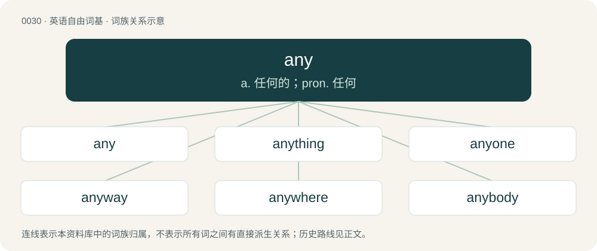

# 0034 · any — a. 任何的；pron. 任何

[总目录](../00_总目录_按常用程度.md)

**类型**：英语自由词基　｜　**来源语言**：见词源记录

## 核心含义与来源

- 核心含义：a. 任何的；pron. 任何
- 英文含义：To even the slightest extent; at all.
- 词形：any

**来源记录 1**（副词；To even the slightest extent; at all.）

From Middle English any, eny, ony, ani, aniȝ, eniȝ, æniȝ, from Old English ǣniġ (“any”), from Proto-West Germanic \*ainīg, \*ainag, from Proto-Germanic \*ainagaz, from Proto-Germanic \*ainaz (“one”), equivalent to one + -y. Cognate with Saterland Frisian eenich (“some”), West Frisian iennich (“only”), Dutch enig (“any, some”), Afrikaans enig (“any”), German Low German enig (“some”), German einig (“some”); via Proto-Indo-European \*óynos cognate with Latin ūllus (“any”), Latin ūnicus (whence Italian unico (“unique”), French unique (“unique”)). Piecewise doublet of unique.

## 词族图

## 单词速览（常用到不常用）

| 单词 | 音标 | 释义 |
|---|---|---|
| [any](#w-1) | 英 /ɛni/；美 /ɪni/ | a. 任何的；pron. 任何 |
| [anything](#w-2) | 英 /ˈɛn.ɪ.θɪŋ/；美 /ˈɛn.i.θɪŋ/ | pron. 任何事 |
| [anyone](#w-3) | 美 /ˈɛ.ni.wʌn/；/ˈɛ.niˌwʌn/ | pron. 任何人 |
| [anyway](#w-4) | /ˈɛniweɪ/ | adv. 无论如何, 至少 |
| [anywhere](#w-5) | 英 /ˈɛnɪwɛə/；美 /ˈɛn.i.(h)wɛɹ/ | adv. 无论何处 |
| [anybody](#w-6) | 英 /ˈɛn.i.bɒd.i/；美 /ˈɛn.i.bə.di/ | pron. 任何人；n. 重要人物 |
| [anytime](#w-7) | /ˈenitaim/ | adv. 任何时候；无例外地 |
| [anyhow](#w-8) | 美 /ˈɛn.i.haʊ/ | adv. 无论如何, 至少 |
| [anyplace](#w-9) | /ˈenipleis/ | adv. 在任何地方 |
| [anywho](#w-10) | 美 /ˈɛniˌhu/ | 【英文】Anybody. |

## 逐词详解

### 1. any

**词性**：副词　｜　**音标**：英 /ɛni/；美 /ɪni/

**中文释义**：a. 任何的；pron. 任何

**英文义项**：To even the slightest extent; at all. / Used before different, before comparatives with more and less, and idiomatically before other comparatives, generally in interrogative, hypothetical, or negative contexts.

**构词拆分**：one + -y

**词源与演化**：

From Middle English any, eny, ony, ani, aniȝ, eniȝ, æniȝ, from Old English ǣniġ (“any”), from Proto-West Germanic \*ainīg, \*ainag, from Proto-Germanic \*ainagaz, from Proto-Germanic \*ainaz (“one”), equivalent to one + -y. Cognate with Saterland Frisian eenich (“some”), West Frisian iennich (“only”), Dutch enig (“any, some”), Afrikaans enig (“any”), German Low German enig (“some”), German einig (“some”); via Proto-Indo-European \*óynos cognate with Latin ūllus (“any”), Latin ūnicus (whence Italian unico (“unique”), French unique (“unique”)). Piecewise doublet of unique.

**例句**：

> If you get any taller, you'll start having to duck through doorways!

该用例对应义项：Used before different, before comparatives with more and less, and idiomatically before other comparatives, generally in interrogative, hypothetical, or negative contexts.

### 2. anything

**词性**：动词　｜　**音标**：英 /ˈɛn.ɪ.θɪŋ/；美 /ˈɛn.i.θɪŋ/

**中文释义**：pron. 任何事

**英文义项**：Used as a placeholder verb for any verb out of a set of related verbs.

**构词拆分**：any + thing

**词源与演化**：

From Middle English anything, enything, onything, from Late Old English aniþing, from earlier ǣniġ þing (literally “any thing”), equivalent to any + thing.

**例句**：

> –I don't want to accompany him! –You never want to anything him!

该用例对应义项：Used as a placeholder verb for any verb out of a set of related verbs.

### 3. anyone

**词性**：代词　｜　**音标**：美 /ˈɛ.ni.wʌn/；/ˈɛ.niˌwʌn/

**中文释义**：pron. 任何人

**英文义项**：Any person; anybody.

**构词拆分**：By surface analysis, any + one

**词源与演化**：

From Middle English eny on, ony one. By surface analysis, any + one.

**例句**：

> Almost anyone can change a light bulb.

该用例对应义项：Any person; anybody.

### 4. anyway

**词性**：副词　｜　**音标**：/ˈɛniweɪ/

**中文释义**：adv. 无论如何, 至少

**英文义项**：Regardless; anyhow. / Used to indicate that a statement explains or supports a previous statement. See anyhow and at least.

**构词拆分**：any + way

**词源与演化**：

From any + way.

**例句**：

> He didn't enjoy washing his car, but it was so dirty that he did it anyway.

该用例对应义项：Regardless; anyhow.

### 5. anywhere

**词性**：副词　｜　**音标**：英 /ˈɛnɪwɛə/；美 /ˈɛn.i.(h)wɛɹ/

**中文释义**：adv. 无论何处

**英文义项**：In or at any location. / To (in the direction of) any location.

**构词拆分**：any + where

**词源与演化**：

From any + where.

**例句**：

> For many 'home' is an affectation when used anywhere that 'house' would be appropriate, as in 'Home for Sale'.

该用例对应义项：In or at any location.

### 6. anybody

**词性**：代词　｜　**音标**：英 /ˈɛn.i.bɒd.i/；美 /ˈɛn.i.bə.di/

**中文释义**：pron. 任何人；n. 重要人物

**英文义项**：Any one out of an indefinite number of persons; anyone; any person. / A person of some consideration or standing.

**构词拆分**：By surface analysis, any + body

**词源与演化**：

From Middle English ani-bodi, anybodi, eny body. By surface analysis, any + body.

**例句**：

> Everybody who wants to be anybody will come to Jake's party.

该用例对应义项：A person of some consideration or standing.

### 7. anytime

**词性**：副词　｜　**音标**：/ˈenitaim/

**中文释义**：adv. 任何时候；无例外地

**英文义项**：At any time.

**构词拆分**：any + time

**词源与演化**：

From Middle English any time, ony tyme, from Old English ǣniġum tīman, equivalent to any + time.

**例句**：

> I don’t like beer much. Give me a fine wine anytime.

该用例对应义项：At any time.

### 8. anyhow

**词性**：副词　｜　**音标**：美 /ˈɛn.i.haʊ/

**中文释义**：adv. 无论如何, 至少

**英文义项**：In any way or manner whatever. / In any case. Used to indicate that a statement explains or supports a previous statement.

**构词拆分**：any + how

**词源与演化**：

From any + how.

**例句**：

> I think they’re asleep; anyhow, they’re quiet.

该用例对应义项：In any case. Used to indicate that a statement explains or supports a previous statement.

### 9. anyplace

**词性**：副词　｜　**音标**：/ˈenipleis/

**中文释义**：adv. 在任何地方

**英文义项**：At a non-specific place; anywhere.

**构词拆分**：any + place

**词源与演化**：

From any + place.

**例句**：

> Is there anyplace around here where I can rent a motorcycle?

### 10. anywho

**词性**：代词　｜　**音标**：美 /ˈɛniˌhu/

**英文义项**：Anybody.

**构词拆分**：any + who

**词源与演化**：

From any + who.
