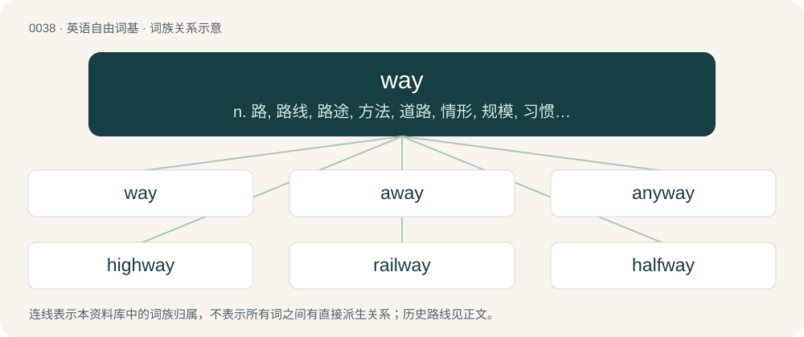

# 0041 · way — n. 路, 路线, 路途, 方法, 道路, 情形, 规模, 习惯, 行业, 方面；adv. 远远地, 非常

[总目录](../00_总目录_按常用程度.md)

**类型**：英语自由词基　｜　**来源语言**：见词源记录

## 核心含义与来源

- 核心含义：n. 路, 路线, 路途, 方法, 道路, 情形, 规模, 习惯, 行业, 方面；adv. 远远地, 非常
- 英文含义：A road, a direction, a (physical or conceptual) path from one place to another.
- 词形：way

**多个词源／构词路径**：同一拼写可能有不同来源；以下按词性和含义分别列出。

**来源记录 1**（名词；A road, a direction, a (physical or conceptual) path from one place to another.）

From Middle English way, wey, from Old English weġ, from Proto-West Germanic \*weg, from Proto-Germanic \*wegaz, from Proto-Indo-European \*weǵʰ-. Doublet of voe and possibly via. Cognates Cognate with North Frisian wai, wäi (“way”), Saterland Frisian Wai (“way”), West Frisian wei (“road; way”), Central Franconian Wääch (“way”), Cimbrian bege, bèg (“way”), Dutch weg (“way”), German, Low German Weg (“way”), Limburgish waeg (“way”), Luxembourgish Wee (“way”), Mòcheno be (“way”), Yiddish וועג (veg, “way”), Danish vej (“way”), Faroese and Icelandic vegur (“way”), Norwegian Bokmål veg, vei (“way”), Norwegian Nynorsk veg (“way”), Swedish väg (“way”), Gothic 𐍅𐌹𐌲𐍃 (wigs, “path; road”).

**来源记录 2**（副词；Far.）

Apheresis of away.

**来源记录 3**（名词；The letter for the w sound in Pitman shorthand.）

From the sound it represents, by analogy with other (velar) letters such as kay and gay.

## 词族图

## 单词速览（常用到不常用）

| 单词 | 音标 | 释义 |
|---|---|---|
| [way](#w-1) | 英 /weɪ/ | n. 路, 路线, 路途, 方法, 道路, 情形, 规模, 习惯, 行业, 方面；adv. 远远地, 非常 |
| [away](#w-2) | 英 /əˈweɪ/ | adv. 离去 |
| [anyway](#w-3) | /ˈɛniweɪ/ | adv. 无论如何, 至少 |
| [highway](#w-4) | /ˈhaɪweɪ/ | n. 公路, 大道, 捷径；\[法\] 公路, 大路 |
| [railway](#w-5) | 英 /ˈɹeɪlˌweɪ/ | n. 铁路, 轨道；\[经\] 铁路 |
| [halfway](#w-6) | 英 /hɑːfˈweɪ/；美 /ˌhæfˈweɪ/ | a. 中途的, 不彻底的, 部分的；adv. 半路地, 在中途, 在半途 |
| [subway](#w-7) | 英 /ˈsʌbˌweɪ/ | n. 地铁, 地道；vi. 乘地铁 |
| [runway](#w-8) | /ˈɹʌnweɪ/ | n. 跑道, 河床, 过道；\[化\] 单轨架空道; 吊车道 |
| [underway](#w-9) | 英 /ʌndəˈweɪ/；美 /ʌndəɹˈweɪ/ | a. 航行中的；进行中的；起步的 |
| [gateway](#w-10) | /ˈɡeɪtˌweɪ/ | n. 门, 通路；\[计\] 网关 |
| [pathway](#w-11) | 英 /ˈpɑːθˌweɪ/；美 /ˈpæθˌweɪ/ | n. 路径, 途径；\[医\] 路径, 道 |
| [hallway](#w-12) | 英 /ˈhɔːlweɪ/；美 /ˈhɔlˌweɪ/ | n. 门厅；玄关；走廊 |
| [midway](#w-13) | /mɪdweɪ/ | n. 中途, 中间, 娱乐场；a. 中途的, 中间的；adv. 中途 |
| [driveway](#w-14) | 美 /ˈdɹaɪvˌweɪ/ | n. 车道 |
| [freeway](#w-15) | /ˈfɹiː.weɪ/ | n. 高速公路 |
| [doorway](#w-16) | 英 /ˈdɔːweɪ/；美 /ˈdɔɹweɪ/ | n. 门口, 途径 |
| [motorway](#w-17) | 英 /ˈməʊtəweɪ/ | n. 高速公路 |
| [roadway](#w-18) | 美 /ˈɹoʊdˌweɪ/ | n. 车道, 道路, 轨道；\[法\] 道路, 路面, 快车道 |
| [parkway](#w-19) | 美 /ˈpɑɹkˌweɪ/ | n. 公园道路, 驾车专用道路 |
| [speedway](#w-20) | /ˈspiːdweɪ/ | n. 汽车(或摩托车)竞赛场, 高速公路 |
| [airway](#w-21) | 英 /ˈɛə.weɪ/；美 /ˈɛɚ.weɪ/ | n. 空中航线, 风道；\[医\] 导气管 |
| [waterway](#w-22) | 英 /ˈwɔːtəweɪ/；/ˈwɔtɚweɪ/ | n. 航道, 水路；\[法\] 水道, 水路航道 |
| [walkway](#w-23) | 英 /ˈwɔːkˌweɪ/；美 /ˈwɔkˌweɪ/ | n. 走道, 人行道 |
| [stairway](#w-24) | 英 /ˈstɛəweɪ/；美 /ˈstɛɹweɪ/ | n. 楼梯, 阶梯 |
| [expressway](#w-25) | /ɪkˈspɹɛs.weɪ/ | n. 高速公路 |
| [headway](#w-26) | /ˈhɛdweɪ/ | n. 前进, 航行速度, 进展；\[经\] 进尺, 钻井 |
| [wayside](#w-27) | /ˈweɪsaɪd/ | n. 路旁；a. 路旁的 |
| [leeway](#w-28) | /ˈliːwei/ | n. 风压差, 风压角, 可容许的误差, 余地 |
| [fairway](#w-29) | 英 /ˈfɛəweɪ/；美 /ˈfɛɹweɪ/ | n. 航路 |
| [beltway](#w-30) | /ˈbɛltˌweɪ/ | n. &lt;美&gt;(环绕城市或某一地区的)环路,环形公路 |
| [passageway](#w-31) | /ˈpæ.sɪdʒˌweɪ/ | n. 通道, 走廊 |
| [carriageway](#w-32) | /ˈkæridʒwei/ | n. 车行道；\[法\] 车道, 马路 |
| [tramway](#w-33) | /ˈtræmwei/ | n. 有轨电车路线, 电车道, (有轨)电车, (吊车)索道 |
| [raceway](#w-34) | 美 /ˈɹeɪsˌweɪ/ | n. 水道, 座圈；\[电\] 槽板 |
| [greenway](#w-35) | /ˈ^riːnwei/ | n. &lt;主美&gt;\[常用作定语\]林荫道路,园林路 |
| [alleyway](#w-36) | /ˈæ.li.weɪ/ | n. 小巷, 窄街, 走廊 |
| [spillway](#w-37) | /ˈspilwei/ | n. 溢洪道, 泄洪道；\[电\] 流溢水路 |
| [archway](#w-38) | /ˈɑɹt͡ʃˌweɪ/ | n. 拱门, 拱道 |
| [ridgeway](#w-39) | /ˈridʒwei/ | n. 山脊路 |
| [seaway](#w-40) | /ˈsiːwei/ | \[经\] 海运航线 |
| [entryway](#w-41) | /ˈentri,wei/ | n. 入口通道 |
| [gangway](#w-42) | 英 /ˈɡæŋweɪ/ | n. 通道, 通路, 跳板；interj. 让路 |
| [skyway](#w-43) | 英 /ˈskaɪ.weɪ/ | n. 航线；\[法\] 航路, 高架公路 |
| [someway](#w-44) | 英 /ˈsʌmweɪ/ | adv. 以某种方法, 不知怎么地, 以某种方式 |
| [colorway](#w-45) | /ˈkʌləɹˌweɪ/ | n. 色彩设计 |
| [partway](#w-46) | /ˈpɑːtˈwei/ | v. 到中途, 到达一半 |
| [waypoint](#w-47) | /ˈweɪpɔɪnt/ | \[体\]航途基准点; \[航空\]航路点 |
| [wayfarer](#w-48) | 英 /ˈweɪˌfɛəɹ.ə(ɹ)/ | n. 旅行者 |
| [taxiway](#w-49) | /ˈtæksiwei/ | n. 滑行道 |
| [byway](#w-50) | /ˈbaɪweɪ/ | n. 旁道, 偏僻小路 |
| [laneway](#w-51) | /ˈleinwei/ | n. 巷道, 通路 |
| [tollway](#w-52) | /ˈtəjlwei,ˈtɔl-/ | n. &lt;美&gt;收费公路 |
| [slipway](#w-53) | /ˈslipwei/ | n. 滑台, 船台 |
| [bikeway](#w-54) | /ˈbaikwei/ | n. 自行车车道 |
| [entranceway](#w-55) | /ˈentrəns,wei/ | n. 入口, 大门 |

## 逐词详解

### 1. way

**词性**：名词　｜　**音标**：英 /weɪ/

**中文释义**：n. 路, 路线, 路途, 方法, 道路, 情形, 规模, 习惯, 行业, 方面；adv. 远远地, 非常

**英文义项**：A road, a direction, a (physical or conceptual) path from one place to another. / A means to enter or leave a place.

**词源与演化**：

From Middle English way, wey, from Old English weġ, from Proto-West Germanic \*weg, from Proto-Germanic \*wegaz, from Proto-Indo-European \*weǵʰ-. Doublet of voe and possibly via. Cognates Cognate with North Frisian wai, wäi (“way”), Saterland Frisian Wai (“way”), West Frisian wei (“road; way”), Central Franconian Wääch (“way”), Cimbrian bege, bèg (“way”), Dutch weg (“way”), German, Low German Weg (“way”), Limburgish waeg (“way”), Luxembourgish Wee (“way”), Mòcheno be (“way”), Yiddish וועג (veg, “way”), Danish vej (“way”), Faroese and Icelandic vegur (“way”), Norwegian Bokmål veg, vei (“way”), Norwegian Nynorsk veg (“way”), Swedish väg (“way”), Gothic 𐍅𐌹𐌲𐍃 (wigs, “path; road”).

**例句**：

> Do you know the way to the airport? Come this way and I'll show you a shortcut.

该用例对应义项：A road, a direction, a (physical or conceptual) path from one place to another.

### 2. away

**词性**：形容词　｜　**音标**：英 /əˈweɪ/

**中文释义**：adv. 离去

**英文义项**：Not here, gone, absent, unavailable, traveling; on vacation. / At a specified distance in space, time, or figuratively.

**构词拆分**：a- (“on”) + way

**词源与演化**：

From Middle English away, awey, awei, oway, o wey, on way, from Old English āweġ, onweġ (“away”), originally on weġ (“on one's way; onward; on”), equivalent to a- (“on”) + way. Cognate with Scots awa, away (“away”), Old Frisian aweg, awei (“away”), Saterland Frisian wäch, wääge (“away”), Dutch weg (“away”), German weg (“away”), Danish væk (“away”), Swedish i väg (“away; off; along”).

**例句**：

> The master is away from home on a course.

该用例对应义项：Not here, gone, absent, unavailable, traveling; on vacation.

### 3. anyway

**词性**：副词　｜　**音标**：/ˈɛniweɪ/

**中文释义**：adv. 无论如何, 至少

**英文义项**：Regardless; anyhow. / Used to indicate that a statement explains or supports a previous statement. See anyhow and at least.

**构词拆分**：any + way

**词源与演化**：

From any + way.

**例句**：

> He didn't enjoy washing his car, but it was so dirty that he did it anyway.

该用例对应义项：Regardless; anyhow.

### 4. highway

**词性**：名词　｜　**音标**：/ˈhaɪweɪ/

**中文释义**：n. 公路, 大道, 捷径；\[法\] 公路, 大路

**英文义项**：A main public road, especially a multi-lane, high-speed thoroughfare. / Any public road.

**构词拆分**：high + way

**词源与演化**：

From Middle English heiȝwai, heiȝwei, from Old English hēahweġ (“main road, highway”), corresponding to high + way. Compare highgate, high street, high road. Cognate with Scots heaway, heway, hieway, hichway, heichway (“highway”).

**例句**：

> You're on a highway to greatness.

该用例对应义项：A way; a path that leads to a certain destiny.

### 5. railway

**词性**：名词　｜　**音标**：英 /ˈɹeɪlˌweɪ/

**中文释义**：n. 铁路, 轨道；\[经\] 铁路

**英文义项**：A transport system using rails used to move passengers or goods. / A track, consisting of parallel rails, over which wheeled vehicles such as trains may travel.

**构词拆分**：rail + way

**词源与演化**：

From rail + way.

**例句**：

> It often happens that railway traffic is suspended by a heavy snowfall.

### 6. halfway

**词性**：形容词　｜　**音标**：英 /hɑːfˈweɪ/；美 /ˌhæfˈweɪ/

**中文释义**：a. 中途的, 不彻底的, 部分的；adv. 半路地, 在中途, 在半途

**英文义项**：Middle; midway; being in the middle of the way or distance.

**构词拆分**：half- + way

**词源与演化**：

From Middle English halfwey, from Old English healfweġ (“half-way”), equivalent to half- + way. Compare partway. Cognate with Saterland Frisian hoolfwais (“halfway”), Dutch halfweg (“halfway”), German halbwegs (“halfway”), Danish halvvejs (“halfway”), Swedish halvvägs (“halfway”).

**例句**：

> John blacked out at the halfway point of the marathon.

该用例对应义项：Middle; midway; being in the middle of the way or distance.

### 7. subway

**词性**：名词　｜　**音标**：英 /ˈsʌbˌweɪ/

**中文释义**：n. 地铁, 地道；vi. 乘地铁

**英文义项**：An underground railway, especially for mass transit of people in urban areas. / A train that runs on such an underground railway.

**构词拆分**：sub- + way

**词源与演化**：

From sub- + way.

**例句**：

> He is going to Westminster by subway.

该用例对应义项：An underground railway, especially for mass transit of people in urban areas.

### 8. runway

**词性**：名词　｜　**音标**：/ˈɹʌnweɪ/

**中文释义**：n. 跑道, 河床, 过道；\[化\] 单轨架空道; 吊车道

**英文义项**：A defined, narrow section of land or an artificial structure used for access. / The usual path taken by deer or other wild animals, such as from a forest to a water source.

**构词拆分**：run + way

**词源与演化**：

From run + way.

**例句**：

> There is a long line of planes waiting to use the runway.

### 9. underway

**词性**：副词　｜　**音标**：英 /ʌndəˈweɪ/；美 /ʌndəɹˈweɪ/

**中文释义**：a. 航行中的；进行中的；起步的

**英文义项**：In motion, in progress; being done or carried out; on a journey.

**构词拆分**：under- + way

**词源与演化**：

Calque of Dutch onderweg (“underway”), equivalent to under- + way. Compare also German unterwegs.

**例句**：

> As discussions were underway, hundreds of anti-globalisation protesters clashed with riot police.

### 10. gateway

**词性**：名词　｜　**音标**：/ˈɡeɪtˌweɪ/

**中文释义**：n. 门, 通路；\[计\] 网关

**英文义项**：A passage that can be closed by use of a gate. / A place regarded as giving access to somewhere.

**构词拆分**：gate + way

**词源与演化**：

From gate + way.

**用法示例／搭配（非完整句）**：

> a gateway drug

该用例对应义项：Any thing or area of interest that tends to lead to deeper involvement.

### 11. pathway

**词性**：名词　｜　**音标**：英 /ˈpɑːθˌweɪ/；美 /ˈpæθˌweɪ/

**中文释义**：n. 路径, 途径；\[医\] 路径, 道

**英文义项**：A footpath or other path or track. / A sequence of biochemical compounds, and the reactions linking them, that describe a process in metabolism or catabolism.

**构词拆分**：path + way

**词源与演化**：

From Middle English pathwei, equivalent to path + way. Cognate with German Pfadweg, Afrikaans padweg.

**用法示例／搭配（非完整句）**：

> the pathway to success

该用例对应义项：A course of action.

### 12. hallway

**词性**：名词　｜　**音标**：英 /ˈhɔːlweɪ/；美 /ˈhɔlˌweɪ/

**中文释义**：n. 门厅；玄关；走廊

**英文义项**：A corridor in a building that connects rooms.

**构词拆分**：hall + way

**词源与演化**：

From hall + way.

**例句**：

> I have to pee, but your friends are completely crowding the hallway.

### 13. midway

**词性**：形容词　｜　**音标**：/mɪdweɪ/

**中文释义**：n. 中途, 中间, 娱乐场；a. 中途的, 中间的；adv. 中途

**英文义项**：Being in the middle of the way or distance; middle.

**构词拆分**：mid- + way

**词源与演化**：

From Middle English mydwaye, mydweye, from Old English midweġ (“midway”), equivalent to mid- + way. Cognate with Dutch midweg (“midway”), Middle Low German midwech (“midway”).

**例句**：

> He told me to identify a good midway point at which I could pause the job.

该用例对应义项：Being in the middle of the way or distance; middle.

### 14. driveway

**词性**：名词　｜　**音标**：美 /ˈdɹaɪvˌweɪ/

**中文释义**：n. 车道

**英文义项**：A short private road that leads to a house or garage. / A road that enters or circulates through a defined area, such as an institution, compound, land area, etc., for the purpose of private access, maintenance, or security.

**构词拆分**：drive + way

**词源与演化**：

From drive + way.

**例句**：

> They parked in the driveway.

该用例对应义项：a road leading up to a private house

### 15. freeway

**词性**：名词　｜　**音标**：/ˈfɹiː.weɪ/

**中文释义**：n. 高速公路

**英文义项**：A highway with grade-separated crossings (rather than level crossings) and designed (and only permitted) for high-speed motor-traffic running in two directions on one separate carriageway each / A toll-free highway.

**构词拆分**：free + way

**词源与演化**：

From free + way.

**例句**：

> There are many rest stops along the freeway for the convenience of travelers.

### 16. doorway

**词性**：名词　｜　**音标**：英 /ˈdɔːweɪ/；美 /ˈdɔɹweɪ/

**中文释义**：n. 门口, 途径

**英文义项**：The passage of a door; a door-shaped entrance into a house or a room. / An opening or passage in general.

**构词拆分**：door + way

**词源与演化**：

From door + way.

**例句**：

> Soon after dawn, he came to the doorway of my tent.

该用例对应义项：An opening or passage in general.

### 17. motorway

**词性**：名词　｜　**音标**：英 /ˈməʊtəweɪ/

**中文释义**：n. 高速公路

**英文义项**：A highway with grade-separated crossings (rather than level crossings) and designed (and only permitted) for high-speed motor-traffic (in Europe motor vehicles with a higher speed limit than 40 km/h) running in two directions on one separate carriageway each. / A racetrack venue designated especially for the sport of auto racing.

**构词拆分**：motor + way

**词源与演化**：

From motor + way.

**例句**：

> At motorway service areas in Germany, many people eat currywurst with chips.

### 18. roadway

**词性**：名词　｜　**音标**：美 /ˈɹoʊdˌweɪ/

**中文释义**：n. 车道, 道路, 轨道；\[法\] 道路, 路面, 快车道

**英文义项**：A way used as a road. / The main or central portion of a road, used by the vehicles.

**构词拆分**：road + way

**词源与演化**：

From Middle English \*rodeway, \*radewey (attested in radewey-stile (literally “roadway-stile”)), equivalent to road + way; road had the early sense of "riding" when the compound was formed, thus originally "a way for riding on".

**例句**：

> Environmental and roadway factors can also contribute to single-vehicle crashes.

### 19. parkway

**词性**：名词　｜　**音标**：美 /ˈpɑɹkˌweɪ/

**中文释义**：n. 公园道路, 驾车专用道路

**英文义项**：A path, carriage-way, or road through a park or a landscaped right of way. / A scenic freeway.

**构词拆分**：park + way

**词源与演化**：

From park + way.

**例句**：

> As they cruised, she remembered the old saw: Why do we drive on a parkway and park in a driveway?

该用例对应义项：A divided highway with a landscaped median.

### 20. speedway

**词性**：名词　｜　**音标**：/ˈspiːdweɪ/

**中文释义**：n. 汽车(或摩托车)竞赛场, 高速公路

**英文义项**：A form of motorcycle racing on flat (without camber) oval dirt tracks using motorcycles with neither brakes nor gears. / A form of bicycle racing on flat (nonbanked) oval dirt tracks.

**构词拆分**：speed + way

**词源与演化**：

From speed + way.

**例句**：

> The most popular sports in that country are soccer, speedway and ski jumping.

### 21. airway

**词性**：名词　｜　**音标**：英 /ˈɛə.weɪ/；美 /ˈɛɚ.weɪ/

**中文释义**：n. 空中航线, 风道；\[医\] 导气管

**英文义项**：The trachea. / The trachea and bronchial tree.

**构词拆分**：air + way

**词源与演化**：

From air + way.

### 22. waterway

**词性**：名词　｜　**音标**：英 /ˈwɔːtəweɪ/；/ˈwɔtɚweɪ/

**中文释义**：n. 航道, 水路；\[法\] 水道, 水路航道

**英文义项**：A body of water, such as a river, channel or canal, that is navigable. / A conduit or watercourse, such as on the deck of a ship, to drain water.

**构词拆分**：water + way

**词源与演化**：

From Middle English waterwey, from Old English wæterweġ (“waterway”), from Proto-West Germanic \*watarweg, equivalent to water + way. Compare Saterland Frisian Woaterwai (“waterway”), West Frisian wetterwei (“waterway”), Dutch waterweg (“waterway”), German Wasserweg (“waterway”), Danish vandvej (“waterway”), Swedish vattenväg (“waterway”).

**例句**：

> A river and a canal are both types of waterway.

### 23. walkway

**词性**：名词　｜　**音标**：英 /ˈwɔːkˌweɪ/；美 /ˈwɔkˌweɪ/

**中文释义**：n. 走道, 人行道

**英文义项**：A clearly defined path for pedestrians.

**构词拆分**：walk + way

**词源与演化**：

From walk + way.

**例句**：

> He went slowly and deliberately to his car, being careful not to step on the cracks in the cement walkway.

### 24. stairway

**词性**：名词　｜　**音标**：英 /ˈstɛəweɪ/；美 /ˈstɛɹweɪ/

**中文释义**：n. 楼梯, 阶梯

**英文义项**：A set of steps, with or without a case, that allow one to walk up or down.

**构词拆分**：stair + way

**词源与演化**：

stair + way

**例句**：

> Mary couldn't believe that Tom had never listened to Stairway to Heaven.

### 25. expressway

**词性**：名词　｜　**音标**：/ɪkˈspɹɛs.weɪ/

**中文释义**：n. 高速公路

**英文义项**：A divided highway, especially one whose intersections and direct access to adjacent properties have been eliminated. / Synonym of freeway.

**构词拆分**：express + way

**词源与演化**：

From express + way.

**例句**：

> A lot of cars speed by on this expressway day and night.

### 26. headway

**词性**：名词　｜　**音标**：/ˈhɛdweɪ/

**中文释义**：n. 前进, 航行速度, 进展；\[经\] 进尺, 钻井

**英文义项**：A movement ahead or forward. / Forward motion, or its rate.

**构词拆分**：By surface analysis, head + way

**词源与演化**：

Partly from Middle English hauedwei, from Old English hēafodweġ (“head-road, main-road”); partly as a shortening of ahead-way, the source of the nautical sense. By surface analysis, head + way.

**例句**：

> The ship made little headway against the gale.

该用例对应义项：forward movement

### 27. wayside

**词性**：名词　｜　**音标**：/ˈweɪsaɪd/

**中文释义**：n. 路旁；a. 路旁的

**英文义项**：The side of a road or path. / A rest area.

**构词拆分**：way + side

**词源与演化**：

From Middle English waye syde, equivalent to way + side.

**例句**：

> Many wild flowers grew on the wayside.

该用例对应义项：The side of a road or path.

### 28. leeway

**词性**：名词　｜　**音标**：/ˈliːwei/

**中文释义**：n. 风压差, 风压角, 可容许的误差, 余地

**英文义项**：The drift of a ship or aeroplane in a leeward direction. / A varying degree or amount of freedom or flexibility.

**构词拆分**：lee (“side away from the wind”) + way

**词源与演化**：

From lee (“side away from the wind”) + way.

**例句**：

> I don't think we have a lot of leeway when it comes to proper formatting.

该用例对应义项：A varying degree or amount of freedom or flexibility.

### 29. fairway

**词性**：名词　｜　**音标**：英 /ˈfɛəweɪ/；美 /ˈfɛɹweɪ/

**中文释义**：n. 航路

**英文义项**：The area between the tee and the green, where the grass is cut short. / Any tract of land free from obstacles.

**构词拆分**：fair + way

**词源与演化**：

From fair + way.

### 30. beltway

**词性**：名词　｜　**音标**：/ˈbɛltˌweɪ/

**中文释义**：n. &lt;美&gt;(环绕城市或某一地区的)环路,环形公路

**英文义项**：A freeway that encircles a city.

**构词拆分**：belt + way

**词源与演化**：

From belt + way.

### 31. passageway

**词性**：名词　｜　**音标**：/ˈpæ.sɪdʒˌweɪ/

**中文释义**：n. 通道, 走廊

**英文义项**：A covered walkway, between rooms or buildings. / Any way for passing in, out or through something.

**构词拆分**：passage + way

**词源与演化**：

From passage + way.

**例句**：

> There is a secret passageway in my mind leading to my childhood.

### 32. carriageway

**词性**：名词　｜　**音标**：/ˈkæridʒwei/

**中文释义**：n. 车行道；\[法\] 车道, 马路

**英文义项**：The part of a road that carries traffic. / One side of a dual carriageway that carries traffic in a single direction.

**构词拆分**：carriage + way

**词源与演化**：

From carriage + way.

**例句**：

> The car came off the carriageway, due to icy conditions on the road.

### 33. tramway

**词性**：名词　｜　**音标**：/ˈtræmwei/

**中文释义**：n. 有轨电车路线, 电车道, (有轨)电车, (吊车)索道

**英文义项**：The track on which a tram (streetcar) runs. / The system of cables that supports a cable car.

**构词拆分**：tram + way

**词源与演化**：

From tram + way.

**例句**：

> This tramway connects the city centre with the railway station.

### 34. raceway

**词性**：名词　｜　**音标**：美 /ˈɹeɪsˌweɪ/

**中文释义**：n. 水道, 座圈；\[电\] 槽板

**英文义项**：A place where races are held; a racetrack. / An easily-accessible conduit or tray for organizing runs of data or power cabling.

**构词拆分**：race + way

**词源与演化**：

From race + way.

### 35. greenway

**词性**：名词　｜　**音标**：/ˈ^riːnwei/

**中文释义**：n. &lt;主美&gt;\[常用作定语\]林荫道路,园林路

**英文义项**：A corridor of undeveloped land or parkland, set aside for environmental protection or recreational and primarily nonmotorized use, such as bicycle paths.

**构词拆分**：green + way

**词源与演化**：

From green + way.

### 36. alleyway

**词性**：名词　｜　**音标**：/ˈæ.li.weɪ/

**中文释义**：n. 小巷, 窄街, 走廊

**英文义项**：A narrow street formed by the proximity of adjacent buildings. / A passage between two rows of cabins in a ship.

**构词拆分**：alley + way

**词源与演化**：

From alley + way.

**例句**：

> The thief was trapped in a dead-end alleyway.

### 37. spillway

**词性**：名词　｜　**音标**：/ˈspilwei/

**中文释义**：n. 溢洪道, 泄洪道；\[电\] 流溢水路

**英文义项**：A path designed to take away overflow safely.

**构词拆分**：spill + way

**词源与演化**：

From spill + way.

**例句**：

> The dam design includes an emergency spillway weir, to handle flood flows without risking erosion on the rest of the embankment.

### 38. archway

**词性**：名词　｜　**音标**：/ˈɑɹt͡ʃˌweɪ/

**中文释义**：n. 拱门, 拱道

**英文义项**：A passageway covered by an arch, particularly one made of masonry. / A doorway with a semilunar-shaped top.

**构词拆分**：arch + way

**词源与演化**：

From arch + way.

**例句**：

> The soffit of the archway is ornamented with deeply recessed coffers, and a relief in the centre represents the apotheosis of Titus.

### 39. ridgeway

**词性**：名词　｜　**音标**：/ˈridʒwei/

**中文释义**：n. 山脊路

**英文义项**：A track or path that follows the highest part of the landscape.

**构词拆分**：ridge + way

**词源与演化**：

From ridge + way.

**例句**：

> He turned into the ridgeway and drew towards the barn.

### 40. seaway

**词性**：名词　｜　**音标**：/ˈsiːwei/

**中文释义**：\[经\] 海运航线

**英文义项**：A lane or route at sea that is regularly used by ships; a sea lane or trade route. / An inland waterway used by seagoing shipping.

**构词拆分**：sea + way

**词源与演化**：

From Middle English seewey, from Old English sǣweġ (“a seaway, a path through the sea”), equivalent to sea + way. Compare Saterland Frisian Seegong (“seaway, swell”), German Seegang (“seaway, swell”).

**例句**：

> The Portuguese Vasco da Gama discovered the seaway that leads from Portugal, around the continent of Africa, to India.

### 41. entryway

**词性**：名词　｜　**音标**：/ˈentri,wei/

**中文释义**：n. 入口通道

**英文义项**：An opening or hallway allowing entry into a structure; a pathway allowing entry into a locality or region.

**构词拆分**：entry + way

**词源与演化**：

From entry + way.

**例句**：

> There were greeters handing out programmes in the entryway to the museum.

该用例对应义项：An opening or hallway allowing entry into a structure; a pathway allowing entry into a locality or region.

### 42. gangway

**词性**：名词　｜　**音标**：英 /ˈɡæŋweɪ/

**中文释义**：n. 通道, 通路, 跳板；interj. 让路

**英文义项**：An aisle between rows of seating (especially in a train, aircraft or auditorium). / The dividing aisle between the rows of seats on either side of the House of Commons. Used chiefly with reference to terms such as below the gangway.

**构词拆分**：gang + way

**词源与演化**：

From Middle English gangway, from Old English gangweġ (“passageway; thoroughfare”), equivalent to gang + way. Related to Dutch gang (“hallway”) and Norwegian gang (“hallway”).

**例句**：

> The new fleet of trains comes with widened gangways and improved seating.

该用例对应义项：An aisle between rows of seating (especially in a train, aircraft or auditorium).

### 43. skyway

**词性**：名词　｜　**音标**：英 /ˈskaɪ.weɪ/

**中文释义**：n. 航线；\[法\] 航路, 高架公路

**英文义项**：An aeroplane route. / An elevated road.

**构词拆分**：sky + way

**词源与演化**：

From sky + way.

### 44. someway

**词性**：副词　｜　**音标**：英 /ˈsʌmweɪ/

**中文释义**：adv. 以某种方法, 不知怎么地, 以某种方式

**英文义项**：Somehow.

**构词拆分**：some + way

**词源与演化**：

From some + way.

### 45. colorway

**词性**：名词　｜　**音标**：/ˈkʌləɹˌweɪ/

**中文释义**：n. 色彩设计

**英文义项**：Any of the schemes of two or more colors in which a design is available.

**构词拆分**：color + way

**词源与演化**：

From color + way.

**例句**：

> This shirt comes in three colorways: taupe, red, and navy.

该用例对应义项：Any of the schemes of two or more colors in which a design is available.

### 46. partway

**词性**：副词　｜　**音标**：/ˈpɑːtˈwei/

**中文释义**：v. 到中途, 到达一半

**英文义项**：To some extent. / In part; part of the way; some of the way.

**构词拆分**：part + way

**词源与演化**：

From part + way.

**例句**：

> The goat climbed partway up the steep mountain.

### 47. waypoint

**词性**：名词　｜　**音标**：/ˈweɪpɔɪnt/

**中文释义**：\[体\]航途基准点; \[航空\]航路点

**英文义项**：Any mapped reference point on a route that can be easily identified.

**构词拆分**：way + point

**词源与演化**：

way + point

### 48. wayfarer

**词性**：名词　｜　**音标**：英 /ˈweɪˌfɛəɹ.ə(ɹ)/

**中文释义**：n. 旅行者

**英文义项**：A traveller, especially one on foot.

**构词拆分**：way + farer

**词源与演化**：

From Middle English weyfarere, weifarere; equivalent to way + farer.

**例句**：

> "I'd sooner walk than take my chances in an antediluvian rattle-trap like that," said the tall wayfarer, bending quite close to her ear.

### 49. taxiway

**词性**：名词　｜　**音标**：/ˈtæksiwei/

**中文释义**：n. 滑行道

**英文义项**：A road or path within an airport designated for the taxiing of aircraft connecting the runways with ramps, hangars, terminals and other facilities.

**构词拆分**：taxi + way

**词源与演化**：

From taxi + way.

### 50. byway

**词性**：名词　｜　**音标**：/ˈbaɪweɪ/

**中文释义**：n. 旁道, 偏僻小路

**英文义项**：A road or track not following a main route; a secondary or minor road or path. / A road that is not frequently travelled.

**构词拆分**：by- + way

**词源与演化**：

From Middle English bywey, equivalent to by- + way.

### 51. laneway

**词性**：名词　｜　**音标**：/ˈleinwei/

**中文释义**：n. 巷道, 通路

**英文义项**：A narrow roadway; a lane

**构词拆分**：lane + way

**词源与演化**：

From lane + way.

**例句**：

> The heavy snowfall kept us from being able to use the laneway.

### 52. tollway

**词性**：名词　｜　**音标**：/ˈtəjlwei,ˈtɔl-/

**中文释义**：n. &lt;美&gt;收费公路

**英文义项**：A toll road or toll highway, where a fee is charged in order to travel on it; a turnpike.

**构词拆分**：toll + way

**词源与演化**：

From toll + way.

### 53. slipway

**词性**：名词　｜　**音标**：/ˈslipwei/

**中文释义**：n. 滑台, 船台

**英文义项**：A sloping surface, leading down to the shore or to a river, on which ships are built, repaired or stored and from which they are launched. / A slip road.

**构词拆分**：slip + way

**词源与演化**：

From slip + way.

**例句**：

> Tom and Mary launched their boat from the slipway at the tip of the peninsula.

### 54. bikeway

**词性**：名词　｜　**音标**：/ˈbaikwei/

**中文释义**：n. 自行车车道

**英文义项**：A bicycle lane or path.

**构词拆分**：bike + way

**词源与演化**：

From bike + way.

### 55. entranceway

**词性**：名词　｜　**音标**：/ˈentrəns,wei/

**中文释义**：n. 入口, 大门

**英文义项**：Something that provides access to an entrance; an entryway.

**构词拆分**：entrance + way

**词源与演化**：

From entrance + way.

**例句**：

> This is a code lock type that you can use on the entranceway as well.
