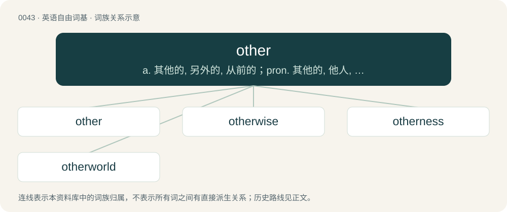

# 0045 · other — a. 其他的, 另外的, 从前的；pron. 其他的, 他人, 另外一个

[总目录](../00_总目录_按常用程度.md)

**类型**：英语自由词基　｜　**来源语言**：见词源记录

## 核心含义与来源

- 核心含义：a. 其他的, 另外的, 从前的；pron. 其他的, 他人, 另外一个
- 英文含义：See other (determiner) below.
- 词形：other

**来源记录 1**（形容词；See other (determiner) below.）

From Middle English other, from Old English ōþer (“other, second”), from Proto-West Germanic \*ą̄þar, \*anþar, from Proto-Germanic \*anþeraz (“other, second”), from Proto-Indo-European \*h₂énteros (“other”). Cognate with Scots uther, ither (“other”), Old Frisian ōther, ("other"; &gt; North Frisian ouder, öler, üđer, Saterland Frisian uur, West Frisian oar), Old Saxon ōthar, ("other"; &gt; Low German anner), Old Dutch āthar, ("other"; &gt; Afrikaans ander, Dutch ander), Old High German andar, ("other"; &gt; Cimbrian andar, German ander, anderer, Luxembourgish aner, Mòcheno ònder, Yiddish אַנדער (ander)), Old Norse annarr, ("other"; &gt; Danish anden, Faroese annar, Icelandic annar, Jamtish æðnen, ænnen, Norwegian Bokmål annen, Norwegian Nynorsk annan, Swedish annan), Gothic 𐌰𐌽𐌸𐌰𐍂 (anþar, “other”), Old Prussian anters, antars (“other, second”), Lithuanian antroks (“other”, pronoun), Latvian otrs, otrais (“second”), Macedonian втор (vtor, “second”), Albanian ndërroj (“to change; to switch; to alternate”), Sanskrit अन्त॑र (ántara, “different”). French autre, Spanish otro, Portuguese outro, etc., all from Latin alter, are false cognates. A true cognate would be Latin anterior.

## 词族图

## 单词速览（常用到不常用）

| 单词 | 音标 | 释义 |
|---|---|---|
| [other](#w-1) | 英 /ˈʌðə/；美 /ˈʌðɚ/ | a. 其他的, 另外的, 从前的；pron. 其他的, 他人, 另外一个 |
| [otherwise](#w-2) | 英 /ˈʌð.əˌwaɪz/；美 /ˈʌð.ɚˌwaɪz/ | adv. 否则, 不同地, 别的方式 |
| [otherness](#w-3) | /ˈʌðənis/ | n. 相异, 不同, 差异性 |
| [otherworld](#w-4) | 美 /ˈʌðɚˌwɝld/ | n. 冥界, 来世 |

## 逐词详解

### 1. other

**词性**：形容词　｜　**音标**：英 /ˈʌðə/；美 /ˈʌðɚ/

**中文释义**：a. 其他的, 另外的, 从前的；pron. 其他的, 他人, 另外一个

**英文义项**：See other (determiner) below. / Second.

**词源与演化**：

From Middle English other, from Old English ōþer (“other, second”), from Proto-West Germanic \*ą̄þar, \*anþar, from Proto-Germanic \*anþeraz (“other, second”), from Proto-Indo-European \*h₂énteros (“other”). Cognate with Scots uther, ither (“other”), Old Frisian ōther, ("other"; &gt; North Frisian ouder, öler, üđer, Saterland Frisian uur, West Frisian oar), Old Saxon ōthar, ("other"; &gt; Low German anner), Old Dutch āthar, ("other"; &gt; Afrikaans ander, Dutch ander), Old High German andar, ("other"; &gt; Cimbrian andar, German ander, anderer, Luxembourgish aner, Mòcheno ònder, Yiddish אַנדער (ander)), Old Norse annarr, ("other"; &gt; Danish anden, Faroese annar, Icelandic annar, Jamtish æðnen, ænnen, Norwegian Bokmål annen, Norwegian Nynorsk annan, Swedish annan), Gothic 𐌰𐌽𐌸𐌰𐍂 (anþar, “other”), Old Prussian anters, antars (“other, second”), Lithuanian antroks (“other”, pronoun), Latvian otrs, otrais (“second”), Macedonian втор (vtor, “second”), Albanian ndërroj (“to change; to switch; to alternate”), Sanskrit अन्त॑र (ántara, “different”). French autre, Spanish otro, Portuguese outro, etc., all from Latin alter, are false cognates. A true cognate would be Latin anterior.

**例句**：

> Pick up the phone and find out who's on the other end.

该用例对应义项：See other (determiner) below.

### 2. otherwise

**词性**：形容词　｜　**音标**：英 /ˈʌð.əˌwaɪz/；美 /ˈʌð.ɚˌwaɪz/

**中文释义**：adv. 否则, 不同地, 别的方式

**英文义项**：Other than supposed; different.

**构词拆分**：other + -wise

**词源与演化**：

From Middle English otherwise, othre wise, from Old English on ōþre wīsan (literally “in (on) other/different manner”); equivalent to other + -wise. Compare West Frisian yn oarwei (“otherwise”), Icelandic öðruvísi (“different”).

**例句**：

> Statistics need lots of information, digital and otherwise.

该用例对应义项：Other than supposed; different.

### 3. otherness

**词性**：名词　｜　**音标**：/ˈʌðənis/

**中文释义**：n. 相异, 不同, 差异性

**英文义项**：The quality of being different or distinct. / The result or product of being different or distinct.

**构词拆分**：other + -ness

**词源与演化**：

From other + -ness.

**例句**：

> The English teacher's cruel remarks perpetuate a sense of otherness and discrimination.

### 4. otherworld

**词性**：名词　｜　**音标**：美 /ˈʌðɚˌwɝld/

**中文释义**：n. 冥界, 来世

**英文义项**：A world beyond death; an afterlife. / A world other than the everyday world.

**构词拆分**：other + world

**词源与演化**：

From Middle English othyr world, oþerr werelld, oþer world, from Old English ōþer weoruld, equivalent to other + world.

**例句**：

> We'll meet again in the otherworld.
