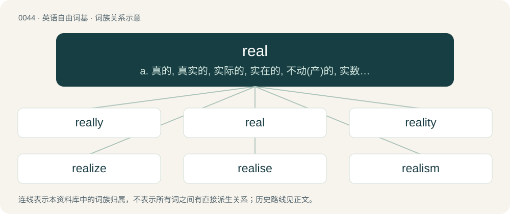

# 0046 · real — a. 真的, 真实的, 实际的, 实在的, 不动(产)的, 实数的；n. 实数, 现实；adv. 真正地

[总目录](../00_总目录_按常用程度.md)

**类型**：英语自由词基　｜　**来源语言**：见词源记录

## 核心含义与来源

- 核心含义：a. 真的, 真实的, 实际的, 实在的, 不动(产)的, 实数的；n. 实数, 现实；adv. 真正地
- 英文含义：True, genuine, not merely nominal or apparent.
- 词形：real

**多个词源／构词路径**：同一拼写可能有不同来源；以下按词性和含义分别列出。

**来源记录 1**（形容词；True, genuine, not merely nominal or apparent.）

From Middle English real, from Old French reel, from Late Latin reālis (“actual”), from Latin rēs (“matter, thing”), from Proto-Indo-European \*reh₁ís (“wealth, goods”). Doublet of realis. In modern times, likely strengthened by or conflated with the use of the prefix re-, analyzable as re- + -al.

**来源记录 2**（名词；Former unit of currency of Spain and Spain's colonies.）

Borrowed from Spanish real (“royal”), from Latin rēgālis (“regal, royal”). Doublet of ariary, regal, riyal, and royal.

**来源记录 3**（名词；A unit of currency used in Portugal and its colonies from 1430 until 1911, and in Brazil from 1790 until 1942.）

From Portuguese real (“royal”), from Latin rēgālis (“regal; royal”). Doublet of ariary, regal, riyal, and royal.

## 词族图

## 单词速览（常用到不常用）

| 单词 | 音标 | 释义 |
|---|---|---|
| [really](#w-1) | 英 /ˈɹɪə.li/；美 /ˈɹɪl.i/ | adv. 实际上, 真实地, 实在 |
| [real](#w-2) | 英 /ɹiːl/；美 /ˈɹi.əl/ | a. 真的, 真实的, 实际的, 实在的, 不动(产)的, 实数的；n. 实数, 现实；adv. 真正地 |
| [reality](#w-3) | 英 /ɹiːˈælɪti/；美 /ɹiˈæləti/ | n. 实在, 事实, 实体, 逼真；\[法\] 现实, 实在存在的事物, 实在性 |
| [realize](#w-4) | 英 /ˈɹɪə.laɪz/；美 /ˈɹi(.ə)ˌlaɪz/ | vt. 了解, 实现, 使显得逼真, 变卖；vi. 变卖 |
| [realise](#w-5) | /ˈriəlaiz,ˈriː-/ | vt. 实现, 认识到, 体会到, 了解, 认清, 使显得逼真, 变卖财产为现钱 |
| [realism](#w-6) | /ˈɹi.əlɪzəm/ | n. 写实主义, 现实, 实在论；\[法\] 现实主义 |
| [surreal](#w-7) | 英 /səˈɹiː(.ə)l/ | a. 超现实主义的；离奇的；不真实的 |
| [unreal](#w-8) | /ʌnˈɹi.əl/ | a. 假的, 虚构的, 不真实的, 幻想的 |
| [realist](#w-9) | 英 /ˈɹɪəlɪst/ | n. 现实主义者, 写实主义者, 实在论者 |
| [realness](#w-10) |  | n. 真诚；真实性 |

## 逐词详解

### 1. really

**词性**：副词　｜　**音标**：英 /ˈɹɪə.li/；美 /ˈɹɪl.i/

**中文释义**：adv. 实际上, 真实地, 实在

**英文义项**：In a way or manner that is real, not unreal. / Actually; in fact; in reality.

**构词拆分**：real + -ly

**词源与演化**：

From Middle English really, realy, rialliche, equivalent to real + -ly.

**例句**：

> "He really is a true friend." / "Really? What makes you so sure?"

该用例对应义项：Actually; in fact; in reality.

### 2. real

**词性**：形容词　｜　**音标**：英 /ɹiːl/；美 /ˈɹi.əl/

**中文释义**：a. 真的, 真实的, 实际的, 实在的, 不动(产)的, 实数的；n. 实数, 现实；adv. 真正地

**英文义项**：True, genuine, not merely nominal or apparent. / Genuine, not artificial, counterfeit, or fake.

**词源与演化**：

From Middle English real, from Old French reel, from Late Latin reālis (“actual”), from Latin rēs (“matter, thing”), from Proto-Indo-European \*reh₁ís (“wealth, goods”). Doublet of realis. In modern times, likely strengthened by or conflated with the use of the prefix re-, analyzable as re- + -al.

**例句**：

> City hall has its place, but this pub is the real heart of the town.

该用例对应义项：True, genuine, not merely nominal or apparent.

### 3. reality

**词性**：名词　｜　**音标**：英 /ɹiːˈælɪti/；美 /ɹiˈæləti/

**中文释义**：n. 实在, 事实, 实体, 逼真；\[法\] 现实, 实在存在的事物, 实在性

**英文义项**：The state of being actual or real; realness. / The real world.

**构词拆分**：real + -ity

**词源与演化**：

From French réalité (“quality of being real”), from Middle French realité (“property, possession”), from Medieval Latin reālitās, from Late Latin reālis (“real”), equivalent to real + -ity. Recorded since 1550 as a legal term in the sense of “fixed property” (compare real estate, realty); the sense “real existence” is attested from 1647. First attested in c. 1540.

**例句**：

> The reality of the crash scene on TV dawned upon him only when he saw the victim was no actor but his friend.

该用例对应义项：The state of being actual or real; realness.

### 4. realize

**词性**：动词　｜　**音标**：英 /ˈɹɪə.laɪz/；美 /ˈɹi(.ə)ˌlaɪz/

**中文释义**：vt. 了解, 实现, 使显得逼真, 变卖；vi. 变卖

**英文义项**：To become aware of, understand, or appreciate (a fact or situation, especially something which has been true for some time). / To sense (something) strongly or vividly as if real.

**构词拆分**：real + -ize；real (adjective) + -ize (suffix denoting the making of what is indicated by the word it is attached to)

**词源与演化**：

From real (adjective) + -ize (suffix denoting the making of what is indicated by the word it is attached to), possibly modelled after French réaliser, Middle French réaliser (“to make real; to convert (something) into assets or cash”), from real (“actual, real”) + -iser (suffix denoting the making of what is indicated by the word it is attached to). Real is derived from Old French reel, from Latin reālis (“actual, real”), from rēs (“deed; event; matter; thing”) (ultimately from Proto-Indo-European \*reh₁ís (“goods; wealth”)) + -ālis (suffix forming adjectives of relationship).

**例句**：

> She desperately yelled at her young daughter, frantic to make her realize what she had done.

该用例对应义项：To become aware of, understand, or appreciate (a fact or situation, especially something which has been true for some time).

### 5. realise

**词性**：动词　｜　**音标**：/ˈriəlaiz,ˈriː-/

**中文释义**：vt. 实现, 认识到, 体会到, 了解, 认清, 使显得逼真, 变卖财产为现钱

**英文义项**：Non-Oxford British standard spelling of realize.

**构词拆分**：real + -ise

**词源与演化**：

From real + -ise, possibly from French réaliser and Middle French réaliser (“to make real; to convert (something) into assets or cash”). See realize.

**例句**：

> You do realise that I won't be able to come, don't you?

### 6. realism

**词性**：名词　｜　**音标**：/ˈɹi.əlɪzəm/

**中文释义**：n. 写实主义, 现实, 实在论；\[法\] 现实主义

**英文义项**：A concern for fact or reality and rejection of the impractical and visionary. / An artistic representation of reality as it is.

**构词拆分**：real + -ism

**词源与演化**：

From real + -ism.

**例句**：

> He stood agape for a moment in front of the painting, surprised at its realism.

### 7. surreal

**词性**：形容词　｜　**音标**：英 /səˈɹiː(.ə)l/

**中文释义**：a. 超现实主义的；离奇的；不真实的

**英文义项**：Resembling a dream: fantastic and incongruous.

**构词拆分**：sur- + real

**词源与演化**：

A back-formation from surrealism, equivalent to sur- + real.

**例句**：

> The movie had a dreamlike, surreal atmosphere.

该用例对应义项：Resembling a dream: fantastic and incongruous.

### 8. unreal

**词性**：形容词　｜　**音标**：/ʌnˈɹi.əl/

**中文释义**：a. 假的, 虚构的, 不真实的, 幻想的

**英文义项**：Not real or substantial; having no actual presence in reality; lacking the characteristics of reality. / very impressive; amazing; unbelievable; incredible; larger or more fantastic than typical of real life.

**构词拆分**：un- + real

**词源与演化**：

From un- + real.

**例句**：

> The video includes unreal footage of an eight-metre wave.

该用例对应义项：very impressive; amazing; unbelievable; incredible; larger or more fantastic than typical of real life.

### 9. realist

**词性**：名词　｜　**音标**：英 /ˈɹɪəlɪst/

**中文释义**：n. 现实主义者, 写实主义者, 实在论者

**英文义项**：An advocate of realism; one who believes that matter, objects etc. have real existence beyond our perception of them. / An adherent of the realism movement; an artist who seeks to portray real everyday life accurately.

**构词拆分**：real + -ist

**词源与演化**：

From real + -ist.

**例句**：

> He's a realist, and doesn't believe that miracles are possible.

### 10. realness

**词性**：名词

**中文释义**：n. 真诚；真实性

**英文义项**：The state of being real; reality.

**构词拆分**：real + -ness

**词源与演化**：

From real + -ness.
