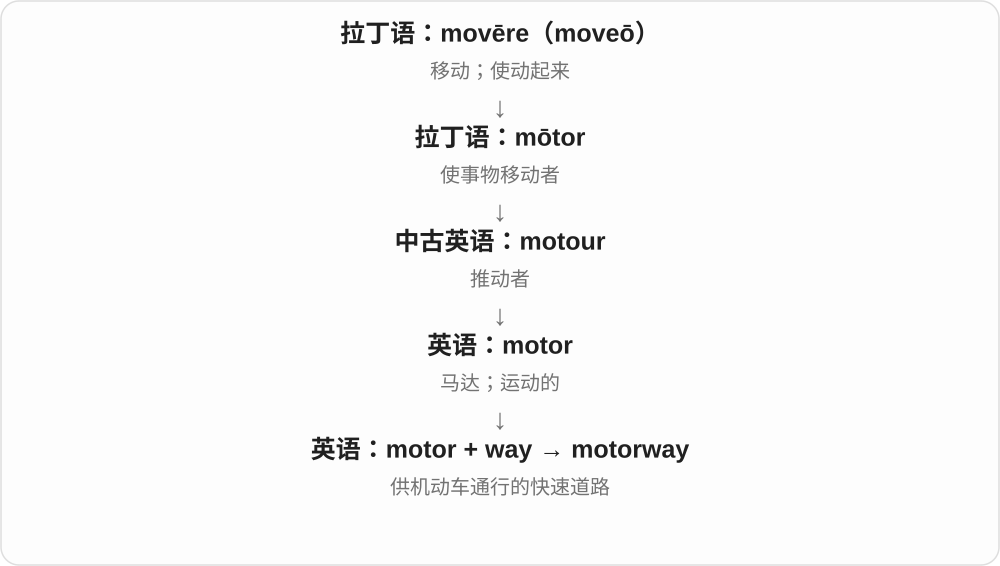
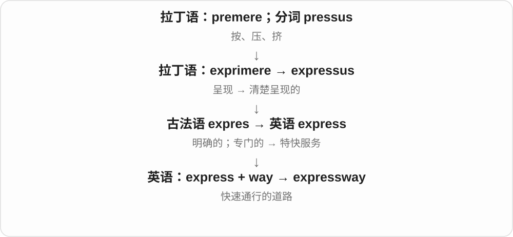

# 0047 · way — 路；方向；方式

[逐词精讲目录](../00_逐词精讲目录.md) · [总目录](../00_总目录_按常用程度.md)

## 核心词根与来源

way 是古英语 weġ 的后代。这个高频词既能说道路，也能说方式；各种交通与建筑词用前面的成分说明“什么东西走的路、通向哪里的路”。away、always 等又保留较早的表达演变。

**WAY：从这里到那里，也从问题走向解决**

一条真实的路可走到车站，一种做法则把人带到结果。

- **基础方向与程度**：way · away · anyway · always
- **走到哪里与偏移**：halfway · midway · partway · sideways · wayward
- **行程与进展**：underway · headway · leeway · wayside
- **道路与交通**：highway · railway · freeway · motorway · runway · taxiway
- **建筑中的通路**：gateway · hallway · doorway · entryway · passageway · archway
- **从短语变成词**：getaway · takeaway · throwaway · giveaway
- **way → ways：道路、方法与习惯**：way · ways
- **highway → highways：主要道路**：highway · highways
- **any way → anyway、anyways 的副词用法**：anyways
- **轨道的道路：railways**：railways
- **path 路 + way 路 → pathways**：pathways

## 词形与演化规律

合成词的两部分是并列材料：rail + way 不是 rail 历史上先变成 way。highway 的 high 指主要、重要的旧意；freeway 的 free 不保证免费。always 不是 all ways 的现代复数；wayward 接中古英语 aweiward。getaway、takeaway、throwaway 则由动词短语转成名词或形容词。

道路与行事方式的联系很早已存在，复数既可说多条路，也可说多种方法、习惯。

继承古英语合成词，high 的重要义不要求高架。

way 道路、方式与 any 组合，anyways 末尾接历史副词 -s；现代一般更随意，正式书面常见 anyway。

rail + way → railway，交通道路的具体命名；现代复数 railways 用于线路、系统，常见英式名称，对应美式 railroad 等搭配习惯。

pathway 是英语复合词，两个近义部分合成道路、通路名称。现代复数 -s，也比喻达成目标的途径、相互衔接的过程。

## 单词速览（按词族由简到繁）

同一基础词的相关扩展放在一起，先读基础形式，再读扩展；各组之间优先读常用的。具体词源关系见各词讲解。

| 单词 | 音标 | 核心意思 |
|---|---|---|
| [way](#w-1) | /weɪ/ | 路；方向；方法；习惯；程度很深地〔口语〕 |
| [ways](#w-63) | /weɪz/ | 方法、方式；道路、方向；习惯、作风；way 的复数 |
| [wayside](#w-27) | /ˈweɪsaɪd/ | 路边；路旁的 |
| [waypoint](#w-47) | /ˈweɪpɔɪnt/ | 航路点；路线上的定位点 |
| [away](#w-2) | /əˈweɪ/ | 离开；在别处；向远处；不断地 |
| [wayward](#w-61) | 英 /ˈweɪwəd/；美 /ˈweɪwərd/ | 任性的；不听管教的；偏离预期的 |
| [anyway](#w-3) | /ˈeniweɪ/ | 无论如何；反正；话说回来 |
| [anyways](#w-65) | 英 /ˈeniweɪz/；美 /ˈɛniweɪz/ | 不管怎样；反正；话说回来〔随意说法〕 |
| [highway](#w-4) | /ˈhaɪweɪ/ | 公路；干线公路 |
| [highways](#w-64) | /ˈhaɪweɪz/ | 公路、主要道路〔复数〕 |
| [railway](#w-5) | /ˈreɪlweɪ/ | 铁路；铁路系统 |
| [railways](#w-66) | 英 /ˈreɪlweɪz/；美 /ˈreɪlweɪz/ | 铁路，铁路线路或系统〔复数〕 |
| [halfway](#w-6) | 英 /ˌhɑːfˈweɪ/；美 /ˌhæfˈweɪ/ | 在半途；到一半；半途的 |
| [subway](#w-7) | 英、美 /ˈsʌbweɪ/ | 地铁〔美式〕；地下人行通道〔英式〕 |
| [runway](#w-8) | /ˈrʌnweɪ/ | 飞机跑道；时装走秀台 |
| [underway](#w-9) | 英 /ˌʌndəˈweɪ/；美 /ˌʌndərˈweɪ/ | 已经开始的；正在进行的 |
| [gateway](#w-10) | /ˈɡeɪtweɪ/ | 入口；门户；通往某处或目标的途径 |
| [pathway](#w-11) | 英 /ˈpɑːθweɪ/；美 /ˈpæθweɪ/ | 小径；途径；通路 |
| [pathways](#w-67) | 英 /ˈpɑːθweɪz/；美 /ˈpæθweɪz/ | 小路；通路；实现目标的途径〔复数〕 |
| [hallway](#w-12) | 英 /ˈhɔːlweɪ/；美 /ˈhɔːlweɪ/ | 走廊；门厅过道 |
| [midway](#w-13) | /ˌmɪdˈweɪ/ | 中途；中间位置 |
| [driveway](#w-14) | /ˈdraɪvweɪ/ | 私人车道；住宅通向街道的车道 |
| [freeway](#w-15) | /ˈfriːweɪ/ | 高速公路〔美式〕 |
| [doorway](#w-16) | 英 /ˈdɔːweɪ/；美 /ˈdɔːrweɪ/ | 门口；门洞 |
| [motorway](#w-17) | 英 /ˈməʊtəweɪ/；美 /ˈmoʊtərweɪ/ | 高速公路（英式） |
| [roadway](#w-18) | 英 /ˈrəʊdweɪ/；美 /ˈroʊdweɪ/ | 道路；行车路面 |
| [airway](#w-21) | 英 /ˈeəweɪ/；美 /ˈerweɪ/ | 气道；航路 |
| [waterway](#w-22) | 英 /ˈwɔːtəweɪ/；美 /ˈwɔːtərweɪ/ | 水路；航道 |
| [walkway](#w-23) | 英 /ˈwɔːkweɪ/；美 /ˈwɔːkweɪ/ | 步行通道；人行道 |
| [stairway](#w-24) | 英 /ˈsteəweɪ/；美 /ˈsterweɪ/ | 楼梯；楼梯通道 |
| [expressway](#w-25) | 英 /ɪkˈspresweɪ/；美 /ɪkˈspresweɪ/ | 快速公路；高速通行道路 |
| [headway](#w-26) | /ˈhedweɪ/ | 进展；前进 |
| [leeway](#w-28) | /ˈliːweɪ/ | 余地；可灵活调整的范围 |
| [fairway](#w-29) | 英 /ˈfeəweɪ/；美 /ˈferweɪ/ | 高尔夫球道；可航行水道 |
| [beltway](#w-30) | /ˈbeltweɪ/ | 环城公路；华盛顿政治圈〔比喻〕 |
| [passageway](#w-31) | 英 /ˈpæsɪdʒweɪ/；美 /ˈpæsɪdʒweɪ/ | 通道、走道 |
| [carriageway](#w-32) | 英 /ˈkærɪdʒweɪ/；美 /ˈkærɪdʒweɪ/ | 行车道；供车辆行驶的路面〔英式〕 |
| [alleyway](#w-36) | /ˈæliweɪ/ | 小巷；狭窄通道 |
| [archway](#w-38) | 英 /ˈɑːtʃweɪ/；美 /ˈɑːrtʃweɪ/ | 拱门；拱形通道 |
| [gangway](#w-42) | /ˈɡæŋweɪ/ | 船舷通道；舷梯；狭窄通道；让路！ |
| [entryway](#w-41) | /ˈentriweɪ/ | 入口通道；玄关〔美式〕 |
| [partway](#w-46) | 英 /ˌpɑːtˈweɪ/；美 /ˌpɑːrtˈweɪ/ | 走了一部分；进行到一部分 |
| [taxiway](#w-49) | /ˈtæksiweɪ/ | 飞机滑行道 |
| [always](#w-56) | /ˈɔːlweɪz/ | 总是；一直；无论何时都 |
| [giveaway](#w-57) | /ˈɡɪvəweɪ/ | 赠品；赠送活动；泄露真相的线索 |
| [sideways](#w-58) | /ˈsaɪdweɪz/ | 向侧面；侧着；横向的 |
| [getaway](#w-59) | /ˈɡetəweɪ/ | 逃离；逃跑；短途度假 |
| [takeaway](#w-60) | /ˈteɪkəweɪ/ | 外卖〔英式〕；要点、收获 |
| [throwaway](#w-62) | 英 /ˈθrəʊəweɪ/；美 /ˈθroʊəweɪ/ | 用后即弃的；随口说的；可丢弃物 |

## 逐词讲解

### 1. way — 路；方向；方法；习惯；程度很深地〔口语〕

**音标**：/weɪ/

**先抓住这个画面**

从这里到那里，有一条路；从问题到解决办法，也可以有一条“路”。

**怎么拆**

来自古英语 weġ，经中古英语 way／wey 延续。道路与方式的联系很早已存在，不把抽象义全说成现代才新造。

**怎么变成今天的意思**

**古英语 weġ → 中古英语 way／wey**  
道路、路线，也可说做事的方式

↓

**英语 way**  
路；方向；方法；习惯

the way home 是回家的路；a way to solve it 是解决方法；in a friendly way 是用友好的方式。口语 way too expensive 表贵得多、太贵，不再是具体道路。

**常见搭配与例句**

on the way；by the way；in a way；a way of doing；way too much。

> Can you show me the way to the station?

你能告诉我去车站的路吗？

> There must be a better way to explain this.

一定有更好的解释方法。

> This suitcase is way too heavy.

这个行李箱实在太重了。

**别混淆**

way 是名词时常说路线或方式；method 更侧重成套、有步骤的方法。in the way 是挡路，on the way 是在途中，介词不能随便换。

### 2. ways — 方法、方式；道路、方向；习惯、作风；way 的复数

**音标**：/weɪz/

**先抓住这个画面**

到目的地可以走不同的路，解决问题也可以走不同的路。ways 把实际路线和做事方法用同一个画面串起来。

**怎么拆**

way + -s，元音后读 /z/。way 接古英语 weg 道路、路线、行事方式等词；道路到方式的联系很早存在，现代复数按语境数路线、办法、习惯。

**怎么变成今天的意思**

**古英语 weg → way**  
路、路线；行事方式

↓

**way + -s → ways**  
多条路线、多种方法或习惯

different ways 不同方法；ways to improve 改进办法；ways of working 工作方式；in many ways 在许多方面；change your ways 改变行事习惯。

**常见搭配与例句**

two ways of doing it；in some ways。

> There are several ways to solve this problem.

这个问题有几种解决办法。

> In many ways, the smaller office works better for us.

从许多方面看，小办公室反而更适合我们。

**别混淆**

a way to do 与 a way of doing 都可表示做事方式。in many ways 是在许多方面，by the way 另是顺便说一句的固定结构。

### 3. wayside — 路边；路旁的

**音标**：/ˈweɪsaɪd/

**先抓住这个画面**

人沿路继续走，落下的东西却留在路边。

**怎么拆**

way（路）+ side（边），中古英语已有相应组合。比喻来自路边被留下的画面，而不是 side 自身表示失败。

**怎么变成今天的意思**

**英语 way；side**  
组合时的两个材料

↓

**way + side → wayside**  
路旁；比喻中被落下的位置

常见 fall by the wayside：半途放弃、未坚持或被忽略。a wayside inn 是路边旅店，较有书面或旅行叙述色彩。

**常见搭配与例句**

fall by the wayside；a wayside inn；wayside flowers。

> Several early ideas fell by the wayside as the project developed.

项目发展过程中，几个早期想法被搁置了。

> We stopped at a small wayside café.

我们在一家路边小咖啡馆停了下来。

**别混淆**

fall by the wayside 不必真摔倒：一个计划、习惯也能半途而废。wayward 则描述行为偏离，并不等于路旁。

### 4. waypoint — 航路点；路线上的定位点

**音标**：/ˈweɪpɔɪnt/

**先抓住这个画面**

不必一次只盯终点，在路线上先标几个“到这里再转”的点。

**怎么拆**

way（路线）+ point（点），组合为导航、行程规划中的路线定位点。

**怎么变成今天的意思**

**英语 way；point**  
组合时的两个材料

↓

**way + point → waypoint**  
路线中用于定位或规划的点

可用于徒步、航海、航空及游戏导航。一个 waypoint 可以只是坐标，并不一定有实物路牌，也不必在每个点停留。

**常见搭配与例句**

set a waypoint；reach a waypoint；a GPS waypoint。

> She added a waypoint near the river crossing.

她在过河处附近加了一个航路点。

> The navigation app displayed the next waypoint.

导航应用显示了下一个路线定位点。

**别混淆**

waypoint 是途中定位点，destination 是目的地；同一个点在某次行程中也可能担当终点，但词本身职责不同。

### 5. away — 离开；在别处；向远处；不断地

**音标**：/əˈweɪ/

**先抓住这个画面**

原先在这里的东西，朝外离开或已经不在身边。

**怎么拆**

接古英语 on weġ／āweġ，经中古英语 away 延续；早期结构相当于 on + way。a- 这里与 on 有关，不是否定前缀。

**怎么变成今天的意思**

**古英语 weġ → 中古英语 way／wey**  
道路、路线，也可说做事的方式

↓

**古英语 on weġ／āweġ → 中古英语 away**  
上路、离开

↓

**英语 away**  
离去；不在；向外远离

go away 是离开，be away 是不在。three miles away 说相距三英里，three days away 说还有三天。work away 还可说持续认真地工作。

**常见搭配与例句**

go away；far away；put away；right away。

> She is away until Monday.

她周一前都不在。

> Please put the tools away when you finish.

用完后请把工具收好。

**别混淆**

away 本身没有“扔掉”的固定动作，throw away 才由 throw 加出扔的行为；put away 常是收好，并非丢弃。

### 6. wayward — 任性的；不听管教的；偏离预期的

**音标**：英 /ˈweɪwəd/；美 /ˈweɪwərd/

**先抓住这个画面**

本该沿着线往前，却老是往旁边跑，叫人管不住。

**怎么拆**

来自中古英语 aweiward 缩短的 weiward，联系 away + -ward“朝离开方向”。不要按现代 way + ward“病房”拼出意义。

**怎么变成今天的意思**

**中古英语 aweiward → weiward**  
朝离开原方向的一边

↓

**英语 wayward**  
不听劝阻的；方向失控的

可形容孩子不听劝，也可说 a wayward shot 打偏的球。词通常带评价，但具体是轻微淘气还是严重行为问题要看语境。

**常见搭配与例句**

a wayward child；a wayward teenager；a wayward shot。

> The coach watched a wayward shot fly over the fence.

教练看着一脚踢偏的球飞过围栏。

> The novel follows the return of a wayward son.

小说讲述一个曾经不听管教的儿子归来的故事。

**别混淆**

wayward 强调偏离管束或预期，awkward 强调笨拙、尴尬或难处理；不能只看共同结尾就当近义词。

### 7. anyway — 无论如何；反正；话说回来

**音标**：/ˈeniweɪ/

**先抓住这个画面**

走哪条路都不影响这件事：不管前面那些情况怎样，后面这点仍成立。

**怎么拆**

any（任何）+ way（方式、路），由任一种方式的组合发展为转折、让步和转回话题的副词。

**怎么变成今天的意思**

**英语 any；way**  
组合时的两个材料

↓

**any + way → anyway**  
不论哪种情况；回到要说的事

It was raining, but we went anyway 是虽然下雨还是去了。Anyway, where were we? 则把谈话带回来。口语中也能略带不耐烦，语气要看上下文。

**常见搭配与例句**

do it anyway；thanks anyway；anyway, …。

> I was tired, but I went anyway.

我很累，但还是去了。

> Thanks anyway, even though you could not find it.

虽然你没找到，还是谢谢你。

**别混淆**

anyway 连写常是反正、总之；any way 分开是任何方法，如 Is there any way to help?。

### 8. anyways — 不管怎样；反正；话说回来〔随意说法〕

**音标**：英 /ˈeniweɪz/；美 /ˈɛniweɪz/

**先抓住这个画面**

说了一段岔开的话，Anyways... 可以把话题拉回来；讲完困难再说 I went anyways，是“反正我还是去了”。

**怎么拆**

有 any way、any ways 以任何方式的旧结构背景；末尾 -s 接历史副词属格材料，和 anyway 属同组现代用法。不是在数几个 anyway。

**怎么变成今天的意思**

**any + way：任何方式的旧副词表达**  
原是分写的短语，有 any ways 等形式

↓

**历史副词 -s → anyways**  
现代常用于不管怎样、转回话题，语体偏随意

Anyways, what happened next? 是话说回来，后来怎样；do it anyways 是反正还是做。

**常见搭配与例句**

Anyways, back to the plan.；do it anyways；go anyways。

> Anyways, what happened after the meeting?

话说回来，会议之后发生了什么？

> It was raining, but we went for a walk anyways.

当时在下雨，但我们还是去散步了。

**别混淆**

anyways 在一些随意口语、地区用法中自然；正式书写通常选 anyway。末尾 s 不是普通名词复数。

### 9. highway — 公路；干线公路

**音标**：/ˈhaɪweɪ/

**先抓住这个画面**

把许多小路接起来、承担主要通行任务的大路。

**怎么拆**

接古英语 hēahweġ，经中古英语延续；现代对应 high + way。high 在旧构词中有主要、重要的含义，不要求公路架得很高。

**怎么变成今天的意思**

**古英语 weġ → 中古英语 way／wey**  
道路、路线，也可说做事的方式

↓

**古英语 hēahweġ → 英语 highway**  
主要道路；公路

美式里 highway 很常见，可泛指主要公路；具体是否分隔、是否控制出入口，不由这个词单独决定。information highway 是信息高速通道的比喻。

**常见搭配与例句**

a major highway；the highway network；drive along the highway。

> The highway connects the coast with the capital.

这条公路连接海岸与首都。

> Heavy snow closed the main highway through the mountains.

大雪封闭了穿越山区的主要公路。

**别混淆**

highway 不必等于全封闭高速公路；freeway、motorway 通常指更具体的道路类型。highway 的 high 也不是道路海拔。

### 10. highways — 公路、主要道路〔复数〕

**音标**：/ˈhaɪweɪz/

**先抓住这个画面**

连接地方、让人和车辆走长段路的主要道路，可以叫 highways。high 在老构词里强调主要，不要求道路真的架得高。

**怎么拆**

highway 接古英语 heahweg，现代可认 high + way；这个合成不是现代才造。末尾是元音后 y，直接加 -s，不改成 ies，尾 /z/。

**怎么变成今天的意思**

**古英语 heahweg → 中古英语、现代 highway**  
主要的路 → 公路

↓

**highway + -s → highways**  
多条主要道路、公路

major highways 主要公路；highways linking towns 连接城镇的公路；busy highways 繁忙公路。

**常见搭配与例句**

maps of the highways 公路地图；highways through the hills 穿过丘陵的公路。

> The map shows the main highways across the island.

地图标出了横穿岛屿的主要公路。

> Several highways connect the towns along the coast.

几条公路连接着沿海城镇。

**别混淆**

highways 在不同地区的具体道路分类不完全相同，不能只凭这个普通词就断定一定是封闭式高速公路。

### 11. railway — 铁路；铁路系统

**音标**：/ˈreɪlweɪ/

**先抓住这个画面**

把车轮的行进固定在两条轨道上，形成列车走的路。

**怎么拆**

rail（轨道）+ way（路）；英语组合词。早期轨道运输到现代铁路有技术发展，不能把古典材料的年代当成现代铁路诞生时间。

**怎么变成今天的意思**

**英语 rail；way**  
组合时的两个材料

↓

**rail + way → railway**  
轨道上的运输路线与系统

英式常用 railway station、railway line；美式常用 railroad，对站名也常说 train station。a railway 可指线路或经营相应运输的系统。

**常见搭配与例句**

a railway station；a railway line；the railway network。

> The new railway links three major cities.

新铁路连接三座大城市。

> We live near the railway station.

我们住在火车站附近。

**别混淆**

railway 是整条铁路或系统，rail 是轨道构件或铁路运输的简称。railway 不是所有装有栏杆的路。

### 12. railways — 铁路，铁路线路或系统〔复数〕

**音标**：英 /ˈreɪlweɪz/；美 /ˈreɪlweɪz/

**先抓住这个画面**

沿轨道运行的道路，是 railway；几条线路、几个地区的铁路系统，可以说 railways。名字把结构直接摆在眼前。

**怎么拆**

rail 轨条 + way 道路 → railway；railway + -s → railways。末尾是元音字母 + y，保留 y 加 s，读 /z/。

**怎么变成今天的意思**

**rail 轨条 + way 道路 → railway**  
较早用于铺轨运输道路，后来用于现代铁路

↓

**railway + -s → railways**  
整个复合词变复数，词尾 /z/

national railways 是全国铁路系统等；mountain railways 是山区铁路；the history of railways 是铁路发展史。

**常见搭配与例句**

mountain railways；national railways；the history of railways。

> The museum tells the history of railways.

博物馆介绍了铁路的发展史。

> Mountain railways connect several towns in the story.

故事里的山区铁路连接着几个城镇。

**别混淆**

railway 在英式等语境常见，美式常见 railroad；现代两者也有交叉，读具体机构名、线路介绍时沿用实际名称。

### 13. halfway — 在半途；到一半；半途的

**音标**：英 /ˌhɑːfˈweɪ/；美 /ˌhæfˈweɪ/

**先抓住这个画面**

从起点到终点画一条线，走到中间那一带。

**怎么拆**

接古英语 healfweġ 与中古英语 halfwey；现代对应 half + way。half 说一半，way 说走过的路或进程。

**怎么变成今天的意思**

**古英语 weġ → 中古英语 way／wey**  
道路、路线，也可说做事的方式

↓

**古英语 healfweġ → 英语 halfway**  
一半路程；过程进行到一半

halfway home 是回家半路上；halfway through a book 是书读到一半。meet someone halfway 可比喻双方各让一点。

**常见搭配与例句**

halfway through；halfway between；meet someone halfway。

> We stopped for lunch halfway home.

回家半路上，我们停下来吃午饭。

> I will compromise if you meet me halfway.

如果你也让一步，我愿意折中。

**别混淆**

halfway 常突出一半或折中，partway 只说一部分，不必恰好到中点。

### 14. subway — 地铁〔美式〕；地下人行通道〔英式〕

**音标**：英、美 /ˈsʌbweɪ/

**先抓住这个画面**

从地面下面穿过去的一条路；美国常让列车跑，英国这个词常让行人走。

**怎么拆**

英语 sub- + way“道路”，先有地下通路义，再发展出地下铁路义。

**怎么变成今天的意思**

**拉丁语：sub**  
在下面；从下向上；靠近

↓

**英语前缀：sub-**  
下方；下一级；低于某个标准

↓

**英语：sub- + way → subway**  
地下通路；地下铁路系统

在纽约 take the subway 是乘地铁；英国街上的 pedestrian subway 是地下人行通道。现代地铁线路也可能有地面或高架区段。

**常见搭配与例句**

take the subway；a subway station；a pedestrian subway。

> We took the subway to the museum.

我们乘地铁去了博物馆。

> A pedestrian subway connects the two sides of the road.

一条地下人行通道连接道路两侧。

**别混淆**

英国常用 underground 或当地系统名称称地铁；tunnel 只是隧道，不指定用途。

### 15. runway — 飞机跑道；时装走秀台

**音标**：/ˈrʌnweɪ/

**先抓住这个画面**

留出一条长通道，让飞机加速起飞，也让模特沿着展示服装。

**怎么拆**

run（跑、行进）+ way（通道）；较早有动物行经的路等用法，后来用于人工跑道、航空和时装展示。

**怎么变成今天的意思**

**英语 run；way**  
组合时的两个材料

↓

**run + way → runway**  
供行进、起降或展示的长条通道

航空 runway 是飞机起飞、降落的跑道；时装 show 的 runway 是伸展台。商业语境 cash runway 还比喻现有现金能撑多久。

**常见搭配与例句**

on the runway；a runway show；cash runway。

> The aircraft waited at the end of the runway.

飞机在跑道尽头等待。

> The model stepped onto the runway in a silver coat.

模特穿着银色外套走上伸展台。

**别混淆**

taxiway 是飞机在地面滑行时使用的连接通道，runway 负责起降，功能不同。

### 16. underway — 已经开始的；正在进行的

**音标**：英 /ˌʌndəˈweɪ/；美 /ˌʌndərˈweɪ/

**先抓住这个画面**

船已经离开原先固定停泊的状态；后来计划也像启程一样运转起来。

**怎么拆**

对应 under + way，形成受到荷兰语 onderweg 等用法的影响；常由航行状态扩展为进行中。under 不能死译成道路下面。

**怎么变成今天的意思**

**under + way；与荷兰语 onderweg 的用法相关**  
在途中、已起程的表达

↓

**英语 underway**  
航行状态；工作等正在进行

The repairs are underway 是维修已开始。get underway 是启动、展开。航海里的 underway 有专门界定，不等于船此刻一定在相对地面前进；日常无需靠这一术语推断船速。

**常见搭配与例句**

be underway；get underway；well underway。

> Preparations for the festival are already underway.

节日的准备工作已经开始了。

> The meeting got underway shortly after nine.

会议九点刚过就开始了。

**别混淆**

underway 说事情进行着，on the way 常说人或物在途中。We are on the way 与 The investigation is underway 的主语类型不同。

### 17. gateway — 入口；门户；通往某处或目标的途径

**音标**：/ˈɡeɪtweɪ/

**先抓住这个画面**

不只是一个地方的门，更是从这里开始能进入另一个区域的关口。

**怎么拆**

gate（门、关口）+ way（通路）。先说可供通过的入口，再可比喻进入更大世界或系统的途径。

**怎么变成今天的意思**

**英语 gate；way**  
组合时的两个材料

↓

**gate + way → gateway**  
出入口；进入另一领域的门户

a gateway to the mountains 可说进山门户；a gateway to opportunity 说获得机会的途径。计算机 gateway 是系统或网络间的连接点，不靠字面推出具体协议。

**常见搭配与例句**

a gateway to；an airport gateway；a network gateway。

> The town is a gateway to the national park.

这座小镇是进入国家公园的门户。

> The course offers a gateway to further study.

这门课为进一步学习提供了入门途径。

**别混淆**

doorway 更具体说门洞，gateway 可说较大区域的出入口或抽象入口。gateway 不保证后面一定是好事，需看其连接的对象。

### 18. pathway — 小径；途径；通路

**音标**：英 /ˈpɑːθweɪ/；美 /ˈpæθweɪ/

**先抓住这个画面**

沿着一个个相接的步骤往前，可以走到某地，也可以达到某个结果。

**怎么拆**

path（小路、途径）+ way，中古英语已有 pathwei。两部分共同强化通行路线，不能把 path 说成 way 的历史后代。

**怎么变成今天的意思**

**英语 path；way**  
组合时的两个材料

↓

**path + way → pathway**  
可行走的小路；达到结果的一条通路

日常可指花园步道；a pathway to a career 是进入职业的途径。生物学 metabolic pathway 说一系列相关反应，不是一条能看见的细小管道。

**常见搭配与例句**

a garden pathway；a pathway to success；a metabolic pathway。

> A narrow pathway leads down to the lake.

一条狭窄小径通向湖边。

> The programme creates a pathway into skilled employment.

这个项目为人们进入技能型岗位开辟途径。

**别混淆**

pathway 常强调具体路线或相连步骤；goal 是目的地或目标，途径与目标不是一回事。

### 19. pathways — 小路；通路；实现目标的途径〔复数〕

**音标**：英 /ˈpɑːθweɪz/；美 /ˈpæθweɪz/

**先抓住这个画面**

一条能从这里走到那里的路，是 pathway。把位置换成人生目标、学习目标，pathways 就成了能够一步步通向目标的途径。

**怎么拆**

path 路 + way 路、方向 → pathway，加 -s → pathways。两个近义部分在英语中组成复合词，今天整体可说实体道路或抽象通路。

**怎么变成今天的意思**

**英语 path + way → pathway 道路**  
近义部分结合成一个整体名称

↓

**道路形象扩展为相连的过程、发展途径 → pathways**  
现代具体、抽象用法均常见

garden pathways 是花园小路；career pathways 是职业发展路径；pathways to learning 是学习、获得知识的途径。

**常见搭配与例句**

garden pathways；career pathways；pathways to。

> Narrow pathways connect the different parts of the garden.

狭窄的小路连接着花园的各个部分。

> The course introduces several pathways into a design career.

这门课介绍了进入设计行业的几条途径。

**别混淆**

pathways 强调可以怎样一步步通往某处，goals 强调想抵达的目标。几个人可以有相同目标，却走不同 pathways。

### 20. hallway — 走廊；门厅过道

**音标**：英 /ˈhɔːlweɪ/；美 /ˈhɔːlweɪ/

**先抓住这个画面**

在建筑物里，从一个房间去另一个房间经过的长条空间。

**怎么拆**

hall（大厅、门厅或过道）+ way（通道）。这里是建筑物内部的通行空间。

**怎么变成今天的意思**

**英语 hall；way**  
组合时的两个材料

↓

**hall + way → hallway**  
室内过道、走廊

常见于住宅、学校、办公楼。美式 hallway 很常用，corridor 也可指较长、正式建筑中的走廊；具体用词有地区习惯。

**常见搭配与例句**

in the hallway；down the hallway；a narrow hallway。

> Please leave your shoes in the hallway.

请把鞋留在门厅过道。

> Her office is at the end of the hallway.

她的办公室在走廊尽头。

**别混淆**

hallway 是通行空间，hall 可是大厅、会堂或门厅。The concert is in the hall 不表示演出在狭窄走廊里。

### 21. midway — 中途；中间位置

**音标**：/ˌmɪdˈweɪ/

**先抓住这个画面**

把注意力放在一段行程、过程或两点之间的中部。

**怎么拆**

由古英语 midweġ 经中古英语相应形式延续；mid- 表中间，way 表路线。本条先讲常用的中途义。

**怎么变成今天的意思**

**古英语 weġ → 中古英语 way／wey**  
道路、路线，也可说做事的方式

↓

**古英语 midweġ → 英语 midway**  
在路程或过程的中间

midway through the meeting 是会议进行到中途；midway between A and B 说位置或性质处在二者之间。美国英语名词 midway 另可指游乐场的游艺摊位区，用法和重音需按语境看。

**常见搭配与例句**

midway through；midway between；stop midway。

> The lights went out midway through the film.

电影放到中途时停电了。

> The village lies midway between the two cities.

村子位于两座城市中间。

**别混淆**

midway 和 halfway 都可说中途；halfway 更直观地强调一半。midway 不必暗示精确测量后的正好 50%。

### 22. driveway — 私人车道；住宅通向街道的车道

**音标**：/ˈdraɪvweɪ/

**先抓住这个画面**

车从公共街道拐进去，沿一小段路开到房屋或车库前。

**怎么拆**

drive（驾车）+ way（路），说供车辆进出私人房产的一段通路。

**怎么变成今天的意思**

**英语 drive；way**  
组合时的两个材料

↓

**drive + way → driveway**  
通向房屋或车库的车道

park in the driveway 常是把车停在自家房子前的车道上。driveway 可有长有短，不由词本身决定产权、路面材料或停车规定。

**常见搭配与例句**

in the driveway；a shared driveway；a gravel driveway。

> He backed the car out of the driveway.

他把车从私人车道倒了出来。

> Two bicycles were lying across the driveway.

两辆自行车横在通往房子的车道上。

**别混淆**

driveway 是进出房屋的车道；freeway 是主要交通道路。尽管都是 way，它们的尺度和用途不同。

### 23. freeway — 高速公路〔美式〕

**音标**：/ˈfriːweɪ/

**先抓住这个画面**

主要车流持续前行，车辆通过专门出入口进入或离开。

**怎么拆**

free + way，二十世纪道路命名。free 关注通行与出入口管理相关的道路概念，不足以推断一定免收费。

**怎么变成今天的意思**

**英语 free；way**  
组合时的两个材料

↓

**free + way → freeway**  
专门控制出入口的主要快速道路

主要用于美式英语。进入、离开 freeway 通常走相应匝道；词本身不承诺永远畅通，也不说明每个具体路段是否收费。

**常见搭配与例句**

a freeway exit；on the freeway；freeway traffic。

> Take the next freeway exit.

从下一个高速公路出口驶出。

> The freeway was crowded during the evening commute.

晚高峰时高速公路上很拥挤。

**别混淆**

freeway 的 free 不能简单等同于价格为零；motorway 是英式常见的相应道路称呼，highway 范围通常更宽。

### 24. doorway — 门口；门洞

**音标**：英 /ˈdɔːweɪ/；美 /ˈdɔːrweɪ/

**先抓住这个画面**

门板可以开或关，doorway 指供人穿过去的那个开口。

**怎么拆**

door（门）+ way（通道），指门所在的通行开口及附近位置。

**怎么变成今天的意思**

**英语 door；way**  
组合时的两个材料

↓

**door + way → doorway**  
可穿过的门洞、门口

stand in the doorway 是站在门口；门板被拆掉后 doorway 仍然存在。也能比喻通往某种机会的入口。

**常见搭配与例句**

in the doorway；through the doorway；a narrow doorway。

> She stood in the doorway and waved.

她站在门口挥手。

> The sofa would not fit through the doorway.

沙发过不了这个门洞。

**别混淆**

door 多指门这个装置或门扇，doorway 侧重门洞与门口位置。close the doorway 不如 close the door 自然。

### 25. motorway — 高速公路（英式）

**音标**：英 /ˈməʊtəweɪ/；美 /ˈmoʊtərweɪ/

**先抓住这个画面**

motorway 是供机动车快速通行的一类道路，画面重点是车流与一般街道分开组织。

**怎么拆**

motor + way（道路）。

**怎么变成今天的意思**

这是英式常用名称；不同地区具体道路标准和名称不同，不能只靠词根判断交通规则。

**常见搭配与例句**

join the motorway；a motorway junction；motorway traffic。

> We left the motorway at the next junction.

我们在下一个出口驶离了高速公路。

> Motorway traffic was heavy that evening.

那天晚上高速公路车流很大。

**别混淆**

road 范围最广；motorway 是特定道路类型。美式常见 freeway 或 expressway。

### 26. roadway — 道路；行车路面

**音标**：英 /ˈrəʊdweɪ/；美 /ˈroʊdweɪ/

**先抓住这个画面**

把道路当作能承载车辆通行的那条路面来看。

**怎么拆**

road（道路）+ way（通路）。早期 road 还关联骑行等义；此处只用有把握的组合关系，不假装现代所有工程定义都来自一个旧释义。

**怎么变成今天的意思**

**英语 road；way**  
组合时的两个材料

↓

**road + way → roadway**  
供通行、尤供车辆行驶的路面

新闻里 debris on the roadway 说路面上的碎片。工程文献有具体范围定义，普通阅读先抓住车辆行经部分，不把它等于整条道路的所有附属设施。

**常见搭配与例句**

the roadway surface；block the roadway；debris on the roadway。

> Fallen branches blocked the roadway.

落下的树枝堵住了路面。

> Workers repaired cracks in the roadway.

工人修补了行车路面的裂缝。

**别混淆**

roadway 关注路面和通行部分，sidewalk 是行人便道；一条 road 可包含不同组成部分。

### 27. airway — 气道；航路

**音标**：英 /ˈeəweɪ/；美 /ˈerweɪ/

**先抓住这个画面**

给空气留一条路，是身体气道；给飞机规划一条路，是空中航路。

**怎么拆**

air + way 路径；根据 air 指空气还是航空，形成两类常见含义。

**怎么变成今天的意思**

**希腊 aer，属格 aeros**  
空气

↓

**拉丁 aer → 法语 air → 英语 air**  
空气

↓

**air + way → airway**  
空气通过的路径；飞机航行的路线

the upper airway 在身体语境指上气道；a busy airway 在航空语境指繁忙航路。Airways 也常出现在航空公司名称中，这时是公司的名字部分，不要按器官理解。

**常见搭配与例句**

the upper airway；airway obstruction；an airway route；Airways〔公司名中〕。

> The diagram shows the upper airway.

图中展示了上气道。

> The aircraft joined a busy airway over the coast.

飞机在海岸上空进入了一条繁忙航路。

**别混淆**

airway 是供空气或飞机通过的路，airline 通常是航空公司。二者有关联，但不是同义替换。

### 28. waterway — 水路；航道

**音标**：英 /ˈwɔːtəweɪ/；美 /ˈwɔːtərweɪ/

**先抓住这个画面**

把河流、运河当作船和货物能够走的“路”。

**怎么拆**

接古英语 wæterweġ 与中古英语 waterwey；对应 water + way，不是近代才首次把水和路线联系起来。

**怎么变成今天的意思**

**古英语 weġ → 中古英语 way／wey**  
道路、路线，也可说做事的方式

↓

**古英语 wæterweġ → 英语 waterway**  
水上可通行的路线

常指供航运使用的河流、运河等路线，也可泛说水道；具体是否天然、是否通航，要看上下文。

**常见搭配与例句**

an inland waterway；a navigable waterway；a network of waterways。

> The canal is an important inland waterway.

这条运河是一条重要内河航道。

> Barges carry goods along the waterway.

驳船沿着水路运输货物。

**别混淆**

waterway 不是每一根自来水管；pipeline 说管线，waterway 多以路线、河道或航行为观察角度。

### 29. walkway — 步行通道；人行道

**音标**：英 /ˈwɔːkweɪ/；美 /ˈwɔːkweɪ/

**先抓住这个画面**

从车流或其他区域里单独留出一条让人走过去的通道。

**怎么拆**

walk（步行）+ way（通道）。可以在地面、高处或建筑内部，不能由词名推断一定在街边。

**怎么变成今天的意思**

**英语 walk；way**  
组合时的两个材料

↓

**walk + way → walkway**  
专供步行的通道

机场 moving walkway 是自动步道；covered walkway 是有顶步行通道。walkway 不必只是一条露天人行道。

**常见搭配与例句**

a covered walkway；a pedestrian walkway；a moving walkway。

> A covered walkway connects the two buildings.

一条有顶步行通道连接两栋楼。

> Please keep the walkway clear.

请保持步行通道畅通。

**别混淆**

sidewalk 通常指道路边的人行道；walkway 更宽泛，连接两栋建筑的步行桥也能这样叫。

### 30. stairway — 楼梯；楼梯通道

**音标**：英 /ˈsteəweɪ/；美 /ˈsterweɪ/

**先抓住这个画面**

向上走时脚下一级一级的台阶，合起来是一条上下楼的通道。

**怎么拆**

stair（台阶、楼梯）+ way（通道），组合描述供上下通行的一段楼梯。

**怎么变成今天的意思**

**英语 stair；way**  
组合时的两个材料

↓

**stair + way → stairway**  
由台阶形成的上下通道

常可与 staircase 近义，强调由楼梯提供的通行路线。fire stairway 是消防疏散楼梯一类搭配，但具体用途须看建筑说明。

**常见搭配与例句**

a narrow stairway；up the stairway；at the foot of the stairway。

> A wooden stairway leads to the attic.

一道木楼梯通向阁楼。

> She waited at the foot of the stairway.

她在楼梯底下等着。

**别混淆**

stairway 是楼梯通路；stairwell 是容纳楼梯的竖向空间，两词常相关但观察对象不同。

### 31. expressway — 快速公路；高速通行道路

**音标**：英 /ɪkˈspresweɪ/；美 /ɪkˈspresweɪ/

**先抓住这个画面**

减少普通街道上的频繁停停走走，让车流更直接地通过。

**怎么拆**

express 快速、直达 + way 道路，是英语复合词。

**怎么变成今天的意思**

常见于北美、亚洲等地的道路名称。具体是否完全封闭、出入口如何设计，要看当地道路制度。

**常见搭配与例句**

an elevated expressway；take the expressway。

> We took the expressway to avoid the city centre.

我们走快速公路，绕开了市中心。

> Traffic slowed on the expressway during the evening rush.

晚高峰时，快速公路上的车流慢了下来。

**别混淆**

expressway、freeway、motorway 在不同地区的命名不完全一一对应，不能只靠汉译判断道路标准。

### 32. headway — 进展；前进

**音标**：/ˈhedweɪ/

**先抓住这个画面**

原先卡在原地，如今终于向前挪出了一点距离。

**怎么拆**

现代前进义联系航海 ahead-way 的缩短；旧路名用法还有古英语 hēafodweġ“主路”一支。两路材料不应硬编成单一的词义先后链。

**怎么变成今天的意思**

**两条相关材料：旧 hēafodweġ；航海 ahead-way**  
主路；向前的行进

↓

**英语 headway 的常用义**  
前进 → 事情取得进展

make headway 是取得进展，常接 with、on、in。make little headway 说虽在努力，但推进不大。通常不可数，不说 a headway 来表示一次进步。

**常见搭配与例句**

make headway；little headway；headway in negotiations。

> We are finally making headway with the repairs.

维修工作终于有进展了。

> The talks made little headway on the main issue.

谈判在主要问题上进展不大。

**别混淆**

headway 关注前进多少，headache 是头痛或麻烦；head 在这个词里也不要求真的有人头在移动。

### 33. leeway — 余地；可灵活调整的范围

**音标**：/ˈliːweɪ/

**先抓住这个画面**

不把时间、规则或预算卡得一丝不剩，留一点可以偏移、缓冲的空间。

**怎么拆**

lee（下风或背风的一侧）+ way；航海中涉及受风造成的侧向漂移，后来转为允许偏差或行动余地。不是“背风舒服”直接变成宽容。

**怎么变成今天的意思**

**英语 lee；way**  
下风一侧；行进

↓

**航海 leeway**  
船只受风等造成的侧向偏移

↓

**抽象 leeway**  
允许偏差、选择或调整的空间

give someone leeway 是给对方自由裁量余地；allow some leeway in the schedule 是给日程留缓冲。不是随意违反所有约束。

**常见搭配与例句**

give someone leeway；some leeway；leeway in the budget。

> The schedule leaves little leeway for delays.

这份日程几乎没给延误留下余地。

> The manager gave us leeway to choose our own approach.

经理让我们有余地自行选择做法。

**别混淆**

leeway 偏可容许的偏差或自由，delay 是已发生的延误；预留 leeway 可用来应对 delay。

### 34. fairway — 高尔夫球道；可航行水道

**音标**：英 /ˈfeəweɪ/；美 /ˈferweɪ/

**先抓住这个画面**

在一大片区域里，有一条更适合通行或推进的带状路线。

**怎么拆**

fair（畅通、适宜等旧义）+ way，先有可通行航道等用法，后用于高尔夫的球道。fair 不能只按公平来翻译。

**怎么变成今天的意思**

**英语 fair；way**  
组合时的两个材料

↓

**fair + way → fairway**  
适宜通行的水道；高尔夫球道

高尔夫球场上通常说开球区与果岭间修整良好的球道区域；不是整座球场，也不是最后推杆的果岭。航运文本仍可指航道。

**常见搭配与例句**

hit the fairway；a narrow fairway；the navigable fairway。

> Her drive landed in the middle of the fairway.

她开出的球落在球道中央。

> The chart marks the fairway through the shallow water.

海图标出了穿越浅水区的航道。

**别混淆**

fairway 是球道，green 是果岭，rough 是长草区；同属球场但用途不同。

### 35. beltway — 环城公路；华盛顿政治圈〔比喻〕

**音标**：/ˈbeltweɪ/

**先抓住这个画面**

公路像腰带一样绕着城市，后来这条圈也代表圈内的政治世界。

**怎么拆**

belt（带、环带）+ way（道路）。美国首都周边的 Capital Beltway 又使 inside the Beltway 形成政治圈内的比喻。

**怎么变成今天的意思**

**英语 belt；way**  
组合时的两个材料

↓

**belt + way → beltway**  
围绕城市的道路；特定语境的政治圈

普通小写可说环城路；the Beltway 在美国新闻里常指华盛顿周边环路或联邦政治圈。词义取决于具体城市和话题。

**常见搭配与例句**

the outer beltway；inside the Beltway；Beltway politics。

> Traffic on the beltway was moving slowly.

环城公路上的车流很慢。

> The debate attracted attention far beyond the Beltway.

这场争论引起的关注远远超出了华盛顿政治圈。

**别混淆**

beltway 是城市周边环路这一类型，不等于所有 motorway。政治比喻也不能任意套在每个城市的环路上。

### 36. passageway — 通道、走道

**音标**：英 /ˈpæsɪdʒweɪ/；美 /ˈpæsɪdʒweɪ/

**先抓住这个画面**

两个地方之间，专门留给人通过的一条空间。

**怎么拆**

passage 通道 + way 路；passage 经法语接 passer“通过”，现代英语再合成 passageway。

**怎么变成今天的意思**

**拉丁 passus**  
一步、步幅

↓

**通俗拉丁 \*passare → 古法语 passer → 英语 pass**  
迈步 → 经过、通过

↓

**法语 passage → 英语 passage；passage + way → passageway**  
通过的地方 → 通道、走道

可以是建筑里的窄走道、两个房间间的连接，也可以是地下的通道。这个词把 passage 的空间义说得很明确，不会像 a passage 那样还容易被理解成文章段落。

**常见搭配与例句**

a narrow passageway；a hidden passageway；a passageway between；lead through a passageway。

> A narrow passageway connected the kitchen to the courtyard.

一条窄通道把厨房与院子连接起来。

> They discovered a hidden passageway behind the bookcase.

他们在书柜后面发现了一条隐藏通道。

**别混淆**

passage 能指段落、通行、时间流逝等，passageway 主要指实体通道。corridor 更常指建筑内部走廊。

### 37. carriageway — 行车道；供车辆行驶的路面〔英式〕

**音标**：英 /ˈkærɪdʒweɪ/；美 /ˈkærɪdʒweɪ/

**先抓住这个画面**

把路上给车辆走的部分，与行人走的部分分开看。

**怎么拆**

carriage（车辆、运载相关名词）+ way。今天不只给马车使用，随着车辆种类变化延伸到一般行车路面。

**怎么变成今天的意思**

**英语 carriage；way**  
组合时的两个材料

↓

**carriage + way → carriageway**  
道路供车辆行驶的部分

英式 dual carriageway 指两个方向的行车部分分隔开的道路；一个方向可有多条车道。single carriageway 是未这样分隔的行车路面。

**常见搭配与例句**

a dual carriageway；a single carriageway；the opposite carriageway。

> The accident blocked one carriageway.

事故堵住了一个方向的行车道。

> The road becomes a dual carriageway beyond the bridge.

过桥后这条路变成双向分隔道路。

**别混淆**

carriageway 与 lane 不同：同一 carriageway 可包含多条 lanes，dual carriageway 不是“整条路总共两条车道”。

### 38. alleyway — 小巷；狭窄通道

**音标**：/ˈæliweɪ/

**先抓住这个画面**

两排房屋或建筑之间，一条不太宽、可以穿过去的小路。

**怎么拆**

alley（巷、小道）+ way（通路）。是两个现有词的组合，不把 -way 当作表示大小的后缀。

**怎么变成今天的意思**

**英语 alley；way**  
组合时的两个材料

↓

**alley + way → alleyway**  
建筑之间的小巷、通道

多用于城镇建筑之间的窄路；往往与 alley 近义。是否可行车、是否私有由现场情况决定。

**常见搭配与例句**

a narrow alleyway；down an alleyway；an alleyway behind the shops。

> We found a café down a narrow alleyway.

我们在一条窄巷深处找到一家咖啡馆。

> The alleyway runs behind the row of shops.

小巷从这一排商店后面穿过。

**别混淆**

alleyway 与 hallway 的区别主要在场所：前者常在室外建筑之间，后者是室内过道。

### 39. archway — 拱门；拱形通道

**音标**：英 /ˈɑːtʃweɪ/；美 /ˈɑːrtʃweɪ/

**先抓住这个画面**

头顶弯成一道弧线，下方留出人能穿过的开口。

**怎么拆**

arch（拱）+ way（通道）。名称同时指出拱形结构和可通过的空间。

**怎么变成今天的意思**

**英语 arch；way**  
组合时的两个材料

↓

**arch + way → archway**  
拱下可穿过的开口、通道

walk through an archway 是穿过拱门；建筑装饰拱若下方根本不能通行，通常只需说 arch。

**常见搭配与例句**

a stone archway；through the archway；beneath an archway。

> A stone archway leads into the courtyard.

一道石拱门通向院子。

> They paused beneath the old archway.

他们在旧拱门下停了片刻。

**别混淆**

arch 是拱这个结构，archway 是形成通路的拱形开口；不把每条弧线都叫 archway。

### 40. gangway — 船舷通道；舷梯；狭窄通道；让路！

**音标**：/ˈɡæŋweɪ/

**先抓住这个画面**

船与岸之间架起一条窄道，让人排着队上船。

**怎么拆**

接古英语 gangweġ，gang 在旧材料里指行走，way 指通道；不是现代 gang“帮派”拥有的道路。

**怎么变成今天的意思**

**古英语 weġ → 中古英语 way／wey**  
道路、路线，也可说做事的方式

↓

**古英语 gangweġ → 中古英语 gangway**  
行走、通行的道路

↓

**英语 gangway**  
上船通道；狭窄通路；让路的喊声

船上常指登船通道或舷梯，也可指某些交通工具、场所里的窄通道。Gangway! 是让路的喊法，语气直接。

**常见搭配与例句**

up the gangway；a narrow gangway；Gangway!。

> Passengers walked up the gangway onto the ferry.

乘客沿登船通道走上渡轮。

> Keep the gangway clear for people carrying luggage.

请保持通道畅通，方便携带行李的人通过。

**别混淆**

gangway 的 gang 与行走的旧材料有关，不能由现代黑帮义编故事。runway 则主要是飞机跑道或时装走台。

### 41. entryway — 入口通道；玄关〔美式〕

**音标**：/ˈentriweɪ/

**先抓住这个画面**

刚跨进门，还没到主要房间，先经过的那片入口空间。

**怎么拆**

entry（进入、入口）+ way（通道）。英语现有词组合，既可指入口通行部分，也可指门内的入口区域。

**怎么变成今天的意思**

**英语 entry；way**  
组合时的两个材料

↓

**entry + way → entryway**  
进出的通道或入口区域

住宅语境常指玄关，可以放鞋、外套。与 doorway 的门洞相比，entryway 可能是一小片区域，不只门框内的一条线。

**常见搭配与例句**

a small entryway；entryway storage；near the entryway。

> There is a bench in the entryway.

玄关里有一张长凳。

> They added a lamp to brighten the entryway.

他们添了一盏灯，让入口区域更亮。

**别混淆**

entryway 强调入内空间；entry 还可说参赛作品、登记条目，这些义项不能全部带进 entryway。

### 42. partway — 走了一部分；进行到一部分

**音标**：英 /ˌpɑːtˈweɪ/；美 /ˌpɑːrtˈweɪ/

**先抓住这个画面**

还没到终点，但已经走出去一截；这一截不一定占一半。

**怎么拆**

part（一部分）+ way（路程、进程）。组合后常作副词，说明只完成某段。

**怎么变成今天的意思**

**英语 part；way**  
组合时的两个材料

↓

**part + way → partway**  
在路程或进程的一部分处

partway through a task 是任务做到一部分；partway up the hill 是爬到山坡半途某处，不给出精确比例。也见分开写 part way。

**常见搭配与例句**

partway through；partway up；come partway。

> I changed my mind partway through the application.

申请填到一部分时，我改变了主意。

> We walked partway up the hill before turning back.

我们爬上山坡一段后就返回了。

**别混淆**

partway 不等于 halfway 的严格“一半”。只知道读了一部分书，用 partway 不会额外暗示已读到中间。

### 43. taxiway — 飞机滑行道

**音标**：/ˈtæksiweɪ/

**先抓住这个画面**

飞机还没起飞，先靠轮子在机场地面上移动，到跑道边等待。

**怎么拆**

taxi（飞机在地面滑行）+ way（通道）。此处 taxi 是航空动词，不是说出租车专走的公路。

**怎么变成今天的意思**

**英语 taxi；way**  
组合时的两个材料

↓

**taxi + way → taxiway**  
机场供飞机地面滑行的通道

taxiway 连接跑道、停机坪等区域，普通阅读先抓住飞机地面移动的路。词汇学习不代替机场标志与通行程序的专业规定。

**常见搭配与例句**

a taxiway；on the taxiway；a taxiway sign。

> The aircraft turned onto the taxiway.

飞机转上了滑行道。

> The diagram distinguishes the runway from the taxiway.

示意图区分了跑道与滑行道。

**别混淆**

runway 用于起降，taxiway 用于地面滑行；不能因为飞机都能在上面移动就把两个名称当同义词。

### 44. always — 总是；一直；无论何时都

**音标**：/ˈɔːlweɪz/

**先抓住这个画面**

把时间轴拉长，每次来到同一个场景，它都在那里。

**怎么拆**

接古英语 ealne weg“始终”等表达，经中古英语 alway 等形式再有副词性 -s。不是现代 all ways“所有方法”的简单复数。

**怎么变成今天的意思**

**古英语 ealne weg → 中古英语 alway**  
始终、一直的时间表达

↓

**副词性 -s → always**  
总是、始终

always 一般说一贯如此，放在普通动词前、be 后。You can always ask me 还可委婉说总可以来问我；is always losing keys 可带抱怨。

**常见搭配与例句**

always remember；always be ready；almost always；can always try。

> She always checks the door before leaving.

她出门前总要检查门。

> If the plan fails, we can always try another route.

如果计划失败，我们总可以试另一条路。

**别混淆**

always 是总是，all ways 是所有途径。always 也不等于 forever：前者常谈每次都如此，后者常谈持续到永远。

### 45. giveaway — 赠品；赠送活动；泄露真相的线索

**音标**：/ˈɡɪvəweɪ/

**先抓住这个画面**

有时是东西免费给出去，有时是秘密被一个细节泄露出去。

**怎么拆**

从 give away 这个动词短语形成名词；away 表示给出去，短语也有泄露、暴露的用法。

**怎么变成今天的意思**

**英语 give；away**  
给；出去、离开

↓

**短语 give away**  
赠送；泄露

↓

**名词 giveaway**  
赠品、赠送活动；暴露内情的线索

a book giveaway 是赠书活动；His accent was a giveaway 是他的口音暴露了来历。第二种不是别人给了你一件礼物，而是某个细节把隐藏的信息送到了你面前。

**常见搭配与例句**

a promotional giveaway；a book giveaway；a dead giveaway。

> The shop is holding a book giveaway this weekend.

这家店本周末举行赠书活动。

> Her muddy boots were a dead giveaway that she had been in the garden.

她沾满泥的靴子一下就暴露了她刚去过花园。

**别混淆**

giveaway 合写是名词或形容词用法；give away 分写是动词短语。The smile gave it away 是笑容露了馅。

### 46. sideways — 向侧面；侧着；横向的

**音标**：/ˈsaɪdweɪz/

**先抓住这个画面**

正面太宽过不去，就把身体转过来，侧着挤过去。

**怎么拆**

side（侧面）+ way（方向、方式）+ 副词性 -s。这里 s 不表示多条道路的普通复数。

**怎么变成今天的意思**

**英语 side；way + 副词性 -s**  
组合时的两个材料

↓

**side + way + 副词性 -s → sideways**  
向侧边；侧身地

move sideways 是向侧面移动，a sideways glance 是斜眼一瞥。a sideways move in a career 可指同等级横向转岗，未必是晋升。

**常见搭配与例句**

turn sideways；move sideways；a sideways glance；a sideways move。

> Turn the box sideways to fit it through the door.

把箱子侧过来才能通过这扇门。

> She made a sideways move into another department.

她平调到另一个部门。

**别混淆**

sideways 是方向或姿势，aside 常说到一旁、搁置，不能所有搭配都互换。

### 47. getaway — 逃离；逃跑；短途度假

**音标**：/ˈɡetəweɪ/

**先抓住这个画面**

一面是迅速离开追赶者，一面是暂时离开日常生活，出去喘口气。

**怎么拆**

短语 get away（离开、脱身）转成连写名词。现代名词重音在前，短语的语法结构与它不同。

**怎么变成今天的意思**

**英语短语 get away**  
离开、逃脱

↓

**名词 getaway**  
逃离；暂离日常的度假

a getaway car 是接应逃跑的汽车；a weekend getaway 是周末短途度假。两义不能用同一个“逃亡”一概翻译。

**常见搭配与例句**

a quick getaway；a getaway car；a weekend getaway。

> The thieves made their getaway in a stolen car.

窃贼开着偷来的车逃走了。

> We booked a quiet seaside cottage for a weekend getaway.

我们订了一间安静的海边小屋，准备周末短途度假。

**别混淆**

get away 分开是动词短语，getaway 连写是名词或名词修饰语。We need a getaway 与 We need to get away 结构不同。

### 48. takeaway — 外卖〔英式〕；要点、收获

**音标**：/ˈteɪkəweɪ/

**先抓住这个画面**

饭做好后带走；听完讨论后，也把最值得记住的一点“带走”。

**怎么拆**

take away（拿走、带走）转成名词 takeaway；英语内部组合，不是一个新借入的古典词根。

**怎么变成今天的意思**

**英语短语 take away**  
带走、拿走

↓

**名词 takeaway**  
带走的食物；值得带走的要点

英式 get a takeaway 是买外卖；the key takeaway from a meeting 是会议的主要收获。美式食物义通常更常用 takeout。

**常见搭配与例句**

a Chinese takeaway；the main takeaway；a key takeaway from。

> We ordered a takeaway because nobody wanted to cook.

我们叫了外卖，因为谁都不想做饭。

> My main takeaway is that we should test the idea earlier.

我最大的收获是应该更早检验这个想法。

**别混淆**

takeaway 的总结义不是逐字记录；它说你最应记住什么。食物义与学习收获义靠语境区分。

### 49. throwaway — 用后即弃的；随口说的；可丢弃物

**音标**：英 /ˈθrəʊəweɪ/；美 /ˈθroʊəweɪ/

**先抓住这个画面**

有的东西用完就扔，有的话只随口丢出一句，并没郑重展开。

**怎么拆**

短语 throw away（扔掉）转成连写形容词、名词。物品义与轻描淡写的话语义是不同语境下的延伸。

**怎么变成今天的意思**

**英语短语 throw away**  
扔掉、丢弃

↓

**英语 throwaway**  
用后即弃；随口带过的

a throwaway cup 是一次性杯子；a throwaway remark 是顺口说的一句话，未必无害，也不必真不重要。a throwaway society 常批评用完就丢的消费习惯。

**常见搭配与例句**

a throwaway line；a throwaway remark；throwaway products。

> The café replaced throwaway cups with reusable ones.

咖啡馆把一次性杯子换成了可重复使用的杯子。

> A throwaway remark started a serious discussion.

一句随口的话引发了一场严肃讨论。

**别混淆**

throwaway 说被当成可丢弃或随口带过；throw away 分开则是动词短语，句法位置不同。

## 这一组要分清什么

in the way：挡路；on the way：在途中。runway：跑道；taxiway：滑行道。doorway：门洞；hallway：室内走廊。halfway：约一半；partway：一部分。学习词族时记对象与场景，不只背一个“路”字。

## 串起来练习

Halfway through the journey, we found a better way forward. Our main takeaway was to leave more leeway next time.

旅程进行到中途时，我们找到了更好的前进路线。最大的收获是，下次要多留一些余地。
