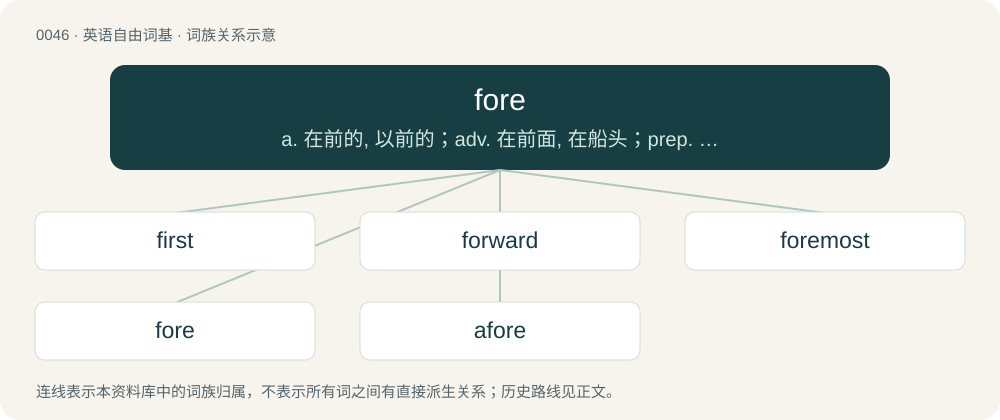

# 0048 · fore — a. 在前的, 以前的；adv. 在前面, 在船头；prep. 在...前

[总目录](../00_总目录_按常用程度.md)

**类型**：英语自由词基　｜　**来源语言**：见词源记录

## 核心含义与来源

- 核心含义：a. 在前的, 以前的；adv. 在前面, 在船头；prep. 在...前
- 英文含义：Forward; situated towards the front (of something).
- 词形：fore

**来源记录 1**（形容词；Forward; situated towards the front (of something).）

A development of the prefix fore-.

## 词族图

## 单词速览（常用到不常用）

| 单词 | 音标 | 释义 |
|---|---|---|
| [first](#w-1) | 英 /fɜːst/；美 /fɚst/ | adv. 首先, 第一, 优先；a. 第一的；num. 第一 |
| [forward](#w-2) | 英 /ˈfɔːwəd/；美 /ˈfɔɹwəɹd/ | a. 向前的, 早的, 迅速的, 在前的, 进步的；vt. 促进...的生长, 转寄, 运送；adv. 向前地 |
| [foremost](#w-3) | 英 /ˈfɔː.məʊst/ | a. 最初的, 最重要的；adv. 在最前 |
| [fore](#w-4) | 英 /fɔː/；美 /foɹ/ | a. 在前的, 以前的；adv. 在前面, 在船头；prep. 在...前 |
| [afore](#w-5) | 英 /əˈfɔː/；美 /əˈfoɹ/ | adv. 在前；prep. 在...前 |

## 逐词详解

### 1. first

**词性**：形容词　｜　**音标**：英 /fɜːst/；美 /fɚst/

**中文释义**：adv. 首先, 第一, 优先；a. 第一的；num. 第一

**英文义项**：Preceding all others of a series or kind; the ordinal of one; earliest. / Most eminent or exalted; most excellent; chief; highest.

**构词拆分**：fore + -est

**词源与演化**：

From Middle English first, furst, ferst, fyrst, from Old English fyrest, from Proto-West Germanic \*furist, from Proto-Germanic \*furistaz (“first, foremost”), superlative of Proto-Germanic \*furai, \*furi (“before”), from Proto-Indo-European \*preh₂- (“before”), from \*per- (“before; first”), equivalent to fore + -est. Cognates Cognate with Scots first (“first”), Dutch voorste (“foremost, first”), vorst (“prince”), German Fürst (“chief, prince”, literally “first (born)”), Limburgish Vürsch (“prince”), Luxembourgish viischt (“anterior; forward”), Vilamovian fiyśt, fjəšt, fjyśt, fjyšt (“prince”), Danish and Norwegian Bokmål først (“first”), Faroese and Icelandic fyrstur (“first”), Norwegian Nynorsk fyrst, først (“first”), Swedish först (“first”); also Latin prīnceps (“first, foremost; chief”), Greek παρ’ (par’), παρά (pará, “despite; less”), Mycenaean Greek 𐀞𐀫 (pa-ro, “from”), Albanian parë (“first; chief, main”), Latgalian pyrmais (“first”), Latvian pirmais (“first; foremost”), Lithuanian pirmas (“first; primary”), Bulgarian пъ́рви (pắrvi), пръ́в (prắv, “first”), Czech and Slovak prvý (“first”), Macedonian прв (prv), први (prvi, “first”), Polish piersy, pierwszy, pirszy (“first”), Russian пе́рвый (pérvyj, “first”), Serbo-Croatian пр̑вӣ, pȓvī (“first”), Slovene prvi (“first”), Armenian հարավ (harav, “south”), Avestan 𐬞𐬀𐬎𐬭𐬎𐬎𐬀 (paᵘruua, “before, first”), Tocharian A pärwat (“first”), Tocharian B parwe (“first”), Sanskrit पूर्व (pūrva, “before”).

**例句**：

> I was the first runner to reach the finish line, and won the race.

该用例对应义项：Preceding all others of a series or kind; the ordinal of one; earliest.

### 2. forward

**词性**：形容词　｜　**音标**：英 /ˈfɔːwəd/；美 /ˈfɔɹwəɹd/

**中文释义**：a. 向前的, 早的, 迅速的, 在前的, 进步的；vt. 促进...的生长, 转寄, 运送；adv. 向前地

**英文义项**：Situated toward or at the front of something. / Situated toward or near the enemy lines.

**构词拆分**：fore + -ward

**词源与演化**：

From Middle English foreward, from Old English foreweard (“forward, inclined to the front, fore, early, former”), from Proto-Germanic \*fura- (“fore-”), \*warþaz (“turned”), equivalent to fore + -ward. Cognate with Dutch voorwaarts (“forward”), German vorwärts (“forward”).

**例句**：

> The grass is forward, or forward for the season. We have a forward spring.

该用例对应义项：Advanced beyond the usual degree; advanced for the season; precocious.

### 3. foremost

**词性**：形容词　｜　**音标**：英 /ˈfɔː.məʊst/

**中文释义**：a. 最初的, 最重要的；adv. 在最前

**英文义项**：Positioned in front of (all) others in space, most forward. / Coming before (all) others in time.

**构词拆分**：fore + -most

**词源与演化**：

From Old English formest, fyrmest (“earliest, first, most prominent”), from Proto-Germanic \*frumistaz, from the locative stem \*fur-, \*fr- + the superlative suffix \*-umistaz, stem ultimately from Proto-Indo-European \*pr-. The suffix \*-umistaz was a compound suffix, created from the rarer comparative suffix \*-umô (as in Old English fruma) + the regular superlative suffix \*-istaz (English -est); \*-umô in turn is from Proto-Indo-European \*-mHo-. Cognate with Old Frisian formest, Gothic 𐍆𐍂𐌿𐌼𐌹𐍃𐍄𐍃 (frumists). See for, first and Old English fruma for more. Partially cognate to primus, from Proto-Indo-European \*pr- + Latin superlative suffix -imus, from Proto-Indo-European \*-mHo-. A comparative former was back-formed analogically, leaving the m from \*-umô in place. Later the Old English suffix complex -(u)m-est was conflated with the word most through folk etymology, so that the word is now interpreted as fore + -most.

**例句**：

> Foremost among the workers’ grievances was the company’s failure to address the many safety issues in the plant.

该用例对应义项：Of the highest rank or position; of the greatest importance; of the highest priority.

### 4. fore

**词性**：名词　｜　**音标**：英 /fɔː/；美 /foɹ/

**中文释义**：a. 在前的, 以前的；adv. 在前面, 在船头；prep. 在...前

**英文义项**：The front; the forward part of something; the foreground. / The front part of a vessel.

**词源与演化**：

A development of the prefix fore-.

**用法示例／搭配（非完整句）**：

> in the fore of the ship

该用例对应义项：The front part of a vessel.

### 5. afore

**词性**：介词　｜　**音标**：英 /əˈfɔː/；美 /əˈfoɹ/

**中文释义**：adv. 在前；prep. 在...前

**英文义项**：Before; in advance of the time of. / Before; situated geographically or metaphorically in front of.

**构词拆分**：a- + fore

**词源与演化**：

From Middle English afore, aforn, from Old English onforan or ætforan; equivalent to a- + fore.

**例句**：

> Business first, pleasure arterwards, as King Richard the Third said wen he stabbed t'other king in the Tower, afore he smothered the babbies.
