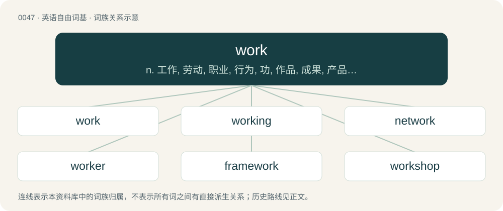

# 0049 · work — n. 工作, 劳动, 职业, 行为, 功, 作品, 成果, 产品, 工程；vi. 工作, 劳动, 做, 运转, 起作用, 被加工；vt. 使工作, 使转动, 开动, 使用, 经营, 使逐渐变得, 造成

[总目录](../00_总目录_按常用程度.md)

**类型**：英语自由词基　｜　**来源语言**：见词源记录

## 核心含义与来源

- 核心含义：n. 工作, 劳动, 职业, 行为, 功, 作品, 成果, 产品, 工程；vi. 工作, 劳动, 做, 运转, 起作用, 被加工；vt. 使工作, 使转动, 开动, 使用, 经营, 使逐渐变得, 造成
- 英文含义：Labour, occupation, job.
- 词形：work

**多个词源／构词路径**：同一拼写可能有不同来源；以下按词性和含义分别列出。

**来源记录 1**（名词；Labour, occupation, job.）

From Middle English work, werk, from Old English weorc, from Proto-West Germanic \*werk, from Proto-Germanic \*werką (“work”), from Proto-Indo-European \*wérǵom (“work”), from Proto-Indo-European \*werǵ- (“to make”). Cognates Cognate with Scots wark (“work”), North Frisian werk (“work”), Saterland Frisian Wierk (“work”), West Frisian wurk (“work”), Dutch werk (“work”), German Werk (“work”), German Low German Wark (“work”), Luxembourgish Wierk (“work”), Danish værk (“work”), Faroese, Icelandic, Norwegian Bokmål, Norwegian Nynorsk, and Swedish verk (“work”); also Breton ober (“to do, make”), Cornish gul, gwul (“to do, make”), Irish and Scottish Gaelic fearg (“anger”), Manx ferg (“anger”), Pictish ᚒᚏᚏᚐᚉᚈ (urract, “he made”), Welsh gwneud, neud (“to do, make”), Greek έργο (érgo, “work”), Albanian argëtim (“entertainment; fun, pleasure”), argëtoj (“to amuse, entertain”), Lithuanian váržas (“fish snaring net”), Macedonian врша (vrša, “fish-trap”), Polish wiersza (“fish-trap”), Russian and Ukrainian ве́рша (vérša, “fish-trap”), Serbo-Croatian вр̑ша, vȓša (“fish-trap”), Slovak and Slovene vrša (“fish-trap”), Aghwan 𐔱𐕒𐕙𐔵 (borz, “labour, work”), Armenian գործ (gorc, “work”), Northern Kurdish werz (“bed, field, patch; season”), Avestan 𐬬𐬆𐬭𐬆𐬰 (vər^əz, “to do, work”), Persian ورز (varz, “art, craft, trade”), ورزه (varze, “art, profession, trade”), ورزیدن (varzidan, “to exercise; to train; to work”), Tocharian B warkṣäl (“energy, power, strength”). English cognates include bulwark, boulevard, energy, erg, georgic, liturgy, metallurgy, organ, surgeon, wright. Doublet of erg and ergon.

**来源记录 2**（动词；To do a specific task by employing physical or mental powers.）

From Middle English werken and worchen, from Old English wyrċan and wircan (Mercian), from Proto-Germanic \*wurkijaną (“to work”), from Proto-Indo-European \*wr̥ǵyéti (“to be working, to be at work”), from the root \*werǵ-. Cognate with Old Frisian werka, wirka, Old Saxon wirkian, Low German warken, Dutch werken, Old High German wurken (German wirken, werken and werkeln), Old Norse yrkja and orka, (Swedish yrka and orka), Gothic 𐍅𐌰𐌿𐍂𐌺𐌾𐌰𐌽 (waurkjan).

## 词族图

## 单词速览（常用到不常用）

| 单词 | 音标 | 释义 |
|---|---|---|
| [work](#w-1) | 英 /wɜːk/；美 /wɝk/ | n. 工作, 劳动, 职业, 行为, 功, 作品, 成果, 产品, 工程；vi. 工作, 劳动, 做, 运转, 起作用, 被加工；vt. 使工作, 使转动, 开动, 使用, 经营, 使逐渐变得, 造成 |
| [working](#w-2) | 英 /ˈwɜːkɪŋ/；美 /ˈwɝkɪŋ/ | n. 工作, 运转, 劳动；a. 工作的, 劳动的, 经营的, 抽搐的, 运转的 |
| [network](#w-3) | 英 /ˈnɛt.wɜːk/；美 /ˈnɛt.wɝk/ | n. 网络, 广播网, 网状物；\[计\] 网络 |
| [worker](#w-4) | 英 /ˈwɜː.kə/；美 /ˈwɝ.kɚ/ | n. 工人, 劳动者；\[经\] 工人, 劳工, 劳动者 |
| [framework](#w-5) | 英 /ˈfɹeɪm.wɜːk/；美 /ˈfɹeɪm.wɝk/ | n. 结构, 骨架, 参照标准, 准则, 观点；\[医\] 构架组织 |
| [workshop](#w-6) | 英 /ˈwɜːk.ʃɒp/；美 /ˈwɝk.ʃɑp/ | n. 工场, 车间, 研讨会；\[计\] 讨论会; 专题研究组 |
| [homework](#w-7) | 英 /ˈhəʊmˌwɜːk/；美 /ˈhoʊmˌwɝk/ | n. 家庭作业, 家里做的工作；\[经\] 家庭作业 |
| [workplace](#w-8) | 美 /ˈwɝkˌpleɪs/ | n. 工作场所, 工厂, 车间 |
| [workforce](#w-9) | 英 /ˈwɜːk.fɔːs/；美 /ˈwɝk.foɹs/ | n. 劳动力；工人总数, 职工总数 |
| [paperwork](#w-10) | /ˈpeɪ.pɚˌwɝk/ | n. 文书工作 |
| [teamwork](#w-11) | /ˈtiːmwəːk/ | n. 协同作业, 协力；\[法\] 联合工作, 联合行动, 协调工作 |
| [workload](#w-12) | /ˈwəːkləud/ | n. 工作量；\[化\] 工作量 |
| [woodwork](#w-13) | 英 /ˈwʊdˌwɜːk/；美 /ˈwʊdˌwɝk/ | n. 木制品, 木制家具, 木工手艺, 木工活, 房屋内的木建部分 |
| [groundwork](#w-14) | /ˈɡɹaʊndˌwɜːɹk/ | n. 地基, 基础, 根据 |
| [workflow](#w-15) | 英 /ˈwɜːkfləʊ/；美 /ˈwɝkfloʊ/ | 工作流程 |
| [footwork](#w-16) | 英 /ˈfʊt.wɜːk/ | n. 脚的动作, 脚力, 现场采访活动 |
| [workable](#w-17) | /ˈwəːkəbl/ | a. 可经营的, 可使用的；\[机\] 能工作的, 机械等能使用的, 材料等可加工的 |
| [patchwork](#w-18) | /ˈpætʃwəːk/ | n. 拼缝物, 拼凑物 |
| [housework](#w-19) | 美 /ˈhaʊsˌwɝk/ | n. 家事, 家务 |
| [workstation](#w-20) | 美 /ˈwɝkˌsteɪʃən/ | n. 工作站；\[计\] 工作站 |
| [coursework](#w-21) | /ˈkɔːswɜːk/ | 国外的硕士入学方式分为两种, 其中的一种为coursework,为普通形式的硕士入学方式, 需要学生提交寻常申请用的资料 |
| [fieldwork](#w-22) | 英 /ˈfiːldwɜːk/；美 /ˈfildwɝk/ | n. 野战工事, 野外工作；\[经\] 农田工作 |
| [firework](#w-23) | 美 /ˈfaɪɚˌwɚk/ | n. 烟火具, 烟火, 烟火信号弹, 焰火, 激情的表现 |
| [workman](#w-24) | 英 /ˈwɜːkmən/；美 /ˈwɝkmən/ | n. 工人, 工匠, 男工 |
| [workday](#w-25) |  | n. 工作日, (一天的)工作时数；\[机\] 工作天 |
| [worksheet](#w-26) |  | \[计\] 工作表；\[化\] 工作单; 加工单 |
| [rework](#w-27) | /ˈɹiːwɜː(ɹ)k/ | vt. 重做, 修订, 修改；\[经\] 再加工, 再制, 返工 |
| [workbook](#w-28) | 英 /ˈwɜːk.bʊk/；美 /ˈwɝk.bʊk/ | n. 辅助练习册, 工作规程书, 工作记事簿, 笔记本, 工作手册；\[计\] 工作簿 |
| [workspace](#w-29) | 美 /ˈwɝkˌspeɪs/ | \[计\] 工作区 |
| [workhouse](#w-30) | /ˈw\\\\ːkhajs/ | n. (英)贫民习艺所, 济贫院, (美)感化院, 教养所 |
| [bodywork](#w-31) | /ˈbɒdiwəːk/ | n. 车身 |
| [bulwark](#w-32) | 英 /ˈbʊl.wək/；美 /ˈbʊl.wɚk/ | n. 保障, 壁垒, 防波堤 |
| [schoolwork](#w-33) | 英 /ˈskuːlˌwɜːk/；美 /ˈskulˌwɝk/ | n. 学校作业, 家庭作业 |
| [guesswork](#w-34) | /ˈgeswəːk/ | n. 臆测, 猜测, 凭猜测所作之工作 |
| [handiwork](#w-35) | 英 /ˈhændiˌwɜːk/；美 /ˈhændiˌwɝk/ | n. 手工, 手工艺, 手工 |
| [workhorse](#w-36) | 英 /ˈwɜːkˌhɔːs/；美 /ˈwɝkˌhoɹs/ | n. 载重马, 做重活的人 |
| [workaround](#w-37) | 英 /ˈwɜːk.əɹaʊnd/ | n. 工作区；变通方案；权变措施 |
| [workaholic](#w-38) | /.wəːkəˈhɒlik/ | n. 工作迷, 醉心于工作的人；\[法\] 为免遭辞退而工作过份卖力的人 |
| [overwork](#w-39) | 英 /ˌəʊvəˈwɜːk/；美 /ˌoʊvɚˈwɝk/ | n. 过度操劳的工作, 额外工作；v. (使)工作过度, 使过分劳累 |
| [workpiece](#w-40) | 英 /ˈwɜːkpiːs/；美 /ˈwɜɹkˌpis/ | n. 工件 |
| [workbench](#w-41) | 美 /ˈwɝk.bɛnt͡ʃ/ | n. 工作台；\[化\] 成型台 |
| [workweek](#w-42) | /ˈwəːkwiːk/ | n. 一星期工作时间 |
| [legwork](#w-43) | 英 /ˈlɛɡˌwɜːk/；美 /ˈlɛɡˌwɝk/ | n. &lt;口&gt;外出搜集情况的工作(如新闻采访,案件调查等) |
| [masterwork](#w-44) | /ˈmɑːstəw\\\\ːk;ˈmæs-/ | n. 杰作, 杰出的事, 名作 |
| [workroom](#w-45) | 美 /ˈwɝk.ɹum/ | n. 工作室 |
| [workwear](#w-46) | 英 /ˈwɜːkwɛə/；美 /ˈwɝkwɛɹ/ | n. 工作服 |
| [casework](#w-47) | /ˈkeiswəːk/ | n. 社会工作 |
| [worksite](#w-48) | /ˈw\\\\ːksait/ | n. 工地 |
| [earthwork](#w-49) | 英 /ˈɜːθwɜːk/；美 /ˈɝθwɝk/ | n. 土木工事, 土方工程 |
| [paintwork](#w-50) | /ˈpeintw\\\\ːk/ | n. 油漆的表面 |
| [workgroup](#w-51) | 英 /ˈwəːkɡɹuːp/ | \[计\] 工作组 |
| [millwork](#w-52) | /ˈmilwəːk/ | \[化\] 工厂机械的安装及操作 |
| [classwork](#w-53) | 英 /ˈklɑːsˌwɜːk/；美 /ˈklæsˌwɝk/ | n. 在教室做的功课, 老师与学生一起在教室做的功课 |
| [pipework](#w-54) | /ˈpaɪpwɜːk/ | 管道工程管（组） |
| [brushwork](#w-55) | /ˈbrʌʃwəːk/ | n. 笔法, 绘画 |
| [beadwork](#w-56) | /ˈbiːdw\\\\ːk/ | n. 珠饰细工, 珠缘 |
| [handwork](#w-57) | /ˈhændwəːk/ | n. 手工 |
| [formwork](#w-58) | /ˈfɔːmwəːk/ | n. 建筑用模子材料(板,螺钉等) |
| [ductwork](#w-59) | /ˈdʌktw\\\\ːk/ | n. 管道系统 |
| [roadwork](#w-60) | /ˈrəjdw\\\\ːk/ | n. 越野长跑训练 |
| [worktop](#w-61) |  | n. 桌面, 台面 |
| [telework](#w-62) | 美 /ˈtɛləwɝk/ | n. 遥控工作 |
| [workrate](#w-63) |  | 【英文】The rate at which work is performed. |
| [workability](#w-64) | /.wəːkəˈbiliti/ | n. 可使用性；\[化\] 加工性; 可加工性; 可使用性; 施工性能 |

## 逐词详解

### 1. work

**词性**：名词　｜　**音标**：英 /wɜːk/；美 /wɝk/

**中文释义**：n. 工作, 劳动, 职业, 行为, 功, 作品, 成果, 产品, 工程；vi. 工作, 劳动, 做, 运转, 起作用, 被加工；vt. 使工作, 使转动, 开动, 使用, 经营, 使逐渐变得, 造成

**英文义项**：Labour, occupation, job. / The place where one is employed.

**词源与演化**：

From Middle English work, werk, from Old English weorc, from Proto-West Germanic \*werk, from Proto-Germanic \*werką (“work”), from Proto-Indo-European \*wérǵom (“work”), from Proto-Indo-European \*werǵ- (“to make”). Cognates Cognate with Scots wark (“work”), North Frisian werk (“work”), Saterland Frisian Wierk (“work”), West Frisian wurk (“work”), Dutch werk (“work”), German Werk (“work”), German Low German Wark (“work”), Luxembourgish Wierk (“work”), Danish værk (“work”), Faroese, Icelandic, Norwegian Bokmål, Norwegian Nynorsk, and Swedish verk (“work”); also Breton ober (“to do, make”), Cornish gul, gwul (“to do, make”), Irish and Scottish Gaelic fearg (“anger”), Manx ferg (“anger”), Pictish ᚒᚏᚏᚐᚉᚈ (urract, “he made”), Welsh gwneud, neud (“to do, make”), Greek έργο (érgo, “work”), Albanian argëtim (“entertainment; fun, pleasure”), argëtoj (“to amuse, entertain”), Lithuanian váržas (“fish snaring net”), Macedonian врша (vrša, “fish-trap”), Polish wiersza (“fish-trap”), Russian and Ukrainian ве́рша (vérša, “fish-trap”), Serbo-Croatian вр̑ша, vȓša (“fish-trap”), Slovak and Slovene vrša (“fish-trap”), Aghwan 𐔱𐕒𐕙𐔵 (borz, “labour, work”), Armenian գործ (gorc, “work”), Northern Kurdish werz (“bed, field, patch; season”), Avestan 𐬬𐬆𐬭𐬆𐬰 (vər^əz, “to do, work”), Persian ورز (varz, “art, craft, trade”), ورزه (varze, “art, profession, trade”), ورزیدن (varzidan, “to exercise; to train; to work”), Tocharian B warkṣäl (“energy, power, strength”). English cognates include bulwark, boulevard, energy, erg, georgic, liturgy, metallurgy, organ, surgeon, wright. Doublet of erg and ergon.

**例句**：

> Holding a brick over your head is hard work. It takes a lot of work to write a dictionary.

该用例对应义项：Effort expended on a particular task.

### 2. working

**词性**：名词　｜　**音标**：英 /ˈwɜːkɪŋ/；美 /ˈwɝkɪŋ/

**中文释义**：n. 工作, 运转, 劳动；a. 工作的, 劳动的, 经营的, 抽搐的, 运转的

**英文义项**：Operation; action. / Method of operation.

**构词拆分**：work + -ing

**词源与演化**：

From Middle English werking, werkynge, warkynge, worchinge, from Old English wyrċing (“working”), verbal noun of wyrċan (“to work”), equivalent to work + -ing. Cognate with Scots wirking, warking, Dutch werking, German Wirkung.

**例句**：

> Be sure to check your working.

该用例对应义项：The incidental or subsidiary calculations performed in solving an overall problem.

### 3. network

**词性**：名词　｜　**音标**：英 /ˈnɛt.wɜːk/；美 /ˈnɛt.wɝk/

**中文释义**：n. 网络, 广播网, 网状物；\[计\] 网络

**英文义项**：Any interconnected group or system. / A set of people with sociocultural connections to one another; especially, such a set consisting of occupational or business connections.

**构词拆分**：net + work

**词源与演化**：

From net + work; the nonliteral sense and its subsenses are extended from the literal sense; they are now the dominant senses. Cognate with German Netzwerk.

**例句**：

> The copy machine is connected to the network so it can now serve as a printer.

该用例对应义项：A computer network: multiple computers and other devices connected together to share information.

### 4. worker

**词性**：名词　｜　**音标**：英 /ˈwɜː.kə/；美 /ˈwɝ.kɚ/

**中文释义**：n. 工人, 劳动者；\[经\] 工人, 劳工, 劳动者

**英文义项**：One who works: a person who performs labor for a living; traditionally, especially, manual labor. / A nonreproductive social insect, such as ant, bee, termite, or wasp.

**构词拆分**：work + -er

**词源与演化**：

Inherited from Middle English worchere, werkere, equivalent to work + -er. Displaced the older term wright, from Old English wyrhta.

**例句**：

> This FTP client spawns a separate worker for each file to be uploaded.

该用例对应义项：A thread performing one instance of a particular task within a program.

### 5. framework

**词性**：名词　｜　**音标**：英 /ˈfɹeɪm.wɜːk/；美 /ˈfɹeɪm.wɝk/

**中文释义**：n. 结构, 骨架, 参照标准, 准则, 观点；\[医\] 构架组织

**英文义项**：A support structure comprising joined parts or conglomerated particles and intervening open spaces of similar or larger size. / The arrangement of support beams that represent a building's general shape and size.

**构词拆分**：frame + work

**词源与演化**：

From frame + work.

**例句**：

> These ‘three principles of connexion’ compose the framework of principles in Hume's account of the association of ideas.

该用例对应义项：A basic conceptual structure.

### 6. workshop

**词性**：名词　｜　**音标**：英 /ˈwɜːk.ʃɒp/；美 /ˈwɝk.ʃɑp/

**中文释义**：n. 工场, 车间, 研讨会；\[计\] 讨论会; 专题研究组

**英文义项**：A room, especially one which is not particularly large, used for manufacturing or other light industrial work. / A brief, intensive course of education for a small group, emphasizing interaction and practical problem solving.

**构词拆分**：work + shop

**词源与演化**：

From work + shop.

**例句**：

> Last night Tom dreamt he had been employed in the Devil's workshop.

### 7. homework

**词性**：名词　｜　**音标**：英 /ˈhəʊmˌwɜːk/；美 /ˈhoʊmˌwɝk/

**中文释义**：n. 家庭作业, 家里做的工作；\[经\] 家庭作业

**英文义项**：Exercises assigned by a teacher to a student which review concepts studied in class. / Something which one is encouraged to learn or study on one's own.

**构词拆分**：home + work

**词源与演化**：

From home + work.

**例句**：

> The speaker had certainly done his homework before delivering the lecture.

该用例对应义项：Something which one is encouraged to learn or study on one's own.

### 8. workplace

**词性**：名词　｜　**音标**：美 /ˈwɝkˌpleɪs/

**中文释义**：n. 工作场所, 工厂, 车间

**英文义项**：The place where someone works.

**构词拆分**：From work + place.

**词源与演化**：

From work + place.

**用法示例／搭配（非完整句）**：

> professionalism in the workplace

该用例对应义项：The place where someone works.

### 9. workforce

**词性**：名词　｜　**音标**：英 /ˈwɜːk.fɔːs/；美 /ˈwɝk.foɹs/

**中文释义**：n. 劳动力；工人总数, 职工总数

**英文义项**：All the workers employed by a specific organization or state, or on a specific project. / The total population of a country or region that is employed or employable.

**构词拆分**：From work + force.

**词源与演化**：

From work + force.

**例句**：

> Tom organized a workforce to pick up garbage from the local streets.

### 10. paperwork

**词性**：名词　｜　**音标**：/ˈpeɪ.pɚˌwɝk/

**中文释义**：n. 文书工作

**英文义项**：Routine work involving written documents. / Written documents.

**构词拆分**：paper + work

**词源与演化**：

From paper + work.

**用法示例／搭配（非完整句）**：

> to have bad paperwork

该用例对应义项：Court documents or pre-sentencing investigation reports detailing the prisoner's criminal history (usually in the context of discerning whether an inmate has been charged for sex-related offenses or is likely to be an informant).

### 11. teamwork

**词性**：名词　｜　**音标**：/ˈtiːmwəːk/

**中文释义**：n. 协同作业, 协力；\[法\] 联合工作, 联合行动, 协调工作

**英文义项**：The cooperative effort of a team of people to achieve a common goal.

**构词拆分**：team + work

**词源与演化**：

From team + work. Compare West Frisian teamwurk (“teamwork”).

**例句**：

> It will take money, good planning and, above all, teamwork.

该用例对应义项：cooperative work done by a team (especially when it is effective)

### 12. workload

**词性**：名词　｜　**音标**：/ˈwəːkləud/

**中文释义**：n. 工作量；\[化\] 工作量

**英文义项**：The amount of work assigned to a particular worker, normally in a specified time period. / The amount of work that a machine can handle or produce.

**构词拆分**：work + load

**词源与演化**：

From work + load.

**例句**：

> Tom was advised, for medical reasons, to cut back on his workload.

### 13. woodwork

**词性**：名词　｜　**音标**：英 /ˈwʊdˌwɜːk/；美 /ˈwʊdˌwɝk/

**中文释义**：n. 木制品, 木制家具, 木工手艺, 木工活, 房屋内的木建部分

**英文义项**：Something made from wood, especially cabinets and trim (e.g., baseboards, doorframes) made from millwork. / Working with wood.

**构词拆分**：wood + work

**词源与演化**：

From Middle English woodewerk (“carpentry”), equivalent to wood + work.

**例句**：

> Friends and relatives were coming out of the woodwork to celebrate his good fortune.

该用例对应义项：A place of concealment or obscurity.

### 14. groundwork

**词性**：名词　｜　**音标**：/ˈɡɹaʊndˌwɜːɹk/

**中文释义**：n. 地基, 基础, 根据

**英文义项**：The foundation; the basic or fundamental parts that support or allow for the rest.

**构词拆分**：ground + work

**词源与演化**：

From ground + work.

**例句**：

> The discovery of the laws of electricity laid the groundwork for a century of innovation.

该用例对应义项：The foundation; the basic or fundamental parts that support or allow for the rest.

### 15. workflow

**词性**：名词　｜　**音标**：英 /ˈwɜːkfləʊ/；美 /ˈwɝkfloʊ/

**中文释义**：工作流程

**英文义项**：The flowrate at which a flow of work takes place. / A process or procedure by which tasks are completed. It may be defined by a flowchart with actors, actions, results, decisions, and action paths.

**构词拆分**：work + flow

**词源与演化**：

From work + flow.

**例句**：

> The team redesigned their workflow to improve efficiency.

该用例对应义项：The flowrate at which a flow of work takes place.

### 16. footwork

**词性**：名词　｜　**音标**：英 /ˈfʊt.wɜːk/

**中文释义**：n. 脚的动作, 脚力, 现场采访活动

**英文义项**：Any movement of the feet, especially intricate or complex movement, as in sports or dancing. / A subgenre of juke/ghetto house and style of street dance that originated in Chicago in the early 1990s.

**构词拆分**：foot + work

**词源与演化**：

From foot + work.

**例句**：

> The dancer impressed the crowd with his fancy footwork.

该用例对应义项：Any movement of the feet, especially intricate or complex movement, as in sports or dancing.

### 17. workable

**词性**：形容词　｜　**音标**：/ˈwəːkəbl/

**中文释义**：a. 可经营的, 可使用的；\[机\] 能工作的, 机械等能使用的, 材料等可加工的

**英文义项**：Capable of functioning. / Able to be worked or fashioned

**构词拆分**：work + -able

**词源与演化**：

From work + -able.

**例句**：

> They came up with a workable solution, until they could think of something better.

该用例对应义项：Capable of functioning.

### 18. patchwork

**词性**：名词　｜　**音标**：/ˈpætʃwəːk/

**中文释义**：n. 拼缝物, 拼凑物

**英文义项**：A work, such as a blanket, composed of many different colors and shapes, sewn together to make an interesting whole. / Any kind of creation that makes use of many different aspects to create one whole piece.

**构词拆分**：patch + work

**词源与演化**：

From patch + work.

**例句**：

> Bill took all of his poetry and put it together in a folder. It made up a patchwork of his life.

该用例对应义项：Any kind of creation that makes use of many different aspects to create one whole piece.

### 19. housework

**词性**：名词　｜　**音标**：美 /ˈhaʊsˌwɝk/

**中文释义**：n. 家事, 家务

**英文义项**：domestic household chores such as cleaning and cooking / homework

**构词拆分**：house + work

**词源与演化**：

From house + work. Cognate with Dutch huiswerk (“homework”).

**例句**：

> It's easier for me to have a job than to do housework.

### 20. workstation

**词性**：名词　｜　**音标**：美 /ˈwɝkˌsteɪʃən/

**中文释义**：n. 工作站；\[计\] 工作站

**英文义项**：A desktop computer, normally more powerful than a normal PC and often dedicated to a specific task, such as graphics. / An area, at a workplace, for a single worker.

**构词拆分**：work + station

**词源与演化**：

From work + station.

**例句**：

> Tom's workstation is usually tidier than Mary's.

### 21. coursework

**词性**：名词　｜　**音标**：/ˈkɔːswɜːk/

**中文释义**：国外的硕士入学方式分为两种, 其中的一种为coursework,为普通形式的硕士入学方式, 需要学生提交寻常申请用的资料

**英文义项**：An assignment, project or task that a student is required to complete as part of a particular course, which is then assessed and counts towards the grade given.

**构词拆分**：course + work

**词源与演化**：

From course + work.

**例句**：

> This numerical analysis coursework is driving me insane.

### 22. fieldwork

**词性**：名词　｜　**音标**：英 /ˈfiːldwɜːk/；美 /ˈfildwɝk/

**中文释义**：n. 野战工事, 野外工作；\[经\] 农田工作

**英文义项**：Work done out in the fields as opposed to that done elsewhere on the farm (e.g., barn, house, outbuildings, office). / Work done out in the real world rather than in controlled conditions.

**构词拆分**：field + work

**词源与演化**：

From Middle English \*felde-werk (found in plural felde werkes), equivalent to field + work.

**例句**：

> Besides the bookkeeping and marketing, there's a ton of fieldwork to get done this week.

该用例对应义项：Work done out in the fields as opposed to that done elsewhere on the farm (e.g., barn, house, outbuildings, office).

### 23. firework

**词性**：名词　｜　**音标**：美 /ˈfaɪɚˌwɚk/

**中文释义**：n. 烟火具, 烟火, 烟火信号弹, 焰火, 激情的表现

**英文义项**：A device using gunpowder and other chemicals which, when lit, emits a combination of coloured flames, sparks, whistles or bangs, and sometimes made to rocket high into the sky before exploding, used for entertainment or celebration.

**构词拆分**：fire + work

**词源与演化**：

From fire + work. Compare Saterland Frisian Fjuurwierk (“firework”), West Frisian fjoerwurk (“firework”), Dutch vuurwerk (“firework”), Low German Füürwark, Füerwark (“firework”), German Feuerwerk (“firework”), Danish fyrværkeri (“firework”), Swedish fyrverkeri (“firework”), Faroese fýrverk (“firework”).

**例句**：

> Fireworks went off after Australia won the World Cup.

该用例对应义项：A device using gunpowder and other chemicals which, when lit, emits a combination of coloured flames, sparks, whistles or bangs, and sometimes made to rocket high into the sky before exploding, used for entertainment or celebration.

### 24. workman

**词性**：名词　｜　**音标**：英 /ˈwɜːkmən/；美 /ˈwɝkmən/

**中文释义**：n. 工人, 工匠, 男工

**英文义项**：A man who labours for wages. / An artisan or craftsman.

**构词拆分**：work + -man

**词源与演化**：

From Middle English werkman, from Old English weorcmann (“workman”), from Proto-West Germanic \*werkamann, from Proto-Germanic \*werkamann- (“workman”), equivalent to work + -man. Compare Dutch werkman (“workman”), German Werkmann (“labourer, workman”), Icelandic verkamaður (“workman”).

**例句**：

> I'm waiting for a workman who's coming to lay some carpets in my house.

### 25. workday

**词性**：名词

**中文释义**：n. 工作日, (一天的)工作时数；\[机\] 工作天

**英文义项**：Any of the days of a week on which work is done; any day in a workweek. / That part of a day in which work is done.

**构词拆分**：work + day

**词源与演化**：

From Middle English werkdai, werkedei, werkedai, from Old English weorcdæġ (“workday”), equivalent to work + day. Cognate with West Frisian wurkdei (“workday”), Dutch werkdag (“workday”), German Low German Warkdag (“workday”), German Werktag (“workday”). See also workaday.

**例句**：

> It will take five workdays to process your application.

该用例对应义项：Any of the days of a week on which work is done; any day in a workweek.

### 26. worksheet

**词性**：名词

**中文释义**：\[计\] 工作表；\[化\] 工作单; 加工单

**英文义项**：A sheet of paper or computerized document on which problems are worked out or solved and the answers are recorded. / A sheet of paper listing work that is completed, to be completed or in progress.

**构词拆分**：work + sheet

**词源与演化**：

From work + sheet. First use appears c. 1823 in the publications of Isaac D'Israeli.

**例句**：

> The reward for finishing your worksheet early is another worksheet.

### 27. rework

**词性**：名词　｜　**音标**：/ˈɹiːwɜː(ɹ)k/

**中文释义**：vt. 重做, 修订, 修改；\[经\] 再加工, 再制, 返工

**英文义项**：The act of redoing, correcting, or rebuilding. / Taking unsaleable food and using it in the manufacture of other food.

**构词拆分**：re- + work

**词源与演化**：

From re- + work.

**例句**：

> The schedule has been pushed back because of the rework.

该用例对应义项：Work done to correct defects associated with a deliverable product, plus any root cause analysis effort to identify the task(s) to be re-performed.

### 28. workbook

**词性**：名词　｜　**音标**：英 /ˈwɜːk.bʊk/；美 /ˈwɝk.bʊk/

**中文释义**：n. 辅助练习册, 工作规程书, 工作记事簿, 笔记本, 工作手册；\[计\] 工作簿

**英文义项**：A book, used by a student, in which answers and workings may be entered besides questions and exercises. / A book, used by a business, containing a record of work to be done, or work completed.

**构词拆分**：work + book

**词源与演化**：

From work + book.

**例句**：

> Are you absolutely sure that you took your workbook with you?

### 29. workspace

**词性**：名词　｜　**音标**：美 /ˈwɝkˌspeɪs/

**中文释义**：\[计\] 工作区

**英文义项**：An area allocated for someone to work in, especially in an office. / A file (or system of files) in which related software and data can be manipulated or developed in isolation from others.

**构词拆分**：work + space

**词源与演化**：

From work + space.

**例句**：

> Keep the countertops clear of clutter for a more spacious workspace.

### 30. workhouse

**词性**：名词　｜　**音标**：/ˈw\\\\ːkhajs/

**中文释义**：n. (英)贫民习艺所, 济贫院, (美)感化院, 教养所

**英文义项**：A prison in which the sentence includes manual labour.

**构词拆分**：work + house

**词源与演化**：

From Middle English werkhous, from Old English weorchūs (“workshop, place of manufacture”), from Proto-Germanic \*werkahūsą, equivalent to work + house.

### 31. bodywork

**词性**：名词　｜　**音标**：/ˈbɒdiwəːk/

**中文释义**：n. 车身

**英文义项**：The exterior body of a motor vehicle. / The repair of such a body.

**构词拆分**：body + work

**词源与演化**：

From body + work.

**例句**：

> There's a lot of bodywork still left to be done.

该用例对应义项：The repair of such a body.

### 32. bulwark

**词性**：名词　｜　**音标**：英 /ˈbʊl.wək/；美 /ˈbʊl.wɚk/

**中文释义**：n. 保障, 壁垒, 防波堤

**英文义项**：A defensive wall or rampart. / A defense or safeguard.

**构词拆分**：bole (“tree trunk”) + work

**词源与演化**：

From Middle English bulwerk, from Middle Dutch bolwerk, bolwerc and Middle Low German bolwerk, equivalent to bole (“tree trunk”) + work. Cognate with German Bollwerk, Danish bolværk, Swedish bålverk, Dutch bolwerk. Doublet of boulevard (from French boulevard, from Dutch); cognate with Portuguese and Spanish baluarte and Italian baluardo.

**例句**：

> The party stalwarts constitute the bulwark that ensures the president's term of office.

该用例对应义项：Any means of defence or security.

### 33. schoolwork

**词性**：名词　｜　**音标**：英 /ˈskuːlˌwɜːk/；美 /ˈskulˌwɝk/

**中文释义**：n. 学校作业, 家庭作业

**英文义项**：Work done for school, including both in class and as homework.

**构词拆分**：school + work

**词源与演化**：

From school + work.

**例句**：

> I'm 40, but now that I'm back going for my degree I'm swamped with schoolwork.

该用例对应义项：Work done for school, including both in class and as homework.

### 34. guesswork

**词性**：名词　｜　**音标**：/ˈgeswəːk/

**中文释义**：n. 臆测, 猜测, 凭猜测所作之工作

**英文义项**：An estimate, judgment or opinion made by guessing, from limited information.

**构词拆分**：guess + work

**词源与演化**：

From guess + work. Compare Dutch giswerk (“guesswork”).

**例句**：

> I used guesswork for all my answers on this test and they were all correct.

### 35. handiwork

**词性**：名词　｜　**音标**：英 /ˈhændiˌwɜːk/；美 /ˈhændiˌwɝk/

**中文释义**：n. 手工, 手工艺, 手工

**英文义项**：Work done by the hands. / A handmade object; a handicraft.

**构词拆分**：hand + work

**词源与演化**：

From Middle English hondywerk, handiwerc, from Old English handġeweorc (“work done by hand, creation”), from hand (“hand”) + ġeweorc (“work”). Equivalent to hand + work, though it may now be reinterpreted as handy (“skilful”) + work. Compare Saterland Frisian Hondwierk, Dutch handwerk, German Handwerk.

**例句**：

> The Museum of Popular Arts showcases Portugal's finest handiworks.

该用例对应义项：A handmade object; a handicraft.

### 36. workhorse

**词性**：名词　｜　**音标**：英 /ˈwɜːkˌhɔːs/；美 /ˈwɝkˌhoɹs/

**中文释义**：n. 载重马, 做重活的人

**英文义项**：A horse used primarily for manual labor; a draft/draught horse. / A person or piece of equipment that performs a lot of work, especially one heavily relied upon to perform consistently and regularly.

**构词拆分**：work + horse

**词源与演化**：

From Middle English werkehorse, equivalent to work + horse.

**例句**：

> Those old machines are not very glamorous, but even 20 years after their introduction, they are still the workhorses of the industry.

该用例对应义项：A person or piece of equipment that performs a lot of work, especially one heavily relied upon to perform consistently and regularly.

### 37. workaround

**词性**：名词　｜　**音标**：英 /ˈwɜːk.əɹaʊnd/

**中文释义**：n. 工作区；变通方案；权变措施

**英文义项**：A means or method of circumventing an obstacle, particularly one arising from constraints, laws or regulatory requirements. / A procedure or a temporary fix that bypasses a problem and allows a user to continue working until a better solution can be provided.

**构词拆分**：work + around

**词源与演化**：

From work + around.

**例句**：

> The workaround is surprisingly elaborate, but the good news is I've already done the heavy lifting.

### 38. workaholic

**词性**：名词　｜　**音标**：/.wəːkəˈhɒlik/

**中文释义**：n. 工作迷, 醉心于工作的人；\[法\] 为免遭辞退而工作过份卖力的人

**英文义项**：A person who feels compelled to work excessively, including while at home.

**构词拆分**：work + -aholic

**词源与演化**：

From work + -aholic.

**例句**：

> All workaholics should move to Hong Kong, where working hours average over 50 per week.

该用例对应义项：A person who feels compelled to work excessively, including while at home.

### 39. overwork

**词性**：动词　｜　**音标**：英 /ˌəʊvəˈwɜːk/；美 /ˌoʊvɚˈwɝk/

**中文释义**：n. 过度操劳的工作, 额外工作；v. (使)工作过度, 使过分劳累

**英文义项**：To make (someone or something) work too hard. / To work too hard.

**构词拆分**：over- + work

**词源与演化**：

From Middle English overwerken, possibly from Old English oferwyrċan (“to overwork, overlay”), equivalent to over- + work. Cognate with Dutch overwerken (“to overwork”).

**用法示例／搭配（非完整句）**：

> to overwork a horse

该用例对应义项：To make (someone or something) work too hard.

### 40. workpiece

**词性**：名词　｜　**音标**：英 /ˈwɜːkpiːs/；美 /ˈwɜɹkˌpis/

**中文释义**：n. 工件

**英文义项**：A partially finished object (often composed of a raw material) which is subjected to various operations, worked on with tools, etc.

**构词拆分**：work (noun) + piece (noun)

**词源与演化**：

From work (noun) + piece (noun), a calque of German Werkstück (“piece of work; object being worked on”).

**例句**：

> Make sure the workpiece is properly secured in the chuck before turning on the lathe.

该用例对应义项：A partially finished object (often composed of a raw material) which is subjected to various operations, worked on with tools, etc.

### 41. workbench

**词性**：名词　｜　**音标**：美 /ˈwɝk.bɛnt͡ʃ/

**中文释义**：n. 工作台；\[化\] 成型台

**英文义项**：A sturdy bench or table at which manual work is done by a carpenter, machinist, etc. / A horizontal padded surface, usually adjustable in height and inclination and often with attached weight rack, used for proper posture during exercise.

**构词拆分**：work + bench

**词源与演化**：

From work + bench.

**例句**：

> Ziri used a clamp on the workbench for stability.

### 42. workweek

**词性**：名词　｜　**音标**：/ˈwəːkwiːk/

**中文释义**：n. 一星期工作时间

**英文义项**：The range of days of the week that are normally worked.

**构词拆分**：work + week

**词源与演化**：

From work + week.

**例句**：

> The International Labour Organization defines a workweek exceeding 48 hours as excessive.

### 43. legwork

**词性**：名词　｜　**音标**：英 /ˈlɛɡˌwɜːk/；美 /ˈlɛɡˌwɝk/

**中文释义**：n. &lt;口&gt;外出搜集情况的工作(如新闻采访,案件调查等)

**英文义项**：Work, especially research or preparation, that involves significant walking, travel, or similar effort. / Skillful or vigorous use of the legs, as in dance or sports.

**构词拆分**：leg + work

**词源与演化**：

From leg + work.

### 44. masterwork

**词性**：名词　｜　**音标**：/ˈmɑːstəw\\\\ːk;ˈmæs-/

**中文释义**：n. 杰作, 杰出的事, 名作

**英文义项**：A piece done to prove possession of skill sufficient to be ranked a master. / A piece of quality, indicative of having been made by a master; a masterpiece.

**构词拆分**：master + work

**词源与演化**：

From master + work.

### 45. workroom

**词性**：名词　｜　**音标**：美 /ˈwɝk.ɹum/

**中文释义**：n. 工作室

**英文义项**：A room, such as a workshop or studio, where work is done.

**构词拆分**：work + room

**词源与演化**：

From work + room.

**例句**：

> He is still at work in the workroom.

### 46. workwear

**词性**：名词　｜　**音标**：英 /ˈwɜːkwɛə/；美 /ˈwɝkwɛɹ/

**中文释义**：n. 工作服

**英文义项**：Clothes designed to be worn while working, especially in a physically demanding job.

**构词拆分**：work + -wear

**词源与演化**：

From work + -wear.

### 47. casework

**词性**：名词　｜　**音标**：/ˈkeiswəːk/

**中文释义**：n. 社会工作

**英文义项**：Any type of work done on an individual case, such as a legal case or a client case in social services. / The work of an MP or other politician to help or advocate for constituents who have problems.

**构词拆分**：case + work

**词源与演化**：

From case + work.

**例句**：

> Most of her time is spent on casework, rather than research.

该用例对应义项：Any type of work done on an individual case, such as a legal case or a client case in social services.

### 48. worksite

**词性**：名词　｜　**音标**：/ˈw\\\\ːksait/

**中文释义**：n. 工地

**英文义项**：A site where work occurs; usually used in reference to construction work.

**构词拆分**：work + site

**词源与演化**：

From work + site.

**例句**：

> The concrete mixing plant is just a mile from the worksite.

### 49. earthwork

**词性**：名词　｜　**音标**：英 /ˈɜːθwɜːk/；美 /ˈɝθwɝk/

**中文释义**：n. 土木工事, 土方工程

**英文义项**：Any structure made from earth, especially an embankment used for fortification or flood control.

**构词拆分**：earth + work

**词源与演化**：

From earth + work. First attested in the 1630s.

### 50. paintwork

**词性**：名词　｜　**音标**：/ˈpeintw\\\\ːk/

**中文释义**：n. 油漆的表面

**英文义项**：The painted surface of a car, building, etc.

**构词拆分**：paint + work

**词源与演化**：

From paint + work.

### 51. workgroup

**词性**：名词　｜　**音标**：英 /ˈwəːkɡɹuːp/

**中文释义**：\[计\] 工作组

**英文义项**：A group of workers engaged in a series of collaborative tasks who usually work together. / A computer network created for use by such groups.

**构词拆分**：work + group

**词源与演化**：

From work + group.

**例句**：

> In this workgroup, I'm responsible for digital affairs and mass media.

### 52. millwork

**词性**：名词　｜　**音标**：/ˈmilwəːk/

**中文释义**：\[化\] 工厂机械的安装及操作

**英文义项**：Components for buildings, produced by milling, such as doors and windows (especially prehung ones) and wood or woodlike trim with decorative cross-sections involving curves, beads, grooves, etc. / Any wooden object manufactured at a lumbermill (sawmill).

**构词拆分**：mill + work

**词源与演化**：

From mill + work.

### 53. classwork

**词性**：名词　｜　**音标**：英 /ˈklɑːsˌwɜːk/；美 /ˈklæsˌwɝk/

**中文释义**：n. 在教室做的功课, 老师与学生一起在教室做的功课

**英文义项**：That part of a scholar's work that is done in class.

**构词拆分**：class + work

**词源与演化**：

From class + work.

**例句**：

> I love learning. I just don't love doing classwork.

### 54. pipework

**词性**：名词　｜　**音标**：/ˈpaɪpwɜːk/

**中文释义**：管道工程管（组）

**英文义项**：Any system of pipes or tubes; piping. / The pipes and stops of an organ.

**构词拆分**：pipe + work

**词源与演化**：

From pipe + work.

### 55. brushwork

**词性**：名词　｜　**音标**：/ˈbrʌʃwəːk/

**中文释义**：n. 笔法, 绘画

**英文义项**：The technique or practice of applying and manipulating paint (usually oil or gouache) in a painting.

**构词拆分**：brush + work

**词源与演化**：

From brush + work.

**例句**：

> The fake was easy to spot because of its inferior brushwork.

该用例对应义项：The technique or practice of applying and manipulating paint (usually oil or gouache) in a painting.

### 56. beadwork

**词性**：名词　｜　**音标**：/ˈbiːdw\\\\ːk/

**中文释义**：n. 珠饰细工, 珠缘

**英文义项**：Decorative work involving beads.

**构词拆分**：bead + work

**词源与演化**：

From bead + work.

### 57. handwork

**词性**：名词　｜　**音标**：/ˈhændwəːk/

**中文释义**：n. 手工

**英文义项**：Work done by the hands, as opposed to by machine.

**构词拆分**：hand + work

**词源与演化**：

From Middle English hondwerk, from Old English handweorc (“work done by hand; handiwork”), from Proto-Germanic \*handuwerką; equivalent to hand + work. Cognate with Dutch handwerk, German Handwerk, Swedish hantverk.

**例句**：

> With little donor money coming in, relief workers can only do the barest minimum, such as teaching children songs and handwork.

### 58. formwork

**词性**：名词　｜　**音标**：/ˈfɔːmwəːk/

**中文释义**：n. 建筑用模子材料(板,螺钉等)

**英文义项**：A temporary mold, made from planks, into which concrete is poured.

**构词拆分**：form + work

**词源与演化**：

From form + work.

### 59. ductwork

**词性**：名词　｜　**音标**：/ˈdʌktw\\\\ːk/

**中文释义**：n. 管道系统

**英文义项**：The system of ducts in a particular building.

**构词拆分**：duct + work

**词源与演化**：

From duct + work.

### 60. roadwork

**词性**：名词　｜　**音标**：/ˈrəjdw\\\\ːk/

**中文释义**：n. 越野长跑训练

**英文义项**：The construction or maintenance done to roads. / Exercise such as running and jogging done on the roads.

**构词拆分**：road + work

**词源与演化**：

From road + work.

**例句**：

> The athlete needed to get home early to do his roadwork before it got too dark to be safe.

该用例对应义项：Exercise such as running and jogging done on the roads.

### 61. worktop

**词性**：名词

**中文释义**：n. 桌面, 台面

**英文义项**：A surface, usually resting on cupboards or drawers that can be used to work on. Usually in a kitchen.

**构词拆分**：work + top

**词源与演化**：

From work + top.

**例句**：

> The cupboards were oak and the worktop was granite.

该用例对应义项：A surface, usually resting on cupboards or drawers that can be used to work on. Usually in a kitchen.

### 62. telework

**词性**：动词　｜　**音标**：美 /ˈtɛləwɝk/

**中文释义**：n. 遥控工作

**英文义项**：To telecommute.

**构词拆分**：tele- + work

**词源与演化**：

From tele- + work.

**例句**：

> Major U.S. businesses announced they would be requesting most employees telework.

### 63. workrate

**词性**：名词

**英文义项**：The rate at which work is performed.

**构词拆分**：work + rate

**词源与演化**：

From work + rate.

### 64. workability

**词性**：名词　｜　**音标**：/.wəːkəˈbiliti/

**中文释义**：n. 可使用性；\[化\] 加工性; 可加工性; 可使用性; 施工性能

**英文义项**：The ease with which something can be worked or fashioned. / The quality of being workable; practical capacity to succeed.

**构词拆分**：work + -ability

**词源与演化**：

From work + -ability.

**例句**：

> I dispute the workability of the new plan.

该用例对应义项：The quality of being workable; practical capacity to succeed.
