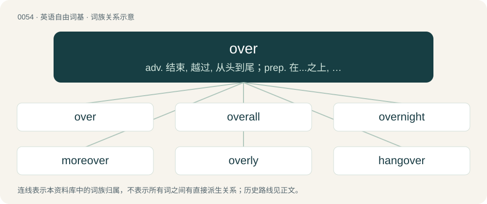

# 0054 · over — adv. 结束, 越过, 从头到尾；prep. 在...之上, 遍于...之上, 越过；a. 上面的

[总目录](../00_总目录_按常用程度.md)

**类型**：英语自由词基　｜　**来源语言**：见词源记录

## 核心含义与来源

- 核心含义：adv. 结束, 越过, 从头到尾；prep. 在...之上, 遍于...之上, 越过；a. 上面的
- 英文含义：Finished; ended; concluded.
- 词形：over

**来源记录 1**（形容词；Finished; ended; concluded.）

From Middle English over, from Old English ofer, ofor, ouer, from Proto-West Germanic \*obar, from Proto-Germanic \*uber (“over”), from Proto-Indo-European \*upér (“above; over”). Cognates Cognate with Scots ower (“over”), Yola oer, ower, owr (“over”), Saterland Frisian uur (“over”), West Frisian oer (“over, across”), Cimbrian übar (“over”), Dutch over (“over”), German ober, über, ueber (“over, above”), Limburgish euver, övver (“over”), Low German över, üöver (“over”), Luxembourgish iwwer (“over”), Mòcheno iber (“over”), Yiddish איבער (iber, “over”), Danish and Norwegian Bokmål over (“over”), Elfdalian yvyr (“over”), Faroese yvir (“over”), Icelandic yfir (“over”), Norwegian Nynorsk over, yver, yvi (“over”), Swedish över (“over”), Gothic 𐌿𐍆𐌰𐍂 (ufar, “over”); also Breton and Cornish war (“on, over”), Irish ar (“on”), Manx er (“on”), Scottish Gaelic air (“on, upon”), Latin super (“above, over”), Ancient Greek ῠ̔πείρ (hŭpeír), ὑπέρ (hupér), ῠ̔́περ (hŭ́per, “above, over”), Albanian epër (“above, high, overhead, up, upward”), Armenian վեր (ver, “up”), Avestan 𐬎𐬞𐬀𐬌𐬭𐬌 (upaⁱri, “above, over”), Persian بر (bar, “on; onto; upon”), Sanskrit उपरि (upari, “above, over”). Doublet of uber, super, and hyper.

## 词族图

## 单词速览（常用到不常用）

| 单词 | 音标 | 释义 |
|---|---|---|
| [over](#w-1) | 英 /ˈəʊ̯.və/；美 /ˈoʊ̯.vɚ/ | adv. 结束, 越过, 从头到尾；prep. 在...之上, 遍于...之上, 越过；a. 上面的 |
| [overall](#w-2) | 英 /ˌəʊ.vəˈɹɔːl/；美 /ˌoʊ.vɚˈɔl/ | a. 全部的, 全体的, 从头至尾的, 一切在内的；adv. 从头到尾, 总的说来；n. 罩衫, 工作服 |
| [overnight](#w-3) | /əʊvə(ɹ)ˈnaɪt/ | n. 前一天晚上, 一夜的逗留；a. 通宵的, 晚上的, 前夜的；adv. 在前一夜, 整夜, 昨晚一晚上 |
| [moreover](#w-4) | 英 /mɔːˈɹəʊ.və/；美 /moɹˈoʊ.vɚ/ | adv. 而且, 此外 |
| [overly](#w-5) | /ˈəuvəli/ | adv. 过度地, 极度地 |
| [hangover](#w-6) | 英 /ˈhæŋəʊ̯vəː/ ~ /ˈhæŋɵ̞ʊ̯vəː/；美 /ˈhæŋoʊ̯vɚ/ ~ /ˈhæŋɔʊ̯vɚ/ | n. 宿醉, 残留物, 遗物；\[电\] 残存物 |
| [overland](#w-7) | /ˈəuvəlænd/ | a. 经由陆路的, 经过陆地的；adv. 经由陆路地 |
| [sleepover](#w-8) | /ˈsliːpəʊvə(r)/ | n. 就是孩子到别的小朋友家过夜。 |
| [overloading](#w-9) | 英 /ˈəʊ.və(ɹ)ləʊdɪŋ/；美 /ˈoʊ.vɚloʊ.diŋ/ | v. 超负荷, 过载（overload的现在分词形式） |
| [layover](#w-10) | /ˈleɪˌəʊvə(ɹ)/ | n. 中途短暂的停留 |
| [spillover](#w-11) | 英 /ˈspɪlˌəʊ̯.və/；美 /ˈspɪlˌoʊ̯.vɚ/ | n. 溢出, 外流人口, 伴随的发展, 间接影响；\[电\] 流溢 |
| [overage](#w-12) | /ˈəʊvəɹɪd͡ʒ/ | 【英文】A surplus of inventory or capacity or of cash that is greater than the amount in the record of an account. |
| [switchover](#w-13) | /ˈswitʃəuvə/ | n. 替换, 转换；\[计\] 切换 |

## 逐词详解

### 1. over

**词性**：形容词　｜　**音标**：英 /ˈəʊ̯.və/；美 /ˈoʊ̯.vɚ/

**中文释义**：adv. 结束, 越过, 从头到尾；prep. 在...之上, 遍于...之上, 越过；a. 上面的

**英文义项**：Finished; ended; concluded. / Of a flower: wilting or withering.

**词源与演化**：

From Middle English over, from Old English ofer, ofor, ouer, from Proto-West Germanic \*obar, from Proto-Germanic \*uber (“over”), from Proto-Indo-European \*upér (“above; over”). Cognates Cognate with Scots ower (“over”), Yola oer, ower, owr (“over”), Saterland Frisian uur (“over”), West Frisian oer (“over, across”), Cimbrian übar (“over”), Dutch over (“over”), German ober, über, ueber (“over, above”), Limburgish euver, övver (“over”), Low German över, üöver (“over”), Luxembourgish iwwer (“over”), Mòcheno iber (“over”), Yiddish איבער (iber, “over”), Danish and Norwegian Bokmål over (“over”), Elfdalian yvyr (“over”), Faroese yvir (“over”), Icelandic yfir (“over”), Norwegian Nynorsk over, yver, yvi (“over”), Swedish över (“over”), Gothic 𐌿𐍆𐌰𐍂 (ufar, “over”); also Breton and Cornish war (“on, over”), Irish ar (“on”), Manx er (“on”), Scottish Gaelic air (“on, upon”), Latin super (“above, over”), Ancient Greek ῠ̔πείρ (hŭpeír), ὑπέρ (hupér), ῠ̔́περ (hŭ́per, “above, over”), Albanian epër (“above, high, overhead, up, upward”), Armenian վեր (ver, “up”), Avestan 𐬎𐬞𐬀𐬌𐬭𐬌 (upaⁱri, “above, over”), Persian بر (bar, “on; onto; upon”), Sanskrit उपरि (upari, “above, over”). Doublet of uber, super, and hyper.

**例句**：

> We're keeping our marriage going for the sake of the kids, but really it's over.

该用例对应义项：Hopeless; irrecoverable.

### 2. overall

**词性**：形容词　｜　**音标**：英 /ˌəʊ.vəˈɹɔːl/；美 /ˌoʊ.vɚˈɔl/

**中文释义**：a. 全部的, 全体的, 从头至尾的, 一切在内的；adv. 从头到尾, 总的说来；n. 罩衫, 工作服

**英文义项**：All-encompassing, all around.

**构词拆分**：over + all

**词源与演化**：

From Middle English overall, overal, from Old English ofer eall, ofer ealle (“over all”), equivalent to over + all. Compare Saterland Frisian oural, uural (“everywhere”), West Frisian oeral (“everywhere”), Dutch overal (“everywhere”), German Low German overall, överall (“everywhere; all over”), German überall (“all over; everywhere”), Danish overalt (“everywhere”), Swedish överallt (“everywhere; overall”).

**例句**：

> The infrastructure of an application is directly related to its overall performance.

### 3. overnight

**词性**：形容词　｜　**音标**：/əʊvə(ɹ)ˈnaɪt/

**中文释义**：n. 前一天晚上, 一夜的逗留；a. 通宵的, 晚上的, 前夜的；adv. 在前一夜, 整夜, 昨晚一晚上

**英文义项**：Occurring between dusk and dawn. / Complete before the next morning.

**构词拆分**：over + night

**词源与演化**：

Inherited from Middle English overnyght, from Old English ofer niht (“through the night, overnight”), equivalent to over + night. Verbal use (late 19th c.) may have been influenced by German übernachten (16th c.), though it could also have developed independently. Compare also Dutch overnachten (“to overnight”), Middle Low German ȫvernachten (“to overnight”), West Frisian oernachtsje (“to overnight”), Saterland Frisian uurnoachtje (“to overnight”).

**例句**：

> They sent their kids to overnight camp.

该用例对应义项：For which participants stay overnight.

### 4. moreover

**词性**：副词　｜　**音标**：英 /mɔːˈɹəʊ.və/；美 /moɹˈoʊ.vɚ/

**中文释义**：adv. 而且, 此外

**英文义项**：In addition to what has been said.

**构词拆分**：more + over

**词源与演化**：

Inherited from Middle English moreover, moreovere, morover, mooreover, more-overe, mare over, equivalent to more + over.

**例句**：

> The cellar was dark; moreover, mice nested there.

该用例对应义项：in addition

### 5. overly

**词性**：副词　｜　**音标**：/ˈəuvəli/

**中文释义**：adv. 过度地, 极度地

**英文义项**：To an excessive degree. / To a high degree; very.

**构词拆分**：over + -ly

**词源与演化**：

From over + -ly (adverbial suffix).

**例句**：

> Parents can be overly protective of their children.

该用例对应义项：To an excessive degree.

### 6. hangover

**词性**：名词　｜　**音标**：英 /ˈhæŋəʊ̯vəː/ ~ /ˈhæŋɵ̞ʊ̯vəː/；美 /ˈhæŋoʊ̯vɚ/ ~ /ˈhæŋɔʊ̯vɚ/

**中文释义**：n. 宿醉, 残留物, 遗物；\[电\] 残存物

**英文义项**：Negative effects, such as headache or nausea, caused by previous drunkenness due to (excessive) consumption of alcohol. / Similar negative effects caused by previous excessive consumption of another substance, such as a drug, coffee, sugar, etc.

**构词拆分**：hang + over

**词源与演化**：

American English; hang + over. First sense was first attested in 1904. Third sense was first attested in 1894.

**例句**：

> I really enjoyed yesterday’s party, but now I have the biggest hangover – I’ll not be doing that again any time soon.

该用例对应义项：Negative effects, such as headache or nausea, caused by previous drunkenness due to (excessive) consumption of alcohol.

### 7. overland

**词性**：形容词　｜　**音标**：/ˈəuvəlænd/

**中文释义**：a. 经由陆路的, 经过陆地的；adv. 经由陆路地

**英文义项**：By or across land.

**构词拆分**：over + land

**词源与演化**：

From over + land.

**例句**：

> Let's take the overland route.

该用例对应义项：By or across land.

### 8. sleepover

**词性**：名词　｜　**音标**：/ˈsliːpəʊvə(r)/

**中文释义**：n. 就是孩子到别的小朋友家过夜。

**英文义项**：The act of spending the night as a guest in another's house, especially when the participants are children. / An overnight guest.

**构词拆分**：sleep + over

**词源与演化**：

From sleep + over.

**例句**：

> Sami had a sleepover at Layla's house to help her with her assignment.

### 9. overloading

**词性**：名词　｜　**音标**：英 /ˈəʊ.və(ɹ)ləʊdɪŋ/；美 /ˈoʊ.vɚloʊ.diŋ/

**中文释义**：v. 超负荷, 过载（overload的现在分词形式）

**英文义项**：A type of polymorphism, where different functions, operators or variables with the same name are invoked based on the data types of the parameters passed. / The loading of a vehicle etc. with too heavy a weight.

**构词拆分**：over + loading

**词源与演化**：

From over + loading.

**例句**：

> Operators can be fined for overloading of vehicles.

该用例对应义项：The loading of a vehicle etc. with too heavy a weight.

### 10. layover

**词性**：名词　｜　**音标**：/ˈleɪˌəʊvə(ɹ)/

**中文释义**：n. 中途短暂的停留

**英文义项**：A break between stages of a journey.

**构词拆分**：lay + over

**词源与演化**：

From lay + over.

**例句**：

> We had a layover while waiting to change planes, so we stretched our legs.

该用例对应义项：A break between stages of a journey.

### 11. spillover

**词性**：名词　｜　**音标**：英 /ˈspɪlˌəʊ̯.və/；美 /ˈspɪlˌoʊ̯.vɚ/

**中文释义**：n. 溢出, 外流人口, 伴随的发展, 间接影响；\[电\] 流溢

**英文义项**：That which overflows; the excess or side effect. / The spread of infectious disease between different species of animal and particularly to humans.

**构词拆分**：spill + over

**词源与演化**：

From spill + over.

**例句**：

> The spillover from this war will be many little massacres of civilians by civilians.

该用例对应义项：That which overflows; the excess or side effect.

### 12. overage

**词性**：名词　｜　**音标**：/ˈəʊvəɹɪd͡ʒ/

**英文义项**：A surplus of inventory or capacity or of cash that is greater than the amount in the record of an account. / Excess; a state of being more than it ought to be.

**构词拆分**：over + -age

**词源与演化**：

From over + -age.

**例句**：

> You're entitled to bring a bag weighing fifty pounds onto the airplane, and will be charged extra for any overage.

该用例对应义项：Excess; a state of being more than it ought to be.

### 13. switchover

**词性**：名词　｜　**音标**：/ˈswitʃəuvə/

**中文释义**：n. 替换, 转换；\[计\] 切换

**英文义项**：A complete change or switch from one state, system or course of action to another.

**构词拆分**：switch + over

**词源与演化**：

From switch + over.

**例句**：

> After the digital switchover, analogue television broadcasts were no longer transmitted.

该用例对应义项：A complete change or switch from one state, system or course of action to another.
