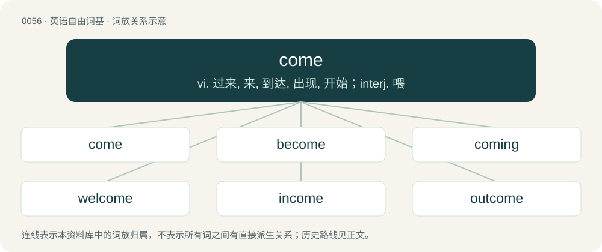

# 0057 · come — vi. 过来, 来, 到达, 出现, 开始；interj. 喂

[总目录](../00_总目录_按常用程度.md)

**类型**：英语自由词基　｜　**来源语言**：见词源记录

## 核心含义与来源

- 核心含义：vi. 过来, 来, 到达, 出现, 开始；interj. 喂
- 英文含义：To move nearer to the point of perspective.
- 词形：come

**来源记录 1**（动词；To move nearer to the point of perspective.）

From Middle English comen, cumen, from Old English cuman, from Proto-West Germanic \*kweman, from Proto-Germanic \*kwemaną (“to come”), from Proto-Indo-European \*gʷémt (“to step; to arrive”), from \*gʷem- (“to come, step”). Cognates Cognate from Proto-Germanic with Scots cum (“to come”), Yola come, coome, cum (“to come”), North Frisian kaame, kame, keem, kem, kum, kååme, käme (“to come”), Saterland Frisian kume, kuume (“to come”), West Frisian komme (“to come”), Alemannic German cha, cheemen, cheme, cho, chomu, chéeme (“to come”), Bavarian ckeman, kemma, kemman, khemen, kumma, kumman, kèmmin (“to come”), Central Franconian komme, kunn, kumme (“to come”), Cimbrian ken, khemmen, khèmman (“to come”), Dutch komen, kommen (“to come”), Dutch Low Saxon kåmen (“to come”), German and Luxembourgish kommen (“to come”), Low German kamen, kuemen (“to come”), Mòcheno kemmen (“to come”), Yiddish קימען (kimen), קומען (kumen, “to come”), Danish and Norwegian Bokmål komme (“to come”), Elfdalian kumå (“to come”), Faroese and Icelandic koma (“to come; to arrive”), Jamtish kuma (“to come”), Norwegian Nynorsk koma, komma, komme, kåmmå, kåmå (“to come”), Swedish komma (“to come”), Crimean Gothic kommen (“to come”), Gothic 𐌵𐌹𐌼𐌰𐌽 (qiman, “to come”). Cognate from Proto-Indo-European with Latin venio (“to come; to approach”), Greek βήμα (víma, “pace, step”), Albanian ngah, ngaj (“to hasten, run”), Latvian dzimt (“to be born”), Lithuanian gimti (“to be born”), Armenian եկ (ek, “the act of coming, arrival; income”), Avestan 𐬔𐬀𐬨 (gam, “to come, go”), Northern Kurdish gav (“step”), Persian گام (gâm, “step”), Tocharian A kum- (“to come”), Tocharian B käm- (“to come”), Sanskrit गम् (gam, “to come, go, move”).

## 词族图

## 单词速览（常用到不常用）

| 单词 | 音标 | 释义 |
|---|---|---|
| [come](#w-1) | 英 /kʌm/；美 /kʌm/ | vi. 过来, 来, 到达, 出现, 开始；interj. 喂 |
| [become](#w-2) | 美 /bɪˈkʌm/ | vi. 变成, 变得；vt. 适合 |
| [coming](#w-3) | /ˈkʌmɪŋ/ | n. 来临；a. 就要来的, 接着的 |
| [welcome](#w-4) | 英 /ˈwɛl.kəm/ | n. 欢迎, 欢迎词；a. 受欢迎的, 可随意的, 可喜的；vt. 欢迎, 接待 |
| [income](#w-5) | /ˈɪnˌkʌm/ | n. 收入, 收益, 流入；\[经\] 收益 |
| [outcome](#w-6) | /ˈaʊtkʌm/ | n. 结果, 出口 |
| [comer](#w-7) | 美 /ˈkʌmɚ/ | n. 来的人, 新来者, 有成功希望的人 |

## 逐词详解

### 1. come

**词性**：动词　｜　**音标**：英 /kʌm/；美 /kʌm/

**中文释义**：vi. 过来, 来, 到达, 出现, 开始；interj. 喂

**英文义项**：To move nearer to the point of perspective. / To move toward the speaker.

**词源与演化**：

From Middle English comen, cumen, from Old English cuman, from Proto-West Germanic \*kweman, from Proto-Germanic \*kwemaną (“to come”), from Proto-Indo-European \*gʷémt (“to step; to arrive”), from \*gʷem- (“to come, step”). Cognates Cognate from Proto-Germanic with Scots cum (“to come”), Yola come, coome, cum (“to come”), North Frisian kaame, kame, keem, kem, kum, kååme, käme (“to come”), Saterland Frisian kume, kuume (“to come”), West Frisian komme (“to come”), Alemannic German cha, cheemen, cheme, cho, chomu, chéeme (“to come”), Bavarian ckeman, kemma, kemman, khemen, kumma, kumman, kèmmin (“to come”), Central Franconian komme, kunn, kumme (“to come”), Cimbrian ken, khemmen, khèmman (“to come”), Dutch komen, kommen (“to come”), Dutch Low Saxon kåmen (“to come”), German and Luxembourgish kommen (“to come”), Low German kamen, kuemen (“to come”), Mòcheno kemmen (“to come”), Yiddish קימען (kimen), קומען (kumen, “to come”), Danish and Norwegian Bokmål komme (“to come”), Elfdalian kumå (“to come”), Faroese and Icelandic koma (“to come; to arrive”), Jamtish kuma (“to come”), Norwegian Nynorsk koma, komma, komme, kåmmå, kåmå (“to come”), Swedish komma (“to come”), Crimean Gothic kommen (“to come”), Gothic 𐌵𐌹𐌼𐌰𐌽 (qiman, “to come”). Cognate from Proto-Indo-European with Latin venio (“to come; to approach”), Greek βήμα (víma, “pace, step”), Albanian ngah, ngaj (“to hasten, run”), Latvian dzimt (“to be born”), Lithuanian gimti (“to be born”), Armenian եկ (ek, “the act of coming, arrival; income”), Avestan 𐬔𐬀𐬨 (gam, “to come, go”), Northern Kurdish gav (“step”), Persian گام (gâm, “step”), Tocharian A kum- (“to come”), Tocharian B käm- (“to come”), Sanskrit गम् (gam, “to come, go, move”).

**例句**：

> Our milkshakes come in vanilla, strawberry and chocolate flavours.

该用例对应义项：To be supplied, or made available; to exist.

### 2. become

**词性**：动词　｜　**音标**：美 /bɪˈkʌm/

**中文释义**：vi. 变成, 变得；vt. 适合

**英文义项**：begin to be; turn into (often with permanent states). / To come about; happen; come into being; arise.

**构词拆分**：be- + come；be- (“about, around”) + come

**词源与演化**：

A compound of the sources of be- + come. From Middle English becomen, bicumen, from Old English becuman (“to come (to), approach, arrive, enter, meet with, fall in with; happen, befall; befit”), from Proto-Germanic \*bikwemaną (“to come around, come about, come across, come by”), equivalent to be- (“about, around”) + come. Cognate with Scots becum (“to come, arrive, reach a destination”), North Frisian bekommen, bykommen (“to come by, obtain, receive”), West Frisian bikomme (“to come by, obtain, receive”), Dutch bekomen (“to come by, obtain, receive”), German bekommen (“to get, receive, obtain”), Swedish bekomma (“to receive, concern”), Gothic 𐌱𐌹𐌵𐌹𐌼𐌰𐌽 (biqiman, “to come upon one, befall”). Sense of "befit, suit" due to influence from Middle English cweme, icweme, see queem. Displaced Old English weorþan.

**例句**：

> The full extent of my injuries did not become evident until they tried to move me.

该用例对应义项：begin to be; turn into (often with permanent states).

### 3. coming

**词性**：感叹词　｜　**音标**：/ˈkʌmɪŋ/

**中文释义**：n. 来临；a. 就要来的, 接着的

**英文义项**：Used to express that one is on the way.

**构词拆分**：come + -ing (present participle ending)

**词源与演化**：

From Middle English cominge, comynge, comande, from Old English cumende, from Proto-Germanic \*kwemandz, present participle of Proto-Germanic \*kwemaną (“to come”), equivalent to come + -ing (present participle ending). Cognate with Dutch komend (“coming”), German kommend (“coming”), Swedish kommande (“coming”), Icelandic komandi (“coming”).

**用法示例／搭配（非完整句）**：

> — Coming

该用例对应义项：Used to express that one is on the way.

### 4. welcome

**词性**：形容词　｜　**音标**：英 /ˈwɛl.kəm/

**中文释义**：n. 欢迎, 欢迎词；a. 受欢迎的, 可随意的, 可喜的；vt. 欢迎, 接待

**英文义项**：Whose arrival is a cause of joy; received with gladness; admitted willingly to the house, entertainment, or company. / Producing gladness.

**构词拆分**：will (“desire”) + come (“comer, arrival”)

**词源与演化**：

From Middle English welcome, wolcume, wulcume, wilcume, from Old English wilcuma (“a wished-for guest”; compare also wilcume (“welcome!”, interjection)), from Proto-West Germanic \*willjakwemō, from Proto-Germanic \*wiljakwemô (“a wished-for arrival or guest”), possibly from \*wiljakwemaną (“to be welcome”), equivalent to will (“desire”) + come (“comer, arrival”). The component wil- was replaced by wel- when the sense “guest” of the second component was no longer understood, likely under influence from the adverb well. Cognates Cognate with Scots walcome, Yola welcome, welkome, North Frisian welkimen, Saterland Frisian wilkemen, wäilkeemen, wülkemen, West Frisian wolkom, Alemannic German wol chomne, wolgcheemen, woul chemne, wéllkòmm, Cimbrian bóolkhèmm, Dutch welkom (earlier willecome), German willkommen, German Low German willkamen, Limburgish welkom, wéllekemm, Luxembourgish wëllkomm, Danish and Norwegian Bokmål velkommen, Elfdalian welkumin, Faroese vælkomin, Icelandic velkominn, Norwegian Nynorsk velkomen, Swedish välkommen, and Old French wilecome (whence Middle French willecomme (“welcome”)), from Germanic. The verb is from Middle English welcomen, wolcumen, wilcumen, from Old English wellcumian, wylcumian, wilcumian (“to welcome, receive gladly”). Similar constructions are found in Modern Greek καλώς ορίσατε (kalós orísate), South Slavic languages, such as Bulgarian добре́ дошъ́л (dobré došắl), Serbo-Croatian dobrodošao, and also in Romance languages, such as Italian benvenuto, Spanish bienvenido, French bienvenu, Catalan benvingut, Portuguese bem-vindo and Romanian bun venit, meaning “\[may you have fared\] well \[in\] coming \[here\]”. These Romance terms do not derive from a Classical Latin root, as no similar construction in Latin is found to exist, but are instead presumed (considering the ruling elite of the Germanic kingdoms which succeeded the Western Roman Empire) to be the result of a calque from a Germanic language into Proto-Romance (Vulgar Latin; see Latin \*bene venūtus, and compare perdōnō and compāniō for similar historical calques).

**例句**：

> You are welcome to the use of my library.

该用例对应义项：Followed by to: free to have or enjoy gratuitously.

### 5. income

**词性**：名词　｜　**音标**：/ˈɪnˌkʌm/

**中文释义**：n. 收入, 收益, 流入；\[经\] 收益

**英文义项**：Money one earns by working or by capitalising on the work of others. / Money coming in to a fund, account, or policy.

**构词拆分**：in- + come

**词源与演化**：

From Middle English income, perhaps continuing (in altered form) Old English incyme (“an in-coming, entrance”), equivalent to in- + come. Cognate with Saterland Frisian Íenkúumen (“income”), West Frisian ynkommen (“income”), Dutch inkomen, inkomst (“income, earnings, gainings”), German Low German Inkumst (“income”), German Einkommen, Einkunft (“income, earnings, competence”), Danish indkomst (“income”), Swedish inkomst (“income”), Icelandic innkváma (“income”).

**例句**：

> A man of wealth has to pay a lot of income tax.

### 6. outcome

**词性**：名词　｜　**音标**：/ˈaʊtkʌm/

**中文释义**：n. 结果, 出口

**英文义项**：That which is produced or occurs as a result of an event or process. / The result of a random trial. An element of a sample space.

**构词拆分**：out + come

**词源与演化**：

From out + come.

**例句**：

> A quality automobile is the outcome of the work of skilled engineers and thousands of workers.

该用例对应义项：That which is produced or occurs as a result of an event or process.

### 7. comer

**词性**：名词　｜　**音标**：美 /ˈkʌmɚ/

**中文释义**：n. 来的人, 新来者, 有成功希望的人

**英文义项**：One in a race who is catching up to others and shows promise of winning. / An ambitious person; one who is catching up in some contest and has a likelihood of victory;

**构词拆分**：come + -er

**词源与演化**：

From Middle English comere, equivalent to come + -er.

**例句**：

> The champ will face all comers.

该用例对应义项：One who arrives.
