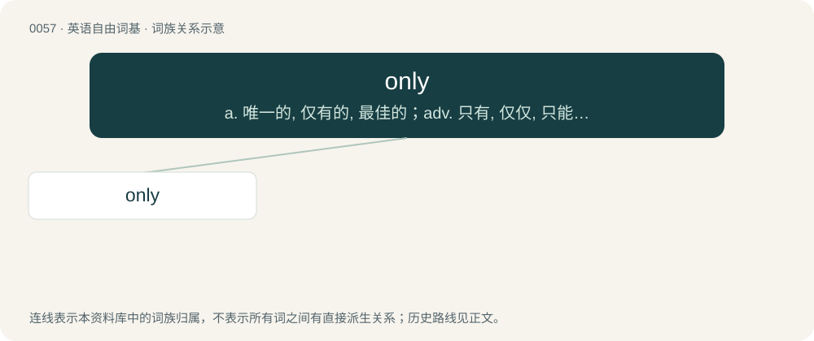

# 0058 · only — a. 唯一的, 仅有的, 最佳的；adv. 只有, 仅仅, 只能；conj. 但是, 不过

[总目录](../00_总目录_按常用程度.md)

**类型**：英语自由词基　｜　**来源语言**：见词源记录

## 核心含义与来源

- 核心含义：a. 唯一的, 仅有的, 最佳的；adv. 只有, 仅仅, 只能；conj. 但是, 不过
- 英文含义：Alone in a category.
- 词形：only

**来源记录 1**（形容词；Alone in a category.）

From Middle English oonly, only, from Old English ānlīċ, ǣnlīċ (“only; singular; solitary”), from Proto-Germanic \*ainalīkaz. Cognate with obsolete Dutch eenlijk, German ähnlich (“similar”), Old Norse álíkr, Swedish enlig (“unified”). By surface analysis, on(e) + -ly. \* Regarding the different phonological development of only and one, see the note in one.

## 词族图

## 单词速览（常用到不常用）

| 单词 | 音标 | 释义 |
|---|---|---|
| [only](#w-1) | 英 /ˈəʊn.li/；美 /ˈoʊn.li/ | a. 唯一的, 仅有的, 最佳的；adv. 只有, 仅仅, 只能；conj. 但是, 不过 |

## 逐词详解

### 1. only

**词性**：形容词　｜　**音标**：英 /ˈəʊn.li/；美 /ˈoʊn.li/

**中文释义**：a. 唯一的, 仅有的, 最佳的；adv. 只有, 仅仅, 只能；conj. 但是, 不过

**英文义项**：Alone in a category. / Singularly superior; the best.

**构词拆分**：By surface analysis, on(e) + -ly

**词源与演化**：

From Middle English oonly, only, from Old English ānlīċ, ǣnlīċ (“only; singular; solitary”), from Proto-Germanic \*ainalīkaz. Cognate with obsolete Dutch eenlijk, German ähnlich (“similar”), Old Norse álíkr, Swedish enlig (“unified”). By surface analysis, on(e) + -ly. \* Regarding the different phonological development of only and one, see the note in one.

**例句**：

> The only people in the stadium were the fans: no players, coaches, or officials.

该用例对应义项：Alone in a category.
