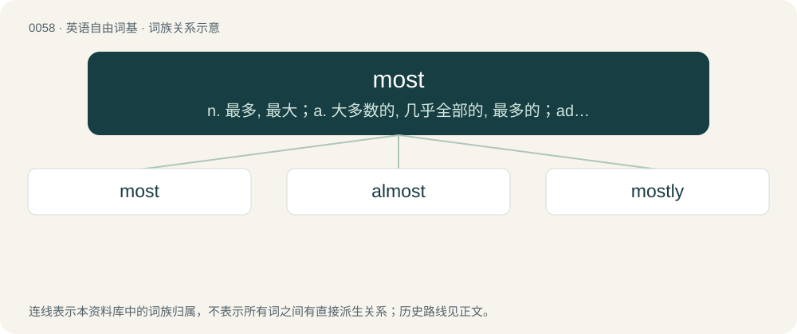

# 0059 · most — n. 最多, 最大；a. 大多数的, 几乎全部的, 最多的；adv. 最, 最多, 极其

[总目录](../00_总目录_按常用程度.md)

**类型**：英语自由词基　｜　**来源语言**：见词源记录

## 核心含义与来源

- 核心含义：n. 最多, 最大；a. 大多数的, 几乎全部的, 最多的；adv. 最, 最多, 极其
- 英文含义：Forms the superlative of many adjectives.
- 词形：most

**来源记录 1**（副词；Forms the superlative of many adjectives.）

From Middle English most, moste, from Old English mǣst, māst, from Proto-Germanic \*maistaz, \*maist. Cognate with Scots mast, maist (“most”), Saterland Frisian maast (“most”), West Frisian meast (“most”), Dutch meest (“most”), German meist (“most”), Danish and Swedish mest (“most”), Icelandic mestur (“most”).

## 词族图

## 单词速览（常用到不常用）

| 单词 | 音标 | 释义 |
|---|---|---|
| [most](#w-1) | 英 /ˈməʊst/；美 /ˈmoʊst/ | n. 最多, 最大；a. 大多数的, 几乎全部的, 最多的；adv. 最, 最多, 极其 |
| [almost](#w-2) | 英 /ˈɔːl.məʊst/；美 /ˈɔl.moʊst/ | adv. 几乎, 差不多 |
| [mostly](#w-3) | 英 /ˈməʊstli/；美 /ˈmoʊstli/ | adv. 大概, 大部分, 主要；\[经\] 大部份 |

## 逐词详解

### 1. most

**词性**：名词　｜　**音标**：英 /ˈməʊst/；美 /ˈmoʊst/

**中文释义**：n. 最多, 最大；a. 大多数的, 几乎全部的, 最多的；adv. 最, 最多, 极其

**英文义项**：The greatest amount. / The greater part.

**词源与演化**：

From Middle English most, moste, from Old English mǣst, māst, from Proto-Germanic \*maistaz, \*maist. Cognate with Scots mast, maist (“most”), Saterland Frisian maast (“most”), West Frisian meast (“most”), Dutch meest (“most”), German meist (“most”), Danish and Swedish mest (“most”), Icelandic mestur (“most”).

**例句**：

> The most I can offer for the house is $150,000.

该用例对应义项：The greatest amount.

### 2. almost

**词性**：名词　｜　**音标**：英 /ˈɔːl.məʊst/；美 /ˈɔl.moʊst/

**中文释义**：adv. 几乎, 差不多

**英文义项**：Something or someone that doesn't quite make it.

**构词拆分**：al- (“all”) + most

**词源与演化**：

From Middle English almost, from Old English eallmǣst (“nearly all, almost, for the most part”), equivalent to al- (“all”) + most.

**例句**：

> In all the submissions, they found four papers that were clearly worth publishing and another dozen almosts.

该用例对应义项：Something or someone that doesn't quite make it.

### 3. mostly

**词性**：副词　｜　**音标**：英 /ˈməʊstli/；美 /ˈmoʊstli/

**中文释义**：adv. 大概, 大部分, 主要；\[经\] 大部份

**英文义项**：Mainly or chiefly; for the most part; usually, generally, on the whole. / Synonym of probably, likely.

**构词拆分**：most + -ly

**词源与演化**：

From most + -ly. The sense “probably” is a calque from Indian languages such as Tamil அனேகமாக (aṉēkamāka).

**例句**：

> They're mostly good people, although they have made a few mistakes.

该用例对应义项：Mainly or chiefly; for the most part; usually, generally, on the whole.
