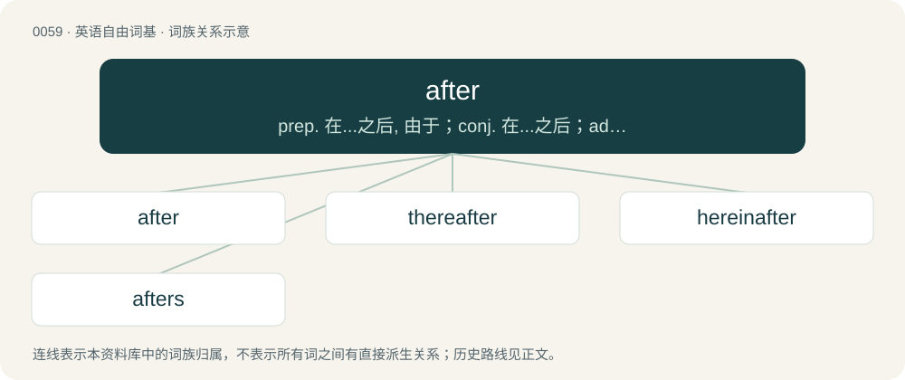

# 0060 · after — prep. 在...之后, 由于；conj. 在...之后；adv. 后来

[总目录](../00_总目录_按常用程度.md)

**类型**：英语自由词基　｜　**来源语言**：见词源记录

## 核心含义与来源

- 核心含义：prep. 在...之后, 由于；conj. 在...之后；adv. 后来
- 英文含义：Behind; later in time; following.
- 词形：after

**来源记录 1**（副词；Behind; later in time; following.）

From Middle English after, from Old English æfter, from Proto-West Germanic \*aftar, from Proto-Germanic \*after, \*aftiri, from Proto-Indo-European \*h₂epoteros (“further behind, further away”), from \*h₂epo (“off, away”). Cognate with Scots efter (“after”), North Frisian efter (“after, behind”), West Frisian after, achter, efter (“behind; after”), Low German and Dutch achter (“behind”), German after- (“after-”), Danish and Swedish efter (“after”), Norwegian Bokmål and Norwegian Nynorsk etter (“after”), Faroese and Icelandic eftir (“after”). The Irish usage to indicate recent completion of an activity is a calque of the Irish collocation Táim tar éis... (“I have just...”, literally “I am after...”).

## 词族图

## 单词速览（常用到不常用）

| 单词 | 音标 | 释义 |
|---|---|---|
| [after](#w-1) | 英 /ˈɑːftə/；美 /ˈæftəɹ/ | prep. 在...之后, 由于；conj. 在...之后；adv. 后来 |
| [thereafter](#w-2) | 英 /ˌðɛəɹˈɑːf.tə(ɹ)/；美 /ˌðɛɹˈæf.tɚ/ | adv. 其后, 从那时以后 |
| [hereinafter](#w-3) | 英 /ˈhɪəɹɪnˈɑːftə/；美 /ˈhɪɹɪnˈæftɚ/ | adv. 以下, 在下文中 |
| [afters](#w-4) | /ˈɑːftəz. ˈæf-/ | n. 正餐后的甜食 |

## 逐词详解

### 1. after

**词性**：形容词　｜　**音标**：英 /ˈɑːftə/；美 /ˈæftəɹ/

**中文释义**：prep. 在...之后, 由于；conj. 在...之后；adv. 后来

**英文义项**：Later; second (of two); next, following, subsequent / At or towards the stern of a ship or the rear of an aircraft.

**词源与演化**：

From Middle English after, from Old English æfter, from Proto-West Germanic \*aftar, from Proto-Germanic \*after, \*aftiri, from Proto-Indo-European \*h₂epoteros (“further behind, further away”), from \*h₂epo (“off, away”). Cognate with Scots efter (“after”), North Frisian efter (“after, behind”), West Frisian after, achter, efter (“behind; after”), Low German and Dutch achter (“behind”), German after- (“after-”), Danish and Swedish efter (“after”), Norwegian Bokmål and Norwegian Nynorsk etter (“after”), Faroese and Icelandic eftir (“after”). The Irish usage to indicate recent completion of an activity is a calque of the Irish collocation Táim tar éis... (“I have just...”, literally “I am after...”).

**例句**：

> The aircraft provided an after cabin for two radar operators.

该用例对应义项：At or towards the stern of a ship or the rear of an aircraft.

### 2. thereafter

**词性**：副词　｜　**音标**：英 /ˌðɛəɹˈɑːf.tə(ɹ)/；美 /ˌðɛɹˈæf.tɚ/

**中文释义**：adv. 其后, 从那时以后

**英文义项**：After that time, from then on; thenceforth. / After that (the thing aforementioned).

**构词拆分**：there + after

**词源与演化**：

From Middle English therafter, theraftir, þerefter, þerafter, þeræfter, from Old English þǣræfter (“after that; thereafter”), equivalent to there + after. Cognate with Saterland Frisian deerätter (“thereafter”), West Frisian dêrefter (“behind that; thereafter”), Dutch daarachter (“behind that; thereafter”), German Low German daarachter (“behind that”), Danish derefter (“thereafter”), Swedish därefter (“thereafter”).

**例句**：

> The little dog was off like a shot, and the children went running thereafter.

该用例对应义项：After that (the thing aforementioned).

### 3. hereinafter

**词性**：副词　｜　**音标**：英 /ˈhɪəɹɪnˈɑːftə/；美 /ˈhɪɹɪnˈæftɚ/

**中文释义**：adv. 以下, 在下文中

**英文义项**：In the parts of this document, statement, or book that follow; after this

**构词拆分**：herein + after

**词源与演化**：

From herein + after.

**例句**：

> The landlord demises unto the tenant the premises hereinafter called the demised premises.

该用例对应义项：in a subsequent part of this document or statement or matter etc.

### 4. afters

**词性**：名词　｜　**音标**：/ˈɑːftəz. ˈæf-/

**中文释义**：n. 正餐后的甜食

**英文义项**：Dessert. / The festivities held after a wedding meal.

**构词拆分**：after + -s

**词源与演化**：

From after + -s (hypocoristic suffix).

**例句**：

> To keep costs down at our wedding, we only had family at the banquet, but invited all our friends to the afters.

该用例对应义项：The festivities held after a wedding meal.
