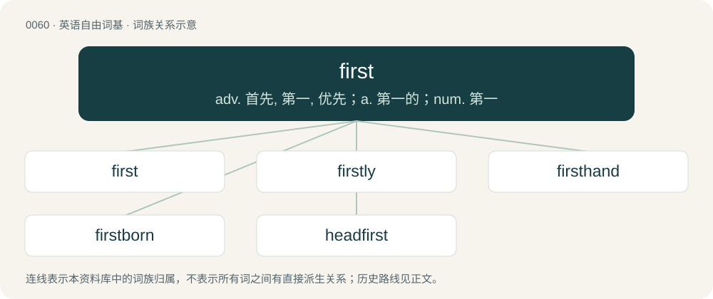

# 0061 · first — adv. 首先, 第一, 优先；a. 第一的；num. 第一

[总目录](../00_总目录_按常用程度.md)

**类型**：英语自由词基　｜　**来源语言**：见词源记录

## 核心含义与来源

- 核心含义：adv. 首先, 第一, 优先；a. 第一的；num. 第一
- 英文含义：Preceding all others of a series or kind; the ordinal of one; earliest.
- 词形：first

**来源记录 1**（形容词；Preceding all others of a series or kind; the ordinal of one; earliest.）

From Middle English first, furst, ferst, fyrst, from Old English fyrest, from Proto-West Germanic \*furist, from Proto-Germanic \*furistaz (“first, foremost”), superlative of Proto-Germanic \*furai, \*furi (“before”), from Proto-Indo-European \*preh₂- (“before”), from \*per- (“before; first”), equivalent to fore + -est. Cognates Cognate with Scots first (“first”), Dutch voorste (“foremost, first”), vorst (“prince”), German Fürst (“chief, prince”, literally “first (born)”), Limburgish Vürsch (“prince”), Luxembourgish viischt (“anterior; forward”), Vilamovian fiyśt, fjəšt, fjyśt, fjyšt (“prince”), Danish and Norwegian Bokmål først (“first”), Faroese and Icelandic fyrstur (“first”), Norwegian Nynorsk fyrst, først (“first”), Swedish först (“first”); also Latin prīnceps (“first, foremost; chief”), Greek παρ’ (par’), παρά (pará, “despite; less”), Mycenaean Greek 𐀞𐀫 (pa-ro, “from”), Albanian parë (“first; chief, main”), Latgalian pyrmais (“first”), Latvian pirmais (“first; foremost”), Lithuanian pirmas (“first; primary”), Bulgarian пъ́рви (pắrvi), пръ́в (prắv, “first”), Czech and Slovak prvý (“first”), Macedonian прв (prv), први (prvi, “first”), Polish piersy, pierwszy, pirszy (“first”), Russian пе́рвый (pérvyj, “first”), Serbo-Croatian пр̑вӣ, pȓvī (“first”), Slovene prvi (“first”), Armenian հարավ (harav, “south”), Avestan 𐬞𐬀𐬎𐬭𐬎𐬎𐬀 (paᵘruua, “before, first”), Tocharian A pärwat (“first”), Tocharian B parwe (“first”), Sanskrit पूर्व (pūrva, “before”).

## 词族图

## 单词速览（常用到不常用）

| 单词 | 音标 | 释义 |
|---|---|---|
| [first](#w-1) | 英 /fɜːst/；美 /fɚst/ | adv. 首先, 第一, 优先；a. 第一的；num. 第一 |
| [firstly](#w-2) | /ˈfɜɹstli/ | adv. 第一, 首先 |
| [firsthand](#w-3) | 英 /ˈfɜːstˌhænd/；美 /ˈfɝstˌhænd/ | a. 直接的, 直接得来的, 直接采购的；adv. 直接地 |
| [firstborn](#w-4) | /ˈfɜː(ɹ)stˌbɔː(ɹ)n/ | a. 第一胎生的；n. 初生儿, 长男, 长女 |
| [headfirst](#w-5) |  | adv. 头在前 |

## 逐词详解

### 1. first

**词性**：形容词　｜　**音标**：英 /fɜːst/；美 /fɚst/

**中文释义**：adv. 首先, 第一, 优先；a. 第一的；num. 第一

**英文义项**：Preceding all others of a series or kind; the ordinal of one; earliest. / Most eminent or exalted; most excellent; chief; highest.

**构词拆分**：fore + -est

**词源与演化**：

From Middle English first, furst, ferst, fyrst, from Old English fyrest, from Proto-West Germanic \*furist, from Proto-Germanic \*furistaz (“first, foremost”), superlative of Proto-Germanic \*furai, \*furi (“before”), from Proto-Indo-European \*preh₂- (“before”), from \*per- (“before; first”), equivalent to fore + -est. Cognates Cognate with Scots first (“first”), Dutch voorste (“foremost, first”), vorst (“prince”), German Fürst (“chief, prince”, literally “first (born)”), Limburgish Vürsch (“prince”), Luxembourgish viischt (“anterior; forward”), Vilamovian fiyśt, fjəšt, fjyśt, fjyšt (“prince”), Danish and Norwegian Bokmål først (“first”), Faroese and Icelandic fyrstur (“first”), Norwegian Nynorsk fyrst, først (“first”), Swedish först (“first”); also Latin prīnceps (“first, foremost; chief”), Greek παρ’ (par’), παρά (pará, “despite; less”), Mycenaean Greek 𐀞𐀫 (pa-ro, “from”), Albanian parë (“first; chief, main”), Latgalian pyrmais (“first”), Latvian pirmais (“first; foremost”), Lithuanian pirmas (“first; primary”), Bulgarian пъ́рви (pắrvi), пръ́в (prắv, “first”), Czech and Slovak prvý (“first”), Macedonian прв (prv), први (prvi, “first”), Polish piersy, pierwszy, pirszy (“first”), Russian пе́рвый (pérvyj, “first”), Serbo-Croatian пр̑вӣ, pȓvī (“first”), Slovene prvi (“first”), Armenian հարավ (harav, “south”), Avestan 𐬞𐬀𐬎𐬭𐬎𐬎𐬀 (paᵘruua, “before, first”), Tocharian A pärwat (“first”), Tocharian B parwe (“first”), Sanskrit पूर्व (pūrva, “before”).

**例句**：

> I was the first runner to reach the finish line, and won the race.

该用例对应义项：Preceding all others of a series or kind; the ordinal of one; earliest.

### 2. firstly

**词性**：副词　｜　**音标**：/ˈfɜɹstli/

**中文释义**：adv. 第一, 首先

**英文义项**：In the first place; before anything else; first.

**构词拆分**：first + -ly

**词源与演化**：

Coined before 1475, from Middle English fyrst-lyk, equivalent to first + -ly.

**例句**：

> Firstly, he is your father, secondly, he is very sick. Tom, you must absolutely help him!

### 3. firsthand

**词性**：形容词　｜　**音标**：英 /ˈfɜːstˌhænd/；美 /ˈfɝstˌhænd/

**中文释义**：a. 直接的, 直接得来的, 直接采购的；adv. 直接地

**英文义项**：Direct, without intermediate stages. / Not previously owned or used; contrasted with secondhand.

**构词拆分**：first + hand

**词源与演化**：

From first + hand.

**用法示例／搭配（非完整句）**：

> firsthand knowledge

该用例对应义项：Direct, without intermediate stages.

### 4. firstborn

**词性**：名词　｜　**音标**：/ˈfɜː(ɹ)stˌbɔː(ɹ)n/

**中文释义**：a. 第一胎生的；n. 初生儿, 长男, 长女

**英文义项**：The first child to be born to a parent or family.

**构词拆分**：By surface analysis, first (adverb) + born

**词源与演化**：

From Middle English first borne. By surface analysis, first (adverb) + born.

**例句**：

> Rumpelstiltskin spun straw into gold, in exchange for the woman's firstborn child.

### 5. headfirst

**词性**：形容词

**中文释义**：adv. 头在前

**英文义项**：With the head in front; headlong.

**构词拆分**：head + first

**词源与演化**：

From head + first.

**例句**：

> A headfirst plunge down the stairs.

该用例对应义项：with the head foremost
