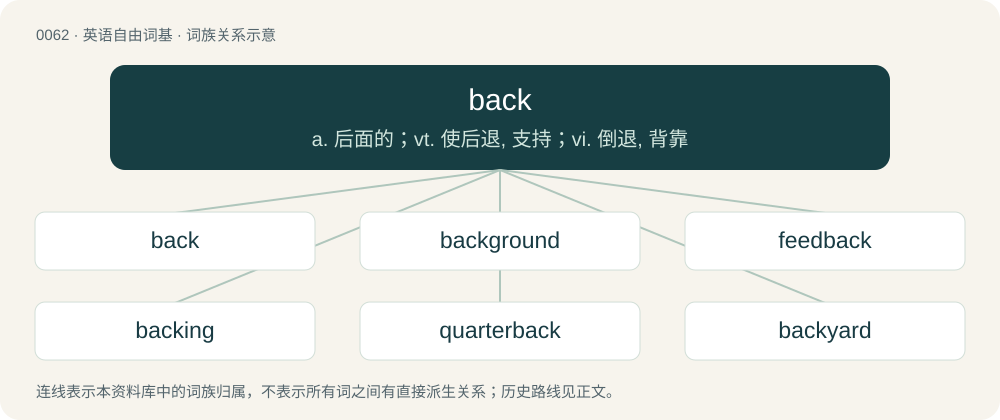

# 0062 · back — a. 后面的；vt. 使后退, 支持；vi. 倒退, 背靠

[总目录](../00_总目录_按常用程度.md)

**类型**：英语自由词基　｜　**来源语言**：见词源记录

## 核心含义与来源

- 核心含义：a. 后面的；vt. 使后退, 支持；vi. 倒退, 背靠
- 英文含义：At or near the rear.
- 词形：back

**多个词源／构词路径**：同一拼写可能有不同来源；以下按词性和含义分别列出。

**来源记录 1**（形容词；At or near the rear.）

From Middle English bak, from Old English bæc, from Proto-West Germanic \*bak, from Proto-Germanic \*baką, possibly from Proto-Indo-European \*bʰeg- (“to bend”). The adverb represents an aphetic form of aback. Compare Middle Low German bak (“back”), from Old Saxon bak, and West Frisian bekling (“chair back”), Old High German bah, Swedish and Norwegian bak. Cognate with German Bache (“sow \[adult female hog\]”).

**来源记录 2**（名词；A large shallow vat; a cistern, tub, or trough, used by brewers, distillers, dyers, picklers, gluemakers, and others, for mixing or cooling wort, holding water, hot glue, etc.）

Borrowed from French bac.

## 词族图

## 单词速览（常用到不常用）

| 单词 | 音标 | 释义 |
|---|---|---|
| [back](#w-1) | 英 /bæk/ | a. 后面的；vt. 使后退, 支持；vi. 倒退, 背靠 |
| [background](#w-2) | /ˈbæk.(ɡ)ɹaʊnd/ | n. 背景, 背景资料；\[计\] 背景, 后台 |
| [feedback](#w-3) | /ˈfiːdˌbæk/ | n. 反馈, 反应；\[计\] 反馈 |
| [backing](#w-4) | /ˈbæk.ɪŋ(ɡ)/ | n. 后退, 衬背, 后援, 支持者；\[化\] 衬垫 |
| [quarterback](#w-5) | /ˈkwɔːtəbak/ | n. 四分卫；vi. 担任四分卫 |
| [backyard](#w-6) | 英 /bækˈjɑːd/ | n. 后院, 后庭 |
| [backpack](#w-7) | /ˈbæk.pæk/ | n. 远足用的背包；双肩背包, 背包 |
| [backward](#w-8) | 英 /ˈbæk.wə(ɹ)d/；美 /ˈbækwɚd/ | adv. 向后地, 相反地；a. 向后的, 相反的；\[计\] 倒推 |
| [paperback](#w-9) | 英 /ˈpeɪ.pə.bæk/；美 /ˈpeɪ.pɚˌbæk/ | n. 平装本, 纸面本 |
| [backstage](#w-10) | /bækˈsteɪd͡ʒ/ | adv. 在后台, 向后台 |
| [backdrop](#w-11) | 英 /ˈbæk.dɹɒp/；美 /ˈbæk.dɹɑp/ | n. 背景幕, 背景 |
| [backbone](#w-12) | 英 /ˈbækˌbəʊn/；美 /ˈbækˌboʊn/ | n. 脊椎, 志气, 骨干, 支柱；\[计\] 主干网, 主干网点 |
| [flashback](#w-13) | /ˈflæʃ.bæk/ | n. 倒叙, 火舌回闪；\[机\] 回闪 |
| [horseback](#w-14) | 英 /ˈhɔːsˌbæk/；美 /ˈhɔɹsˌbæk/ | n. 马背；adv. 在马背上, 骑在马上 |
| [playback](#w-15) | /ˈpleɪˌbæk/ | n. (录音)重放, (录音)重放装置；\[计\] 重现 |
| [fullback](#w-16) | 美 /ˈfʊlˌbæk/ | n. 后卫 |
| [backlog](#w-17) | 美 /ˈbæk(ˌ)lɔɡ/ | n. 积压待办的事务, 积压而未交付的订货, 积压的工作；vt. 储备, 把...积压起来；\[计\] 储备, 后备, 积压 |
| [drawback](#w-18) | 英 /ˈdɹɔːˌbæk/；美 /ˈdɹɔˌbæk/ | n. 缺点, 退税；\[法\] 退款, 退税 |
| [outback](#w-19) | 美 /ˈaʊtbæk/ | n. 内地；a. 内地的；adv. 在内地 |
| [backside](#w-20) | /ˈbækˌsaɪd/ | n. 背部, 背后, 后方 |
| [backseat](#w-21) | /ˈbæksiːt/ | n. 后座, 次要位置 |
| [backfire](#w-22) | /bækˈfaɪə(ɹ)/ | n. 逆火, 回火, 放火；vi. 放逆火, 预先放火, 发生意外 |
| [cornerback](#w-23) | /ˈkɔːnəbæk/ | n. (美式橄榄球)侧卫 |
| [backer](#w-24) | /ˈbækɚ/ | n. 援助者, 支持者；\[经\] 背书人, 支持人 |
| [halfback](#w-25) | 美 /ˈhæfˌbæk/ | n. (足球)前卫 |
| [aback](#w-26) | 英 /əˈbæk/；美 /əˈbæk/ | adv. 向后, 朝后, 突然, 船顶风地 |
| [hatchback](#w-27) | 美 /ˈhæt͡ʃˌbæk/ | n. 有向上打开的后门的汽车 |
| [backhand](#w-28) | 英 /ˈbækhænd/ | n. 手背拍, 反手抽击, 左斜手写体；v. 反手抽击 |
| [backwater](#w-29) | /ˈbæk.wɒːtə/ | n. 死水, 滞水, 停滞, 回水 |
| [humpback](#w-30) | /ˈhʌmpbæk/ | n. 驼背(者), 细鳞大马哈鱼；\[医\] 脊柱后突, 驼背 |
| [hardback](#w-31) | 美 /ˈhɑɹdˌbæk/ | a. 硬封面的；n. 精装本 |
| [backroom](#w-32) | 英 /ˈbækˌɹuːm/；美 /ˈbækˌɹum/ | n. 后房, 密室；a. 在密室中的 |
| [pushback](#w-33) | /ˈpʊʃbæk/ | n. 飞机推迟起飞 |
| [backstreet](#w-34) | /ˈbækstriːt/ | n. （贫穷地区的）后街小巷；a. 偷偷摸摸的；非法的 |
| [backcountry](#w-35) | /ˈbækˌkʌntɹi/ | n. 偏僻地区；边远地区；穷乡僻壤；a. 偏僻地区的 |
| [bareback](#w-36) | 英 /ˈbɛəbæk/；美 /ˈbɛɚbæk/ | a. 不用鞍的；adv. 不用马鞍地 |
| [backwoods](#w-37) | 英 /ˈbak.wʊdz/；美 /ˈbækˌwʊdz/ | n. 未开垦地 |
| [backfield](#w-38) | 英 /ˈbakfiːld/；美 /ˈbækˌfild/ | n. 后卫；守卫区 |
| [backtrack](#w-39) | /ˈbæk.tɹæk/ | vi. 返回, 退走, 撤退, 放弃；\[化\] 回溯 |
| [backstroke](#w-40) | 美 /ˈbækˌstɹoʊk/ | n. 还击, 反手击球, 仰泳；vi. 还击, 反手击球, 仰泳；vt. 用反手击 |
| [backstop](#w-41) | /ˈbæk.stɒp/ | n. 挡球网, 接球手；\[电\] 背向停止 |
| [backboard](#w-42) | /ˈbækbɒːd/ | n. 后挡板, 背板, 脊骨矫正板, 篮板 |
| [greenback](#w-43) | /ˈgriːnbæk/ | n. 美钞, 绿背动物；\[法\] 美钞 |
| [backlit](#w-44) | 美 /ˈbækˌlɪt/ | n. 后面打光；背光式 |
| [brokeback](#w-45) |  | 断背 |
| [backlight](#w-46) | /ˈbæk.laɪt/ | vt. 从背后照亮 |
| [backcourt](#w-47) | /ˈbæk,kɔːt/ | n. 距球门最远的场地 |
| [backless](#w-48) | 美 /ˈbækləs/ | a. 无靠背的 |
| [backhanded](#w-49) | /ˈbækˌhændəd/ | a. 间接的 |
| [backhoe](#w-50) | /ˈbæk.həʊ/ | n. (有伸缩挖掘装置的)锄耕机 |
| [diamondback](#w-51) | /ˈdaɪməndˌbæk/ | a. 有菱形斑纹的；n. 菱背响尾蛇 |
| [brownback](#w-52) |  | \[人名\] 布朗巴克 |
| [razorback](#w-53) | 英 /ˈɹeɪzəˌbæk/；美 /ˈɹeɪzɚˌbæk/ | n. 狭尖的背脊, 鳍鲸 |
| [silverback](#w-54) | /ˈsilvəbæk/ | n. \[动\]银背大猩猩(指背部颈下方有银白色毛的雄性成年大猩猩) |
| [backbench](#w-55) | /ˈbækbentʃ/ | n. 后座议员席；a. 后座议员的 |
| [tailback](#w-56) | 美 /ˈteɪlˌbæk/ | n. &lt;英&gt;交通堵塞 |
| [fightback](#w-57) | /ˈfaitbæk/ | n. &lt;英&gt;回击, 反攻 |
| [saddleback](#w-58) | /ˈsædlbæk/ | n. 鞍状峰, 鞍形屋顶, 鞍背鸟 |
| [camelback](#w-59) | /ˈkæməlbæk/ | a. 骑在骆驼背上的；adv. 骑在骆驼背上地；n. 骆驼背, 一种翻新的橡胶 |
| [backache](#w-60) | /ˈbækeɪk/ | n. 背痛 |
| [snapback](#w-61) | /ˈsnæpˌbæk/ | n. 快速传球, 很快的恢复 |
| [backspace](#w-62) | /ˈbækˌspeɪs/ | vi. 退后一格；n. 退格；\[计\] 退格 |
| [backfill](#w-63) | /ˈbækfɪl/ | vt. 装填, 回填；n. 装填, 回填 |
| [switchback](#w-64) | 英 /ˈswɪt͡ʃbæk/；美 /ˈswɪt͡ʃˌbæk/ | n. Z形爬坡路线 |
| [backman](#w-65) |  | n. 辅助工；后方；n. (Backman)人名；(英、瑞典)巴克曼 |
| [backhaul](#w-66) | /ˈbækhɔːl/ | n. (货运车的)回程(通常亦载货),回程运费 |
| [backwash](#w-67) | 英 /ˈbæk.wɒʃ/；美 /ˈbæk.wɑʃ/ | n. (划桨引起的)反流, 激流区, 反响；\[机\] 逆吹 |
| [backbreaking](#w-68) | /ˈbækbreikiŋ/ | a. 非常辛劳的 |
| [backslash](#w-69) | /ˈbækˌslæʃ/ | \[计\] 反斜杠 |
| [backswing](#w-70) | /ˈbækswiŋ/ | \[电\] 背向摆动 |
| [leatherback](#w-71) | /ˈlɛ.ðɚ.bæk/ | n. 棱皮龟 |
| [backburner](#w-72) |  | 不重要的 |
| [backplane](#w-73) |  | \[电\] 基架 |
| [wingback](#w-74) | /ˈwiŋbæk/ | n. \[美橄\]助攻边卫 |
| [backlink](#w-75) |  | 【英文】A hyperlink to a webpage from an external website. |
| [backstab](#w-76) | /ˈbækˌstæb/ | v. 以卑鄙的手段陷害 |
| [backhouse](#w-77) | /ˈbækhɑjs/ | n. 后面的小屋, (尤指)厕所 |
| [backstabber](#w-78) | /ˈbækˌstæbɚ/ | n. 阴谋暗算他人者, 暗箭伤人者, 背后中伤者 |

## 逐词详解

### 1. back

**词性**：形容词　｜　**音标**：英 /bæk/

**中文释义**：a. 后面的；vt. 使后退, 支持；vi. 倒退, 背靠

**英文义项**：At or near the rear. / Returned or restored to a previous place or condition.

**词源与演化**：

From Middle English bak, from Old English bæc, from Proto-West Germanic \*bak, from Proto-Germanic \*baką, possibly from Proto-Indo-European \*bʰeg- (“to bend”). The adverb represents an aphetic form of aback. Compare Middle Low German bak (“back”), from Old Saxon bak, and West Frisian bekling (“chair back”), Old High German bah, Swedish and Norwegian bak. Cognate with German Bache (“sow \[adult female hog\]”).

**例句**：

> It's OK that the highway is jammed, because I know a back way. It's another good way to get there.

该用例对应义项：Situated away from the main or most frequented areas.

### 2. background

**词性**：形容词　｜　**音标**：/ˈbæk.(ɡ)ɹaʊnd/

**中文释义**：n. 背景, 背景资料；\[计\] 背景, 后台

**英文义项**：Less important or less noticeable in a scene or system.

**构词拆分**：back + ground

**词源与演化**：

From back + ground. Compare backstory.

**例句**：

> The antivirus program runs on a background thread.

该用例对应义项：Less important or less noticeable in a scene or system.

### 3. feedback

**词性**：名词　｜　**音标**：/ˈfiːdˌbæk/

**中文释义**：n. 反馈, 反应；\[计\] 反馈

**英文义项**：Critical assessment of a process or activity or of their results. / The part of an output signal that is looped back into the input to control or modify a system.

**构词拆分**：From feed + back.

**词源与演化**：

From feed + back.

**例句**：

> After you hand in your essays, I will give both grades and feedback.

该用例对应义项：Critical assessment of a process or activity or of their results.

### 4. backing

**词性**：名词　｜　**音标**：/ˈbæk.ɪŋ(ɡ)/

**中文释义**：n. 后退, 衬背, 后援, 支持者；\[化\] 衬垫

**英文义项**：Support, especially financial. / A liner or other material added behind or underneath.

**构词拆分**：From back + -ing.

**词源与演化**：

From back + -ing.

**例句**：

> It's a volunteer organization that works with backing from the city and a few grants.

该用例对应义项：Support, especially financial.

### 5. quarterback

**词性**：名词　｜　**音标**：/ˈkwɔːtəbak/

**中文释义**：n. 四分卫；vi. 担任四分卫

**英文义项**：An offensive back whose primary job is to pass the ball in a play.

**构词拆分**：quarter + back

**词源与演化**：

From quarter + back, in reference to the position in front of the halfback position.

**例句**：

> Quarterback is the most important position on the team.

该用例对应义项：(American football) the position of the football player in the backfield who directs the offensive play of his team

### 6. backyard

**词性**：名词　｜　**音标**：英 /bækˈjɑːd/

**中文释义**：n. 后院, 后庭

**英文义项**：A yard to the rear of a house or similar residence. / A person's neighborhood, or an area nearby to a person's usual residence or place of work and where the person is likely to go.

**构词拆分**：back + yard

**词源与演化**：

From back + yard.

**例句**：

> Tom got lost in the woods and ended up in someone's backyard.

### 7. backpack

**词性**：动词　｜　**音标**：/ˈbæk.pæk/

**中文释义**：n. 远足用的背包；双肩背包, 背包

**英文义项**：To hike and camp overnight in backcountry with one's gear carried in a backpack. / To engage in low-cost, generally urban, travel with minimal luggage and frugal accommodation.

**构词拆分**：back + pack

**词源与演化**：

From back + pack. First attested in 1896.

**例句**：

> Astronauts backpack oxygen during spacewalks.

该用例对应义项：To place or carry (an item or items) in a backpack.

### 8. backward

**词性**：形容词　｜　**音标**：英 /ˈbæk.wə(ɹ)d/；美 /ˈbækwɚd/

**中文释义**：adv. 向后地, 相反地；a. 向后的, 相反的；\[计\] 倒推

**英文义项**：Situated toward or at the rear of something. / Acting or moving in the direction opposite to that in which someone or something is facing.

**构词拆分**：back (adverb) + -ward

**词源与演化**：

From Middle English bakwarde, abakward, equivalent to back (adverb) + -ward. Cognate with Old Frisian bekward (“backward”).

**例句**：

> The occasional apparent backward movement of planets is evidence that they revolve around the sun.

该用例对应义项：Acting or moving in the direction opposite to the usual direction of movement.

### 9. paperback

**词性**：名词　｜　**音标**：英 /ˈpeɪ.pə.bæk/；美 /ˈpeɪ.pɚˌbæk/

**中文释义**：n. 平装本, 纸面本

**英文义项**：A book with flexible binding.

**构词拆分**：paper + back

**词源与演化**：

From paper + back, a shortening of the older term paper-backed book.

**例句**：

> I bought the novel in paperback because it was cheaper than the hardcover.

### 10. backstage

**词性**：形容词　｜　**音标**：/bækˈsteɪd͡ʒ/

**中文释义**：adv. 在后台, 向后台

**英文义项**：Relating to, or situated in the area behind a stage. / Secret, concealed from the public.

**构词拆分**：back + stage

**词源与演化**：

From back + stage.

**例句**：

> Puppeteers control the huge beasts from backstage, sending directional instructions by remote control.

### 11. backdrop

**词性**：名词　｜　**音标**：英 /ˈbæk.dɹɒp/；美 /ˈbæk.dɹɑp/

**中文释义**：n. 背景幕, 背景

**英文义项**：A decorated cloth hung at the back of a stage. / An image that serves as a visual background.

**构词拆分**：back + drop

**词源与演化**：

From back + drop.

**例句**：

> Against a backdrop of falling interest rates, the new savings account is looking less appealing.

该用例对应义项：Any background situation.

### 12. backbone

**词性**：名词　｜　**音标**：英 /ˈbækˌbəʊn/；美 /ˈbækˌboʊn/

**中文释义**：n. 脊椎, 志气, 骨干, 支柱；\[计\] 主干网, 主干网点

**英文义项**：The series of vertebrae, separated by disks, that encloses and protects the spinal cord, and runs down the middle of the back in vertebrate animals. / Any fundamental support, structure, or infrastructure.

**构词拆分**：back + bone

**词源与演化**：

From Middle English bakbon, bakebon, bac-bon; equivalent to back + bone. Compare the semantically analogous English ridgebone.

**例句**：

> He would make a good manager, if he had a little more backbone.

该用例对应义项：Courage, fortitude, or strength.

### 13. flashback

**词性**：名词　｜　**音标**：/ˈflæʃ.bæk/

**中文释义**：n. 倒叙, 火舌回闪；\[机\] 回闪

**英文义项**：A dramatic device in which an earlier event is inserted into the normal chronological flow of a narrative. / A vivid mental image of a past trauma or other sensation that the trauma is happening in the present, especially one that recurs.

**构词拆分**：flash + back

**词源与演化**：

From flash + back.

**例句**：

> This movie has way too many flashback scenes.

### 14. horseback

**词性**：名词　｜　**音标**：英 /ˈhɔːsˌbæk/；美 /ˈhɔɹsˌbæk/

**中文释义**：n. 马背；adv. 在马背上, 骑在马上

**英文义项**：The back of a horse. / A ridge of sand, gravel, and boulders.

**构词拆分**：horse + back

**词源与演化**：

From Middle English horsebacke, horsebak, horsbak, equivalent to horse + back.

**例句**：

> They came on horseback across the plains.

该用例对应义项：The back of a horse.

### 15. playback

**词性**：名词　｜　**音标**：/ˈpleɪˌbæk/

**中文释义**：n. (录音)重放, (录音)重放装置；\[计\] 重现

**英文义项**：The replaying of something previously recorded, especially sound or moving images.

**构词拆分**：play + back

**词源与演化**：

From play + back. Sense 2 is from French playback, a pseudo-anglicism of this term.

**例句**：

> He was allowed to hear the playback of his testimony.

该用例对应义项：the act of reproducing recorded sound

### 16. fullback

**词性**：名词　｜　**音标**：美 /ˈfʊlˌbæk/

**中文释义**：n. 后卫

**英文义项**：An offensive back whose primary jobs are to block in advance of the halfback on running plays and for the quarterback on passing plays. / A position behind the main line of backs in both rugby union and rugby league. In rugby union, they wear number 15 jersey at the start of play and are the last line of defence responsible for catching punts.

**构词拆分**：full + back

**词源与演化**：

From full + back.

**例句**：

> The fullback was expelled from the match.

### 17. backlog

**词性**：名词　｜　**音标**：美 /ˈbæk(ˌ)lɔɡ/

**中文释义**：n. 积压待办的事务, 积压而未交付的订货, 积压的工作；vt. 储备, 把...积压起来；\[计\] 储备, 后备, 积压

**英文义项**：A large log to burn at the back of a fire. / A reserve source or supply.

**构词拆分**：back + log

**词源与演化**：

From back + log. 1680s; originally a large log at the back of a fire. Figurative sense from 1880s, meaning "something stored up for later use". Possibly influenced by logbook as well.

**例句**：

> Kyle purchased a new one despite having a backlog of video games that he hasn't played.

该用例对应义项：An accumulation or buildup, especially of unfilled orders, unconsumed products or unfinished work.

### 18. drawback

**词性**：名词　｜　**音标**：英 /ˈdɹɔːˌbæk/；美 /ˈdɹɔˌbæk/

**中文释义**：n. 缺点, 退税；\[法\] 退款, 退税

**英文义项**：A disadvantage; something that detracts or takes away. / A partial refund of an import fee, as when goods are re-exported from the country that collected the fee.

**构词拆分**：draw + back

**词源与演化**：

From draw + back. Compare setback.

**例句**：

> Poor fuel economy is a common drawback among larger vehicles.

该用例对应义项：A disadvantage; something that detracts or takes away.

### 19. outback

**词性**：名词　｜　**音标**：美 /ˈaʊtbæk/

**中文释义**：n. 内地；a. 内地的；adv. 在内地

**英文义项**：The most remote and desolate areas of Australia; the desert and areas too arid for growing crops.

**构词拆分**：out + back

**词源与演化**：

From out + back.

**例句**：

> Layla spent a long night alone in the outback.

### 20. backside

**词性**：名词　｜　**音标**：/ˈbækˌsaɪd/

**中文释义**：n. 背部, 背后, 后方

**英文义项**：The back side of anything, the part opposite its front, particularly / The back side of an estate: the backyard and outbuildings behind a main house, especially (UK dialect, euphemistic) an outhouse.

**构词拆分**：back + side

**词源与演化**：

From back + side.

**例句**：

> Having ridden the horse all day for the first time, I had painful blisters on my backside.

该用例对应义项：A person's buttocks.

### 21. backseat

**词性**：动词　｜　**音标**：/ˈbæksiːt/

**中文释义**：n. 后座, 次要位置

**英文义项**：To act in the manner of a back-seat driver or a back-seat gamer.

**构词拆分**：From back + seat.

**词源与演化**：

From back + seat.

**例句**：

> Tom slept in the backseat of the car as Mary drove.

### 22. backfire

**词性**：动词　｜　**音标**：/bækˈfaɪə(ɹ)/

**中文释义**：n. 逆火, 回火, 放火；vi. 放逆火, 预先放火, 发生意外

**英文义项**：Of a gun, cannon, Bunsen burner, etc., to fire in the opposite direction, for example due to an obstruction in the barrel. / Of a reciprocating engine, to experience a premature ignition of fuel or an ignition of exhaust gases, making a popping sound.

**构词拆分**：back + fire

**词源与演化**：

From back + fire.

**例句**：

> Tom thought that he heard a car backfire.

### 23. cornerback

**词性**：名词　｜　**音标**：/ˈkɔːnəbæk/

**中文释义**：n. (美式橄榄球)侧卫

**英文义项**：Any of the defensive players who are in position on each side farthest laterally from the ball and whose principal responsibility is to defend against passes.

**构词拆分**：corner + back

**词源与演化**：

From corner + back.

**例句**：

> The cornerback tipped the ball away from the receiver.

该用例对应义项：Any of the defensive players who are in position on each side farthest laterally from the ball and whose principal responsibility is to defend against passes.

### 24. backer

**词性**：名词　｜　**音标**：/ˈbækɚ/

**中文释义**：n. 援助者, 支持者；\[经\] 背书人, 支持人

**英文义项**：One who, or that which, backs; especially one who backs an entrant in a contest, or who supports an enterprise by funding it.

**构词拆分**：back + -er

**词源与演化**：

From back + -er.

**例句**：

> The backer is waiting to see how the deal pans out.

### 25. halfback

**词性**：名词　｜　**音标**：美 /ˈhæfˌbæk/

**中文释义**：n. (足球)前卫

**英文义项**：Any of various positions on the field of play between the forwards and the fullbacks. / An offensive back whose primary jobs are to carry the ball on running plays and to serve as a receiver or blocker on passing plays.

**构词拆分**：half + back

**词源与演化**：

From half + back, in reference to position on the field of play; compare fullback. In the sense of someone who moves to Florida and then to a more temperate climate, from moving "half way back"

### 26. aback

**词性**：副词　｜　**音标**：英 /əˈbæk/；美 /əˈbæk/

**中文释义**：adv. 向后, 朝后, 突然, 船顶风地

**英文义项**：By surprise; startled; dumbfounded. (see usage) / Backward against the mast; said of the sails when pressed by the wind from the "wrong" (forward) side, or of a ship when its sails are set that way.

**构词拆分**：a- (“towards”) + back

**词源与演化**：

From Middle English abak, from Old English onbæc, equivalent to a- (“towards”) + back. Compare West Frisian tebek (“aback”, adverb, literally “to/at back”), Swedish tillbaka (idem.).

**例句**：

> The ship came up into the wind with all yards aback.

该用例对应义项：having the wind against the forward side of the sails

### 27. hatchback

**词性**：名词　｜　**音标**：美 /ˈhæt͡ʃˌbæk/

**中文释义**：n. 有向上打开的后门的汽车

**英文义项**：A car with a sloping, hinged rear door that opens upwards. / The door itself.

**构词拆分**：hatch + back

**词源与演化**：

From hatch + back.

**例句**：

> A hatchback car is often called a five-door vehicle.

### 28. backhand

**词性**：名词　｜　**音标**：英 /ˈbækhænd/

**中文释义**：n. 手背拍, 反手抽击, 左斜手写体；v. 反手抽击

**英文义项**：A stroke made across the chest from the off-hand side to the racquet hand side; a stroke during which the back of the hand faces the shot. / Handwriting that leans to the left.

**构词拆分**：back + hand

**词源与演化**：

From back + hand.

**例句**：

> It was written in a shaky backhand.

该用例对应义项：Handwriting that leans to the left.

### 29. backwater

**词性**：名词　｜　**音标**：/ˈbæk.wɒːtə/

**中文释义**：n. 死水, 滞水, 停滞, 回水

**英文义项**：The water held back by a dam or other obstruction. / A remote place: somewhere that remains unaffected by new events, progresses, ideas, etc; any field of endeavor that figuratively resembles such a place.

**构词拆分**：back + water

**词源与演化**：

From back + water.

**用法示例／搭配（非完整句）**：

> an academic backwater

该用例对应义项：A remote place: somewhere that remains unaffected by new events, progresses, ideas, etc; any field of endeavor that figuratively resembles such a place.

### 30. humpback

**词性**：名词　｜　**音标**：/ˈhʌmpbæk/

**中文释义**：n. 驼背(者), 细鳞大马哈鱼；\[医\] 脊柱后突, 驼背

**英文义项**：A humped back (deformity in humans caused by abnormal curvature of the upper spine). / A hump or protuberance on the shoulders or back of an animal.

**构词拆分**：hump + back

**词源与演化**：

From hump + back.

**例句**：

> Much about the humpback, a species famous for its song, remains a mystery.

### 31. hardback

**词性**：名词　｜　**音标**：美 /ˈhɑɹdˌbæk/

**中文释义**：a. 硬封面的；n. 精装本

**英文义项**：A book with a solid binding.

**构词拆分**：hard + back

**词源与演化**：

From hard + back, formed in analogy to earlier paperback.

**例句**：

> The girl was carrying several books, not textbooks but thick hardback books.

### 32. backroom

**词性**：名词　｜　**音标**：英 /ˈbækˌɹuːm/；美 /ˈbækˌɹum/

**中文释义**：n. 后房, 密室；a. 在密室中的

**英文义项**：Especially, one that is only accessible to a privileged few and can be used as an inconspicuous meeting place, where secrecy, anonymity, and even crooked dealings may occur. / A storeroom in the rear of the premises.

**构词拆分**：back + room

**词源与演化**：

Compound of back + room

**例句**：

> We had thought that they were out of the old model, but somebody checked in the backroom and found a case of them.

该用例对应义项：A storeroom in the rear of the premises.

### 33. pushback

**词性**：名词　｜　**音标**：/ˈpʊʃbæk/

**中文释义**：n. 飞机推迟起飞

**英文义项**：The act of repelling an enemy, etc. / A procedure in which an aircraft is pushed backwards away from the gate by some external force, usually a special tractor.

**构词拆分**：push + back

**词源与演化**：

From push + back, or push back.

### 34. backstreet

**词性**：形容词　｜　**音标**：/ˈbækstriːt/

**中文释义**：n. （贫穷地区的）后街小巷；a. 偷偷摸摸的；非法的

**英文义项**：Associated with neighborhoods on back streets, often in older neighborhoods, with poorer residents. / Done in poor and unsanitary conditions, secretly and illegally; back-alley.

**构词拆分**：back + street

**词源与演化**：

From back + street.

**例句**：

> The refugees were living in a narrow, squalid backstreet.

### 35. backcountry

**词性**：名词　｜　**音标**：/ˈbækˌkʌntɹi/

**中文释义**：n. 偏僻地区；边远地区；穷乡僻壤；a. 偏僻地区的

**英文义项**：A remote region; countryside that is relatively inaccessible.

**构词拆分**：back + country

**词源与演化**：

From back + country.

**例句**：

> John is writing an assignment about the Brazilian backcountry.

### 36. bareback

**词性**：形容词　｜　**音标**：英 /ˈbɛəbæk/；美 /ˈbɛɚbæk/

**中文释义**：a. 不用鞍的；adv. 不用马鞍地

**英文义项**：Without a saddle. / Without a condom.

**构词拆分**：bare + back

**词源与演化**：

From bare + back.

**用法示例／搭配（非完整句）**：

> bareback riding

该用例对应义项：Without a saddle.

### 37. backwoods

**词性**：名词　｜　**音标**：英 /ˈbak.wʊdz/；美 /ˈbækˌwʊdz/

**中文释义**：n. 未开垦地

**英文义项**：Partly or wholly uncleared forest, especially in North America. / A remote or sparsely inhabited region, especially in North America; away from big towns and from the influence of modern life.

**构词拆分**：back + woods

**词源与演化**：

From back + woods.

**例句**：

> Tom bought a backwoods cabin that was without electricity or running water.

### 38. backfield

**词性**：名词　｜　**音标**：英 /ˈbakfiːld/；美 /ˈbækˌfild/

**中文释义**：n. 后卫；守卫区

**英文义项**：Synonym of outfield. / The area behind the line of scrimmage occupied before the snap by the team on offense.

**构词拆分**：back + field

**词源与演化**：

From back + field.

### 39. backtrack

**词性**：动词　｜　**音标**：/ˈbæk.tɹæk/

**中文释义**：vi. 返回, 退走, 撤退, 放弃；\[化\] 回溯

**英文义项**：To retrace one's steps. / To repeat or review work already done.

**构词拆分**：back + track

**词源与演化**：

From back + track.

**例句**：

> If we backtrack through this problem, maybe we can figure out where we went wrong.

该用例对应义项：To repeat or review work already done.

### 40. backstroke

**词性**：名词　｜　**音标**：美 /ˈbækˌstɹoʊk/

**中文释义**：n. 还击, 反手击球, 仰泳；vi. 还击, 反手击球, 仰泳；vt. 用反手击

**英文义项**：A backhanded stroke or blow. / A stroke swum lying on one's back, while rotating both arms through the water as to propel the swimmer backwards.

**构词拆分**：back + stroke

**词源与演化**：

From back + stroke.

**例句**：

> No matter how hard I practiced, I wasn't able to do the backstroke.

### 41. backstop

**词性**：名词　｜　**音标**：/ˈbæk.stɒp/

**中文释义**：n. 挡球网, 接球手；\[电\] 背向停止

**英文义项**：An object or a person put in the rear or in the back of something to reinforce, hold, support. / A default arrangement that holds if all else fails.

**构词拆分**：back + stop

**词源与演化**：

From back + stop.

### 42. backboard

**词性**：名词　｜　**音标**：/ˈbækbɒːd/

**中文释义**：n. 后挡板, 背板, 脊骨矫正板, 篮板

**英文义项**：The flat vertical surface to which the basket is attached. / A flat vertical wall with the image of a tennis net drawn or painted on it, designed to practice hitting against such that the ball rebounds.

**构词拆分**：back + board

**词源与演化**：

From back + board.

**例句**：

> He banked the shot off the backboard.

该用例对应义项：a raised vertical board with basket attached; used to play basketball

### 43. greenback

**词性**：名词　｜　**音标**：/ˈgriːnbæk/

**中文释义**：n. 美钞, 绿背动物；\[法\] 美钞

**英文义项**：Any bill that is legal tender in the US (originally printed with green and black ink) issued by the Federal Reserve. / The United States dollar.

**构词拆分**：green + back

**词源与演化**：

From green + back.

**例句**：

> The greenback lost ground against the yen.

### 44. backlit

**词性**：形容词　｜　**音标**：美 /ˈbækˌlɪt/

**中文释义**：n. 后面打光；背光式

**英文义项**：Lit or illuminated from behind.

**构词拆分**：back + lit

**词源与演化**：

From back + lit.

**例句**：

> Tom is backlit in this picture. That's why you can't make out his face.

### 45. brokeback

**词性**：形容词

**中文释义**：断背

**英文义项**：Hunchbacked. / Broken; derelict.

**构词拆分**：break + back

**词源与演化**：

From break + back; first used for "hunchback" in Carson McCullers' 1943 novella The Ballad of the Sad Café.

**例句**：

> The brokeback bridges in the hills sadden me: this place used to be beautiful.

该用例对应义项：Broken; derelict.

### 46. backlight

**词性**：名词　｜　**音标**：/ˈbæk.laɪt/

**中文释义**：vt. 从背后照亮

**英文义项**：Light shining from a source behind the object of interest or attention. / A spotlight that illuminates a photographic subject from behind.

**构词拆分**：back + light

**词源与演化**：

From back + light.

**例句**：

> The backlight from the sunset cast the pier and the crowd in silhouette.

该用例对应义项：Light shining from a source behind the object of interest or attention.

### 47. backcourt

**词性**：名词　｜　**音标**：/ˈbæk,kɔːt/

**中文释义**：n. 距球门最远的场地

**英文义项**：A courtyard behind a housing block or tenement building. / A team's defensive half of the court; the part of the court where the other team's basket is located, or the guards playing in that area.

**构词拆分**：back + court

**词源与演化**：

From back + court.

### 48. backless

**词性**：形容词　｜　**音标**：美 /ˈbækləs/

**中文释义**：a. 无靠背的

**英文义项**：Having no back, especially where one would be expected, as with a chair or a dress. / Having the back uncovered, showing the skin.

**构词拆分**：back + -less

**词源与演化**：

From back + -less.

**用法示例／搭配（非完整句）**：

> a backless surgical gown

该用例对应义项：Having no back, especially where one would be expected, as with a chair or a dress.

### 49. backhanded

**词性**：形容词　｜　**音标**：/ˈbækˌhændəd/

**中文释义**：a. 间接的

**英文义项**：With the back of the hand. / Involving a backward flip of the hand.

**构词拆分**：back + hand

**词源与演化**：

From back + hand + -ed.

**例句**：

> The English teacher uses subtle, backhanded compliments that undermine the non-native speakers' abilities.

### 50. backhoe

**词性**：名词　｜　**音标**：/ˈbæk.həʊ/

**中文释义**：n. (有伸缩挖掘装置的)锄耕机

**英文义项**：A piece of excavating equipment, either an integral subassembly or an attachment, consisting of a digging bucket or scoop on the end of an articulated arm, drawn backwards to move earth; used in excavator/digger and backhoe tractors.

**构词拆分**：back + hoe

**词源与演化**：

From back + hoe.

**例句**：

> You run that backhoe like a concert violinist plays a concerto.

### 51. diamondback

**词性**：名词　｜　**音标**：/ˈdaɪməndˌbæk/

**中文释义**：a. 有菱形斑纹的；n. 菱背响尾蛇

**英文义项**：Either of two species of rattlesnake having a diamond pattern on the back: Crotalus adamanteus, found in the southeastern United States, and Crotalus atrox, found in the southwestern United States and northwestern and central Mexico. / The saltmarsh terrapin of the Atlantic coast (Malaclemys terrapin).

**构词拆分**：diamond + back

**词源与演化**：

From diamond + back.

### 52. brownback

**词性**：名词

**中文释义**：\[人名\] 布朗巴克

**英文义项**：A bird, the dowitcher or red-breasted snipe. / A postage stamp printed in brown ink, used in the 1890s.

**构词拆分**：brown + back

**词源与演化**：

From brown + back.

### 53. razorback

**词性**：名词　｜　**音标**：英 /ˈɹeɪzəˌbæk/；美 /ˈɹeɪzɚˌbæk/

**中文释义**：n. 狭尖的背脊, 鳍鲸

**英文义项**：A feral pig. / The rorqual or finback whale.

**构词拆分**：razor + back

**词源与演化**：

From razor + back.

### 54. silverback

**词性**：名词　｜　**音标**：/ˈsilvəbæk/

**中文释义**：n. \[动\]银背大猩猩(指背部颈下方有银白色毛的雄性成年大猩猩)

**英文义项**：A mature male gorilla leading a troop, so named from the silver streaking on its back. / A dominant or powerful older human male.

**构词拆分**：silver + back

**词源与演化**：

From silver + back.

**例句**：

> I obtained a permit to see the silverback gorillas.

### 55. backbench

**词性**：形容词　｜　**音标**：/ˈbækbentʃ/

**中文释义**：n. 后座议员席；a. 后座议员的

**英文义项**：relating to the back benches in parliament / Pertaining to the preparation of a donor organ prior to transplantation.

**构词拆分**：back + bench

**词源与演化**：

From back + bench.

**例句**：

> He prefers to be a backbench MP.

该用例对应义项：relating to the back benches in parliament

### 56. tailback

**词性**：名词　｜　**音标**：美 /ˈteɪlˌbæk/

**中文释义**：n. &lt;英&gt;交通堵塞

**英文义项**：A line of motor vehicles causing or the result of traffic congestion or a traffic jam. / A running back or halfback who lines up furthest to the rear in an I formation.

**构词拆分**：tail + back

**词源与演化**：

From tail + back.

**例句**：

> Tom seems to have been late because of a tailback on the A19.

### 57. fightback

**词性**：名词　｜　**音标**：/ˈfaitbæk/

**中文释义**：n. &lt;英&gt;回击, 反攻

**英文义项**：A campaign of resistance; a counterattack.

**构词拆分**：fight + back

**词源与演化**：

From fight + back, as a deverbal from fight back.

**例句**：

> City staged a late fightback, scoring an equaliser in injury time.

### 58. saddleback

**词性**：名词　｜　**音标**：/ˈsædlbæk/

**中文释义**：n. 鞍状峰, 鞍形屋顶, 鞍背鸟

**英文义项**：A saddle-shaped ridge forming a shallow pass between two peaks. / A roof in the same shape, having a gable at each end.

**构词拆分**：From saddle + back.

**词源与演化**：

From saddle + back.

### 59. camelback

**词性**：名词　｜　**音标**：/ˈkæməlbæk/

**中文释义**：a. 骑在骆驼背上的；adv. 骑在骆驼背上地；n. 骆驼背, 一种翻新的橡胶

**英文义项**：The backs of camels. / A flexible water container worn on the back.

**构词拆分**：camel + back

**词源与演化**：

From camel + back. \]

**例句**：

> An empty camelback is a blessing and a curse: it is easy to carry, but it means you have no water.

该用例对应义项：A flexible water container worn on the back.

### 60. backache

**词性**：名词　｜　**音标**：/ˈbækeɪk/

**中文释义**：n. 背痛

**英文义项**：Any pain or ache in the back.

**构词拆分**：back + ache

**词源与演化**：

From back + ache.

**例句**：

> You complain and complain of backache, but you never visit a doctor.

### 61. snapback

**词性**：名词　｜　**音标**：/ˈsnæpˌbæk/

**中文释义**：n. 快速传球, 很快的恢复

**英文义项**：The reimposition of an earlier and usually higher tariff. / The reimposition of previous sanctions.

**构词拆分**：snap + back

**词源与演化**：

From snap + back.

### 62. backspace

**词性**：名词　｜　**音标**：/ˈbækˌspeɪs/

**中文释义**：vi. 退后一格；n. 退格；\[计\] 退格

**英文义项**：The key on a typewriter that moves the head one position backwards. / A keyboard key used for removing a character behind the cursor, and moving the cursor one position backwards.

**构词拆分**：back + space

**词源与演化**：

From back + space.

### 63. backfill

**词性**：动词　｜　**音标**：/ˈbækfɪl/

**中文释义**：vt. 装填, 回填；n. 装填, 回填

**英文义项**：To refill a hole with the material dug out of it. / To refill an excavation unit to restore the former ground surface and/or to preserve the unit and make it recognizable as having been excavated.

**构词拆分**：back + fill

**词源与演化**：

From back + fill.

**例句**：

> The company backfilled Joe's position after he was terminated.

该用例对应义项：To replenish or restock due to attrition or loss.

### 64. switchback

**词性**：名词　｜　**音标**：英 /ˈswɪt͡ʃbæk/；美 /ˈswɪt͡ʃˌbæk/

**中文释义**：n. Z形爬坡路线

**英文义项**：A railway track on a steep slope in a zigzag formation, in which a train travels in a reverse direction at each switch. / A railway track on which there are steep ascents and descents, a train moving partially or fully by the force of gravity using the momentum generated when descending to travel up an ascending part of the track; especially (UK, dated), such a track built for fun rides at an amusement park; a type of rollercoaster.

**构词拆分**：switch (“to turn (a train) from one railway track to another using a switch”, verb) + back (“so as to reverse direction and return”, adverb)

**词源与演化**：

The noun is derived from switch (“to turn (a train) from one railway track to another using a switch”, verb) + back (“so as to reverse direction and return”, adverb). The verb is derived from the noun.

### 65. backman

**词性**：名词

**中文释义**：n. 辅助工；后方；n. (Backman)人名；(英、瑞典)巴克曼

**英文义项**：A defender in Australian rules football.

**构词拆分**：back + man

**词源与演化**：

From back + man.

### 66. backhaul

**词性**：名词　｜　**音标**：/ˈbækhɔːl/

**中文释义**：n. (货运车的)回程(通常亦载货),回程运费

**英文义项**：A return trip after delivery of cargo. / The shipment of material to or through an area from which the material had previously been shipped.

**构词拆分**：back + haul

**词源与演化**：

From back + haul.

**例句**：

> Low rates for backhaul account for the huge volume of waste paper shipped to Asia from the US.

该用例对应义项：A return trip after delivery of cargo.

### 67. backwash

**词性**：名词　｜　**音标**：英 /ˈbæk.wɒʃ/；美 /ˈbæk.wɑʃ/

**中文释义**：n. (划桨引起的)反流, 激流区, 反响；\[机\] 逆吹

**英文义项**：A backward flow of water, as from oars, a propeller, breaking waves, etc. / The similar flow of air from an aircraft engine.

**构词拆分**：back + wash

**词源与演化**：

From back + wash.

**例句**：

> The waves broke, and the backwash rushed over the sand.

### 68. backbreaking

**词性**：形容词　｜　**音标**：/ˈbækbreikiŋ/

**中文释义**：a. 非常辛劳的

**英文义项**：Of work, very physically tiring.

**构词拆分**：back + breaking

**词源与演化**：

From back + breaking.

**例句**：

> Man may be freed from backbreaking labor by the products of scientific technology.

### 69. backslash

**词性**：名词　｜　**音标**：/ˈbækˌslæʃ/

**中文释义**：\[计\] 反斜杠

**英文义项**：The punctuation mark \ (a left-leaning diagonal line). (Common uses include (1) use as a delimiter in filepaths and (2) use as an escape character to mark literals.) / The punctuation mark /; a slash, forward slash.

**构词拆分**：back + slash

**词源与演化**：

From back + slash, because it is a slash “leaning back” against the direction of writing (in writing lines from left to right), in contrast to the more common (forward) slash / (“solidus, oblique, diagonal”). The actual direction of (hand-)writing these marks can be reversed, when writing from left to right, top to baseline: the backslash forwards, the (forward) slash backwards. The naming can be explained as an anthropomorphism, assuming a bar (\|) standing on the baseline, facing in the direction of writing, toppling backwards or forwards, respectively. The (new) Unicode name of \ is REVERSE SOLIDUS.

### 70. backswing

**词性**：名词　｜　**音标**：/ˈbækswiŋ/

**中文释义**：\[电\] 背向摆动

**英文义项**：The preparatory stroke preceding that which produces contact with the target. Normally associated with sports using an implement such as a bat, club, racket or stick.

**构词拆分**：back + swing

**词源与演化**：

From back + swing.

### 71. leatherback

**词性**：名词　｜　**音标**：/ˈlɛ.ðɚ.bæk/

**中文释义**：n. 棱皮龟

**英文义项**：Any member of the species Dermochelys coriacea, of large sea turtles with leathery backs. / A lesser queenfish (Scomberoides lysan).

**构词拆分**：leather + back

**词源与演化**：

From leather + back.

**例句**：

> Leatherback turtles can weigh more than a thousand pounds.

### 72. backburner

**词性**：动词

**中文释义**：不重要的

**英文义项**：To relegate to a lower priority.

**构词拆分**：back + burner

**词源与演化**：

From back + burner.

**例句**：

> They had to put that project on the backburner until financing was arranged.

### 73. backplane

**词性**：名词

**中文释义**：\[电\] 基架

**英文义项**：A circuit board that connects several connectors in parallel to each other, so that each pin of each connector is linked to the same relative pin of all the other connectors, forming a computer bus.

**构词拆分**：back + plane

**词源与演化**：

From back + plane.

### 74. wingback

**词性**：名词　｜　**音标**：/ˈwiŋbæk/

**中文释义**：n. \[美橄\]助攻边卫

**英文义项**：A player who doubles on either side of the center as a defender when their team is defending, and a winger when they are attacking. / A running back who is in formation near the line of scrimmage and outside the tackles, a slotback.

**构词拆分**：wing + back

**词源与演化**：

From wing + back.

### 75. backlink

**词性**：名词

**英文义项**：A hyperlink to a webpage from an external website. / A reference to an object on another server, allowing it to be updated periodically.

**构词拆分**：back + link

**词源与演化**：

From back + link.

### 76. backstab

**词性**：动词　｜　**音标**：/ˈbækˌstæb/

**中文释义**：v. 以卑鄙的手段陷害

**英文义项**：To attack someone (especially verbally) unfairly in a deceitful, underhand, or treacherous manner, especially when they're not present in the place or situation that it happens.

**构词拆分**：back + stab

**词源与演化**：

From back + stab.

### 77. backhouse

**词性**：名词　｜　**音标**：/ˈbækhɑjs/

**中文释义**：n. 后面的小屋, (尤指)厕所

**英文义项**：An outbuilding behind the main building, or an annex attached to the rear of it; especially, a scullery or washhouse. / An outhouse: an outbuilding used as a lavatory.

**构词拆分**：back + house

**词源与演化**：

From back + house.

### 78. backstabber

**词性**：名词　｜　**音标**：/ˈbækˌstæbɚ/

**中文释义**：n. 阴谋暗算他人者, 暗箭伤人者, 背后中伤者

**英文义项**：A traitor or hypocrite, such as a co-worker or friend assumed trustworthy but who figuratively attacks when one's back is turned.

**构词拆分**：back + stabber

**词源与演化**：

From back + stabber.

**例句**：

> Tom turned out to be a backstabber.
