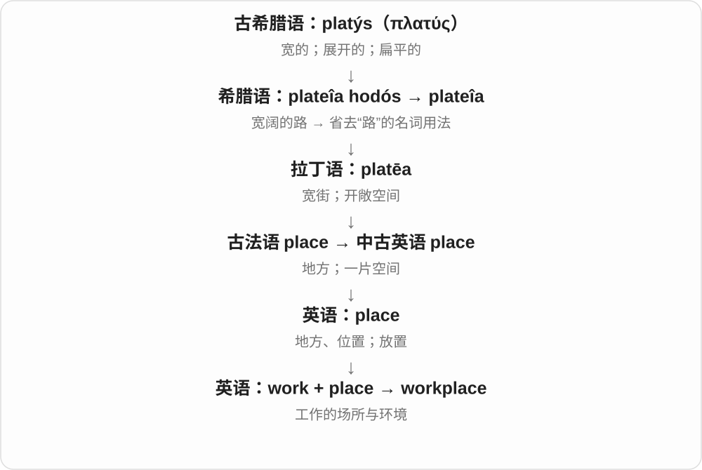
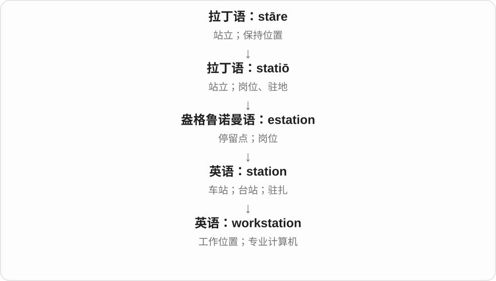
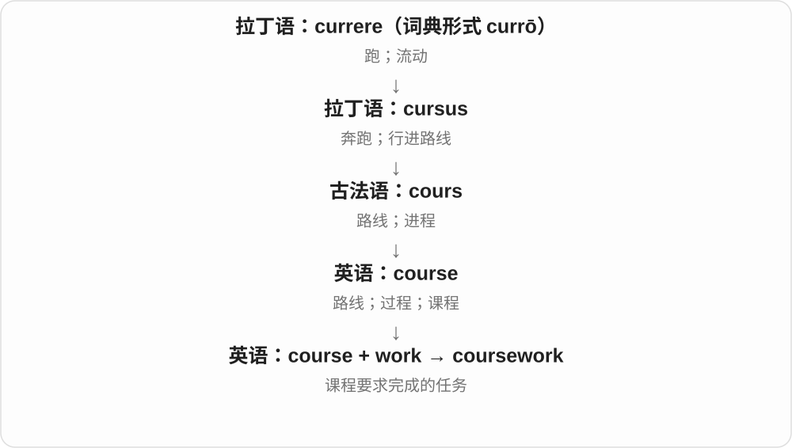
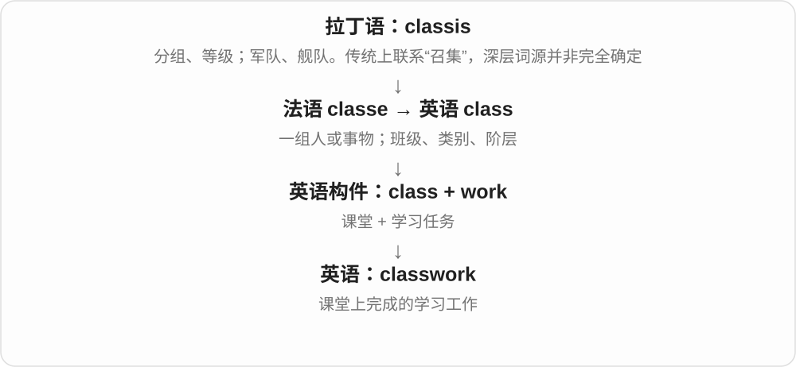

# 0064 · work — 工作；做成；运作

[逐词精讲目录](../00_逐词精讲目录.md) · [总目录](../00_总目录_按常用程度.md)

## 核心词根与来源

work 接古英语 weorc、wyrcan 一系，不仅是上班：机器能用、办法奏效也叫 work。合成词前后两部分会说明工作对象、方式、成果或场所；work 在不同词里不必一律翻译成“工作”。

**WORK：投入劳动，使事情做成或运转**

人的任务、机器的运行、办法的效果，都看有没有实际做起来。

- **工作与能力**：work · working · worker · workable · workability
- **组织与流程**：network · framework · workforce · teamwork · workflow · workload
- **学校与文书**：homework · schoolwork · coursework · classwork · paperwork · worksheet · workbook
- **准备与应变**：groundwork · legwork · guesswork · workaround · rework
- **现场、场所与用具**：workplace · workspace · workstation · workshop · workroom · workbench · worktop
- **负荷与投入**：workhorse · workaholic · overwork · workweek
- **制作成果与系统**：woodwork · handiwork · bodywork · pipework · ductwork · brushwork
- **works：作品、工厂与进行中的项目**：work · works
- **work → worked：工作过；起作用了**：work · worked
- **work → worker → workers：工作与劳动者**：work · worker · workers
- **workshop → workshops：做东西的地方到实践活动**：workshop · workshops
- **worktop → worktops：操作用平面**：work · worktop · worktops
- **workbench → workbenches：加工操作台**：work · workbench · workbenches
- **worksheet → worksheets：工作、练习用表页**：worksheet · worksheets
- **workbook → workbooks：练习册、工作簿**：workbook · workbooks
- **fretwork：交织纹样、镂空雕饰工艺**：work · fretwork
- **slog：咬着牙苦干、苦走**：slog · slogs · slogged · slogging
- **workout → workouts：一场锻炼**：workout · workouts

## 词形与演化规律

work 本身谈劳动多不可数，a work of art 和 masterwork 的作品义可数。network 的 work 偏结构，paperwork 偏事务，workload 是任务量，workflow 是流转过程。bulwark 从荷兰语、低地德语借入，不能拆成 bull + work。workaholic 的 -aholic 是由 alcoholic 类推的较新材料。

works 可说多件作品，也形成工厂、公共设施及 in the works 等固定用法；另可作 work 的第三人称动词形式。

worked 的 -ed 读 /t/；work 的过去式不只说工作，也常说办法奏效、设备可用。

worker 是 work 加 -er 的人物名词，workers 为复数，范围不限于工厂岗位。

work 加 shop，复数可数场所或场次。

work 在这里说明使用目的，不能按忙碌程度理解 top。

work 给用途，bench 给台架；ch 后复数增加 iz。

纸上练习与电子工作表分别按场景读。

练习书册与电子表格工作簿是不同场景里的用途扩展。

fretwork 接装饰纹样的 fret 加 work，不是焦虑动词加工作，也不是吉他品的同一来源；work 命名工艺及做成的制品。

本组与 work 比较用力程度，不是现代 work 的后代。slog 较早是重击，可能为 slug 击打材料的变体，后来有苦干、吃力步行义。

work + out 的动词短语与名词化组成 workout，常见意义是一场锻炼，早期记录联系拳击训练。不能把 work out 的算出、顺利发展等所有意思都搬给闭合名词 workout。

## 单词速览（按词族由简到繁）

同一基础词的相关扩展放在一起，先读基础形式，再读扩展；各组之间优先读常用的。具体词源关系见各词讲解。

| 单词 | 音标 | 核心意思 |
|---|---|---|
| [work](#w-1) | 英 /wɜːk/；美 /wɜːrk/ | 工作；运作；奏效；作品 |
| [working](#w-2) | 英 /ˈwɜːkɪŋ/；美 /ˈwɜːrkɪŋ/ | 工作的；能运转的；暂用的；运作机制 |
| [works](#w-65) | 英 /wɜːks/；美 /wɝːks/ | 作品、工程；工厂、设施；全部配套；work 的第三人称形式 |
| [worked](#w-66) | 英 /wɜːkt/；美 /wɜːrkt/ | 工作过；运作过；奏效了；work 的过去式和过去分词 |
| [worker](#w-4) | 英 /ˈwɜːkə/；美 /ˈwɜːrkər/ | 工作者；工人 |
| [workers](#w-67) | 英 /ˈwɜːkəz/；美 /ˈwɜːrkərz/ | 劳动者、工作人员；工人；worker 的复数 |
| [workshop](#w-6) | 英 /ˈwɜːkʃɒp/；美 /ˈwɜːrkʃɑːp/ | 作坊；车间；实践研讨班 |
| [workshops](#w-68) | 英 /ˈwɜːkʃɒps/；美 /ˈwɜːrkʃɑːps/ | 工坊、作坊；实践研讨活动、工作坊〔复数〕 |
| [workplace](#w-8) | 英 /ˈwɜːkpleɪs/；美 /ˈwɜːrkpleɪs/ | 工作场所；职场 |
| [workout](#w-78) | 英 /ˈwɜːkaʊt/；美 /ˈwɝkaʊt/ | 一场锻炼；训练 |
| [workouts](#w-79) | 英 /ˈwɜːkaʊts/；美 /ˈwɝkaʊts/ | 多次锻炼；训练课、训练安排〔复数〕 |
| [workforce](#w-9) | 英 /ˈwɜːkfɔːs/；美 /ˈwɜːrkfɔːrs/ | 劳动力；全体员工 |
| [workload](#w-12) | 英 /ˈwɜːkləʊd/；美 /ˈwɜːrkloʊd/ | 工作量；工作负荷 |
| [workflow](#w-15) | 英 /ˈwɜːkfləʊ/；美 /ˈwɜːrkfloʊ/ | 工作流程 |
| [workable](#w-17) | 英 /ˈwɜːkəbəl/；美 /ˈwɜːrkəbəl/ | 可行的；可加工的 |
| [workability](#w-64) | 英 /ˌwɜːkəˈbɪləti/；美 /ˌwɜːrkəˈbɪləti/ | 可行性；可加工性；和易性 |
| [workstation](#w-20) | 英 /ˈwɜːksteɪʃən/；美 /ˈwɜːrkˌsteɪʃən/ | 工作位；工作站电脑 |
| [workman](#w-24) | 英 /ˈwɜːkmən/；美 /ˈwɜːrkmən/ | 工人；工匠〔传统称呼〕 |
| [workday](#w-25) | 英 /ˈwɜːkdeɪ/；美 /ˈwɜːrkdeɪ/ | 工作日；一天的工作时间 |
| [worksheet](#w-26) | 英 /ˈwɜːkʃiːt/；美 /ˈwɜːrkʃiːt/ | 练习纸；工作表 |
| [worksheets](#w-71) | /ˈwɜːkʃiːts/〔英〕；/ˈwɜːrkʃiːts/〔美〕 | 练习页、工作表〔复数〕 |
| [workbook](#w-28) | 英 /ˈwɜːkbʊk/；美 /ˈwɜːrkbʊk/ | 练习册；电子表格工作簿 |
| [workbooks](#w-72) | /ˈwɜːkbʊks/〔英〕；/ˈwɜːrkbʊks/〔美〕 | 练习册；工作簿〔复数〕 |
| [workspace](#w-29) | 英 /ˈwɜːkspeɪs/；美 /ˈwɜːrkspeɪs/ | 工作空间；工作区 |
| [workhouse](#w-30) | 英 /ˈwɜːkhaʊs/；美 /ˈwɜːrkhaʊs/ | 济贫院〔历史〕；劳动收容机构 |
| [bulwark](#w-32) | 英 /ˈbʊlwək/；美 /ˈbʊlwərk/ | 堡垒；防护物；坚强保障 |
| [workhorse](#w-36) | 英 /ˈwɜːkhɔːs/；美 /ˈwɜːrkhɔːrs/ | 役马；可靠耐用、承担大量工作的人或物 |
| [workaround](#w-37) | 英 /ˈwɜːkəraʊnd/；美 /ˈwɜːrkəraʊnd/ | 变通办法；绕过问题的临时方案 |
| [workaholic](#w-38) | 英 /ˌwɜːkəˈhɒlɪk/；美 /ˌwɜːrkəˈhɔːlɪk/ | 工作狂 |
| [workpiece](#w-40) | 英 /ˈwɜːkpiːs/；美 /ˈwɜːrkpiːs/ | 工件 |
| [workbench](#w-41) | 英 /ˈwɜːkbentʃ/；美 /ˈwɜːrkbentʃ/ | 工作台 |
| [workbenches](#w-70) | 英 /ˈwɜːkbentʃɪz/；美 /ˈwɜːrkbentʃɪz/ | 工作台、加工操作台〔复数〕 |
| [workweek](#w-42) | 英 /ˈwɜːkwiːk/；美 /ˈwɜːrkwiːk/ | 一周工作时间；工作周 |
| [workroom](#w-45) | 英 /ˈwɜːkruːm/；美 /ˈwɜːrkruːm/ | 工作间 |
| [workwear](#w-46) | 英 /ˈwɜːkweə/；美 /ˈwɜːrkwer/ | 工作服；适合工作场合的服装 |
| [worksite](#w-48) | 英 /ˈwɜːksaɪt/；美 /ˈwɜːrksaɪt/ | 作业现场；施工地点 |
| [workgroup](#w-51) | 英 /ˈwɜːkɡruːp/；美 /ˈwɜːrkɡruːp/ | 工作组 |
| [worktop](#w-61) | 英 /ˈwɜːktɒp/；美 /ˈwɜːrktɑːp/ | 操作台面；厨房台面〔英式〕 |
| [worktops](#w-69) | 英 /ˈwɜːktɒps/；美 /ˈwɜːrktɑːps/ | 操作台面、工作台面〔复数，常见英式〕 |
| [network](#w-3) | 英 /ˈnetwɜːk/；美 /ˈnetwɜːrk/ | 网络；人脉网；建立联系 |
| [framework](#w-5) | 英 /ˈfreɪmwɜːk/；美 /ˈfreɪmwɜːrk/ | 框架；体系；结构 |
| [homework](#w-7) | 英 /ˈhəʊmwɜːk/；美 /ˈhoʊmwɜːrk/ | 家庭作业；事前功课 |
| [paperwork](#w-10) | 英 /ˈpeɪpəwɜːk/；美 /ˈpeɪpərwɜːrk/ | 文书工作；相关手续资料 |
| [teamwork](#w-11) | 英 /ˈtiːmwɜːk/；美 /ˈtiːmwɜːrk/ | 团队协作 |
| [woodwork](#w-13) | 英 /ˈwʊdwɜːk/；美 /ˈwʊdwɜːrk/ | 木工；木制构件 |
| [groundwork](#w-14) | 英 /ˈɡraʊndwɜːk/；美 /ˈɡraʊndwɜːrk/ | 基础工作；准备工作 |
| [footwork](#w-16) | 英 /ˈfʊtwɜːk/；美 /ˈfʊtwɜːrk/ | 步法；脚步动作；灵活应对 |
| [patchwork](#w-18) | 英 /ˈpætʃwɜːk/；美 /ˈpætʃwɜːrk/ | 拼布；拼凑而成的混合体 |
| [housework](#w-19) | 英 /ˈhaʊswɜːk/；美 /ˈhaʊswɜːrk/ | 家务 |
| [coursework](#w-21) | 英 /ˈkɔːswɜːk/；美 /ˈkɔːrswɜːrk/ | 课程作业；平时课程任务 |
| [firework](#w-23) | 英 /ˈfaɪəwɜːk/；美 /ˈfaɪərwɜːrk/ | 烟花；烟火 |
| [fieldwork](#w-22) | 英 /ˈfiːldwɜːk/；美 /ˈfiːldwɜːrk/ | 实地调查；田野工作 |
| [rework](#w-27) | 英 动 /ˌriːˈwɜːk/；名 /ˈriːwɜːk/；美动 /ˌriːˈwɜːrk/ | 返工；重做；修改加工 |
| [bodywork](#w-31) | 英 /ˈbɒdiwɜːk/；美 /ˈbɑːdiwɜːrk/ | 车身；车身修理；身体手法疗法〔特定语境〕 |
| [schoolwork](#w-33) | 英 /ˈskuːlwɜːk/；美 /ˈskuːlwɜːrk/ | 学业；学校功课 |
| [guesswork](#w-34) | 英 /ˈɡeswɜːk/；美 /ˈɡeswɜːrk/ | 猜测；凭猜判断 |
| [handiwork](#w-35) | 英 /ˈhændiwɜːk/；美 /ˈhændiwɜːrk/ | 手工制品；某人的所作所为 |
| [overwork](#w-39) | 英 动 /ˌəʊvəˈwɜːk/；名 /ˈəʊvəwɜːk/；美动 /ˌoʊvərˈwɜːrk/ | 过度工作；使过劳 |
| [legwork](#w-43) | 英 /ˈleɡwɜːk/；美 /ˈleɡwɜːrk/ | 跑腿工作；实地搜集资料的基础工作 |
| [masterwork](#w-44) | 英 /ˈmɑːstəwɜːk/；美 /ˈmæstərwɜːrk/ | 杰作；代表作 |
| [earthwork](#w-49) | 英 /ˈɜːθwɜːk/；美 /ˈɜːrθwɜːrk/ | 土方工程；土筑工事 |
| [paintwork](#w-50) | 英 /ˈpeɪntwɜːk/；美 /ˈpeɪntwɜːrk/ | 漆面；油漆层 |
| [classwork](#w-53) | 英 /ˈklɑːswɜːk/；美 /ˈklæswɜːrk/ | 课堂作业；课堂学习任务 |
| [pipework](#w-54) | 英 /ˈpaɪpwɜːk/；美 /ˈpaɪpwɜːrk/ | 管道系统；管道工程 |
| [brushwork](#w-55) | 英 /ˈbrʌʃwɜːk/；美 /ˈbrʌʃwɜːrk/ | 绘画笔法；画笔笔触 |
| [formwork](#w-58) | 英 /ˈfɔːmwɜːk/；美 /ˈfɔːrmwɜːrk/ | 混凝土模板；模板支架系统 |
| [ductwork](#w-59) | 英 /ˈdʌktwɜːk/；美 /ˈdʌktwɜːrk/ | 风管系统；管道系统 |
| [roadwork](#w-60) | 英 /ˈrəʊdwɜːk/；美 /ˈroʊdwɜːrk/ | 道路施工；公路训练跑 |
| [telework](#w-62) | 英 /ˈtelɪwɜːk/；美 /ˈteliwɜːrk/ | 远程工作；远程办公 |
| [slog](#w-74) | 英 /slɒɡ/；美 /slɑɡ/ | 苦干；吃力地走；重击；一段艰苦工作 |
| [slogging](#w-75) | 英 /ˈslɒɡɪŋ/；美 /ˈslɑɡɪŋ/ | 正在苦干、吃力前行；用力击打 |
| [slogged](#w-76) | 英 /slɒɡd/；美 /slɑɡd/ | 苦干了；费力走过了；用力击打了 |
| [slogs](#w-77) | 英 /slɒɡz/；美 /slɑɡz/ | 苦干、吃力地走〔第三人称单数〕；几段艰苦工作 |
| [fretwork](#w-73) | 英 /ˈfretwɜːk/；美 /ˈfretwɝk/ | 镂空雕饰；交织纹样的装饰工艺或制品 |

## 逐词讲解

### 1. work — 工作；运作；奏效；作品

**音标**：英 /wɜːk/；美 /wɜːrk/

**先抓住这个画面**

人付出劳动把事情做成；机器能按预期运转；一种办法能产生效果。

**怎么拆**

名词接古英语 weorc，动词接 wyrcan 等本族形式，经中古英语延续；与“做、制作”的日耳曼语词族相连。

**怎么变成今天的意思**

**古英语 weorc；wyrcan → 中古英语 work／werken**  
工作、做出的事物；做、制作

↓

**英语 work**  
工作；运作；做出的成果

I work here 是在这里工作，The printer works 是打印机能用，The plan worked 是办法奏效。work 说工作或劳动通常不可数；a work of art 和 collected works 则可数，指作品。

**常见搭配与例句**

at work；go to work；work on；work out；a work of art。

> This key does not work in the front door.

这把钥匙打不开前门。

> She has a lot of work to finish before Friday.

她周五前有很多工作要完成。

> We tried a different approach, and it worked.

我们试了另一种做法，结果奏效了。

**别混淆**

job 是一份职位或具体任务，可数；work 是工作活动，常不可数。I have a lot of work 不能机械写成 many works。

### 2. working — 工作的；能运转的；暂用的；运作机制

**音标**：英 /ˈwɜːkɪŋ/；美 /ˈwɜːrkɪŋ/

**先抓住这个画面**

把东西从摆着看的状态拿到实际使用中：人正在做事，机器确实能用。

**怎么拆**

work + -ing；古英语相应动名词、分词及中古英语形式参与延续。现代也形成独立形容词和名词用法。

**怎么变成今天的意思**

**古英语 weorc；wyrcan → 中古英语 work／werken**  
工作、做出的事物；做、制作

↓

**英语 work**  
工作；运作；做出的成果

↓

**work + -ing → working**  
正在工作；可用；供工作暂用

a working printer 是能用的打印机，a working title 是创作期间暂用的标题，working knowledge 是够实际使用的知识。the workings of a machine 常用复数说运行机制。

**常见搭配与例句**

working hours；a working model；a working title；working knowledge。

> We need a working prototype by Monday.

我们周一前需要一台能实际运转的原型。

> She has a working knowledge of Spanish.

她的西班牙语达到能实际使用的水平。

**别混淆**

working 不一律等于“正在工作”：working days 常是工作日，a working assumption 是暂作依据的假设。

### 3. works — 作品、工程；工厂、设施；全部配套；work 的第三人称形式

**音标**：英 /wɜːks/；美 /wɝːks/

**先抓住这个画面**

做出来的东西可以是 works；把生产活动集中起来的地方也可叫 works。This works 则是在说这个办法管用。

**怎么拆**

work 接古英语 weorc 等做事、劳动、制成品词族，works 是其复数，较早已说行为、事迹；后来有大型设施和工厂等固定用法。动词 work + -s 又与名词同形。

**怎么变成今天的意思**

**古英语 work 词族及复数**  
做过的事、劳动产品、作品

↓

**现代 works 的专门义及动词形式**  
作品、工厂；进行中；管用、工作

the works of an author 作者作品；a steel works 钢铁厂；in the works 正在筹办、制作；the works 全套；the machine works 机器能运作。

**常见搭配与例句**

public works；a project in the works。

> The library has collected works by local writers.

图书馆收藏了本地作家的作品。

> The old steel works closed several years ago.

旧钢铁厂几年前关闭了。

> This method works well for small teams.

这个办法对小团队很管用。

**别混淆**

a works 可指一处工厂，不能仅因 s 就认定一定是多个工厂。通常说有工作 work，不把 I have works 当普通我有工作的表达。

### 4. worked — 工作过；运作过；奏效了；work 的过去式和过去分词

**音标**：英 /wɜːkt/；美 /wɜːrkt/

**先抓住这个画面**

人把活干了，设备运转了，办法产生效果了，都可以说 worked。先看是谁或什么在 work，才能知道是哪种意思。

**怎么拆**

work + -ed；/k/ 后读 /t/。work 的劳动、制作词族继承古英语 weorc 名词和 wyrcan 等动词，现代动词再按规则变化。

**怎么变成今天的意思**

**古英语工作、制作词族 → work**  
劳动；做出成果；运转、起作用

↓

**work + -ed → worked**  
过去的工作、运作或奏效

worked for a company 为公司工作过；worked on a design 做过某个设计；the key worked 钥匙能用；worked out a solution 想出了解决办法。

**常见搭配与例句**

worked well；worked together；worked out。

> The printer worked yesterday, but it will not start today.

打印机昨天还能用，今天却启动不了。

> We moved the chair, and the new arrangement worked much better.

我们挪了椅子，新的摆法好用多了。

**别混淆**

It worked 是办法奏效了；It was worked on 是有人对它做了工作。多一个 on 和被动结构，意思就变了。

### 5. worker — 工作者；工人

**音标**：英 /ˈwɜːkə/；美 /ˈwɜːrkər/

**先抓住这个画面**

同一项劳动，可以按谁在做来称呼：做这项事的人是 worker。

**怎么拆**

work + -er，-er 表执行动作的人；接中古英语相应形式。比旧词 wright 的现代适用范围更宽。

**怎么变成今天的意思**

**古英语 weorc；wyrcan → 中古英语 work／werken**  
工作、做出的事物；做、制作

↓

**英语 work**  
工作；运作；做出的成果

↓

**work + -er → worker**  
做工作的人

factory worker 是工厂工人，office worker 是办公室职员，social worker 是社会工作者。worker 不只指体力劳动，也可在昆虫语境说工蚁、工蜂。

**常见搭配与例句**

a factory worker；an office worker；a skilled worker。

> The workers stopped for a short break.

工人们停下来短暂休息。

> She is a social worker who supports local families.

她是一名为当地家庭提供支持的社会工作者。

**别混淆**

employee 强调被某雇主雇用的关系，worker 关注做劳动的人；自雇者也能算 worker。

### 6. workers — 劳动者、工作人员；工人；worker 的复数

**音标**：英 /ˈwɜːkəz/；美 /ˈwɜːrkərz/

**先抓住这个画面**

从事某项工作的人是 workers。可以在工厂，也可以在办公室、医院或社区里，具体职业要看前面的修饰。

**怎么拆**

worker + -s，词尾 /z/。worker 对应 work + -er 做事的人，接中古英语相应形式；work 的词族继承早期英语劳动、制作词。

**怎么变成今天的意思**

**早期英语工作词族 → work；中古英语相应人物形式 → worker**  
工作 → 从事工作的人

↓

**worker + -s → workers**  
多位劳动者、工作人员

factory workers 工厂工人；office workers 办公室职员；health workers 医务、卫生工作者；social workers 社会工作者；seasonal workers 季节性工作人员。

**常见搭配与例句**

workers at the site；workers in the industry。

> The workers arrived early to set up the stage.

工作人员早早到场搭舞台。

> The café provides a quiet lunch spot for local office workers.

这家咖啡馆为附近的办公室职员提供了安静的午餐去处。

**别混淆**

workers 强调做工作的人，employees 强调受雇关系。有些 workers 自雇或从事志愿工作；具体身份仍看上下文，不能只凭一个词断定雇佣安排。

### 7. workshop — 作坊；车间；实践研讨班

**音标**：英 /ˈwɜːkʃɒp/；美 /ˈwɜːrkʃɑːp/

**先抓住这个画面**

大家围着工具、材料或一个问题，边做边学、边试边改。

**怎么拆**

work（工作）+ shop（工坊、店）。从做东西的场所发展到实际练习、共同讨论的活动名称。

**怎么变成今天的意思**

**英语 work；shop**  
并列的两个构词材料

↓

**work + shop → workshop**  
制作场所；动手实践的研讨活动

a repair workshop 是维修作坊，a writing workshop 是有练习和反馈的写作工作坊。并非所有会议都可叫 workshop，通常强调参与和实践。

**常见搭配与例句**

attend a workshop；a repair workshop；a workshop on design。

> She repairs bicycles in a small workshop.

她在一间小作坊里修自行车。

> The workshop included short exercises and group feedback.

工作坊包含小练习和小组反馈。

**别混淆**

lecture 常以听讲为主，workshop 通常让参与者动手或讨论。shop 在这里不必是卖商品的店铺。

### 8. workshops — 工坊、作坊；实践研讨活动、工作坊〔复数〕

**音标**：英 /ˈwɜːkʃɒps/；美 /ˈwɜːrkʃɑːps/

**先抓住这个画面**

做东西的房间是 workshops；把一群人聚来边讨论边实际练习的活动，也叫 workshops。两边都带有动手做的感觉。

**怎么拆**

workshop 是 work 工作 + shop 工坊、店的英语合成，制作场所名扩展到实践研讨活动。现代整个词后加复数 -s，/p/ 后读 /s/。

**怎么变成今天的意思**

**work + shop → workshop**  
工作的工坊 → 实际制作场所

↓

**活动义扩展；workshop + -s → workshops**  
多间工坊；多场实践活动

writing workshops 写作工作坊；craft workshops 手工实践活动；repair workshops 维修工坊。

**常见搭配与例句**

attend workshops 参加工作坊；workshops for beginners 初学者实践活动。

> The museum offers workshops for beginners.

博物馆为初学者开设实践工作坊。

> Several small workshops stand behind the main building.

主楼后面有几间小作坊。

**别混淆**

workshops 不只是任何听讲座的活动，常突出参与、练习、共同做。场所还是活动，要看是在说房间、设备，还是报名、场次。

### 9. workplace — 工作场所；职场

**音标**：英 /ˈwɜːkpleɪs/；美 /ˈwɜːrkpleɪs/

**先抓住这个画面**

人们做工作的地方；进一步也包括那里的关系、规则和氛围。

**怎么拆**

work 工作 + place 地方。

**怎么变成今天的意思**

可以是办公室、工厂、店铺等。workplace culture 不只说房间布置，而是大家怎么一起做事。

**常见搭配与例句**

workplace safety；workplace culture；in the workplace。

> The company wants to improve communication in the workplace.

公司希望改善职场中的沟通。

> Good lighting makes the workplace more comfortable.

良好的照明让工作场所更舒适。

**别混淆**

workplace 是工作的场所或环境；workstation 是个人工作位或计算机工作站。

### 10. workout — 一场锻炼；训练

**音标**：英 /ˈwɜːkaʊt/；美 /ˈwɝkaʊt/

**先抓住这个画面**

换上运动鞋，专门练上二十分钟，这一场运动可以叫 a workout。它把 work out 的训练用法打包成一次可数活动。

**怎么拆**

work + out 的动词短语相关形式名词化为 workout；早期英语名词记录联系拳击训练，后来用于一般体育锻炼。具体记录并非要求现代每次短语义都先于所有名词义。

**怎么变成今天的意思**

**work + out：动词短语的用法发展**  
体育训练是其中一条用法，另有算出、实现、顺利发展等

↓

**闭合名词 workout：训练、一场锻炼**  
早期记录联系拳击训练，后来扩大到一般体育锻炼

a quick workout 是短时间锻炼；a full-body workout 是全身训练；after a workout 是锻炼后。名词常在前面重读。

**常见搭配与例句**

a morning workout；a quick workout；after a workout。

> I fitted in a quick workout before breakfast.

早饭前我挤时间锻炼了一会儿。

> That long climb gave my legs a good workout.

那段长长的攀登让我的双腿好好活动了一番。

**别混淆**

workout 是一个词的名词；work out 是两个词的动词短语。work out a problem 还能说解题，不能把这个意思随便套给 a workout。

### 11. workouts — 多次锻炼；训练课、训练安排〔复数〕

**音标**：英 /ˈwɜːkaʊts/；美 /ˈwɝkaʊts/

**先抓住这个画面**

周一一场、周三一场，几次锻炼就是 workouts。数的是一场场活动，也可以按内容谈不同训练。

**怎么拆**

workout + -s → workouts，末尾 /t/ 后读 /s/；复合名词在整体末尾加复数。

**怎么变成今天的意思**

**work + out：动词短语的用法发展**  
体育训练是其中一条用法，另有算出、实现、顺利发展等

↓

**闭合名词 workout：训练、一场锻炼**  
早期记录联系拳击训练，后来扩大到一般体育锻炼

↓

**workout + -s → workouts**  
多次锻炼，后缀接整个名词

home workouts 是居家锻炼；short workouts 是短时训练；three workouts a week 数每周三次。

**常见搭配与例句**

home workouts；short workouts；three workouts a week。

> She prefers short workouts at home.

她更喜欢在家做短时间锻炼。

> We planned three workouts for the week.

我们为这一周安排了三次锻炼。

**别混淆**

she works out 的 s 加在动词 work 上；her workouts 的 s 加在闭合名词 workout 上。词与短语的句法位置不同。

### 12. workforce — 劳动力；全体员工

**音标**：英 /ˈwɜːkfɔːs/；美 /ˈwɜːrkfɔːrs/

**先抓住这个画面**

不看一个个职位，而把能投入劳动的所有人当成一支整体力量。

**怎么拆**

work（工作）+ force（力量、队伍）。force 在这里是人员整体，不是用暴力逼迫工作。

**怎么变成今天的意思**

**英语 work；force**  
并列的两个构词材料

↓

**work + force → workforce**  
工作的人组成的整体

the company’s workforce 是公司员工总群体；enter the workforce 是进入劳动市场。可以说一个地区或行业的 workforce，具体范围由限定语给出。

**常见搭配与例句**

a skilled workforce；enter the workforce；reduce the workforce。

> The company has a workforce of five hundred.

这家公司有五百名员工。

> Many graduates will enter the workforce this summer.

许多毕业生将在今年夏天进入职场。

**别混淆**

workforce 是集体名词，worker 是个人。the workforce grew 不一定表示每位现有员工都长大了，而是人数或规模扩大。

### 13. workload — 工作量；工作负荷

**音标**：英 /ˈwɜːkləʊd/；美 /ˈwɜːrkloʊd/

**先抓住这个画面**

把所有待处理任务放到肩上，这一堆有多重就是 workload。

**怎么拆**

work（工作）+ load（负荷），组合量化人、团队或系统承担的工作。

**怎么变成今天的意思**

**英语 work；load**  
并列的两个构词材料

↓

**work + load → workload**  
需要处理的工作总量

a heavy workload 是工作量大，reduce the workload 是减轻任务负担。计算机语境也可指系统需要处理的任务集合，不只说人忙不忙。

**常见搭配与例句**

a heavy workload；manage the workload；share the workload。

> Her workload increased after two colleagues left.

两位同事离职后，她的工作量增加了。

> We need to distribute the workload more evenly.

我们需要更均匀地分配工作量。

**别混淆**

workload 说任务量，不直接等于 working hours 工作时长；相同时间内的任务数量和复杂度也可能不同。

### 14. workflow — 工作流程

**音标**：英 /ˈwɜːkfləʊ/；美 /ˈwɜːrkfloʊ/

**先抓住这个画面**

一项任务从申请、审核到完成，像水流一样经过相连步骤。

**怎么拆**

work（工作）+ flow（流动），用流动说明任务、信息在步骤之间传递。

**怎么变成今天的意思**

**英语 work；flow**  
并列的两个构词材料

↓

**work + flow → workflow**  
工作步骤及其流转方式

improve the workflow 是改善任务如何交接与推进，可以涉及顺序、角色和工具。不是只要让人做得更快就一定改善流程。

**常见搭配与例句**

a review workflow；streamline the workflow；workflow automation。

> The new tool simplifies our editing workflow.

新工具简化了我们的编辑流程。

> We mapped the workflow before changing the software.

更换软件前，我们画出了工作流程。

**别混淆**

workflow 是怎么走流程，workload 是有多少任务。一个流程很清楚的团队也可能工作量过大。

### 15. workable — 可行的；可加工的

**音标**：英 /ˈwɜːkəbəl/；美 /ˈwɜːrkəbəl/

**先抓住这个画面**

方案放到真实条件里，确实能推着走，不只是纸上好看。

**怎么拆**

work + -able，-able 表能够被或可以。work 有运作、奏效和加工等义，因此可行与可加工两义各有对象。

**怎么变成今天的意思**

**古英语 weorc；wyrcan → 中古英语 work／werken**  
工作、做出的事物；做、制作

↓

**英语 work**  
工作；运作；做出的成果

↓

**work + -able → workable**  
可以奏效、实施或加工的

a workable solution 是能执行的解决方案，未必最完美。workable clay 则说黏土适合加工，不是在给它评价工作效率。

**常见搭配与例句**

a workable plan；a workable compromise；workable material。

> We finally found a workable compromise.

我们终于找到了一个可行的折中办法。

> Add a little water to make the clay more workable.

加一点水，让黏土更容易加工。

**别混淆**

workable 关注实际可操作，working 可指正在运作或暂用。a working draft 是供修改的草稿，a workable draft 强调方案能行得通。

### 16. workability — 可行性；可加工性；和易性

**音标**：英 /ˌwɜːkəˈbɪləti/；美 /ˌwɜːrkəˈbɪləti/

**先抓住这个画面**

不是只问它看上去对不对，而是问实际执行、塑形或处理起来顺不顺。

**怎么拆**

workable 对应的性质名词，-able → -ability，现代也可分析 work + -ability。结尾表示“可行、可加工”这种性质。

**怎么变成今天的意思**

**古英语 weorc；wyrcan → 中古英语 work／werken**  
工作、做出的事物；做、制作

↓

**英语 work**  
工作；运作；做出的成果

↓

**workable → workability**  
从可行、可加工，转为相应性质名词

计划的 workability 说落地是否行得通；材料领域可说处理性能，如混凝土拌合物的和易性。语境决定衡量的对象，不能混成统一数值。

**常见搭配与例句**

the workability of a plan；improve workability；concrete workability。

> The trial will test the workability of the new system.

试行将检验新制度的可操作性。

> The added water changed the workability of the mixture.

加水改变了混合物的可加工性能。

**别混淆**

workability 与 affordability 不同：做得出来和付得起钱是两个条件，实际方案可能需要两者都满足。

### 17. workstation — 工作位；工作站电脑

**音标**：英 /ˈwɜːksteɪʃən/；美 /ˈwɜːrkˌsteɪʃən/

**先抓住这个画面**

给一个人配置好桌面、工具和设备，让他在这里完成工作，这个位置就是 workstation。也可指专业用途的计算机。

**怎么拆**

work（工作）+ station（固定工作点）。

**怎么变成今天的意思**

从物理工作点延伸到执行工作的电脑系统。并非每次出现都指高性能电脑，办公室布局中的 workstation 常只是工位。

**常见搭配与例句**

an ergonomic workstation；a graphics workstation；set up a workstation。

> Each workstation has an adjustable desk.

每个工位都配有可调节的桌子。

> The designer uses a powerful workstation for rendering.

设计师用一台性能强的工作站电脑进行渲染。

**别混淆**

workplace 是工作的场所，范围可以很大；workstation 更具体，通常是一个人的设备或位置。

### 18. workman — 工人；工匠〔传统称呼〕

**音标**：英 /ˈwɜːkmən/；美 /ˈwɜːrkmən/

**先抓住这个画面**

穿着工作服，带工具来安装、维修、建造的人。

**怎么拆**

work + man，接古英语 weorcmann 及中古英语 werkman。历史上 man 指人或男性的材料参与，现代具体称呼宜看岗位与语境。

**怎么变成今天的意思**

**古英语 weorc；wyrcan → 中古英语 work／werken**  
工作、做出的事物；做、制作

↓

**古英语 weorcmann → 英语 workman**  
从事劳动，尤其手工、施工工作的人

常见于施工、维修叙述；worker 更宽泛、也更中性。workmen 是复数，不用 workmans。

**常见搭配与例句**

a skilled workman；a workman’s tools；workmen on the roof。

> A workman came to repair the window.

一位工人来修窗户。

> The workmen left their tools beside the gate.

工人们把工具放在大门旁。

**别混淆**

workman 通常强调手工或体力技术劳动；office worker 不常直接换成 office workman。

### 19. workday — 工作日；一天的工作时间

**音标**：英 /ˈwɜːkdeɪ/；美 /ˈwɜːrkdeɪ/

**先抓住这个画面**

从开始工作到结束工作，把这段时间装进一天里。

**怎么拆**

work 工作 + day 日，组合表示工作的日子，也可表示一日中工作的时段。

**怎么变成今天的意思**

**英语 work；day**  
工作；日

↓

**workday**  
工作的日子或一日工作时段

an eight-hour workday 是一天工作八小时；the end of the workday 是下班前后。workday 不固定等于星期一到星期五，轮班会改变实际安排。

**常见搭配与例句**

a normal workday；during the workday；the end of the workday。

> My workday usually begins at eight.

我通常八点开始一天的工作。

> Sunday is a normal workday for many restaurant staff.

对很多餐馆员工来说，星期日是正常工作日。

**别混淆**

weekday 常是周一到周五的日历分类；workday 看你那天是否工作。working day 也是常见说法。

### 20. worksheet — 练习纸；工作表

**音标**：英 /ˈwɜːkʃiːt/；美 /ˈwɜːrkʃiːt/

**先抓住这个画面**

先把要填的项目、题目或格子放在一张表上，边做边填写。

**怎么拆**

work（工作、练习）+ sheet（一张纸、表），现代也用于电子表格里的工作表。

**怎么变成今天的意思**

**英语 work；sheet**  
并列的两个构词材料

↓

**work + sheet → worksheet**  
供练习、处理数据的表页

课堂 worksheet 常是练习单；电子表格 workbook 可含多个 worksheets。电子 worksheet 不要求能直接打印在一张纸上。

**常见搭配与例句**

complete a worksheet；a maths worksheet；an Excel worksheet。

> The teacher handed out a worksheet on fractions.

老师发了一张分数练习单。

> Each worksheet contains data for a different month.

每张工作表包含不同月份的数据。

**别混淆**

worksheet 是一个表页，workbook 是整本练习册或整个电子表格文件；层级不同。

### 21. worksheets — 练习页、工作表〔复数〕

**音标**：/ˈwɜːkʃiːts/〔英〕；/ˈwɜːrkʃiːts/〔美〕

**先抓住这个画面**

为练习、整理工作留出的一页页表格、题目纸，是 worksheets；电子表格文件里的各张工作表也用这个名字。

**怎么拆**

work 工作、练习 + sheet 表页 → worksheet，再加 -s，/t/ 后读 /s/。

**怎么变成今天的意思**

**work + sheet → worksheet**  
供工作、练习的一张表页

↓

**电子工作表用途；+ -s → worksheets**  
多张练习页、工作表

maths worksheets 数学练习页；worksheets in a workbook 工作簿里的工作表。

**常见搭配与例句**

print the worksheets 打印练习页；add worksheets 添加工作表。

> The teacher handed out the worksheets.

老师发了练习页。

> The workbook contains separate worksheets for each month.

工作簿中每个月各有一张工作表。

**别混淆**

worksheet 可是一张纸，也可是一份电子工作簿中的表页；别仅凭中文表格就把所有层级当成一个对象。

### 22. workbook — 练习册；电子表格工作簿

**音标**：英 /ˈwɜːkbʊk/；美 /ˈwɜːrkbʊk/

**先抓住这个画面**

一本不是只让你读、还留着位置让你动手做的书。

**怎么拆**

work（练习、工作）+ book（书、本），后来计算机借用成整份电子表格文件的名称。

**怎么变成今天的意思**

**英语 work；book**  
并列的两个构词材料

↓

**work + book → workbook**  
练习册；包含工作表的电子文件

a grammar workbook 有语法练习；save the workbook 在表格软件中指保存整个工作簿。两种场景都包含若干页面或表页。

**常见搭配与例句**

a student workbook；open a workbook；save the workbook。

> Complete the first two pages of the workbook.

做完练习册的前两页。

> Save the workbook before closing the spreadsheet application.

关闭电子表格应用前先保存工作簿。

**别混淆**

textbook 是主要讲授内容的教材，workbook 主要让学习者练习；软件中的 worksheet 则是工作簿里的单张表。

### 23. workbooks — 练习册；工作簿〔复数〕

**音标**：/ˈwɜːkbʊks/〔英〕；/ˈwɜːrkbʊks/〔美〕

**先抓住这个画面**

留给学习者动手做练习的书册，是 workbooks；电子表格语境里也可指包含工作表的文件。

**怎么拆**

work 工作、练习 + book 书册 → workbook，加 -s，/k/ 后读 /s/。数字工作簿借组织多页工作的用途。

**怎么变成今天的意思**

**work + book → workbook**  
供工作、练习的书册

↓

**数字用途；workbook + -s → workbooks**  
多本练习册、多个工作簿文件

maths workbooks 数学练习册；spreadsheet workbooks 电子表格工作簿。

**常见搭配与例句**

complete the workbooks 做练习册；open the workbooks 打开工作簿。

> The children completed the exercises in their workbooks.

孩子们完成了练习册里的题目。

> She compared the totals in the two workbooks.

她比较了两份工作簿中的总数。

**别混淆**

workbook 可包含多张 worksheets；在电子表格语境里先分整份文件和其中一张表。

### 24. workspace — 工作空间；工作区

**音标**：英 /ˈwɜːkspeɪs/；美 /ˈwɜːrkspeɪs/

**先抓住这个画面**

为完成工作划出的一块地方，可以是桌面，也可以是软件中的项目区域。

**怎么拆**

英语 work + space；从实际工作场所扩展到数字工作环境。

**怎么变成今天的意思**

**拉丁语 spatium**  
空间、范围、距离；也指一段时间，远源尚有不同解释

↓

**古法语 espace / 盎格鲁法语 space → 中古英语 space → 现代 space**  
空间、间隔、时间段；后来包括太空和抽象活动领域

↓

**英语 work + space → workspace**  
可用于工作的区域；软件中的工作环境

a shared workspace 是共用工作区；软件里的 workspace 可能组织文件、窗口或项目，具体功能因软件而异。

**常见搭配与例句**

a quiet workspace；a shared workspace；organize your workspace。

> She turned a corner of the bedroom into a workspace.

她把卧室的一角改成了工作区。

> The editor remembers the files in your workspace.

这个编辑器会记住工作区中的文件。

**别混淆**

workplace 是工作所在的地方或机构；workspace 常关注实际占用或操作的空间。

### 25. workhouse — 济贫院〔历史〕；劳动收容机构

**音标**：英 /ˈwɜːkhaʊs/；美 /ˈwɜːrkhaʊs/

**先抓住这个画面**

贫困者进入一个机构获取食宿，同时被要求劳动，条件往往严苛。

**怎么拆**

work + house，古英语及中古英语已有工作场所的组合；后来英国历史制度中的济贫院成为重要义项，不把所有时期机构都看成同一种。

**怎么变成今天的意思**

**古英语 weorc；wyrcan → 中古英语 work／werken**  
工作、做出的事物；做、制作

↓

**古英语 weorchūs 等工作场所名称**  
劳动、制作的房屋

↓

**英语 workhouse 的历史制度义**  
为贫困者提供食宿并要求劳动的机构

阅读英国历史或狄更斯作品时常见。它是特定历史机构，不能直接当作现代普通办公室或居家办公地点。

**常见搭配与例句**

a Victorian workhouse；enter the workhouse；the workhouse system。

> The museum occupies a former workhouse.

博物馆设在一所旧济贫院内。

> The novel describes the harsh conditions of the workhouse.

小说描写了济贫院严酷的条件。

**别混淆**

workhouse 是历史机构，workplace 是一般工作场所；house 在其中不表示轻松舒适的家。

### 26. bulwark — 堡垒；防护物；坚强保障

**音标**：英 /ˈbʊlwək/；美 /ˈbʊlwərk/

**先抓住这个画面**

外面有一道挡得住攻击或侵袭的屏障，替里面的人守住边界。

**怎么拆**

经中古英语借自中古荷兰语、低地德语 bolwerk 一系，材料涉及树干、木料与 work“构筑物”的日耳曼语同源成分；不是现代 bull“公牛”+ work。

**怎么变成今天的意思**

**中古荷兰语／中古低地德语 bolwerk**  
防御工事，木料与构筑物相关材料

↓

**中古英语 bulwerk → bulwark**  
堡垒、屏障；后来比喻保障

a bulwark against corruption 是防腐败的坚强保障；船舶复数 bulwarks 可指船边防护围板。主体意象是阻挡外来的侵袭。

**常见搭配与例句**

a bulwark against；a bulwark of freedom；ship’s bulwarks。

> An independent press can be a bulwark against abuse of power.

独立媒体可以成为防止滥权的一道保障。

> The old fortress served as a bulwark for the harbour.

旧堡垒曾是港口的防御屏障。

**别混淆**

bulwark 的前段不是 bull，因此不靠公牛勤劳的故事解释；workhorse 才是与工作中的马相关的词。

### 27. workhorse — 役马；可靠耐用、承担大量工作的人或物

**音标**：英 /ˈwɜːkhɔːs/；美 /ˈwɜːrkhɔːrs/

**先抓住这个画面**

不一定最耀眼，却每天都扛得住重活，少了它就转不动。

**怎么拆**

work（劳动）+ horse（马），先说承担劳动的马，再比喻勤劳可靠的人、机器或工具。

**怎么变成今天的意思**

**英语 work；horse**  
并列的两个构词材料

↓

**work + horse → workhorse**  
役马；承担大量日常任务的可靠主力

an office workhorse 可说踏实干活的人；a workhorse printer 可夸打印机能承受大批量日常任务。通常是肯定可靠，并不必然说高端。

**常见搭配与例句**

a reliable workhorse；the workhorse of the fleet；an office workhorse。

> This old laptop is still the workhorse of my home office.

这台旧笔记本仍是我居家办公的主力。

> The small van became the workhorse of the business.

这辆小货车成了公司日常运输的主力。

**别混淆**

workhorse 是可靠主力，workaholic 是难以停止工作的人；工作多与依赖工作不是同一种评价。

### 28. workaround — 变通办法；绕过问题的临时方案

**音标**：英 /ˈwɜːkəraʊnd/；美 /ˈwɜːrkəraʊnd/

**先抓住这个画面**

前门卡住了，先从侧门把事情办成，前门本身可能还没修好。

**怎么拆**

work around（设法绕过困难）形成连写名词 workaround。around 指围着、绕过障碍，不表示彻底解决其根源。

**怎么变成今天的意思**

**英语短语 work around a problem**  
绕过困难继续做事

↓

**名词 workaround**  
使事情暂时能继续的变通办法

技术与办公场景很常见。a workaround 可能可长期使用，但重点在绕过限制，不把它默认当成修复了底层问题。

**常见搭配与例句**

find a workaround；a temporary workaround；use a workaround。

> Restarting the app is a workaround, not a permanent fix.

重启应用是变通办法，不是永久修复。

> We found a workaround that let the team finish the report.

我们找到了一个变通办法，让团队完成了报告。

**别混淆**

fix 关注修好问题，workaround 关注避免被问题卡住；知道变通办法不代表原问题已经消失。

### 29. workaholic — 工作狂

**音标**：英 /ˌwɜːkəˈhɒlɪk/；美 /ˌwɜːrkəˈhɔːlɪk/

**先抓住这个画面**

工作已经结束，人却放不下，总忍不住继续做，其他生活被挤开。

**怎么拆**

work + -aholic；-aholic 从 alcoholic 等词重新分析，后来用于说对某活动的过度沉迷。不是古典英语里一直独立存在的“狂人”词根。

**怎么变成今天的意思**

**英语 work；由 alcoholic 类推的 -aholic**  
工作；对某活动过度依赖的构词材料

↓

**英语 workaholic**  
难以停止工作、过度投入工作的人

日常可半开玩笑称工作很多的人，但也可能批评工作挤占健康与关系。词汇标签本身不是临床诊断。

**常见搭配与例句**

a self-confessed workaholic；become a workaholic；a workaholic culture。

> He calls himself a workaholic, but he is trying to take weekends off.

他自称工作狂，但正在努力周末休息。

> Her family worried that she was becoming a workaholic.

家人担心她正在变成工作狂。

**别混淆**

hard worker 是勤奋工作者，通常是肯定；workaholic 更容易强调失去平衡、停不下来。

### 30. workpiece — 工件

**音标**：英 /ˈwɜːkpiːs/；美 /ˈwɜːrkpiːs/

**先抓住这个画面**

工具在动，台子上那块正在被切削、打磨或加工的材料，就是 workpiece。

**怎么拆**

work（加工）+ piece（物件、块），为与德语 Werkstück 对应的英语组合、仿译；指正在加工的对象。

**怎么变成今天的意思**

**英语 work；piece**  
并列的两个构词材料

↓

**work + piece → workpiece**  
接受加工的那件材料或零件

用于制造、木工、金工等。workpiece 可以仍是半成品，不要求已经达到最终形状；工作台是 workbench。

**常见搭配与例句**

clamp the workpiece；machine a workpiece；the surface of the workpiece。

> The worker checked the dimensions of the workpiece.

工人检查了工件的尺寸。

> The drawing shows how the workpiece sits in the clamp.

图示说明了工件如何放在夹具中。

**别混淆**

workpiece 是被加工的对象，tool 是用来加工的工具；不能把夹具、机器和工件混成同一类。

### 31. workbench — 工作台

**音标**：英 /ˈwɜːkbentʃ/；美 /ˈwɜːrkbentʃ/

**先抓住这个画面**

一张结实的台面，材料和工具放在上面，好让双手加工。

**怎么拆**

work（加工、工作）+ bench（长凳、台），组合后通常指有相应功能的工作台，不是一切办公桌。

**怎么变成今天的意思**

**英语 work；bench**  
并列的两个构词材料

↓

**work + bench → workbench**  
做手工、维修等使用的结实台子

常出现在木工、维修和实验空间；软件名称也可借这个意象指一组操作工具。

**常见搭配与例句**

a wooden workbench；at the workbench；a workbench drawer。

> He laid the tools on the workbench.

他把工具放在工作台上。

> The garage has a workbench along one wall.

车库沿着一面墙设有工作台。

**别混淆**

workbench 强调实际加工操作，desk 通常用于写字、办公；材质相同也不一定是同一用途。

### 32. workbenches — 工作台、加工操作台〔复数〕

**音标**：英 /ˈwɜːkbentʃɪz/；美 /ˈwɜːrkbentʃɪz/

**先抓住这个画面**

在上面固定材料、加工、装配的结实台面，是 workbenches。work 给工作用途，bench 给支承、操作的台。

**怎么拆**

work + bench → workbench，现代加 -es，/tʃ/ 后读 /ɪz/。组合后固定为操作台的常见名称。

**怎么变成今天的意思**

**work + bench → workbench**  
供加工、操作的台架

↓

**workbench + -es → workbenches**  
多张工作台

wooden workbenches 木工作台；tools on the workbenches 工作台上的工具。

**常见搭配与例句**

workbenches in the workshop 车间里的工作台；clear the workbenches 清空工作台面。

> Workbenches lined the workshop.

车间里排着工作台。

> They cleared the workbenches before the lesson.

他们上课前清空了工作台面。

**别混淆**

bench 的长凳材料在组合里取承放、操作的家具义；workbench 常说加工台，普通办公桌则常用 desk。

### 33. workweek — 一周工作时间；工作周

**音标**：英 /ˈwɜːkwiːk/；美 /ˈwɜːrkwiːk/

**先抓住这个画面**

把一周里用于上班的日子或工时圈出来，而不是整整七天都算工作。

**怎么拆**

work（工作）+ week（周），美式常用连写形式；英式也常用 working week。

**怎么变成今天的意思**

**英语 work；week**  
并列的两个构词材料

↓

**work + week → workweek**  
一周里的工作日或总工作时间

a forty-hour workweek 强调工时，a four-day workweek 强调工作日安排。具体何时休息不由词本身规定。

**常见搭配与例句**

a shorter workweek；a four-day workweek；the standard workweek。

> The company is testing a four-day workweek.

公司正在试行每周工作四天。

> Her workweek includes Saturday but not Monday.

她一周的工作日包括周六，但不包括周一。

**别混淆**

workweek 不能一律翻成“周一到周五”，轮班制的工作周可能采用其他安排。

### 34. workroom — 工作间

**音标**：英 /ˈwɜːkruːm/；美 /ˈwɜːrkruːm/

**先抓住这个画面**

从住宅或建筑里划出一个房间，专门用来制作、整理或做事。

**怎么拆**

work（工作）+ room（房间），名称按用途限定房间，不预设一定是办公室或工厂。

**怎么变成今天的意思**

**英语 work；room**  
并列的两个构词材料

↓

**work + room → workroom**  
供工作、制作的房间

可说裁缝的工作间、学校教职员工作间或艺术家的制作空间；是否售货、是否对外开放不是词名给出的。

**常见搭配与例句**

a sewing workroom；the staff workroom；in the workroom。

> She converted the spare bedroom into a workroom.

她把空卧室改成了工作间。

> The costumes were stored beside the workroom.

服装放在工作间旁边。

**别混淆**

workroom 是一个具体房间，workspace 是工作空间，可能只是桌面、共享区或数字环境，不一定独立成室。

### 35. workwear — 工作服；适合工作场合的服装

**音标**：英 /ˈwɜːkweə/；美 /ˈwɜːrkwer/

**先抓住这个画面**

围绕工作需要选衣服：可能要耐磨、防护，也可能要适合办公室。

**怎么拆**

work（工作）+ wear（服装这一名词材料），组合说明穿着用途。wear 在这里不是单指磨损。

**怎么变成今天的意思**

**英语 work；wear**  
并列的两个构词材料

↓

**work + wear → workwear**  
工作时穿的服装这一类别

可涵盖工装裤、防护外套，也可在服装零售中说通勤办公服。具体保护性能要看衣物本身，workwear 这个标签不是认证。

**常见搭配与例句**

durable workwear；protective workwear；office workwear。

> The shop sells boots and durable workwear.

商店出售靴子和耐穿的工作服。

> She prefers simple, comfortable workwear for the office.

她上班喜欢穿简单舒服的通勤服装。

**别混淆**

workwear 是类别名词，working clothes 是一般短语；uniform 则强调统一制式，并非所有 workwear 都统一。

### 36. worksite — 作业现场；施工地点

**音标**：英 /ˈwɜːksaɪt/；美 /ˈwɜːrksaɪt/

**先抓住这个画面**

图纸在办公室，真正挖土、安装、施工的那片地点是 worksite。

**怎么拆**

work（作业）+ site（地点），组合按工作发生的位置命名。

**怎么变成今天的意思**

**英语 work；site**  
并列的两个构词材料

↓

**work + site → worksite**  
具体进行作业的场所

常用于施工和现场劳动，也可说开展特定工作的地点。范围由项目决定，不必是一整家公司的所有办公点。

**常见搭配与例句**

arrive at the worksite；a construction worksite；worksite access。

> The crew arrived at the worksite before sunrise.

施工队在日出前到达作业现场。

> Visitors must report to the office beside the worksite.

访客须先到作业现场旁的办公室报到。

**别混淆**

worksite 偏具体作业地点，workplace 更泛指工作环境；词之间有重叠，不能人为规定绝不互换。

### 37. workgroup — 工作组

**音标**：英 /ˈwɜːkɡruːp/；美 /ˈwɜːrkɡruːp/

**先抓住这个画面**

围绕一项共同任务，把几个人组成小组，分担、讨论并推进。

**怎么拆**

work（工作）+ group（组）。也见 working group 的短语形式；计算机命名里有相应专门用法。

**怎么变成今天的意思**

**英语 work；group**  
并列的两个构词材料

↓

**work + group → workgroup**  
为某项工作组织起来的小组

职场里可指任务组；计算机语境 workgroup 可能指一组相关联的设备或用户，具体技术含义由系统给定，不只是一群同事。

**常见搭配与例句**

join a workgroup；a project workgroup；a workgroup meeting。

> A small workgroup reviewed the proposed changes.

一个小工作组审查了拟议变更。

> Each workgroup presented its findings at the meeting.

各工作组在会上汇报了发现。

**别混淆**

workgroup 是围绕任务的组，workforce 是某机构或地区的人员整体。组内讨论方式不能由名称直接推断。

### 38. worktop — 操作台面；厨房台面〔英式〕

**音标**：英 /ˈwɜːktɒp/；美 /ˈwɜːrktɑːp/

**先抓住这个画面**

切菜、放碗、揉面时双手直接操作的那片平面。

**怎么拆**

work（操作）+ top（顶部平面），组合说柜体等上面的工作表面。

**怎么变成今天的意思**

**英语 work；top**  
并列的两个构词材料

↓

**work + top → worktop**  
厨房等供操作的台面

英式 kitchen worktop，美式常说 countertop。worktop 侧重表面，不一定指整个柜子或工作台结构。

**常见搭配与例句**

a kitchen worktop；a stone worktop；wipe the worktop。

> Please wipe the worktop after preparing the food.

备餐后请擦净台面。

> They chose a wooden worktop for the kitchen.

他们给厨房选了木质操作台面。

**别混淆**

worktop 是台面，workbench 是整张工作台；擦台面和搬工作台不是同一层操作。

### 39. worktops — 操作台面、工作台面〔复数，常见英式〕

**音标**：英 /ˈwɜːktɒps/；美 /ˈwɜːrktɑːps/

**先抓住这个画面**

供切菜、摆物、动手操作的上层平面，是 worktops。work 给操作用途，top 给顶面位置。

**怎么拆**

work + top → worktop，现代整个词加 -s，/p/ 后读 /s/。两部分都是英语可认的基本词。

**怎么变成今天的意思**

**work + top → worktop**  
操作用途的平面

↓

**worktop + -s → worktops**  
多块、不同位置的操作台面

kitchen worktops 厨房操作台面；wooden worktops 木台面。

**常见搭配与例句**

clean the worktops 清洁台面；clear the worktops 清出台面空间。

> They cleared the worktops before cooking.

他们做饭前清出台面。

> The kitchen has wooden worktops.

厨房装着木操作台面。

**别混淆**

worktop 常说厨房等固定台面，working surface 是更宽泛的工作表面表达。美式常用 countertop。

### 40. network — 网络；人脉网；建立联系

**音标**：英 /ˈnetwɜːk/；美 /ˈnetwɜːrk/

**先抓住这个画面**

一个点连着多个点，再连成一张网；节点可以是电脑、道路，也可以是人。

**怎么拆**

net（网）+ work（制成物、结构），先有网状结构等实体用法，后来扩大到相连系统。不是 computer 时代才首次出现的词。

**怎么变成今天的意思**

**英语 net；work**  
并列的两个构词材料

↓

**net + work → network**  
网状结构 → 相连的系统或关系

a rail network 是铁路网，a computer network 是计算机网络，a network of friends 是朋友支持网。动词 network 常说在职业场合结识人、建立联系。

**常见搭配与例句**

a support network；a network connection；network with colleagues。

> The storm damaged the railway network.

暴风雨损坏了铁路网。

> The event gave young designers a chance to network.

活动让年轻设计师有机会结识同行、建立联系。

**别混淆**

internet 是一种特定的全球互联体系；network 范围更宽，可以完全没有互联网连接。

### 41. framework — 框架；体系；结构

**音标**：英 /ˈfreɪmwɜːk/；美 /ˈfreɪmwɜːrk/

**先抓住这个画面**

先搭一个能承重、能安排位置的架子，再往里面加具体内容。

**怎么拆**

frame（框架）+ work（构成的整体），可以说实体骨架，再比喻组织思想、规则或代码的基本结构。

**怎么变成今天的意思**

**英语 frame；work**  
并列的两个构词材料

↓

**frame + work → framework**  
支撑整体的架构

a legal framework 是一套基本规则，a framework for discussion 是安排讨论的结构。软件 framework 提供开发所依托的结构，不等于某一个独立功能。

**常见搭配与例句**

a framework for；within a framework；a legal framework。

> The report provides a framework for future discussions.

报告为后续讨论提供了框架。

> Workers assembled the steel framework of the building.

工人组装了建筑的钢框架。

**别混淆**

framework 是支撑、组织内容的结构，detail 是填入结构的细节。只有框架，可能还没有具体执行方案。

### 42. homework — 家庭作业；事前功课

**音标**：英 /ˈhəʊmwɜːk/；美 /ˈhoʊmwɜːrk/

**先抓住这个画面**

课堂结束了，仍带回去自己完成的练习；开会前也可以先把资料查好。

**怎么拆**

home（家）+ work（工作），组合成家庭作业，后来 do your homework 可比喻提前调查准备。

**怎么变成今天的意思**

**英语 home；work**  
并列的两个构词材料

↓

**home + work → homework**  
课后作业；准备工作

通常不可数：some homework、a lot of homework。do your homework on a company 是事先了解公司，未必真有老师布置的练习。

**常见搭配与例句**

do homework；hand in homework；do your homework on。

> I have finished my maths homework.

我已经做完数学作业了。

> Before buying the car, do your homework on its running costs.

买车前，先查清它的使用成本。

**别混淆**

homework 是作业，housework 是家务。打扫厨房通常叫 housework，不是学校的 homework。

### 43. paperwork — 文书工作；相关手续资料

**音标**：英 /ˈpeɪpəwɜːk/；美 /ˈpeɪpərwɜːrk/

**先抓住这个画面**

事情本身也许已经做完，还要填表、签字、核对、归档。

**怎么拆**

paper（文件）+ work（工作），着眼于处理文件和手续，不只是把纸折成某个物件。

**怎么变成今天的意思**

**英语 paper；work**  
并列的两个构词材料

↓

**paper + work → paperwork**  
处理表格、文件等事务的工作或资料

complete the paperwork 是办完文书手续。即使表格在线填写、完全不用纸，也仍可叫 paperwork；词义已不受纸张材质限制。

**常见搭配与例句**

fill out paperwork；complete the paperwork；a pile of paperwork。

> We cannot release the goods until the paperwork is complete.

文书手续办完前，我们不能放行货物。

> Online forms have reduced some of the paperwork.

在线表格减少了部分文书工作。

**别混淆**

paperwork 多为不可数名词；a paper 可能是论文、报纸或一份文件，不能直接把二者数法互换。

### 44. teamwork — 团队协作

**音标**：英 /ˈtiːmwɜːk/；美 /ˈtiːmwɜːrk/

**先抓住这个画面**

不是几个人各干各的，而是互相接上动作，让整体配合起来。

**怎么拆**

team（团队）+ work（工作、配合），组合强调多人协同完成任务的过程。

**怎么变成今天的意思**

**英语 team；work**  
并列的两个构词材料

↓

**team + work → teamwork**  
团队成员之间的配合

常用于体育、工作和协作项目，通常不可数。good teamwork 不要求每个人贡献相同，而要让不同分工有效衔接。

**常见搭配与例句**

good teamwork；require teamwork；a spirit of teamwork。

> The rescue required patience and excellent teamwork.

救援需要耐心和出色的团队协作。

> We finished early because of good teamwork.

配合得好，所以我们提前完成了。

**别混淆**

teamwork 强调合作方式，workforce 强调人员群体，team 则直接指团队本身。

### 45. woodwork — 木工；木制构件

**音标**：英 /ˈwʊdwɜːk/；美 /ˈwʊdwɜːrk/

**先抓住这个画面**

把木料锯、刨、拼成东西；也可以直接指屋里的木门框、护壁板等构件。

**怎么拆**

wood（木材）+ work（加工、制成物），中古英语已有相应组合；活动与成果两义都与木材有关。

**怎么变成今天的意思**

**英语 wood；work**  
并列的两个构词材料

↓

**wood + work → woodwork**  
木工劳动；建筑中的木制部分

学校 woodwork 可说木工课程；paint the woodwork 是刷建筑里的木制构件。come out of the woodwork 是突然冒出来，常带原先不见人的意味。

**常见搭配与例句**

do woodwork；paint the woodwork；come out of the woodwork。

> He learned basic woodwork at school.

他在学校学过基础木工。

> The old house needs new paint on the woodwork.

旧房子的木制构件需要重新刷漆。

**别混淆**

woodwork 不等于所有树林中的活动：伐木是 logging，林业是 forestry；work 的对象是木材加工或其制品。

### 46. groundwork — 基础工作；准备工作

**音标**：英 /ˈɡraʊndwɜːk/；美 /ˈɡraʊndwɜːrk/

**先抓住这个画面**

盖房前先把地基做好，做大项目也先打基础。

**怎么拆**

ground（地面、基础）+ work，实体基础的画面延伸为后续工作所依赖的前期准备。

**怎么变成今天的意思**

**英语 ground；work**  
并列的两个构词材料

↓

**ground + work → groundwork**  
为后续发展打基础的工作

lay the groundwork for 是为某事打基础，常用于研究、谈判、改革等。完成 groundwork 不等于后面的建设已经完成。

**常见搭配与例句**

lay the groundwork；groundwork for；do the groundwork。

> The early study laid the groundwork for later research.

早期研究为后续研究打下了基础。

> We did the groundwork before seeking funding.

我们申请资金前先做好了基础工作。

**别混淆**

groundwork 强调打基础，homework 可强调事前查资料，两者有交叉但不是所有搭配都能互换。

### 47. footwork — 步法；脚步动作；灵活应对

**音标**：英 /ˈfʊtwɜːk/；美 /ˈfʊtwɜːrk/

**先抓住这个画面**

球还没打出去，脚先移动到合适位置，身体才能接上下一步。

**怎么拆**

foot（脚）+ work（动作、运用），先关注脚的配合，也能比喻应变手法。

**怎么变成今天的意思**

**英语 foot；work**  
并列的两个构词材料

↓

**foot + work → footwork**  
脚步的运用；比喻灵活应变

在拳击、网球、舞蹈等语境说步法。fancy footwork 有时赞灵活，有时调侃用技巧回避问题，需看语气。

**常见搭配与例句**

quick footwork；improve your footwork；fancy footwork。

> The coach focused on footwork rather than power.

教练重点训练步法，而不是力量。

> Some quick footwork helped her avoid an awkward question.

她灵活应对，避开了一个尴尬问题。

**别混淆**

footwork 是脚步技巧，legwork 通常指跑腿调查的繁琐工作。不能因为都涉及腿脚就统一译成跑步。

### 48. patchwork — 拼布；拼凑而成的混合体

**音标**：英 /ˈpætʃwɜːk/；美 /ˈpætʃwɜːrk/

**先抓住这个画面**

一小块红布、一小块蓝布缝起来，既能形成图案，也会留下明显接缝。

**怎么拆**

patch（补丁、小块）+ work（制品、结构），先说拼接的布艺，再比喻多部分拼成、未必统一的整体。

**怎么变成今天的意思**

**英语 patch；work**  
并列的两个构词材料

↓

**patch + work → patchwork**  
拼布作品；由不同小块拼成的整体

a patchwork quilt 是拼布被；a patchwork of regulations 常批评规定来源杂、缺乏统一。田野的 patchwork 也可只是描绘不同色块，不一定贬义。

**常见搭配与例句**

a patchwork quilt；a patchwork of fields；a patchwork of rules。

> Her grandmother made a patchwork quilt.

她祖母做了一床拼布被。

> The policy is a patchwork of old and new rules.

这项政策是新旧规定拼凑起来的。

**别混淆**

patchwork 可强调拼接感，network 则强调连接关系。一个 network 可以设计统一，不必像临时拼凑的 patchwork。

### 49. housework — 家务

**音标**：英 /ˈhaʊswɜːk/；美 /ˈhaʊswɜːrk/

**先抓住这个画面**

饭后洗碗、擦地、收拾房间，让家能继续舒适地住。

**怎么拆**

house（房屋、家）+ work（劳动），组合指照料家庭环境的日常事务。

**怎么变成今天的意思**

**英语 house；work**  
并列的两个构词材料

↓

**house + work → housework**  
清洁、整理等家务劳动

通常不可数：do some housework。家务由谁承担不写在词里，不能把它限定成女性的事。

**常见搭配与例句**

do housework；share the housework；housework and childcare。

> We share the housework equally.

我们平等分担家务。

> I spent the morning doing housework.

我上午一直在做家务。

**别混淆**

housework 是家务，homework 是课后作业或准备功课；home 与 house 的近义不能使两个合成词自动相同。

### 50. coursework — 课程作业；平时课程任务

**音标**：英 /ˈkɔːswɜːk/；美 /ˈkɔːrswɜːrk/

**先抓住这个画面**

一门课不是只在最后考一次，过程中交的报告、项目、练习等工作，统称 coursework。

**怎么拆**

course（课程）+ work（工作、任务）。

**怎么变成今天的意思**

常与最终考试相对，涉及学习期间完成并可能评分的任务。一般作不可数名词。

**常见搭配与例句**

complete coursework；coursework assignments；coursework marks。

> Half of the final grade is based on coursework.

总评成绩的一半依据平时课程作业。

> I need to finish my coursework before the holiday.

我需要在假期前完成课程作业。

**别混淆**

homework 常是课后作业；coursework 更强调一门课程正式要求完成的任务，不一定都在家做。

### 51. firework — 烟花；烟火

**音标**：英 /ˈfaɪəwɜːk/；美 /ˈfaɪərwɜːrk/

**先抓住这个画面**

点燃后把光、声音和形状送到空中，供人观赏。

**怎么拆**

fire（火）+ work（制成物、技艺成果），英语组合词；复数 fireworks 常指烟花整体或烟花表演。

**怎么变成今天的意思**

**英语 fire；work**  
并列的两个构词材料

↓

**fire + work → firework**  
以燃烧产生观赏效果的烟花

a firework 是一个烟花装置，watch the fireworks 是看烟花表演。比喻 There will be fireworks 还可能说将有激烈争执或强烈反应。

**常见搭配与例句**

a firework display；watch the fireworks；set off fireworks。

> We watched the fireworks from across the river.

我们隔着河看烟花。

> A single firework lit up the sky.

一枚烟花照亮了天空。

**别混淆**

firework 不是任何会燃烧的东西；firewood 是烧火木柴，firework 是特定烟花制品。

### 52. fieldwork — 实地调查；田野工作

**音标**：英 /ˈfiːldwɜːk/；美 /ˈfiːldwɜːrk/

**先抓住这个画面**

不只在办公室读报告，而是到事情实际发生的地方观察、访谈、采样。

**怎么拆**

field（现场、领域）+ work（工作）；早期也有地面或田间工作材料，现代研究用法强调走到实地。

**怎么变成今天的意思**

**英语 field；work**  
并列的两个构词材料

↓

**field + work → fieldwork**  
到现场进行的调查、研究

人类学可访谈社区，地质学可采岩样，语言学可记录实际语言。field 不要求一定是一片农田。

**常见搭配与例句**

conduct fieldwork；anthropological fieldwork；fieldwork data。

> She spent six months doing fieldwork in coastal villages.

她在沿海村落做了六个月实地调查。

> The students collected soil samples during their fieldwork.

学生在实地调查时采集了土壤样本。

**别混淆**

fieldwork 关注研究发生在实际现场，lab work 关注实验室环境；两种方法常配合使用。

### 53. rework — 返工；重做；修改加工

**音标**：英 动 /ˌriːˈwɜːk/；名 /ˈriːwɜːk/；美动 /ˌriːˈwɜːrk/

**先抓住这个画面**

已有一版东西，但需要再动手，把有问题的部分改好。

**怎么拆**

re-（再）+ work（加工、工作）。名词和动词可能有重音差别，具体读法随句中功能。

**怎么变成今天的意思**

**古英语 weorc；wyrcan → 中古英语 work／werken**  
工作、做出的事物；做、制作

↓

**英语 work**  
工作；运作；做出的成果

↓

**re- + work → rework**  
重新加工、修改；返工工作

rework a paragraph 是重新修改一段，不要求从空白开始。生产中的 rework 常指为达到要求而再次加工，通常比一般编辑更强调已有问题要处理。

**常见搭配与例句**

rework a draft；require rework；rework the design。

> We need to rework the opening paragraph.

我们需要重写开头那一段。

> The faulty parts were sent back for rework.

有缺陷的零件被送回返工。

**别混淆**

rework 可以保留原有部分，replace 是用另一件替换。返工与完全推倒重来并非必然相同。

### 54. bodywork — 车身；车身修理；身体手法疗法〔特定语境〕

**音标**：英 /ˈbɒdiwɜːk/；美 /ˈbɑːdiwɜːrk/

**先抓住这个画面**

看汽车外面的壳和板件，而不是里面的发动机。

**怎么拆**

body（主体、车身或身体）+ work（构成物、处理）。汽车与人体处理是分别沿 body 的不同义项形成的用法，不能混成一种技术。

**怎么变成今天的意思**

**英语 body；work**  
并列的两个构词材料

↓

**body + work → bodywork**  
汽车车身或修理；另有人体手法处理义

车评里 damage to the bodywork 说车身损伤，bodywork repairs 是车身修理。健康服务文本中另可能指身体手法处理，具体服务不能只靠单词断定。

**常见搭配与例句**

damaged bodywork；bodywork repairs；paintwork and bodywork。

> The engine is fine, but the bodywork needs attention.

发动机没问题，但车身需要处理。

> The garage specialises in bodywork repairs.

这家修理厂专修车身。

**别混淆**

bodywork 不自动包含发动机维修；engine repairs 与 bodywork repairs 是汽车维修的不同部分。

### 55. schoolwork — 学业；学校功课

**音标**：英 /ˈskuːlwɜːk/；美 /ˈskuːlwɜːrk/

**先抓住这个画面**

把上课相关的练习、作业和学习任务放在一起看。

**怎么拆**

school（学校）+ work（功课），范围可以包括课堂内和课堂外的学习任务。

**怎么变成今天的意思**

**英语 school；work**  
并列的两个构词材料

↓

**school + work → schoolwork**  
与学校学习有关的任务

keep up with schoolwork 是跟上功课。不是修理校舍的施工，也不必只指回家做的作业。

**常见搭配与例句**

finish schoolwork；keep up with schoolwork；fall behind with schoolwork。

> She found it hard to balance sport and schoolwork.

她觉得很难兼顾体育与学业。

> He missed a week of schoolwork because he was ill.

他生病耽误了一周功课。

**别混淆**

schoolwork 比 homework 广；homework 重点是课后布置的作业，schoolwork 还可包含课堂学习任务。

### 56. guesswork — 猜测；凭猜判断

**音标**：英 /ˈɡeswɜːk/；美 /ˈɡeswɜːrk/

**先抓住这个画面**

手头没有够用的资料，只能靠“我想大概是这样”把空白补上。

**怎么拆**

guess（猜）+ work（工作、处理过程），强调以猜测代替有充分依据的判断。

**怎么变成今天的意思**

**英语 guess；work**  
并列的两个构词材料

↓

**guess + work → guesswork**  
没有充分资料支持的推测过程

take the guesswork out of 是让事情有据可依、减少盲猜。guesswork 多不可数；some guesswork 是带着猜测的成分。

**常见搭配与例句**

pure guesswork；involve guesswork；take the guesswork out of。

> Without measurements, the answer would be pure guesswork.

没有测量，答案就只能纯靠猜。

> The guide takes the guesswork out of choosing the right size.

这份指南让你选尺码时不用再盲猜。

**别混淆**

estimate 可以是有数据依据的估算，guesswork 更强调资料不足、主要靠猜；两者不都等于随便乱说。

### 57. handiwork — 手工制品；某人的所作所为

**音标**：英 /ˈhændiwɜːk/；美 /ˈhændiwɜːrk/

**先抓住这个画面**

看见一件做出来的东西，就能认出是谁那双手留下的痕迹。

**怎么拆**

接古英语 handġeweorc“手做的工作”、中古英语 hondywerk 等形式；是 hand 与 work 的历史组合，不能只按现代 handy“方便的”来编来源。

**怎么变成今天的意思**

**古英语 hand + ġeweorc → handġeweorc**  
手做出的劳动、作品

↓

**中古英语 handiwerk → 英语 handiwork**  
手工成果；某人做的事

admire her handiwork 可说欣赏她的手工作品；This mess is your handiwork 可说这一团乱是你弄的，常带调侃或责备。

**常见搭配与例句**

admire someone’s handiwork；recognise someone’s handiwork；skilled handiwork。

> She stepped back to admire her handiwork.

她退后一步欣赏自己的作品。

> The broken lock was clearly the thieves’ handiwork.

门锁显然是窃贼弄坏的。

**别混淆**

handiwork 是做出的成果或痕迹；handwork 强调手工劳动，handy 则说便利或手巧，不能都换成同一个词。

### 58. overwork — 过度工作；使过劳

**音标**：英 动 /ˌəʊvəˈwɜːk/；名 /ˈəʊvəwɜːk/；美动 /ˌoʊvərˈwɜːrk/

**先抓住这个画面**

原本能承受的劳动一再加码，超过了身体或人的持续承受能力。

**怎么拆**

over-（过度）+ work；相关组合可接中古英语或更早本族材料。名词说过量劳动，动词说过度工作或使某人过劳。

**怎么变成今天的意思**

**古英语 weorc；wyrcan → 中古英语 work／werken**  
工作、做出的事物；做、制作

↓

**英语 work**  
工作；运作；做出的成果

↓

**over- + work → overwork**  
工作超过适当限度；过量劳动

Don’t overwork yourself 是别让自己过劳；be overworked 是工作负担太重。名词 from overwork 说因过量劳动，不能只因为某天很忙就替人作诊断。

**常见搭配与例句**

overwork yourself；overworked staff；stress and overwork。

> Do not overwork yourself before the exam.

考前别把自己累过头。

> The clinic was short of staff, and the remaining nurses were overworked.

诊所人手不足，留下的护士工作负担过重。

**别混淆**

overtime 是超出正常工时的加班，overwork 评价工作过量；加班未必每次都到过劳程度，正常工时内也可能负荷过重。

### 59. legwork — 跑腿工作；实地搜集资料的基础工作

**音标**：英 /ˈleɡwɜːk/；美 /ˈleɡwɜːrk/

**先抓住这个画面**

问几家店、跑几处地点、核几份资料，结论前有许多不起眼的小步骤。

**怎么拆**

leg（腿）+ work（工作），从来回跑动的画面指调查、联系、核实等具体事务。

**怎么变成今天的意思**

**英语 leg；work**  
并列的两个构词材料

↓

**leg + work → legwork**  
为取得结果所做的奔走、调查工作

do the legwork 常说承担收集信息和核查细节的部分。现代即便在线完成，也可以用来强调繁琐基础调查，并非要求真的走路。

**常见搭配与例句**

do the legwork；a lot of legwork；save someone legwork。

> I did the legwork, and she wrote the final report.

我负责调查核实，她写了最终报告。

> The comparison site saved us a lot of legwork.

比价网站替我们省了很多逐一打听的工夫。

**别混淆**

legwork 是跑腿调查，footwork 是脚步技巧或灵活应对；两者同有腿脚画面，但重点不同。

### 60. masterwork — 杰作；代表作

**音标**：英 /ˈmɑːstəwɜːk/；美 /ˈmæstərwɜːrk/

**先抓住这个画面**

看过一位创作者的许多作品，这一件尤其能代表最高水平。

**怎么拆**

master（大师、高手）+ work（作品），组合赞许一件作品达到杰出水平；work 在这里可数。

**怎么变成今天的意思**

**英语 master；work**  
并列的两个构词材料

↓

**master + work → masterwork**  
出色的作品、杰作

常用于艺术、音乐、文学评价。称 masterwork 是评价，不是一个人人都必须认可的客观等级。

**常见搭配与例句**

a literary masterwork；a late masterwork；a masterwork of design。

> Critics regard the novel as her masterwork.

评论家认为这部小说是她的代表作。

> The gallery displayed a masterwork of early photography.

画廊展出了一件早期摄影杰作。

**别混淆**

masterwork 与 masterpiece 很接近；homework、paperwork 的 work 通常不可数，而 masterwork 指一件作品，可数。

### 61. earthwork — 土方工程；土筑工事

**音标**：英 /ˈɜːθwɜːk/；美 /ˈɜːrθwɜːrk/

**先抓住这个画面**

把土挖走、搬来、堆起，就能形成堤、壕沟或防御屏障。

**怎么拆**

earth（土）+ work（工程、构筑物），不是 Earth 作为整颗行星在工作。

**怎么变成今天的意思**

**英语 earth；work**  
并列的两个构词材料

↓

**earth + work → earthwork**  
移动土石的工程或筑出的土体结构

工程中 earthworks 常指土方施工，历史、考古里可说土垒遗迹。艺术语境也可涉及以地表材料塑形的作品，具体看对象。

**常见搭配与例句**

ancient earthworks；earthwork construction；an earthwork bank。

> The survey identified traces of ancient earthworks.

调查发现了古代土筑工事的痕迹。

> Earthwork began before the foundations were laid.

铺设地基之前，土方施工就开始了。

**别混淆**

earthwork 是土方或土筑结构，groundwork 常比喻准备基础；两个“地”相关词不总是近义。

### 62. paintwork — 漆面；油漆层

**音标**：英 /ˈpeɪntwɜːk/；美 /ˈpeɪntwɜːrk/

**先抓住这个画面**

手指沿车门划过去，看到的是那层光亮或有划痕的漆面；这个整体表层就是 paintwork。

**怎么拆**

paint + work，英语复合名词；这里 work 指做出来的表面成果，不是某份油漆工职业。

**怎么变成今天的意思**

**拉丁 pingere，过去分词 pictus**  
绘画、着色；用图像表现

↓

**古法语 peindre → 分词 peint → peintier**  
绘画、涂色

↓

**中古英语 peinten／peynten → paint**  
画；涂漆；后来也用于言语描绘

↓

**英语 paint + work → paintwork**  
门、墙、车辆等表面的漆层

尤其常见于英式英语，通常不可数。damaged paintwork 说漆面受损；不必表示底下的金属或木材也坏了。

**常见搭配与例句**

scratched paintwork；damaged paintwork；restore the paintwork；glossy paintwork。

> The bicycle has a few scratches in the paintwork.

自行车的漆面上有几道划痕。

> The old door still has its original paintwork.

旧门还保留着原来的漆面。

**别混淆**

painting 可指刷漆活动；paintwork 通常指留下的漆面。a painting 则往往是一幅画。

### 63. classwork — 课堂作业；课堂学习任务

**音标**：英 /ˈklɑːswɜːk/；美 /ˈklæswɜːrk/

**先抓住这个画面**

在上课时做的练习、讨论或任务，装进一个总称里。

**怎么拆**

class + work。

**怎么变成今天的意思**

通常不可数。既可以指课堂书面练习，也能概括学生在课内完成的任务；不一定是考试。

**常见搭配与例句**

complete the classwork；assess classwork；classwork and homework。

> Please finish the classwork before you pack your bag.

收书包前请完成课堂作业。

> Her classwork shows a better understanding of fractions.

她的课堂作业表明，她对分数理解得更好了。

**别混淆**

homework 通常课后完成；classwork 重点在课内完成。

### 64. pipework — 管道系统；管道工程

**音标**：英 /ˈpaɪpwɜːk/；美 /ˈpaɪpwɜːrk/

**先抓住这个画面**

不只一根管，而是一组连接、转弯、分支的管线及安装工作。

**怎么拆**

pipe（管）+ work（组成结构或工程），集合地说安装好的管道系统，也可说相关施工。

**怎么变成今天的意思**

**英语 pipe；work**  
并列的两个构词材料

↓

**pipe + work → pipework**  
一组管道及其安装工程

英式维修、工程叙述常见，通常不可数。water pipework 是水管系统；不同系统输送什么，不由 work 这个尾部指定。

**常见搭配与例句**

exposed pipework；replace the pipework；water pipework。

> The plumber replaced the damaged pipework.

管道工更换了受损的管线。

> The design leaves some of the pipework exposed.

这一设计让部分管道外露。

**别混淆**

pipe 是一根管或具体构件，可数；pipework 常将一整套管道作为整体来看。

### 65. brushwork — 绘画笔法；画笔笔触

**音标**：英 /ˈbrʌʃwɜːk/；美 /ˈbrʌʃwɜːrk/

**先抓住这个画面**

看同样的颜色怎样被画笔拖开、叠上、点出，能看出画者用笔的方式。

**怎么拆**

brush（画笔）+ work（运用、做出的效果），用于绘画中笔触及用笔方式。

**怎么变成今天的意思**

**英语 brush；work**  
并列的两个构词材料

↓

**brush + work → brushwork**  
运用画笔形成的技巧、笔触效果

bold brushwork 是大胆笔触，delicate brushwork 是精细用笔。通常不可数，关注笔触如何组织画面，不只是用了哪种刷子。

**常见搭配与例句**

loose brushwork；bold brushwork；delicate brushwork。

> The painting is known for its bold brushwork.

这幅画以大胆的笔触著称。

> Close inspection reveals the delicacy of her brushwork.

仔细看能发现她用笔的细腻。

**别混淆**

brushwork 说用笔与笔触，composition 说画面构图；一幅画可以两方面风格不同。

### 66. formwork — 混凝土模板；模板支架系统

**音标**：英 /ˈfɔːmwɜːk/；美 /ˈfɔːrmwɜːrk/

**先抓住这个画面**

混凝土没硬时会流，先搭好外面的模子，才能让它凝固成想要的墙、柱或楼板。

**怎么拆**

form“模子、形状” + work“构造或工程”，现代复合词。

**怎么变成今天的意思**

传统可以用木板，也可用金属或其他材料。它负责塑形和支撑；有些模板后续拆除，有些留在结构中。

**常见搭配与例句**

install formwork；remove the formwork；concrete formwork。

> Workers installed the formwork before pouring the concrete.

工人在浇筑混凝土前安装了模板。

> The curved formwork gave the wall its shape.

弧形模板使墙体形成了相应曲线。

**别混淆**

framework 是框架；formwork 特别指混凝土成形用的模板，不能互换。

### 67. ductwork — 风管系统；管道系统

**音标**：英 /ˈdʌktwɜːk/；美 /ˈdʌktwɜːrk/

**先抓住这个画面**

天花板上方，一段段宽管接起来，把空气送到不同房间。

**怎么拆**

duct（导管、风管）+ work（整体结构），通常集合地说建筑通风或空调的管道网络。

**怎么变成今天的意思**

**英语 duct；work**  
并列的两个构词材料

↓

**duct + work → ductwork**  
由多段导管组成的系统

常用于供暖、通风、空调说明。材质和尺寸随系统变化；普通住宅语境多抓住空气输送，不把每根水管都叫 ductwork。

**常见搭配与例句**

air-conditioning ductwork；install ductwork；exposed ductwork。

> The ceiling hides the ventilation ductwork.

天花板遮住了通风管道。

> The contractor inspected the old ductwork.

承包商检查了旧风管系统。

**别混淆**

pipework 常偏一组管道，ductwork 常偏风管系统；具体工程也会有专门术语，不能仅由外形判断。

### 68. roadwork — 道路施工；公路训练跑

**音标**：英 /ˈrəʊdwɜːk/；美 /ˈroʊdwɜːrk/

**先抓住这个画面**

一条路可以是被修的对象，也可以是运动员跑步训练的场地。

**怎么拆**

road（道路）+ work（作业、训练）。道路施工与训练跑依各自语境使用，不能把两义强行当成同一次活动。

**怎么变成今天的意思**

**英语 road；work**  
并列的两个构词材料

↓

**road + work → roadwork**  
修路作业；在道路上做的耐力训练

交通叙述常见英式 roadworks、美式 roadwork，说道路施工。拳击等训练语境的 roadwork 可指道路跑步训练。

**常见搭配与例句**

delays due to roadworks；roadwork ahead；morning roadwork。

> Roadworks delayed the bus for twenty minutes.

道路施工让公交车耽误了二十分钟。

> The boxer began the day with roadwork.

拳击手以公路跑步训练开始一天。

**别混淆**

roadwork 是施工或训练，roadway 是供通行的路面；后者是对象，前者是相关工作。

### 69. telework — 远程工作；远程办公

**音标**：英 /ˈtelɪwɜːk/；美 /ˈteliwɜːrk/

**先抓住这个画面**

人不必坐在公司的同一间屋里，通过通信工具把任务和结果接起来。

**怎么拆**

tele-（远距离）+ work（工作），用古典组合形式与本族词组成现代工作名称。

**怎么变成今天的意思**

**英语 tele-；work**  
并列的两个构词材料

↓

**tele- + work → telework**  
通过远程通信安排的工作

可作动词或名词，常见政策、办公制度文本；并不要求所有 telework 都在自己家里完成。日常也常用 work remotely、remote work。

**常见搭配与例句**

a telework policy；telework arrangements；be allowed to telework。

> Employees may telework two days a week.

员工可以每周远程办公两天。

> The new telework policy applies to several departments.

新的远程办公政策适用于几个部门。

**别混淆**

telework 重在远程通信，homework 是作业，不能因为在家办公就把一般工作叫 homework。

### 70. slog — 苦干；吃力地走；重击；一段艰苦工作

**音标**：英 /slɒɡ/；美 /slɑɡ/

**先抓住这个画面**

任务又长又累，只能咬着牙做，是 slog。a hard slog 很常见，像一步一步顶着阻力磨过去。它也保留用力击打的意思。

**怎么拆**

较早英语指重击，可能是 slug 击打材料的变体；后来有苦干，再有顽强、吃力步行义。不能从 slug 蛞蝓直接推出这条来历。

**怎么变成今天的意思**

**slog 较早指重击，可能接 slug 击打材料**  
不是把现代 slug 蛞蝓的动物义套过来

↓

**重击 → 苦干；后来又可说吃力走路**  
现代 slog 常把费劲、漫长的投入写出来

a hard slog 一场苦干；slog through a report 费力读完报告。

**常见搭配与例句**

slog away 埋头苦干；slog uphill 吃力爬坡。

> Finishing the report was a hard slog.

写完那份报告真是一场苦干。

> We had to slog through deep mud to reach the road.

我们得在深泥里费力走，才能到公路上。

**别混淆**

work 只说工作，slog 常突出时间长、费劲、很难轻松做完；不必把每次工作都说成苦干。

### 71. slogging — 正在苦干、吃力前行；用力击打

**音标**：英 /ˈslɒɡɪŋ/；美 /ˈslɑɡɪŋ/

**先抓住这个画面**

活一时做不完，人仍一段段往前磨，是 slogging。它不像轻松做事，更像投入持续的力气，顶着单调和疲劳。

**怎么拆**

slog 双写 g 加 -ing；短元音重读单音节的规则变化。

**怎么变成今天的意思**

**slog 较早指重击，可能接 slug 击打材料**  
不是把现代 slug 蛞蝓的动物义套过来

↓

**重击 → 苦干；后来又可说吃力走路**  
现代 slog 常把费劲、漫长的投入写出来

↓

**slog + -ing → slogging**  
双写 g，苦干、费力行进或重击的过程

slogging away at a task 埋头苦干；slogging through mud。

**常见搭配与例句**

slogging uphill；slogging through a long document。

> They were slogging away at the repairs all weekend.

他们整个周末都在埋头苦干，忙着修缮。

> After an hour of slogging uphill, we finally saw the cabin.

吃力爬坡一个小时后，我们终于看见了小屋。

**别混淆**

slogging 不等于没有结果；它写过程辛苦，能不能成功要看后文，不能只凭费劲就判断失败。

### 72. slogged — 苦干了；费力走过了；用力击打了

**音标**：英 /slɒɡd/；美 /slɑɡd/

**先抓住这个画面**

刚才顶着疲惫把难活磨完，或走过一段泥地，可以说 slogged。球场等语境里，也可说用力把球击出去。

**怎么拆**

slog 双写 g 加完整 -ed，/ɡ/ 后读 /d/；不另加 /ɪd/。

**怎么变成今天的意思**

**slog 较早指重击，可能接 slug 击打材料**  
不是把现代 slug 蛞蝓的动物义套过来

↓

**重击 → 苦干；后来又可说吃力走路**  
现代 slog 常把费劲、漫长的投入写出来

↓

**slog + -ed → slogged**  
双写 g，过去苦干、苦走或重击

slogged through the work；slogged uphill；slogged the ball。

**常见搭配与例句**

slogged away for hours；slogged through the mud。

> We slogged through the paperwork until midnight.

我们苦干到半夜，才把那些文书工作推进完。

> The batter slogged the ball towards the boundary.

击球手用力把球击向边界。

**别混淆**

slogged through 强调费劲推进，glided through 常像顺畅轻松完成；后者借滑行的画面，语气相反。

### 73. slogs — 苦干、吃力地走〔第三人称单数〕；几段艰苦工作

**音标**：英 /slɒɡz/；美 /slɑɡz/

**先抓住这个画面**

他每天对着单调的表格埋头做，是 slogs away；几次漫长又费劲的任务，也可数成 slogs。

**怎么拆**

slog + -s，读 /z/；名词复数与动词三单同形，基础词较早重击义之后发展出苦干义。

**怎么变成今天的意思**

**slog 较早指重击，可能接 slug 击打材料**  
不是把现代 slug 蛞蝓的动物义套过来

↓

**重击 → 苦干；后来又可说吃力走路**  
现代 slog 常把费劲、漫长的投入写出来

↓

**slog + -s → slogs**  
他或她苦干；多段苦活

slogs away at the paperwork；long slogs 几段漫长苦活。

**常见搭配与例句**

slogs uphill；slogs through the files。

> She slogs away at the accounts every evening.

她每天晚上都埋头苦算账目。

> The early stages were long slogs with little visible progress.

前几个阶段都是长时间苦干，却看不出多少进展。

**别混淆**

slogs away 强调持续苦干，puts off 强调拖着不做；难而继续与难而推后是两种行为。

### 74. fretwork — 镂空雕饰；交织纹样的装饰工艺或制品

**音标**：英 /ˈfretwɜːk/；美 /ˈfretwɝk/

**先抓住这个画面**

木板、金属板被做成细密相交、带孔隙的花纹，像门廊、屏风上的镂空雕饰，这类工艺或制品叫 fretwork。

**怎么拆**

装饰纹样 fret + work。这里的 fret 接古法语 frete 交织、格状工艺，不接焦虑动词；work 命名工艺及做成的东西。

**怎么变成今天的意思**

**古法语 frete → 英语 fret 装饰纹样**  
更早可能联系日耳曼捆束材料，仍有不确定性

↓

**装饰 fret + work → fretwork**  
交织装饰、镂空雕饰的工艺或制品

wooden fretwork 木质镂空雕饰；decorative fretwork 装饰镂空工艺。

**常见搭配与例句**

delicate fretwork；fretwork around a window。

> Delicate wooden fretwork decorated the balcony.

精细的木质镂空雕饰装点着阳台。

> The old screen had intricate fretwork along its upper edge.

旧屏风的上缘有复杂精细的镂空雕饰。

**别混淆**

fretwork 常突出交织、镂空或细密纹样，woodwork 是更宽泛的木工或木制部分；不能把所有木作都叫 fretwork。

## 这一组要分清什么

work／job：工作活动／具体职位或任务；workload／workflow：任务多少／如何流转；homework／housework：作业／家务；workhorse／workaholic：可靠主力／难以停止工作的人。

## 串起来练习

Good teamwork reduced the workload, and a clearer workflow made the plan workable.

良好的配合减轻了工作量，更清楚的流程也让计划能真正执行。
