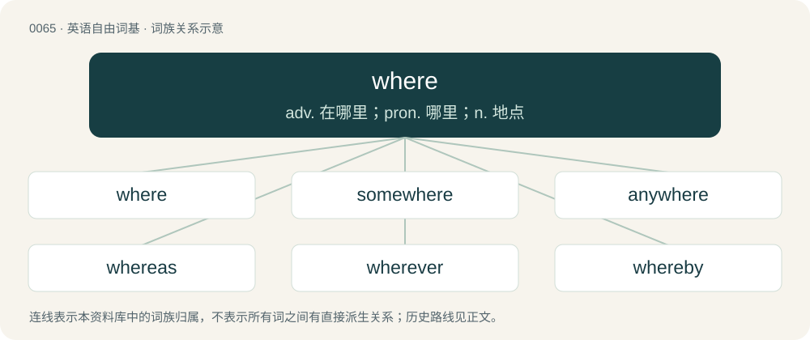

# 0065 · where — adv. 在哪里；pron. 哪里；n. 地点

[总目录](../00_总目录_按常用程度.md)

**类型**：英语自由词基　｜　**来源语言**：见词源记录

## 核心含义与来源

- 核心含义：adv. 在哪里；pron. 哪里；n. 地点
- 英文含义：In, at or to what place.
- 词形：where

**来源记录 1**（副词；In, at or to what place.）

From Middle English wher, from Old English hwǣr (“where”, literally “at what place”), from Proto-West Germanic \*hwār, from Proto-Germanic \*hwar (“where”), from Proto-Indo-European \*kʷ- (interrogative pronoun).

## 词族图

## 单词速览（常用到不常用）

| 单词 | 音标 | 释义 |
|---|---|---|
| [where](#w-1) | /ˈwɛə/ | adv. 在哪里；pron. 哪里；n. 地点 |
| [somewhere](#w-2) | 英 /ˈsʌm.wɛː/；美 /ˈsʌm.wɛɹ/ | adv. 到某处, 在某处 |
| [anywhere](#w-3) | 英 /ˈɛnɪwɛə/；美 /ˈɛn.i.(h)wɛɹ/ | adv. 无论何处 |
| [whereas](#w-4) | 英 /wɛəɹˈaz/；美 /(h)wɛɹˈæz/ | conj. 然而, 鉴于；\[法\] 考虑到, 鉴于, 就...而论 |
| [wherever](#w-5) | 英 /wɛəˈɹɛvə/；美 /(h)wɛɹˈɛvɚ/ | adv. 无论哪里 |
| [whereby](#w-6) | /wɛə(ɹ)ˈbaɪ/ | adv. 靠什么, 如何, 为何, 靠那个, 因此, 由此；\[法\] 因此, 由是 |
| [whereof](#w-7) | 英 /wɛəɹˈɒv/；美 /(h)wɛɹˈʌv/ | adv. 关于什么, 关于那事 |

## 逐词详解

### 1. where

**词性**：名词　｜　**音标**：/ˈwɛə/

**中文释义**：adv. 在哪里；pron. 哪里；n. 地点

**英文义项**：The place in which something happens.

**词源与演化**：

From Middle English wher, from Old English hwǣr (“where”, literally “at what place”), from Proto-West Germanic \*hwār, from Proto-Germanic \*hwar (“where”), from Proto-Indo-European \*kʷ- (interrogative pronoun).

**例句**：

> A good article will cover the who, the what, the when, the where, the why and the how.

该用例对应义项：The place in which something happens.

### 2. somewhere

**词性**：副词　｜　**音标**：英 /ˈsʌm.wɛː/；美 /ˈsʌm.wɛɹ/

**中文释义**：adv. 到某处, 在某处

**英文义项**：In an uncertain or unspecified location. / To an uncertain or unspecified location.

**构词拆分**：some + where

**词源与演化**：

From some + where.

**例句**：

> I don't remember the exact number, but it was somewhere between 200 and 300.

该用例对应义项：At some unspecified point.

### 3. anywhere

**词性**：副词　｜　**音标**：英 /ˈɛnɪwɛə/；美 /ˈɛn.i.(h)wɛɹ/

**中文释义**：adv. 无论何处

**英文义项**：In or at any location. / To (in the direction of) any location.

**构词拆分**：any + where

**词源与演化**：

From any + where.

**例句**：

> For many 'home' is an affectation when used anywhere that 'house' would be appropriate, as in 'Home for Sale'.

该用例对应义项：In or at any location.

### 4. whereas

**词性**：连词　｜　**音标**：英 /wɛəɹˈaz/；美 /(h)wɛɹˈæz/

**中文释义**：conj. 然而, 鉴于；\[法\] 考虑到, 鉴于, 就...而论

**英文义项**：In contrast; whilst on the contrary; although. / It being the fact that; inasmuch as. (Often used to begin recitals; sometimes emboldened or emphasized as a signifier.)

**构词拆分**：where + as (“that”)

**词源与演化**：

From where + as (“that”); first attested in the meaning of "where" in the 14th century. Compare thereas.

**例句**：

> He came first in the race, whereas his brother came last.

该用例对应义项：In contrast; whilst on the contrary; although.

### 5. wherever

**词性**：副词　｜　**音标**：英 /wɛəˈɹɛvə/；美 /(h)wɛɹˈɛvɚ/

**中文释义**：adv. 无论哪里

**英文义项**：Where ever; an emphatic form of where. / In, at or to any place that one likes or chooses.

**构词拆分**：where + ever；where + -ever

**词源与演化**：

From where + -ever.

**例句**：

> Where do you want to have lunch? — Wherever; I don't mind.

该用例对应义项：In, at or to any place that one likes or chooses.

### 6. whereby

**词性**：副词　｜　**音标**：/wɛə(ɹ)ˈbaɪ/

**中文释义**：adv. 靠什么, 如何, 为何, 靠那个, 因此, 由此；\[法\] 因此, 由是

**英文义项**：By which.

**构词拆分**：where + by

**词源与演化**：

From where + by.

**例句**：

> But he said: Lord God, whereby may I know that I shall possess it?

### 7. whereof

**词性**：连词　｜　**音标**：英 /wɛəɹˈɒv/；美 /(h)wɛɹˈʌv/

**中文释义**：adv. 关于什么, 关于那事

**英文义项**：Of what. / Of which.

**构词拆分**：where + of

**词源与演化**：

From Middle English wherof; equivalent to where + of. Compare the parallel formations of Swedish varav and Dutch waaraf.

**例句**：

> Whereof one cannot speak, thereof one must be silent.
