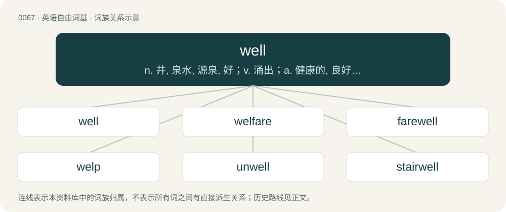

# 0067 · well — n. 井, 泉水, 源泉, 好；v. 涌出；a. 健康的, 良好的, 适宜的, 恰当的

[总目录](../00_总目录_按常用程度.md)

**类型**：英语自由词基　｜　**来源语言**：见词源记录

## 核心含义与来源

- 核心含义：n. 井, 泉水, 源泉, 好；v. 涌出；a. 健康的, 良好的, 适宜的, 恰当的
- 英文含义：Accurately, competently, satisfactorily.
- 词形：well

**多个词源／构词路径**：同一拼写可能有不同来源；以下按词性和含义分别列出。

**来源记录 1**（副词；Accurately, competently, satisfactorily.）

From Middle English wel, wal, wol, wele, from Old English wel (“well, abundantly, very, very easily, very much, fully, quite, nearly”), from Proto-Germanic \*wela, \*wala (“well”, literally “as wished, as desired”), from Proto-Indo-European \*welh₁- (“wish, desire”). Cognates Cognate with Yola vella, waal, wel, well, wull (“well”), Cimbrian boll, bóol (“well”), Dutch wel (“well”), German wohl, wol, woll (“well”), Danish, Icelandic, Norwegian Bokmål, and Norwegian Nynorsk vel (“well”), Faroese væl (“well”), Swedish väl, waͤl (“well”), Gothic 𐍅𐌰𐌹𐌻𐌰 (waila, “well”). Related to will.

**来源记录 2**（名词；A hole sunk into the ground as a source of water, oil, natural gas or other fluids.）

From Middle English welle, from Old English wielle (“well”), from Proto-West Germanic \*wallijā, from Proto-Germanic \*wallijǭ (“well, swirl, wave”), from Proto-Indo-European \*welH- (“to turn; wind; roll”). Cognate with West Frisian wel (“well”), Dutch wel (“well”), German Low German Well (“well”), German Welle (“wave”), Danish væld (“well; spring”), Swedish väl (“well”), Icelandic vella (“boiling; bubbling; eruption”).

**来源记录 3**（动词；To issue forth, as water from the earth; to flow; to spring.）

From Middle English wellen, from a merger of Old English weallan (intransitive) and wiellan (transitive), both meaning “to boil.” Further from Proto-Germanic \*wallaną and \*wallijaną. Doublet of wall. Cognate with German wallen (“boil, seethe”), Danish vælde (“gush”), Norwegian Nynorsk vella and outside Germanic, with Albanian valë (“hot, boiling”).

## 词族图

## 单词速览（常用到不常用）

| 单词 | 音标 | 释义 |
|---|---|---|
| [well](#w-1) | 英 /ˈwɛl/；/ˈwɛʊ̯/ | n. 井, 泉水, 源泉, 好；v. 涌出；a. 健康的, 良好的, 适宜的, 恰当的 |
| [welfare](#w-2) | 英 /ˈwɛlˌfɛə/；美 /ˈwɛlˌfɛɚ/ | n. 福利, 安宁, 幸福, 福利事业；a. 福利的 |
| [farewell](#w-3) | 英 /fɛəˈwɛl/；美 /fɛɹˈwɛl/ | n. 辞别, 再见, 再会；interj. 再会 |
| [welp](#w-4) | /wɛlp/ | 【英文】Well. Typically used to express exasperation, a matter-of-fact or unenthusiastic attitude, or helpless acceptance of something surprising. |
| [unwell](#w-5) | /ʌnˈwɛl/ | a. 不舒服的, 生病的, 身体不好的 |
| [stairwell](#w-6) | 英 /ˈstɛəwɛl/；美 /ˈstɛɹwɛl/ | n. 楼梯井 |
| [wellspring](#w-7) | 美 /ˈwɛlsprɪŋ/ | n. 水源, 泉源 |
| [wellhead](#w-8) | 英 /ˈwɛlhɛd/ | n. 水源, 泉源 |
| [wellbore](#w-9) | /ˈwelbɔː/ | 井眼 |

## 逐词详解

### 1. well

**词性**：形容词　｜　**音标**：英 /ˈwɛl/；/ˈwɛʊ̯/

**中文释义**：n. 井, 泉水, 源泉, 好；v. 涌出；a. 健康的, 良好的, 适宜的, 恰当的

**英文义项**：In good health. / Highly satisfactory

**词源与演化**：

From Middle English wel, wal, wol, wele, from Old English wel (“well, abundantly, very, very easily, very much, fully, quite, nearly”), from Proto-Germanic \*wela, \*wala (“well”, literally “as wished, as desired”), from Proto-Indo-European \*welh₁- (“wish, desire”). Cognates Cognate with Yola vella, waal, wel, well, wull (“well”), Cimbrian boll, bóol (“well”), Dutch wel (“well”), German wohl, wol, woll (“well”), Danish, Icelandic, Norwegian Bokmål, and Norwegian Nynorsk vel (“well”), Faroese væl (“well”), Swedish väl, waͤl (“well”), Gothic 𐍅𐌰𐌹𐌻𐌰 (waila, “well”). Related to will.

**例句**：

> I've always been a healthy, fit woman, but right now I really don't feel very well.

该用例对应义项：In good health.

### 2. welfare

**词性**：名词　｜　**音标**：英 /ˈwɛlˌfɛə/；美 /ˈwɛlˌfɛɚ/

**中文释义**：n. 福利, 安宁, 幸福, 福利事业；a. 福利的

**英文义项**：Health, safety, happiness and prosperity; well-being in any respect. / Shortened form of "welfare spending", "welfare payments", or "welfare assistance".

**构词拆分**：well + fare

**词源与演化**：

From Middle English welefare, probably from the Old English phrase wel faran (“to fare well, get along successfully, prosper”) (cognate with Middle Dutch welvare (“welfare”), Middle Low German wolvare (“welfare”), Middle High German wolvar, wolfar (“welfare”)). Equivalent to well + fare. Compare also West Frisian wolfeart, Dutch welvaart, German Wohlfahrt, Old Norse velferð (whence Swedish välfärd (“welfare”)). The first recorded use in the sense of "social concern for the well-being of children, the unemployed, etc." is from 1904 and in the sense of "organized effort to provide for maintenance of members of a group" from 1918.

**例句**：

> She lives on welfare.

该用例对应义项：governmental provision of economic assistance to persons in need

### 3. farewell

**词性**：名词　｜　**音标**：英 /fɛəˈwɛl/；美 /fɛɹˈwɛl/

**中文释义**：n. 辞别, 再见, 再会；interj. 再会

**英文义项**：A wish of happiness or safety at parting, especially a permanent departure. / A departure; the act of leaving.

**构词拆分**：fare (“to fare, travel, journey”) + well

**词源与演化**：

From Middle English farewel, from fare wel! (and the variants with the personal pronoun "fare ye well" and "fare you well" used in the Renaissance), an imperative expression, possibly further derived from Old English \*far wel!, equivalent to fare (“to fare, travel, journey”) + well. Compare Scots farewele, fairweill (“farewell”), Saterland Frisian Foarwäil (“farewell”), West Frisian farwol (“farewell”), German Fahrwol, Fahrwohl, East Frisian forwal, Dutch vaarwel (“farewell (sadly)”), Danish farvel (“farewell”), Norwegian farvel (“farewell”), Swedish farväl (“farewell”), Faroese farvæl (“goodbye”), Icelandic far vel (“farewell”). The extensive list of cognates suggests a postulated ultimate Proto-Germanic phrase of origin, possibly something akin to \*far wela.

**例句**：

> He bid farewell to all of his fans.

该用例对应义项：A wish of happiness or safety at parting, especially a permanent departure.

### 4. welp

**词性**：感叹词　｜　**音标**：/wɛlp/

**英文义项**：Well. Typically used to express exasperation, a matter-of-fact or unenthusiastic attitude, or helpless acceptance of something surprising.

**构词拆分**：well + -p

**词源与演化**：

Representing well pronounced with the mouth snapped closed at the end: well + -p.

**例句**：

> Welp, that there is a genuine piss bottle circa 1987. Southerly's is asking $1.7 million.

### 5. unwell

**词性**：形容词　｜　**音标**：/ʌnˈwɛl/

**中文释义**：a. 不舒服的, 生病的, 身体不好的

**英文义项**：Not in good health; not feeling well; somewhat ill / Specifically, ill from menstruation; affected with, or having, catamenial; menstruant.

**构词拆分**：From un- + well.

**词源与演化**：

From un- + well.

**用法示例／搭配（非完整句）**：

> feel unwell

该用例对应义项：Not in good health; not feeling well; somewhat ill

### 6. stairwell

**词性**：名词　｜　**音标**：英 /ˈstɛəwɛl/；美 /ˈstɛɹwɛl/

**中文释义**：n. 楼梯井

**英文义项**：A shaft in a multi-story building enclosing a stairway or staircase.

**构词拆分**：stair + well

**词源与演化**：

From stair + well.

**例句**：

> The lift is out of order, and the lights in the stairwell don't work.

### 7. wellspring

**词性**：名词　｜　**音标**：美 /ˈwɛlsprɪŋ/

**中文释义**：n. 水源, 泉源

**英文义项**：The source of water for a stream, spring or well; a fountainhead; a wellhead. / A perennial source of anything; a fountainhead of supply or emanation; resource.

**构词拆分**：well + spring

**词源与演化**：

From Middle English wellespring, from Old English wiellspring, wiellġespring (“spring, fount, fountain”), corresponding to well + spring. More at well, spring.

### 8. wellhead

**词性**：名词　｜　**音标**：英 /ˈwɛlhɛd/

**中文释义**：n. 水源, 泉源

**英文义项**：The place where a spring breaks out of the ground; the source of water for a stream or well. / The source of something; a fountainhead.

**构词拆分**：well + head

**词源与演化**：

From well + head.

### 9. wellbore

**词性**：名词　｜　**音标**：/ˈwelbɔː/

**中文释义**：井眼

**英文义项**：The hole produced when drilling an oil or gas well.

**构词拆分**：well + bore

**词源与演化**：

From well + bore.
