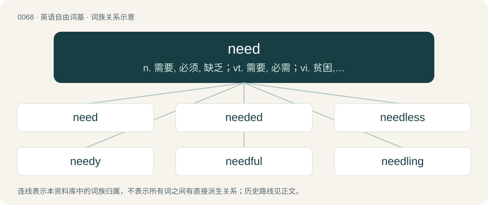

# 0068 · need — n. 需要, 必须, 缺乏；vt. 需要, 必需；vi. 贫困, 有必要

[总目录](../00_总目录_按常用程度.md)

**类型**：英语自由词基　｜　**来源语言**：见词源记录

## 核心含义与来源

- 核心含义：n. 需要, 必须, 缺乏；vt. 需要, 必需；vi. 贫困, 有必要
- 英文含义：A requirement for something; something needed.
- 词形：need

**多个词源／构词路径**：同一拼写可能有不同来源；以下按词性和含义分别列出。

**来源记录 1**（名词；A requirement for something; something needed.）

From Middle English need, nede, a merger of two terms: \* Old English nīed (West Saxon), nēd (Mercian), nēad (“necessity, compulsion, want”), from Proto-West Germanic \*naudi, from Proto-Germanic \*naudiz, from Proto-Indo-European \*neh₂w- (“death”). \* Old English nēod (“desire, longing”), from Proto-West Germanic \*niudi (“desire, eagerness”), from Proto-Indo-European \*new- (“to incline, tend, move, push, nod, wave”).

**来源记录 2**（动词；To have an absolute requirement for.）

From Middle English neden, from Old English nēodian.

## 词族图

## 单词速览（常用到不常用）

| 单词 | 音标 | 释义 |
|---|---|---|
| [need](#w-1) | 英 /niːd/；美 /nid/ | n. 需要, 必须, 缺乏；vt. 需要, 必需；vi. 贫困, 有必要 |
| [needed](#w-2) | 英 /ˈniː.dɪd/；美 /ˈni.dɪd/ | a. 需要的 |
| [needless](#w-3) | /ˈniːdləs/ | a. 不需要的, 不必要的 |
| [needy](#w-4) | /ˈniːdi/ | a. 贫穷的, 贫困的, 生活艰苦的 |
| [needful](#w-5) | /ˈniːdfl̩/ | a. 必要的, 需要的 |
| [needling](#w-6) | /ˈniːdlɪŋ/ | \[医\] 针刺, 针术 |

## 逐词详解

### 1. need

**词性**：名词　｜　**音标**：英 /niːd/；美 /nid/

**中文释义**：n. 需要, 必须, 缺乏；vt. 需要, 必需；vi. 贫困, 有必要

**英文义项**：A requirement for something; something needed. / A desire or craving for the satisfaction of a requirement perceived as essential or primal.

**词源与演化**：

From Middle English need, nede, a merger of two terms: \* Old English nīed (West Saxon), nēd (Mercian), nēad (“necessity, compulsion, want”), from Proto-West Germanic \*naudi, from Proto-Germanic \*naudiz, from Proto-Indo-European \*neh₂w- (“death”). \* Old English nēod (“desire, longing”), from Proto-West Germanic \*niudi (“desire, eagerness”), from Proto-Indo-European \*new- (“to incline, tend, move, push, nod, wave”).

**例句**：

> I've always tried to have few needs beyond food, clothing and shelter.

该用例对应义项：A requirement for something; something needed.

### 2. needed

**词性**：形容词　｜　**音标**：英 /ˈniː.dɪd/；美 /ˈni.dɪd/

**中文释义**：a. 需要的

**英文义项**：Necessary; being required.

**构词拆分**：need + -ed

**词源与演化**：

From need + -ed. The adjective is derived from the verb.

**用法示例／搭配（非完整句）**：

> Just-in-time as-needed support for in-house training

该用例对应义项：Necessary; being required.

### 3. needless

**词性**：形容词　｜　**音标**：/ˈniːdləs/

**中文释义**：a. 不需要的, 不必要的

**英文义项**：Not needed; unnecessary.

**构词拆分**：need + -less

**词源与演化**：

From Middle English needlees, nedelees, nedeles, equivalent to need + -less.

**例句**：

> This new project of yours will only be a needless expense.

该用例对应义项：Not needed; unnecessary.

### 4. needy

**词性**：形容词　｜　**音标**：/ˈniːdi/

**中文释义**：a. 贫穷的, 贫困的, 生活艰苦的

**英文义项**：In need; poor. / Desiring constant affirmation; lacking self-confidence.

**构词拆分**：need + -y

**词源与演化**：

From Middle English nedy, nedi (“necessitous”), from Old English nēdiġ, \*nīediġ ("of need, obligated, compelled"; found in the derivative nīediġnes (“obligation”)), from Proto-Germanic \*naudigaz (“of need, forced, compelled”), equivalent to need + -y. Cognate with Scots nedy, neidy (“needy, necessitous, impoverished”), Saterland Frisian niedich (“miserable, poor, wretched, needy”), Saterland Frisian nöödich (“necessary, needful”), West Frisian nedich (“needful, needed”), Dutch nodig (“necessary”), Middle Low German nōdich (“necessary, urgent, by requirement”), German nötig (“necessary, needful”), Danish nødig (“necessary”), Swedish nödig (“necessary”), Icelandic nauðugur (“constrained”).

**例句**：

> Needy people want to give too, but have few material goods to offer.

该用例对应义项：In need; poor.

### 5. needful

**词性**：形容词　｜　**音标**：/ˈniːdfl̩/

**中文释义**：a. 必要的, 需要的

**英文义项**：Needed; necessary; mandatory; requisite; indispensable.

**构词拆分**：need + -ful

**词源与演化**：

From Middle English needeful, nedeful, from Old English nēodful (“necessary; earnest; zealous”). Equivalent to need + -ful. Cognate with Dutch noodvol, German notvoll.

**例句**：

> Provided them with all things needful.

该用例对应义项：necessary for relief or supply

### 6. needling

**词性**：名词　｜　**音标**：/ˈniːdlɪŋ/

**中文释义**：\[医\] 针刺, 针术

**英文义项**：A needy person.

**构词拆分**：need + -ling

**词源与演化**：

From need + -ling.

**例句**：

> His older brother keeps needling him.
