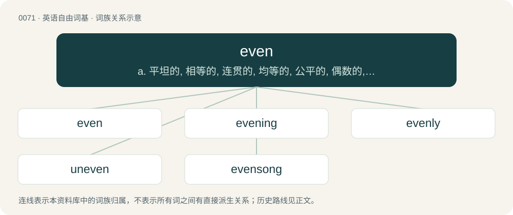

# 0072 · even — a. 平坦的, 相等的, 连贯的, 均等的, 公平的, 偶数的, 平均的, 平衡的, 恰好的；vt. 使平坦, 使相等；vi. 变平, 成为相等

[总目录](../00_总目录_按常用程度.md)

**类型**：英语自由词基　｜　**来源语言**：见词源记录

## 核心含义与来源

- 核心含义：a. 平坦的, 相等的, 连贯的, 均等的, 公平的, 偶数的, 平均的, 平衡的, 恰好的；vt. 使平坦, 使相等；vi. 变平, 成为相等
- 英文含义：Flat and level.
- 词形：even

**来源记录 1**（形容词；Flat and level.）

From Middle English even, from Old English efn (“flat; level, even, equal”), from Proto-West Germanic \*ebn, from Proto-Germanic \*ebnaz, from Proto-Indo-European \*(h₁)em-no- (“equal, straight; flat, level, even”). Cognate with Saterland Frisian íeuwen (“even, flat”), West Frisian even (“even”), Alemannic German ëben (“even”), Cimbrian ébane (“even”), Dutch even (“even, equal, same”), effen (“leveled”), German eben (“even, flat, level”), Danish jævn (“even, flat, smooth”), Icelandic jafn (“even”), Norwegian Bokmål jevn (“even, smooth”), Norwegian Nynorsk jamn (“even, smooth”), Swedish jämn (“even, level, smooth”), Gothic 𐌹𐌱𐌽𐍃 (ibns, “even”), Old Cornish eun (“equal, right”) (attested in Vocabularium Cornicum eun-hinsic (“iustus, i. e., just”)), Old Breton eun (“equal, right”) (attested in Eutychius Glossary eunt (“aequus, i. e., equal”)), Middle Breton effn, Breton eeun, Sanskrit अम्नस् (amnás, “(adverb) just, just now; at once”). The verb descends from Middle English evenen, from Old English efnan; the adverb from Middle English evene, from Old English efne. The traditional proposal connecting the Germanic adjective with the root Proto-Indo-European \*h₂eym- (Latin imāgō (“picture, image, likeness, copy”), Latin aemulus (“competitor, rival”), Sanskrit यम (yamá, “pair, twin”)) is problematic from a phonological point of view. For the meaning development compare with Latin aequus (“equal, level, even, flat, horizontal”), Russian ро́вный (róvnyj, “even, level, flat, smooth”), ра́вный (rávnyj, “equal”), по́ровну (pórovnu, “in equal parts”).

## 词族图

## 单词速览（常用到不常用）

| 单词 | 音标 | 释义 |
|---|---|---|
| [even](#w-1) | /ˈiːvən/ | a. 平坦的, 相等的, 连贯的, 均等的, 公平的, 偶数的, 平均的, 平衡的, 恰好的；vt. 使平坦, 使相等；vi. 变平, 成为相等 |
| [evening](#w-2) | 英 /ˈiːv.nɪŋ/；美 /ˈiv.nɪŋ/ | n. 傍晚, 晚间, 末期 |
| [evenly](#w-3) | /ˈiːvənli/ | adv. 平衡地, 平坦地, 平等地 |
| [uneven](#w-4) | /ʌnˈivən/ | a. 不平坦的, 不均等的, 奇数的 |
| [evensong](#w-5) | /ˈiːvənsɒŋ/ | n. (天主教的)晚祷, (英国国教的)晚祷 |

## 逐词详解

### 1. even

**词性**：形容词　｜　**音标**：/ˈiːvən/

**中文释义**：a. 平坦的, 相等的, 连贯的, 均等的, 公平的, 偶数的, 平均的, 平衡的, 恰好的；vt. 使平坦, 使相等；vi. 变平, 成为相等

**英文义项**：Flat and level. / Without great variation.

**词源与演化**：

From Middle English even, from Old English efn (“flat; level, even, equal”), from Proto-West Germanic \*ebn, from Proto-Germanic \*ebnaz, from Proto-Indo-European \*(h₁)em-no- (“equal, straight; flat, level, even”). Cognate with Saterland Frisian íeuwen (“even, flat”), West Frisian even (“even”), Alemannic German ëben (“even”), Cimbrian ébane (“even”), Dutch even (“even, equal, same”), effen (“leveled”), German eben (“even, flat, level”), Danish jævn (“even, flat, smooth”), Icelandic jafn (“even”), Norwegian Bokmål jevn (“even, smooth”), Norwegian Nynorsk jamn (“even, smooth”), Swedish jämn (“even, level, smooth”), Gothic 𐌹𐌱𐌽𐍃 (ibns, “even”), Old Cornish eun (“equal, right”) (attested in Vocabularium Cornicum eun-hinsic (“iustus, i. e., just”)), Old Breton eun (“equal, right”) (attested in Eutychius Glossary eunt (“aequus, i. e., equal”)), Middle Breton effn, Breton eeun, Sanskrit अम्नस् (amnás, “(adverb) just, just now; at once”). The verb descends from Middle English evenen, from Old English efnan; the adverb from Middle English evene, from Old English efne. The traditional proposal connecting the Germanic adjective with the root Proto-Indo-European \*h₂eym- (Latin imāgō (“picture, image, likeness, copy”), Latin aemulus (“competitor, rival”), Sanskrit यम (yamá, “pair, twin”)) is problematic from a phonological point of view. For the meaning development compare with Latin aequus (“equal, level, even, flat, horizontal”), Russian ро́вный (róvnyj, “even, level, flat, smooth”), ра́вный (rávnyj, “equal”), по́ровну (pórovnu, “in equal parts”).

**例句**：

> You biffed me back at the barn, and I biffed you here—so now we're even.

该用例对应义项：On equal terms of a moral sort; quits.

### 2. evening

**词性**：名词　｜　**音标**：英 /ˈiːv.nɪŋ/；美 /ˈiv.nɪŋ/

**中文释义**：n. 傍晚, 晚间, 末期

**英文义项**：The time of day between afternoon and night. / The time of the day between the approximate time of midwinter dusk and midnight (compare afternoon); the period after the end of regular office working hours.

**构词拆分**：even + -ing

**词源与演化**：

From Middle English evening, evenyng, from Old English ǣfnung, from ǣfnian (“to become evening”), from ǣfen (“eve”) (from Proto-West Germanic \*ābanþ, from Proto-Germanic \*ēbanþs), corresponding to even + -ing.

**例句**：

> I met my wife on a summer's evening in 1999.

该用例对应义项：The time of day between afternoon and night.

### 3. evenly

**词性**：副词　｜　**音标**：/ˈiːvənli/

**中文释义**：adv. 平衡地, 平坦地, 平等地

**英文义项**：So as to form a flat surface. / In a fair manner of distribution, giving the same amount or number to each; equally.

**构词拆分**：even + -ly

**词源与演化**：

From Middle English evenly, evenliche, from Old English efenlīċe (“evenly, alike, equally”), equivalent to even + -ly.

**例句**：

> To avoid arguments, he divided the sweets evenly between his two children.

该用例对应义项：In a fair manner of distribution, giving the same amount or number to each; equally.

### 4. uneven

**词性**：形容词　｜　**音标**：/ʌnˈivən/

**中文释义**：a. 不平坦的, 不均等的, 奇数的

**英文义项**：Of a surface, not even; covered with raised spots, pits and grooves. / Not level or smooth.

**构词拆分**：un- + even

**词源与演化**：

From Middle English uneven, from Old English unefen (“unequal, unlike, dissimilar, diverse, irregular”), equivalent to un- + even. Cognate with Dutch oneven (“unequal, uneven, odd”), German uneben (“uneven, rough, irregular, bumpy”).

**例句**：

> Wood with an uneven grain.

该用例对应义项：not even or uniform as e.g. in shape or texture

### 5. evensong

**词性**：名词　｜　**音标**：/ˈiːvənsɒŋ/

**中文释义**：n. (天主教的)晚祷, (英国国教的)晚祷

**英文义项**：A religious service, most commonly seen in the Anglican or Episcopal Church, that takes place in the early hours of the evening; originally, and sometimes still, an alternative name for vespers or a service combining vespers and compline.

**构词拆分**：even + song

**词源与演化**：

From Old English ǣfensang, equivalent to even + song. The use of even to mean evening is now obsolete except in poetry.
