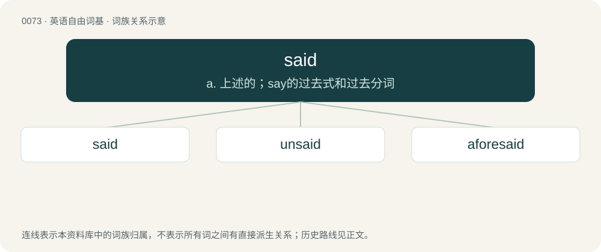

# 0075 · said — a. 上述的；say的过去式和过去分词

[总目录](../00_总目录_按常用程度.md)

**类型**：英语自由词基　｜　**来源语言**：见词源记录

## 核心含义与来源

- 核心含义：a. 上述的；say的过去式和过去分词
- 英文含义：Mentioned earlier; aforesaid.
- 词形：said

**来源记录 1**（形容词；Mentioned earlier; aforesaid.）

From Middle English seide (preterite) and seid, iseid (past participle), from Old English sǣde, sæġde (preterite) and ġesæġd (past participle), equivalent to say + -ed.

## 词族图

## 单词速览（常用到不常用）

| 单词 | 音标 | 释义 |
|---|---|---|
| [said](#w-1) | /sɛd/ | a. 上述的；say的过去式和过去分词 |
| [unsaid](#w-2) | /ˈʌnˈsed/ | unsay的过去式和过去分词 |
| [aforesaid](#w-3) | 英 /əˈfɔːsɛd/；美 /əˈfɔɹsɛd/ | a. 上述的, 前述的；\[法\] 如上所述的, 上面提到的 |

## 逐词详解

### 1. said

**词性**：形容词　｜　**音标**：/sɛd/

**中文释义**：a. 上述的；say的过去式和过去分词

**英文义项**：Mentioned earlier; aforesaid.

**构词拆分**：say + -ed

**词源与演化**：

From Middle English seide (preterite) and seid, iseid (past participle), from Old English sǣde, sæġde (preterite) and ġesæġd (past participle), equivalent to say + -ed.

**例句**：

> The said party has denied the charges.

该用例对应义项：Mentioned earlier; aforesaid.

### 2. unsaid

**词性**：形容词　｜　**音标**：/ˈʌnˈsed/

**中文释义**：unsay的过去式和过去分词

**英文义项**：Unspoken.

**构词拆分**：un- + said

**词源与演化**：

From un- + said.

**例句**：

> We discussed the terms, but the methods were left unsaid.

该用例对应义项：Unspoken.

### 3. aforesaid

**词性**：形容词　｜　**音标**：英 /əˈfɔːsɛd/；美 /əˈfɔɹsɛd/

**中文释义**：a. 上述的, 前述的；\[法\] 如上所述的, 上面提到的

**英文义项**：Previously stated; said or named before.

**构词拆分**：afore- + said

**词源与演化**：

From Middle English aforesaid(e), aforeseid(e), past participle of aforesayen, aforeseyen, aforeseien, aforeseggen; formed with the prefix afore- and the several forms of seien (“to say”). Equivalent to afore- + said.

**例句**：

> Once the aforesaid issues have been rectified, construction may continue.
