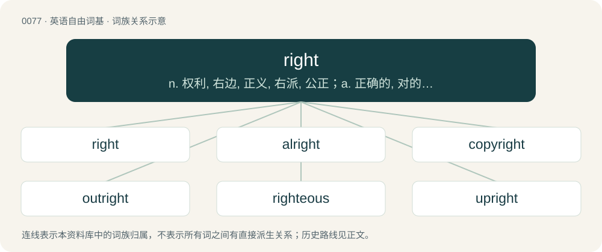

# 0079 · right — n. 权利, 右边, 正义, 右派, 公正；a. 正确的, 对的, 恰当的, 正常的, 正直的, 正面的, 右方的；adv. 正确地, 以有利结果, 一直, 直接, 向右

[总目录](../00_总目录_按常用程度.md)

**类型**：英语自由词基　｜　**来源语言**：见词源记录

## 核心含义与来源

- 核心含义：n. 权利, 右边, 正义, 右派, 公正；a. 正确的, 对的, 恰当的, 正常的, 正直的, 正面的, 右方的；adv. 正确地, 以有利结果, 一直, 直接, 向右
- 英文含义：Designating the side of the body which is positioned to the east if one is facing north, the side on which the heart is not located in most humans. This arrow points to the reader's right: →
- 词形：right

**多个词源／构词路径**：同一拼写可能有不同来源；以下按词性和含义分别列出。

**来源记录 1**（形容词；Designating the side of the body which is positioned to the east if one is facing north, the side on which the heart is not located in most humans. This arrow points to the reader's right: →）

From Middle English reȝt, right, righte, riht, riȝt, riȝte, ryght, ryȝt, from Old English reht, reoht, rieht, riht, ryht (“right,” also the word for “straight” and “direct”), from Proto-West Germanic \*reht, from Proto-Germanic \*rehtaz (“right, straight; just, morally upright”), from Proto-Indo-European \*h₃reǵtós (“right, straightened”), from \*h₃reǵ- (“to straighten; to righten”). The Germanic adjective which has been used also as a noun since the common Germanic period. Cognates Cognate with Scots richt (“right”), Yola reights, rights (“rights”), North Frisian recht, rocht, rucht (“right”), Saterland Frisian gjucht (“right”), West Frisian rjocht (“straight”), Central Franconian rääch (“right”), Dutch recht (“straight”), German recht, Recht (“right”), Limburgish réët (“right”), Luxembourgish Recht, riets (“right”), riicht (“straight”), Yiddish רעכט (rekht, “right”), Danish ret (“right”), Faroese rættur (“right”), Icelandic réttur (“right”), Norwegian Bokmål and Norwegian Nynorsk rett (“right”), Swedish rät (“straight”), rätt (“right”), Gothic 𐍂𐌰𐌹𐌷𐍄𐍃 (raihts, “straight; correct”). The Indo-European root is also the source of Breton reiñ (“to give”), Cornish ri (“to give; to grant; to present”), Irish reachd, reacht (“law, statute; authority; dispensation”), Scottish Gaelic reachd (“law, right; command, power”), Welsh rhoddi, rhoi (“to give; to put”), Latin rēctus (“led straight along; correct, right; just, lawful”), Ancient Greek ὀρεκτός (orektós, “stretched out; longed for”), Latvian redzēt (“to see”), Lithuanian regėti (“to see, view”), Avestan 𐬆𐬭𐬆𐬰𐬎 (ər^əzu, “straight”), Baluchi راست (rást, “right”), Central Kurdish ڕاست (rast, “right; straight”), Northern Kurdish rast (“straight; right; true; erect; direct”), Ossetian раст (rast, “honest, true; correct; exact; straight; fair; direct”), Persian راس (rās / râs), راست (râst, “straight; direct; true; erect”), Zazaki raşt (“right; straight”), Sanskrit ऋजु (ṛju, “straight; honest, sincere”).

**来源记录 2**（副词；On the right side.）

From Middle English right, righte, from Old English rihte, rehte (“right; rightly; due; directly; straight”), from Proto-Germanic \*rehta, from \*rehtaz (“right; straight”).

**来源记录 3**（名词；That which complies with justice, law or reason.）

From Middle English right, from Old English riht, reht, ġeriht (“that which is right, just, or proper”), from Proto-West Germanic \*reht, from Proto-Germanic \*rehtą (“a right”), from Proto-Indo-European \*h₃reǵtom, from Proto-Indo-European \*h₃reǵt- (“to straighten; direct”). Cognate with Dutch recht (“a right; privilege”), German Recht (“a right”), Danish ret (“a right”).

**来源记录 4**（动词；To correct.）

From Middle English righten, reghten, riȝten, from Old English rihtan, ġerihtan (“to straighten, judge, set upright, set right”), from Proto-West Germanic \*rihtijan, from Proto-Germanic \*rihtijaną (“to straighten; rectify; judge”).

## 词族图

## 单词速览（常用到不常用）

| 单词 | 音标 | 释义 |
|---|---|---|
| [right](#w-1) | 英 /ɹaɪt/；美 /ɹaɪt/ | n. 权利, 右边, 正义, 右派, 公正；a. 正确的, 对的, 恰当的, 正常的, 正直的, 正面的, 右方的；adv. 正确地, 以有利结果, 一直, 直接, 向右 |
| [alright](#w-2) | 英 /ɔːlˈɹaɪt/；美 /ɔlˈɹaɪt/ | a. 没问题的 |
| [copyright](#w-3) | 英 /ˈkɒpiˌɹaɪt/；美 /ˈkɑpiˌɹaɪt/ | n. 版权, 著作权；\[法\] 著作权 |
| [outright](#w-4) | /ˈaʊtɹaɪt/ | a. 率直的, 完全的, 总共的, 直率的；adv. 完全地, 率直地, 立刻地, 一直向前 |
| [righteous](#w-5) | /ˈɹaɪt͡ʃəs/ | a. 公正的, 正义的, 正直的；\[法\] 正直的, 正当的, 正义的 |
| [upright](#w-6) | /ˈʌpɹaɪt/ | a. 正直的, 诚实的, 公正的, 垂直的, 竖式的；\[化\] 立杆 |
| [rightly](#w-7) | 英 /ˈɹaɪtli/ | adv. 合适地, 正当地, 正确地 |
| [rightful](#w-8) | /ˈɹaɪtfəl/ | a. 合法的, 正直的, 恰当的；\[法\] 正当的, 合法的, 依法有求权的 |
| [birthright](#w-9) | 英 /ˈbɜːθ.ɹaɪt/；美 /ˈbɝθ.ɹaɪt/ | n. 生来就有的权利, 长子继承权 |
| [forthright](#w-10) | 英 /ˈfɔːθˌɹaɪt/；美 /ˈfɔɹθˌɹaɪt/ | adv. 直率地, 直接地, 马上, 立即；a. 直接的, 直率的, 坦白的；n. 直路 |
| [righty](#w-11) | /ˈraiti/ | n. 右派, 保守派 |
| [rightist](#w-12) | /ˈɹaɪtɪst/ | n. 右派人士, 保守党员；a. 右翼的, 右派的 |
| [rightness](#w-13) | /ˈraitnis/ | n. 廉正, 正直, 公正, 正确性 |
| [rightward](#w-14) | 英 /ˈɹaɪtwəd/；美 /ˈɹaɪtwɚd/ | adv. 向右, 向右倾；a. 朝右的 |
| [aright](#w-15) | 英 /əˈɹaɪt/ | adv. 正确地 |
| [rightmost](#w-16) |  | \[计\] 最右边的 |
| [righter](#w-17) |  | n. 订正者；改正者 |

## 逐词详解

### 1. right

**词性**：形容词　｜　**音标**：英 /ɹaɪt/；美 /ɹaɪt/

**中文释义**：n. 权利, 右边, 正义, 右派, 公正；a. 正确的, 对的, 恰当的, 正常的, 正直的, 正面的, 右方的；adv. 正确地, 以有利结果, 一直, 直接, 向右

**英文义项**：Designating the side of the body which is positioned to the east if one is facing north, the side on which the heart is not located in most humans. This arrow points to the reader's right: → / Clockwise, particularly when describing a change in direction or orientation.

**词源与演化**：

From Middle English reȝt, right, righte, riht, riȝt, riȝte, ryght, ryȝt, from Old English reht, reoht, rieht, riht, ryht (“right,” also the word for “straight” and “direct”), from Proto-West Germanic \*reht, from Proto-Germanic \*rehtaz (“right, straight; just, morally upright”), from Proto-Indo-European \*h₃reǵtós (“right, straightened”), from \*h₃reǵ- (“to straighten; to righten”). The Germanic adjective which has been used also as a noun since the common Germanic period. Cognates Cognate with Scots richt (“right”), Yola reights, rights (“rights”), North Frisian recht, rocht, rucht (“right”), Saterland Frisian gjucht (“right”), West Frisian rjocht (“straight”), Central Franconian rääch (“right”), Dutch recht (“straight”), German recht, Recht (“right”), Limburgish réët (“right”), Luxembourgish Recht, riets (“right”), riicht (“straight”), Yiddish רעכט (rekht, “right”), Danish ret (“right”), Faroese rættur (“right”), Icelandic réttur (“right”), Norwegian Bokmål and Norwegian Nynorsk rett (“right”), Swedish rät (“straight”), rätt (“right”), Gothic 𐍂𐌰𐌹𐌷𐍄𐍃 (raihts, “straight; correct”). The Indo-European root is also the source of Breton reiñ (“to give”), Cornish ri (“to give; to grant; to present”), Irish reachd, reacht (“law, statute; authority; dispensation”), Scottish Gaelic reachd (“law, right; command, power”), Welsh rhoddi, rhoi (“to give; to put”), Latin rēctus (“led straight along; correct, right; just, lawful”), Ancient Greek ὀρεκτός (orektós, “stretched out; longed for”), Latvian redzēt (“to see”), Lithuanian regėti (“to see, view”), Avestan 𐬆𐬭𐬆𐬰𐬎 (ər^əzu, “straight”), Baluchi راست (rást, “right”), Central Kurdish ڕاست (rast, “right; straight”), Northern Kurdish rast (“straight; right; true; erect; direct”), Ossetian раст (rast, “honest, true; correct; exact; straight; fair; direct”), Persian راس (rās / râs), راست (râst, “straight; direct; true; erect”), Zazaki raşt (“right; straight”), Sanskrit ऋजु (ṛju, “straight; honest, sincere”).

**例句**：

> the right side of a piece of cloth Begin this stitch on the right side.

该用例对应义项：Designed to be placed or worn outward.

### 2. alright

**词性**：感叹词　｜　**音标**：英 /ɔːlˈɹaɪt/；美 /ɔlˈɹaɪt/

**中文释义**：a. 没问题的

**英文义项**：Used to indicate acknowledgement or acceptance; OK. / An expression of happiness.

**构词拆分**：al- (“all”) + right

**例句**：

> Alright! I passed my exam!

该用例对应义项：An expression of happiness.

### 3. copyright

**词性**：名词　｜　**音标**：英 /ˈkɒpiˌɹaɪt/；美 /ˈkɑpiˌɹaɪt/

**中文释义**：n. 版权, 著作权；\[法\] 著作权

**英文义项**：The right by law to be the entity which determines who may publish, copy and distribute a piece of writing, music, picture or other work of authorship. / Such an exclusive right as it pertains to one or more specific works.

**构词拆分**：From copy + right.

**词源与演化**：

From copy + right.

**例句**：

> The artist lost the copyrights to her songs when she signed the contract.

该用例对应义项：Such an exclusive right as it pertains to one or more specific works.

### 4. outright

**词性**：形容词　｜　**音标**：/ˈaʊtɹaɪt/

**中文释义**：a. 率直的, 完全的, 总共的, 直率的；adv. 完全地, 率直地, 立刻地, 一直向前

**英文义项**：Unqualified and unreserved. / Total or complete.

**构词拆分**：By surface analysis, out + right

**词源与演化**：

From Middle English outright. By surface analysis, out + right.

**例句**：

> They don't seek outright independence, but rather greater autonomy.

该用例对应义项：Having no outstanding conditions.

### 5. righteous

**词性**：形容词　｜　**音标**：/ˈɹaɪt͡ʃəs/

**中文释义**：a. 公正的, 正义的, 正直的；\[法\] 正直的, 正当的, 正义的

**英文义项**：Free from sin or guilt. / Moral and virtuous, perhaps to the point of sanctimony.

**构词拆分**：right + -wise；right + wise (“way, manner”)

**词源与演化**：

From earlier rightuous, rightwose, rightwos, rightwise, from Middle English rightwise, rightwis, from Old English rihtwīs (“righteous, just”), corresponding to right + -wise (with assimilation of second element to -ous), or to right + wise (“way, manner”). Cognate with Scots richtwis (“righteous”), Old High German rehtwīsic (“righteous, just”), Icelandic réttvíss (“righteous, just”). Compare also thefteous, mighteous.

**例句**：

> Human beings should take a righteous path, and so should art. We should promote kindness and beauty through art.

该用例对应义项：Moral and virtuous, perhaps to the point of sanctimony.

### 6. upright

**词性**：形容词　｜　**音标**：/ˈʌpɹaɪt/

**中文释义**：a. 正直的, 诚实的, 公正的, 垂直的, 竖式的；\[化\] 立杆

**英文义项**：Vertical; erect. / In its proper orientation; not overturned.

**构词拆分**：up- + right

**词源与演化**：

From Middle English upright, uppryght, upriht, from Old English upriht (“upright; erect”), from Proto-Germanic \*upprehtaz, equivalent to up- + right. Cognate with Saterland Frisian apgjucht (“upright”), West Frisian oprjocht (“upright”), Dutch oprecht (“upright”), German Low German uprecht (“upright”), German aufrecht (“upright”), Swedish upprätt (“upright”), Icelandic uppréttur (“upright”).

**例句**：

> My brother didn't get angry when his son knocked over the lamp; he simply called the boy over and helped him set it upright again.

该用例对应义项：In its proper orientation; not overturned.

### 7. rightly

**词性**：副词　｜　**音标**：英 /ˈɹaɪtli/

**中文释义**：adv. 合适地, 正当地, 正确地

**英文义项**：In a right manner; correctly, justifiably.

**构词拆分**：right + -ly

**词源与演化**：

From Middle English ryȝtly, rihtliche, from Old English rihtlīċe, from Proto-West Germanic \*rehtalīkā, \*rehtalīkō, from Proto-Germanic \*rehtalīkê, \*rehtalīkô (“rightly”), equivalent to right + -ly. Cognate with West Frisian rjochtlik, Dutch rechtelijk, German rechtlich, Swedish rätteligen, Icelandic réttilega.

**例句**：

> She was quite rightly disappointed in not being promoted.

该用例对应义项：In a right manner; correctly, justifiably.

### 8. rightful

**词性**：形容词　｜　**音标**：/ˈɹaɪtfəl/

**中文释义**：a. 合法的, 正直的, 恰当的；\[法\] 正当的, 合法的, 依法有求权的

**英文义项**：By right; by law.

**构词拆分**：right + -ful

**词源与演化**：

From Middle English rightful, ryghtfull, riȝtful, from Old English \*rihtfull (suggested by derivative unrihtfull (“unrightful”)), equivalent to right + -ful.

**例句**：

> He was restored to his rightful position.

该用例对应义项：By right; by law.

### 9. birthright

**词性**：名词　｜　**音标**：英 /ˈbɜːθ.ɹaɪt/；美 /ˈbɝθ.ɹaɪt/

**中文释义**：n. 生来就有的权利, 长子继承权

**英文义项**：Something a person is entitled to due to the circumstances of their birth, such as an inheritance or citizenship.

**构词拆分**：birth + right

**词源与演化**：

From birth + right. Compare West Frisian berterjocht (“birthright”), Dutch geboorterecht (“birthright”), German Geburtsrecht (“birthright”). Compare also Icelandic frumburðarréttur (“birthright”).

**例句**：

> Freedom of speech is our birthright.

该用例对应义项：Something a person is entitled to due to the circumstances of their birth, such as an inheritance or citizenship.

### 10. forthright

**词性**：形容词　｜　**音标**：英 /ˈfɔːθˌɹaɪt/；美 /ˈfɔɹθˌɹaɪt/

**中文释义**：adv. 直率地, 直接地, 马上, 立即；a. 直接的, 直率的, 坦白的；n. 直路

**英文义项**：Straightforward; not evasive; candid and direct. / Frank, outspoken.

**构词拆分**：By surface analysis, forth + right

**词源与演化**：

From Middle English forþright, forþriʒt, forþriht, from Old English forþriht (“direct, plain”). By surface analysis, forth + right.

**例句**：

> The witness was considered eminently credible thanks to her forthright answers.

该用例对应义项：Straightforward; not evasive; candid and direct.

### 11. righty

**词性**：名词　｜　**音标**：/ˈraiti/

**中文释义**：n. 右派, 保守派

**英文义项**：A right-handed person. / A right-wing person.

**构词拆分**：right + -y

**词源与演化**：

From right + -y (nominal suffix).

### 12. rightist

**词性**：名词　｜　**音标**：/ˈɹaɪtɪst/

**中文释义**：n. 右派人士, 保守党员；a. 右翼的, 右派的

**英文义项**：One who believes in the politics or policies of the political right. / One who supports the rights of a specified group.

**构词拆分**：right + -ist

**词源与演化**：

From right + -ist.

**用法示例／搭配（非完整句）**：

> an animal rightist

该用例对应义项：One who supports the rights of a specified group.

### 13. rightness

**词性**：名词　｜　**音标**：/ˈraitnis/

**中文释义**：n. 廉正, 正直, 公正, 正确性

**英文义项**：The characteristic of being right; correctness. / The result or product of being right; something correct.

**构词拆分**：right + -ness

**词源与演化**：

From Middle English rightnesse, riȝtnesse, rihtnesse, from Old English rihtnes, rehtnis, from Proto-West Germanic \*rehtanassī (“rightness, justice”), equivalent to right + -ness. Cognate with West Frisian rjochtens (“rightness”), Middle Dutch rechtenesse (“rightness, justification”), Old High German rehtnissa (“justice”).

**例句**：

> Rightness of limitation is essential for growth of reality.

### 14. rightward

**词性**：形容词　｜　**音标**：英 /ˈɹaɪtwəd/；美 /ˈɹaɪtwɚd/

**中文释义**：adv. 向右, 向右倾；a. 朝右的

**英文义项**：To or from the right.

**构词拆分**：right + -ward

**词源与演化**：

From right + -ward.

### 15. aright

**词性**：副词　｜　**音标**：英 /əˈɹaɪt/

**中文释义**：adv. 正确地

**英文义项**：Rightly, correctly; in the right way or form.

**构词拆分**：a- + right

**词源与演化**：

From Middle English ariȝt, ariht, from Old English āriht (“aright, properly”), from earlier \*an riht, on riht (“rightly”), corresponding to a- + right.

**例句**：

> Bela and I need to set things aright.

### 16. rightmost

**词性**：形容词

**中文释义**：\[计\] 最右边的

**英文义项**：Furthest to the right.

**构词拆分**：right + -most

**词源与演化**：

From right + -most.

**例句**：

> Start with the rightmost one and work towards the left.

该用例对应义项：Furthest to the right.

### 17. righter

**词性**：名词

**中文释义**：n. 订正者；改正者

**英文义项**：Someone who puts right; someone who does justice or redresses wrong.

**构词拆分**：right + -er (agent suffix)

**词源与演化**：

From Middle English \*rightere, from Old English rihtere (“a ruler; director”), from Proto-Germanic \*rehtārijaz, equivalent to right + -er (agent suffix). Cognate with Saterland Frisian Gjuchter (“one who makes right; judge”), West Frisian rjochter (“one who makes right; judge”), Dutch rechter (“one who makes right; judge”), German Low German Richter (“one who makes right; judge”), German Richter (“one who makes right; judge”), Icelandic réttari (“a justiciary”).
