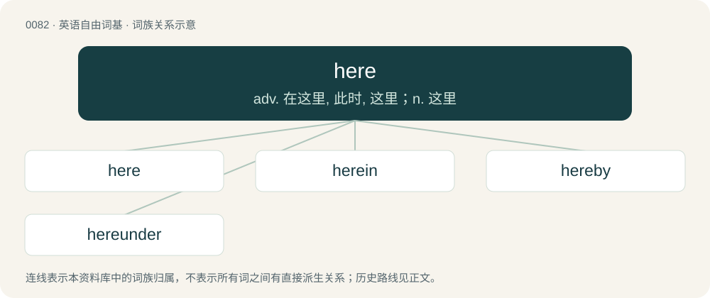

# 0084 · here — adv. 在这里, 此时, 这里；n. 这里

[总目录](../00_总目录_按常用程度.md)

**类型**：英语自由词基　｜　**来源语言**：见词源记录

## 核心含义与来源

- 核心含义：adv. 在这里, 此时, 这里；n. 这里
- 英文含义：In, on, or at this place (a place perceived to be close to the speaker); compare there.
- 词形：here

**来源记录 1**（副词；In, on, or at this place (a place perceived to be close to the speaker); compare there.）

From Middle English her, from Old English hēr (“at this place”), from Proto-West Germanic \*hēr, from Proto-Germanic \*hē₂r, from \*hiz + \*-r, from Proto-Indo-European \*kís, from \*ḱe + \*ís. Cognates Cognate with Saterland Frisian hier, West Frisian hjir, Dutch hier, German Low German hier, German hier, Danish her, Swedish här, Norwegian her, Faroese her, Icelandic hér. Also related to the English pronoun he (“this/that person”), and the words hither (“to this place”) and hence (“from this place”).

## 词族图

## 单词速览（常用到不常用）

| 单词 | 音标 | 释义 |
|---|---|---|
| [here](#w-1) | 英 /ˈhɪə̯/；美 /ˈhɪɚ̯/ | adv. 在这里, 此时, 这里；n. 这里 |
| [herein](#w-2) | 英 /hɪəˈɹɪn/；美 /hɪɹˈɪn/ | adv. 在此处, 如此 |
| [hereby](#w-3) | 英 /hɪəˈbʌɪ/；美 /hɪɹˈbaɪ/ | adv. 因此, 据此 |
| [hereunder](#w-4) | /hiərˈʌndə/ | adv. 在下面；\[法\] 在下面 |

## 逐词详解

### 1. here

**词性**：形容词　｜　**音标**：英 /ˈhɪə̯/；美 /ˈhɪɚ̯/

**中文释义**：adv. 在这里, 此时, 这里；n. 这里

**英文义项**：Alive

**词源与演化**：

From Middle English her, from Old English hēr (“at this place”), from Proto-West Germanic \*hēr, from Proto-Germanic \*hē₂r, from \*hiz + \*-r, from Proto-Indo-European \*kís, from \*ḱe + \*ís. Cognates Cognate with Saterland Frisian hier, West Frisian hjir, Dutch hier, German Low German hier, German hier, Danish her, Swedish här, Norwegian her, Faroese her, Icelandic hér. Also related to the English pronoun he (“this/that person”), and the words hither (“to this place”) and hence (“from this place”).

**例句**：

> I'm not dead yet! I'm still here!

该用例对应义项：Alive

### 2. herein

**词性**：副词　｜　**音标**：英 /hɪəˈɹɪn/；美 /hɪɹˈɪn/

**中文释义**：adv. 在此处, 如此

**英文义项**：In this; within this content, context, or thing.

**构词拆分**：here + in

**词源与演化**：

From Middle English here-inne, her-in, her-inne, hier-ine, from Old English hērinne, from Proto-West Germanic \*hērinna, from Proto-Germanic \*hē₂rinna, equivalent to here + in. Cognate with West Frisian hjiryn (“herein”), Dutch hierin (“herein”), German hierin (“herein”), Danish heri (“herein”), Swedish häri (“herein”), Icelandic hér í (“herein”).

**例句**：

> I shall discuss the question herein.

该用例对应义项：in this place or thing or document

### 3. hereby

**词性**：副词　｜　**音标**：英 /hɪəˈbʌɪ/；美 /hɪɹˈbaɪ/

**中文释义**：adv. 因此, 据此

**英文义项**：By this means, action or process.

**构词拆分**：here + by

**词源与演化**：

From here + by.

**例句**：

> I hereby declare you husband and wife.

该用例对应义项：By this means, action or process.

### 4. hereunder

**词性**：副词　｜　**音标**：/hiərˈʌndə/

**中文释义**：adv. 在下面；\[法\] 在下面

**英文义项**：Under this. / Under this (within the document being read).

**构词拆分**：here + under

**词源与演化**：

From Middle English here-under; equivalent to here + under.

**例句**：

> The terms specified hereunder.

该用例对应义项：in a subsequent part of this document or statement or matter etc.
