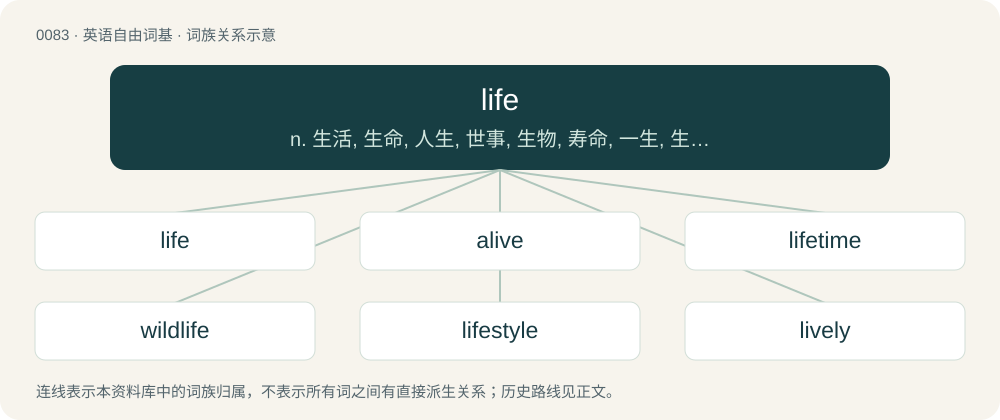

# 0085 · life — n. 生活, 生命, 人生, 世事, 生物, 寿命, 一生, 生命力, 灵魂, 无期徒刑；\[医\] 生活, 生存, 生命, 寿命

[总目录](../00_总目录_按常用程度.md)

**类型**：英语自由词基　｜　**来源语言**：见词源记录

## 核心含义与来源

- 核心含义：n. 生活, 生命, 人生, 世事, 生物, 寿命, 一生, 生命力, 灵魂, 无期徒刑；\[医\] 生活, 生存, 生命, 寿命
- 英文含义：The state of organisms preceding their death, characterized by biological processes such as metabolism and reproduction and distinguishing them from inanimate objects; the state of being alive and living.
- 词形：life

**来源记录 1**（名词；The state of organisms preceding their death, characterized by biological processes such as metabolism and reproduction and distinguishing them from inanimate objects; the state of being alive and living.）

From Middle English lyf, from Old English līf, from Proto-West Germanic \*līb, from Proto-Germanic \*lībą (“life, body”), from \*lībaną (“to remain, stay, be left”), from Proto-Indo-European \*leyp- (“to stick, glue”). Cognate with Scots life, leif (“life”), Saterland Frisian Lieuw (“body”), West Frisian liif (“body”), Cimbrian laip (“body”), Dutch lijf (“body”) and leven (“life”), German Leib (“body; womb”) and Leben (“life”), Low German Lief (“body; life”), Luxembourgish Leif, Läif (“body”), Vilamovian łaowa (“life”), Yiddish לײַב (layb, “body”), Danish, Norwegian Bokmål, Norwegian Nynorsk, and Swedish liv (“life; waist”), Faroese lív (“life”), Icelandic líf (“life”). Related to belive. The sense "biography" is likely a semantic loan from Medieval Latin vīta (“biography; hagiography”).

## 词族图

## 单词速览（常用到不常用）

| 单词 | 音标 | 释义 |
|---|---|---|
| [life](#w-1) | /ˈlaɪ̯f/ | n. 生活, 生命, 人生, 世事, 生物, 寿命, 一生, 生命力, 灵魂, 无期徒刑；\[医\] 生活, 生存, 生命, 寿命 |
| [alive](#w-2) | /əˈlaɪv/ | a. 活着的, 活泼的, 敏感的, 热闹的 |
| [lifetime](#w-3) | /ˈlaɪf.taɪm/ | n. 一生, 终生；a. 一生的, 终生的 |
| [wildlife](#w-4) | /ˈwaɪldlaɪf/ | n. 野生动植物 |
| [lifestyle](#w-5) | /ˈlaɪfˌstaɪl/ | n. 生活方式 |
| [lively](#w-6) | 英 /ˈlaɪv.li/ | a. 活泼的, 鲜明的, 生动的 |
| [lifelong](#w-7) | /ˈlaɪf.lɔːŋ/ | a. 终身的, 毕生的 |
| [lifespan](#w-8) | /ˈlaɪf.spæn/ | n. 预期生命期限；寿命；预期使用期限 |
| [afterlife](#w-9) | 英 /ˈɑːftəˌlaɪf/；美 /ˈæftɚˌlaɪf/ | n. 来世, 下半生 |
| [lifeless](#w-10) | /ˈlaɪfləs/ | a. 无生命的, 无趣味的, 死气沉沉的 |
| [lifeline](#w-11) | /ˈlaɪfˌlaɪn/ | n. 救生索, 生命线 |
| [lifeboat](#w-12) | 英 /ˈlaɪfˌbəʊt/；美 /ˈlaɪfˌboʊt/ | n. 救生艇 |
| [nightlife](#w-13) | /ˈnaɪtˌlaɪf/ | n. 夜生活 |
| [lifeguard](#w-14) | 美 /ˈlaɪfˌɡɑɹd/ | n. 卫兵, 禁卫军, 救生员 |
| [lifesaving](#w-15) | /ˈlaifseiviŋ/ | a. 救命的, 救生用的 |
| [lifesaver](#w-16) | 英 /ˈlaɪfˌseɪvə/；美 /ˈlaɪfˌseɪvəɹ/ | n. 救命者, 救生员, 济急的人 |
| [midlife](#w-17) | 美 /ˈmɪdlaɪf/ | n. 中年 |
| [lifelike](#w-18) | /ˈlaɪflaɪk/ | a. 栩栩如生的, 逼真的, 酷象实物的 |
| [lifeblood](#w-19) | 美 /ˈlaɪfˌblʌd/ | n. 鲜血, 血, 生机的根源 |
| [liven](#w-20) | /ˈlaɪvən/ | vt. 使高兴, 使快活；vi. 快活起来 |
| [lowlife](#w-21) | 英 /ˈləʊlaɪf/；美 /ˈloʊlaɪf/ | n. 下层阶级的人, 卑劣人, 罪犯 |
| [lifer](#w-22) | /ˈlaɪfə(ɹ)/ | n. 无期徒刑者, 职业军人；\[法\] 无期徒刑犯 |
| [enliven](#w-23) | 英 /ɛnˈlaɪvən/ | vt. 使活泼, 使生动 |
| [birdlife](#w-24) | /ˈbɜːdlaɪf/ | 鸟类生活, （一地区的）鸟类 |
| [highlife](#w-25) |  | 强节奏爵士舞, 强节奏爵士乐（尤指盛行于20世纪50年代和60年代, 受摇滚乐、爵士乐影响的源于西非的舞蹈和音乐风格） |
| [parklife](#w-26) |  | 【英文】The lifestyle and culture of parkgoers. |
| [folklife](#w-27) | /ˈfəuk,laif/ | n. 民众生活 |
| [lifeform](#w-28) |  | 生活型 |

## 逐词详解

### 1. life

**词性**：名词　｜　**音标**：/ˈlaɪ̯f/

**中文释义**：n. 生活, 生命, 人生, 世事, 生物, 寿命, 一生, 生命力, 灵魂, 无期徒刑；\[医\] 生活, 生存, 生命, 寿命

**英文义项**：The state of organisms preceding their death, characterized by biological processes such as metabolism and reproduction and distinguishing them from inanimate objects; the state of being alive and living. / The status possessed by any of a number of entities, including animals, plants, fungi, bacteria, and sometimes viruses, which have the properties of replication and metabolism.

**词源与演化**：

From Middle English lyf, from Old English līf, from Proto-West Germanic \*līb, from Proto-Germanic \*lībą (“life, body”), from \*lībaną (“to remain, stay, be left”), from Proto-Indo-European \*leyp- (“to stick, glue”). Cognate with Scots life, leif (“life”), Saterland Frisian Lieuw (“body”), West Frisian liif (“body”), Cimbrian laip (“body”), Dutch lijf (“body”) and leven (“life”), German Leib (“body; womb”) and Leben (“life”), Low German Lief (“body; life”), Luxembourgish Leif, Läif (“body”), Vilamovian łaowa (“life”), Yiddish לײַב (layb, “body”), Danish, Norwegian Bokmål, Norwegian Nynorsk, and Swedish liv (“life; waist”), Faroese lív (“life”), Icelandic líf (“life”). Related to belive. The sense "biography" is likely a semantic loan from Medieval Latin vīta (“biography; hagiography”).

**例句**：

> The life of this milk carton may be thousands of years in this landfill.

该用例对应义项：The period of time during which an object is recognizable.

### 2. alive

**词性**：形容词　｜　**音标**：/əˈlaɪv/

**中文释义**：a. 活着的, 活泼的, 敏感的, 热闹的

**英文义项**：Having life; living; not dead. / In a state of action; in force or operation; existent.

**构词拆分**：a- + life

**词源与演化**：

From Middle English alyve, alive, alife, olive, olife, on live, on life, from Old English on līfe (“alive”, literally “in life" or "in (the) body”), from on (“on, in”) + līfe, dative singular of līf (“life”). In this sense, replaced Old English cwic (whence English quick). Equivalent to a- + life. Compare Dutch in leven (“alive”, literally “in life”), German am Leben (“alive”, literally “at life" or "at living”).

**例句**：

> First a solitary blackbird started up, and soon the whole forest was alive with birdsong.

该用例对应义项：Busy with activity of many living beings; swarming; thronged; busy.

### 3. lifetime

**词性**：名词　｜　**音标**：/ˈlaɪf.taɪm/

**中文释义**：n. 一生, 终生；a. 一生的, 终生的

**英文义项**：The duration of the life of someone or something. / A long period of time.

**构词拆分**：life + time

**词源与演化**：

From Middle English lyftyme, equivalent to life + time. Cognate with Icelandic líftími (“lifetime”). Compare also Saterland Frisian Lieuwendstied, Dutch leeftijd and levenstijd, German Low German Levenstied, German Lebenszeit, Danish livstid, Swedish livstid.

**例句**：

> I've been waiting a lifetime for a train.

该用例对应义项：A long period of time.

### 4. wildlife

**词性**：名词　｜　**音标**：/ˈwaɪldlaɪf/

**中文释义**：n. 野生动植物

**英文义项**：undomesticated animals, especially mammals, birds, and fish, which live in the wild. / Living undomesticated organisms of all kinds.

**构词拆分**：wild + life

**词源与演化**：

From wild + life.

**例句**：

> This town offers wildlife tours where you can go and watch the bears, deer, wild rabbits and other creatures in their natural habitats.

该用例对应义项：undomesticated animals, especially mammals, birds, and fish, which live in the wild.

### 5. lifestyle

**词性**：名词　｜　**音标**：/ˈlaɪfˌstaɪl/

**中文释义**：n. 生活方式

**英文义项**：A style of living that reflects the attitudes and values of a person or group. / The totality of the likes and dislikes of a particular section of the market, especially when expressed in terms of the products and services that they would buy; a marketing strategy based on the self-image of such a group.

**构词拆分**：life + style

**词源与演化**：

From life + style.

**例句**：

> An orderly lifestyle and a regular diet are the keys to health.

### 6. lively

**词性**：形容词　｜　**音标**：英 /ˈlaɪv.li/

**中文释义**：a. 活泼的, 鲜明的, 生动的

**英文义项**：Full of life; energetic, vivacious. / Bright, glowing, vivid; strong, vigorous.

**构词拆分**：life + -ly

**词源与演化**：

From Middle English lyvely, lifly, from Old English līflīċ (“living, lively, long-lived, necessary to life, vital”), from Proto-West Germanic \*lībalīk (“living, lively”), equivalent to life + -ly. Cognate with Scots lively, lifely (“of or pertaining to life, vital, living, life-like”), Old High German līblīh (“living, animated”), German leiblich (“bodily, corporeal”). Doublet of lifely and lifelike.

**例句**：

> Lively and attractive parents.

该用例对应义项：full of life and energy

### 7. lifelong

**词性**：形容词　｜　**音标**：/ˈlaɪf.lɔːŋ/

**中文释义**：a. 终身的, 毕生的

**英文义项**：Extending for the entire duration of life.

**构词拆分**：life + -long

**词源与演化**：

From life + -long.

**例句**：

> They were lifelong friends; they met in elementary school and ended their lives in the same rest home.

该用例对应义项：Extending for the entire duration of life.

### 8. lifespan

**词性**：名词　｜　**音标**：/ˈlaɪf.spæn/

**中文释义**：n. 预期生命期限；寿命；预期使用期限

**英文义项**：The length of time for which an organism lives. / The length of time for which something exists or is current, valid, or usable.

**构词拆分**：life + span

**词源与演化**：

From life + span.

**例句**：

> Some clams have lifespans far longer than those of human beings.

该用例对应义项：The length of time for which an organism lives.

### 9. afterlife

**词性**：名词　｜　**音标**：英 /ˈɑːftəˌlaɪf/；美 /ˈæftɚˌlaɪf/

**中文释义**：n. 来世, 下半生

**英文义项**：A conscious existence after death; a supernatural life that follows one's natural life, in some worldviews. / The place believed to be inhabited by people who have died.

**构词拆分**：after- + life

**词源与演化**：

From after- + life.

**例句**：

> They say that life begins at 40, but right now I'm more interested in the afterlife that begins at 65!

该用例对应义项：The part of a person's life that follows a particular stage or event; later life.

### 10. lifeless

**词性**：形容词　｜　**音标**：/ˈlaɪfləs/

**中文释义**：a. 无生命的, 无趣味的, 死气沉沉的

**英文义项**：inanimate; having no life / dead; having lost life

**构词拆分**：life + -less

**词源与演化**：

From Middle English lyfles, lifles, from Old English līflēas (“lifeless”), equivalent to life + -less. Cognate with West Frisian libbensleas (“lifeless”), Dutch levenloos (“lifeless”), German leblos (“lifeless”), Danish livløs (“lifeless”), Swedish livlös (“lifeless”), Icelandic líflaus (“lifeless”).

**例句**：

> After the dance the littered and lifeless ballroom echoed hollowly.

该用例对应义项：destitute or having been emptied of life or living beings

### 11. lifeline

**词性**：名词　｜　**音标**：/ˈlaɪfˌlaɪn/

**中文释义**：n. 救生索, 生命线

**英文义项**：A line to which a drowning or falling victim may cling. / A source of salvation in a crisis.

**构词拆分**：life + line

**词源与演化**：

From life + line.

**例句**：

> Wild tigers have been offered a lifeline by countries where they still roam.

### 12. lifeboat

**词性**：名词　｜　**音标**：英 /ˈlaɪfˌbəʊt/；美 /ˈlaɪfˌboʊt/

**中文释义**：n. 救生艇

**英文义项**：A boat especially designed for saving the lives of shipwrecked people or people in distress at sea (either launched from the shore with a crew, or else carried on board a larger ship). / An emergency vehicle carried aboard a spaceship.

**构词拆分**：life + boat

**词源与演化**：

From life + boat.

**例句**：

> Tom spent the night in the lifeboat and was rescued the next morning.

### 13. nightlife

**词性**：名词　｜　**音标**：/ˈnaɪtˌlaɪf/

**中文释义**：n. 夜生活

**英文义项**：Nocturnal activities, especially visiting nightclubs.

**构词拆分**：night + life

**词源与演化**：

From night + life.

**例句**：

> Rio de Janeiro boasts the best nightlife in South America.

该用例对应义项：Nocturnal activities, especially visiting nightclubs.

### 14. lifeguard

**词性**：名词　｜　**音标**：美 /ˈlaɪfˌɡɑɹd/

**中文释义**：n. 卫兵, 禁卫军, 救生员

**英文义项**：A lifesaver: a rescuer, usually an expert swimmer, employed to save swimmers in trouble or near drowning at a body of water. / A bodyguard or unit of bodyguards, a guard of someone's (especially a king's) life or person.

**构词拆分**：life + guard

**词源与演化**：

From life + guard, calque of Dutch lijfgarde, where life has the sense of Dutch lijf (“body”) (hence literally “bodyguard”). Compare German Leibgarde (“bodyguard”), Danish livgarde (“bodyguard”), Swedish livgarde (“bodyguard”). Compare also Old English līfweard (“guardian of life”).

**例句**：

> I applied for a job as a lifeguard at the community pool.

### 15. lifesaving

**词性**：名词　｜　**音标**：/ˈlaifseiviŋ/

**中文释义**：a. 救命的, 救生用的

**英文义项**：The act of saving a life, especially from drowning.

**构词拆分**：life + saving

**词源与演化**：

From life + saving.

**例句**：

> I’m normally a big fan of lifesaving, but in his case we can make an exception.

该用例对应义项：The act of saving a life, especially from drowning.

### 16. lifesaver

**词性**：名词　｜　**音标**：英 /ˈlaɪfˌseɪvə/；美 /ˈlaɪfˌseɪvəɹ/

**中文释义**：n. 救命者, 救生员, 济急的人

**英文义项**：A lifeguard or other rescuer. / A life buoy.

**构词拆分**：life + saver

**词源与演化**：

From life + saver.

**例句**：

> Paramedics are not just ordinary workers but lifesavers with a very important job.

该用例对应义项：A lifeguard or other rescuer.

### 17. midlife

**词性**：形容词　｜　**音标**：美 /ˈmɪdlaɪf/

**中文释义**：n. 中年

**英文义项**：Occurring in the middle point of one's life, usually considered about 45.

**构词拆分**：mid- + life

**词源与演化**：

From mid- + life.

**例句**：

> Maybe I'm going through a midlife crisis.

### 18. lifelike

**词性**：形容词　｜　**音标**：/ˈlaɪflaɪk/

**中文释义**：a. 栩栩如生的, 逼真的, 酷象实物的

**英文义项**：Like a living being; resembling life; being an accurate representation.

**构词拆分**：life + -like

**词源与演化**：

From life + -like. First attested in the 1610s.

**例句**：

> The robot was so lifelike, Jack could hardly tell it apart from his sister.

该用例对应义项：Like a living being; resembling life; being an accurate representation.

### 19. lifeblood

**词性**：名词　｜　**音标**：美 /ˈlaɪfˌblʌd/

**中文释义**：n. 鲜血, 血, 生机的根源

**英文义项**：Blood that is needed for continued life; blood regarded as the seat of life. / That which is required for continued existence or function.

**构词拆分**：life + blood

**词源与演化**：

From life + blood. Compare English heart-blood (“lifeblood”).

**例句**：

> Gasoline is the lifeblood of the modern city.

该用例对应义项：That which is required for continued existence or function.

### 20. liven

**词性**：动词　｜　**音标**：/ˈlaɪvən/

**中文释义**：vt. 使高兴, 使快活；vi. 快活起来

**英文义项**：To cause to be more lively, or to become more lively.

**构词拆分**：life + -en；live (adjective) + -en

**词源与演化**：

Partly from life + -en; partly from live (adjective) + -en; and partly a shortening of enliven. Cognate with Norwegian Nynorsk livna (“to quicken, come alive”), Faroese livna (“to come to life, come alive”), Icelandic lifna (“to come to life”).

**例句**：

> Let's liven up this party!

该用例对应义项：To cause to be more lively, or to become more lively.

### 21. lowlife

**词性**：名词　｜　**音标**：英 /ˈləʊlaɪf/；美 /ˈloʊlaɪf/

**中文释义**：n. 下层阶级的人, 卑劣人, 罪犯

**英文义项**：An untrustworthy, despicable, disreputable, or otherwise immoral person, especially one suspected of being a criminal. / A person who is rebuked by their community for their behavior.

**构词拆分**：low + life

**词源与演化**：

From low + life.

**例句**：

> They say all the lowlifes used to hang out at the docks and plot their despicable crimes, before being elected to public office.

该用例对应义项：An untrustworthy, despicable, disreputable, or otherwise immoral person, especially one suspected of being a criminal.

### 22. lifer

**词性**：名词　｜　**音标**：/ˈlaɪfə(ɹ)/

**中文释义**：n. 无期徒刑者, 职业军人；\[法\] 无期徒刑犯

**英文义项**：A prisoner sentenced to life in prison. / A prisoner sentenced to transportation for life.

**构词拆分**：life + -er

**词源与演化**：

From life + -er.

### 23. enliven

**词性**：动词　｜　**音标**：英 /ɛnˈlaɪvən/

**中文释义**：vt. 使活泼, 使生动

**英文义项**：To make more lively, cheerful or interesting.

**构词拆分**：life + en- -en (intensifying verbal circumfix)

**词源与演化**：

From life + en- -en (intensifying verbal circumfix). See liven.

**例句**：

> The game was much enlivened when both teams scored within five minutes of each other.

该用例对应义项：To make more lively, cheerful or interesting.

### 24. birdlife

**词性**：名词　｜　**音标**：/ˈbɜːdlaɪf/

**中文释义**：鸟类生活, （一地区的）鸟类

**英文义项**：Birds collectively; avifauna.

**构词拆分**：bird + life

**词源与演化**：

From bird + life.

### 25. highlife

**词性**：名词

**中文释义**：强节奏爵士舞, 强节奏爵士乐（尤指盛行于20世纪50年代和60年代, 受摇滚乐、爵士乐影响的源于西非的舞蹈和音乐风格）

**英文义项**：A genre of music that originated in Ghana in the early 20th century, blending elements of traditional Akan music with Western instruments and ideas. / A work or performance in this style.

**构词拆分**：high + life

**词源与演化**：

From high + life.

### 26. parklife

**词性**：名词

**英文义项**：The lifestyle and culture of parkgoers.

**构词拆分**：park + life

**词源与演化**：

park + life. Almost unattested prior to the 1994 Blur single "Parklife".

### 27. folklife

**词性**：名词　｜　**音标**：/ˈfəuk,laif/

**中文释义**：n. 民众生活

**英文义项**：Folklore; those cultural traditions passed down orally or informally.

**构词拆分**：folk + life

**词源与演化**：

From folk + life.

**例句**：

> A Chinese puppeteer entertains the crowd with the antics of his monkey on a bicycle at the Smithsonian Folklife Festival in Washington.

### 28. lifeform

**词性**：名词

**中文释义**：生活型

**英文义项**：Any specific living organism.

**构词拆分**：life + form

**词源与演化**：

From life + form.

**例句**：

> In a popular show, the Horta is a silicon-based lifeform.
