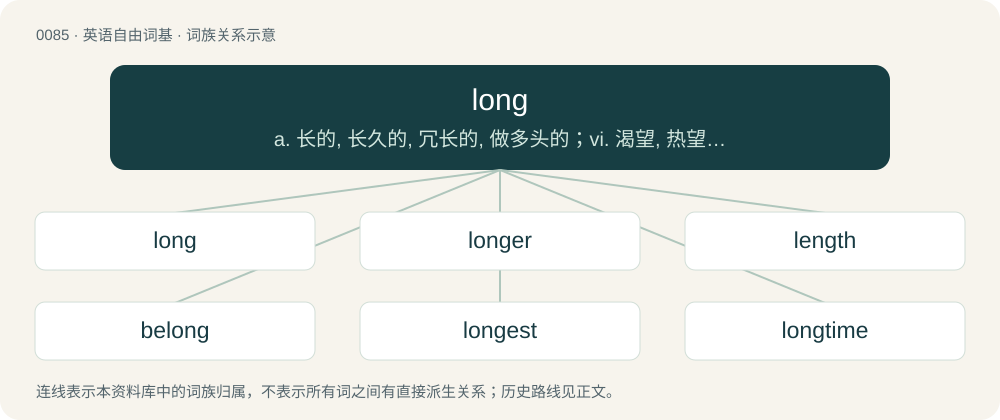

# 0087 · long — a. 长的, 长久的, 冗长的, 做多头的；vi. 渴望, 热望, 极想；adv. 长久, 始终

[总目录](../00_总目录_按常用程度.md)

**类型**：英语自由词基　｜　**来源语言**：见词源记录

## 核心含义与来源

- 核心含义：a. 长的, 长久的, 冗长的, 做多头的；vi. 渴望, 热望, 极想；adv. 长久, 始终
- 英文含义：Having much distance in space from one end to the other.
- 词形：long

**多个词源／构词路径**：同一拼写可能有不同来源；以下按词性和含义分别列出。

**来源记录 1**（形容词；Having much distance in space from one end to the other.）

From Middle English long, lang, from Old English long, lang (“long, tall, lasting”), from Proto-West Germanic \*lang, from Proto-Germanic \*langaz (“long”), from Proto-Indo-European \*dlongʰos (“long”). Cognates Cognate with Scots lang (“long”), Yola lhaung, long (“long”), North Frisian long, lung, lüng (“long”), Saterland Frisian loang (“long”), West Frisian lang (“long”), Cimbrian lång (“long”), Dutch, German, and Low German lang (“long”), Luxembourgish laang (“long”), Mòcheno lònk (“long”), Vilamovian łaong (“long”), Yiddish לאַנג (lang, “long”), Danish, Norwegian Bokmål, and Norwegian Nynorsk lang (“long”), Faroese and Icelandic langur (“long”), Swedish lång (“long”), Gothic 𐌻𐌰𐌲𐌲𐍃 (laggs, “long”); also Latin longus (“long”) (whence French long (“long”), Italian lungo (“long”), Portuguese longo (“long”), Spanish luengo (“long”)), Ancient Greek δολιχός (dolikhós, “long; wearisome”), Albanian gjatë (“long; tall”), Latvian ilgs (“long”), Lithuanian ilgas (“long”), Belarusian до́ўгі (dówhi, “long”), Bulgarian дъ́лъг (dắlăg, “long”), Czech dlúhý (“long”), Macedonian долг (dolg, “long”), Polish długi (“long”), Russian дли́нный (dlínnyj, “lengthy, long”), до́лгий (dólgij, “long”), Serbo-Croatian ду̏г, dȕg (“long”), Slovak dlhý (“long”), Slovene dolg (“long”), Ukrainian до́вгий (dóvhyj, “long”), Ossetian даргъ (darǧ, “late”), Central Kurdish دێر (dêr), درەنگ (dreng, “late”), Northern Kurdish dereng (“late”), Persian دیر (dēr / dir, “late; long”), درنگ (derang, “delay”), Sanskrit दीर्घ (dīrgha, “long”) (whence Bengali দীর্ঘ (dirgho, “long; tall”), Dhivehi ދިގު (digu, “long, lengthy”), Kalasha driga, dríga (“long; tall”), Kholosi taɽgo (“long”), Khowar درونگ (drung, “long”), Hindi दीर्घ (dīrgh, “long; tall; weighty”), Nepali दिघो (digho, “stable”), Odia ଦୀର୍ଘ (dirgha, “long”), Sinhalese දිග (diga, “long”), Urdu دیرگھ (dīrgh, “long; tall; weighty”)), Kamkata-viri drëgeř, drëgëř, drëŋëň, dërëgeň (“long; tall”), Prasuni jigni (“long; tall”). The word shows the regular historical change of a to o before certain consonant clusters such as ng (compare with other examples in Middle and Modern English such as bond, song, throng, and wrong). The o-form may have also been reinforced by Old French long, from Latin longus, from the same Indo-European word. Doublet of lungo and lunge.

**来源记录 2**（副词；Over a great distance in space.）

From Middle English longe, lange, from Old English longe, lange, from the adjective (see above).

**来源记录 3**（动词；To await, aspire, desire greatly (something to occur or to be true).）

From Middle English longen, from Old English langian (“to long for, yearn after, grieve for, be pained, lengthen, grow longer, summon, belong”), from Proto-West Germanic \*langōn, from Proto-Germanic \*langōną (“to desire, long for”), from Proto-Indo-European \*lengʷʰ- (“to be easy, be quick, jump, move around, vary”). Cognate with German langen (“to reach, be sufficient”), Swedish langa (“to push, pass by hand”), Icelandic langa (“to want, desire”), Dutch, German verlangen (“to desire, want, long for”).

## 词族图

## 单词速览（常用到不常用）

| 单词 | 音标 | 释义 |
|---|---|---|
| [long](#w-1) | 英 /lɒŋ/；美 /lɑŋ/ | a. 长的, 长久的, 冗长的, 做多头的；vi. 渴望, 热望, 极想；adv. 长久, 始终 |
| [longer](#w-2) | 英 /ˈlɒŋ.ə/；美 /ˈlɔŋ.ɚ/ | adv. 比较久 |
| [length](#w-3) | 英 /lɛŋ(k)θ/；美 /leɪŋ(k)θ/ | n. 长度, 长, 期间, 一段；\[计\] 记录长度; 块长; 字长 |
| [belong](#w-4) | 英 /bɪˈlɒŋ/；/bɪˈlɒŋ/ | vi. 属于, 合适 |
| [longest](#w-5) | 英 /ˈlɒŋɡəst/；美 /ˈlɔŋɡəst/ | a. 最长的 |
| [longtime](#w-6) | /ˈlɔŋtaim;ˈlɔːŋ-/ | a. (已持续)长时间的,为时甚久的；adv. 长久 |
| [longing](#w-7) | 英 /ˈlɒŋɪŋ/；美 /ˈlɔːŋɪŋ/ | n. 渴望, 热望, 憧憬；a. 渴望的, 热望的 |
| [linger](#w-8) | 英 /ˈlɪŋɡə/；美 /ˈlɪŋɡɚ/ | vi. 逗留, 消磨, 徘徊；vt. 消磨 |
| [longhorn](#w-9) | 英 /ˈlɒŋhɔːn/；美 /ˈlɔŋhɔɹn/ | n. 长角牛 |
| [longboard](#w-10) |  | 冲浪板 |
| [longish](#w-11) | /ˈlɒŋiʃ/ | a. 稍长的, 略长的 |
| [longbow](#w-12) | 英 /ˈlɒŋbəʊ/ | n. 大弓, 长弓 |
| [longboat](#w-13) | /ˈlɒŋbəut/ | n. (商船附载的)大艇 |
| [longlist](#w-14) |  | 【英文】An initial, relatively long, shortlist, from which a further shortlist is selected. |
| [overlong](#w-15) | /ˈəuvəlɔŋ/ | adv. 太长；a. 太长的 |
| [longhouse](#w-16) |  | （英国旧式人畜共居的）长屋 |
| [longline](#w-17) | /ˈlɒŋlain/ | n. 延绳钓 |
| [longhand](#w-18) | 美 /lɔŋˌhænd/；/ˈlɒŋˌhænd/ | n. 普通写法 |

## 逐词详解

### 1. long

**词性**：形容词　｜　**音标**：英 /lɒŋ/；美 /lɑŋ/

**中文释义**：a. 长的, 长久的, 冗长的, 做多头的；vi. 渴望, 热望, 极想；adv. 长久, 始终

**英文义项**：Having much distance in space from one end to the other. / Specifically, having much distance in a horizontal dimension (see also Usage Notes below).

**词源与演化**：

From Middle English long, lang, from Old English long, lang (“long, tall, lasting”), from Proto-West Germanic \*lang, from Proto-Germanic \*langaz (“long”), from Proto-Indo-European \*dlongʰos (“long”). Cognates Cognate with Scots lang (“long”), Yola lhaung, long (“long”), North Frisian long, lung, lüng (“long”), Saterland Frisian loang (“long”), West Frisian lang (“long”), Cimbrian lång (“long”), Dutch, German, and Low German lang (“long”), Luxembourgish laang (“long”), Mòcheno lònk (“long”), Vilamovian łaong (“long”), Yiddish לאַנג (lang, “long”), Danish, Norwegian Bokmål, and Norwegian Nynorsk lang (“long”), Faroese and Icelandic langur (“long”), Swedish lång (“long”), Gothic 𐌻𐌰𐌲𐌲𐍃 (laggs, “long”); also Latin longus (“long”) (whence French long (“long”), Italian lungo (“long”), Portuguese longo (“long”), Spanish luengo (“long”)), Ancient Greek δολιχός (dolikhós, “long; wearisome”), Albanian gjatë (“long; tall”), Latvian ilgs (“long”), Lithuanian ilgas (“long”), Belarusian до́ўгі (dówhi, “long”), Bulgarian дъ́лъг (dắlăg, “long”), Czech dlúhý (“long”), Macedonian долг (dolg, “long”), Polish długi (“long”), Russian дли́нный (dlínnyj, “lengthy, long”), до́лгий (dólgij, “long”), Serbo-Croatian ду̏г, dȕg (“long”), Slovak dlhý (“long”), Slovene dolg (“long”), Ukrainian до́вгий (dóvhyj, “long”), Ossetian даргъ (darǧ, “late”), Central Kurdish دێر (dêr), درەنگ (dreng, “late”), Northern Kurdish dereng (“late”), Persian دیر (dēr / dir, “late; long”), درنگ (derang, “delay”), Sanskrit दीर्घ (dīrgha, “long”) (whence Bengali দীর্ঘ (dirgho, “long; tall”), Dhivehi ދިގު (digu, “long, lengthy”), Kalasha driga, dríga (“long; tall”), Kholosi taɽgo (“long”), Khowar درونگ (drung, “long”), Hindi दीर्घ (dīrgh, “long; tall; weighty”), Nepali दिघो (digho, “stable”), Odia ଦୀର୍ଘ (dirgha, “long”), Sinhalese දිග (diga, “long”), Urdu دیرگھ (dīrgh, “long; tall; weighty”)), Kamkata-viri drëgeř, drëgëř, drëŋëň, dërëgeň (“long; tall”), Prasuni jigni (“long; tall”). The word shows the regular historical change of a to o before certain consonant clusters such as ng (compare with other examples in Middle and Modern English such as bond, song, throng, and wrong). The o-form may have also been reinforced by Old French long, from Latin longus, from the same Indo-European word. Doublet of lungo and lunge.

**例句**：

> It'll be a long journey home for the travelling supporters after that 5-0 defeat.

该用例对应义项：Seeming to last a lot of time, due to being boring, tedious, tiring, irksome, etc.

### 2. longer

**词性**：名词　｜　**音标**：英 /ˈlɒŋ.ə/；美 /ˈlɔŋ.ɚ/

**中文释义**：adv. 比较久

**英文义项**：One who longs or yearns for something.

**构词拆分**：long + -er

**词源与演化**：

From long (“yearn”) + -er.

**例句**：

> You had better take into consideration that you are no longer young.

### 3. length

**词性**：名词　｜　**音标**：英 /lɛŋ(k)θ/；美 /leɪŋ(k)θ/

**中文释义**：n. 长度, 长, 期间, 一段；\[计\] 记录长度; 块长; 字长

**英文义项**：The distance measured along the longest dimension of an object. / Duration.

**构词拆分**：long + -th (abstract nominal suffix)

**词源与演化**：

From Middle English lengthe, from Old English lengþ, lengþu, from Proto-West Germanic \*langiþu, from Proto-Germanic \*langiþō, equivalent to long + -th (abstract nominal suffix). Cognate with Scots lenth, lainth (“length”), Saterland Frisian Loangte (“length”), West Frisian lingte, langte (“length”), Dutch lengte (“length”), German Low German Längde, Längd, Längte, Längt (“length”), Danish længde (“length”), Swedish längd (“length”), Icelandic lengd (“length”).

**用法示例／搭配（非完整句）**：

> five lengths ahead of the field

该用例对应义项：The length of a horse, used to indicate the distance between horses at the end of a race.

### 4. belong

**词性**：动词　｜　**音标**：英 /bɪˈlɒŋ/；/bɪˈlɒŋ/

**中文释义**：vi. 属于, 合适

**英文义项**：To have its proper place. / To be accepted in a group.

**构词拆分**：be- + long (“to belong”)

**词源与演化**：

From Middle English belongen, bilongen, from Middle English be- + longen (“to be fitting, be suitable”), from Old English langian (“to pertain to, suit”), equivalent to be- + long (“to belong”). Compare Saterland Frisian beloangje (“to attain, reach, meet”), Dutch belangen (“to concern”), German belangen (“to sue, concern”).

**例句**：

> John wanted to ask Mary out on a date, but learned that Mary belonged to another man.

该用例对应义项：To be the spouse or partner of.

### 5. longest

**词性**：名词　｜　**音标**：英 /ˈlɒŋɡəst/；美 /ˈlɔŋɡəst/

**中文释义**：a. 最长的

**英文义项**：Something that is longer than all others in its class.

**构词拆分**：long + -est

**词源与演化**：

From long + -est.

**例句**：

> Having 25 letters, "anticonstitutionnellement" is the longest word in the French language.

### 6. longtime

**词性**：形容词　｜　**音标**：/ˈlɔŋtaim;ˈlɔːŋ-/

**中文释义**：a. (已持续)长时间的,为时甚久的；adv. 长久

**英文义项**：Having endured for a long period of time.

**构词拆分**：long + time

**词源与演化**：

From long + time.

**例句**：

> My longtime friend, since birth actually, called and gently broke the bad news to me.

该用例对应义项：Having endured for a long period of time.

### 7. longing

**词性**：名词　｜　**音标**：英 /ˈlɒŋɪŋ/；美 /ˈlɔːŋɪŋ/

**中文释义**：n. 渴望, 热望, 憧憬；a. 渴望的, 热望的

**英文义项**：An earnest and deep, not greatly passionate, but rather melancholic desire. / The buying of a financial instrument with the expectation that its value will rise.

**构词拆分**：long + -ing (gerund ending)

**词源与演化**：

From Middle English longinge, langynge, from Old English longung, langung (“longing, desire”), from Proto-Germanic \*langungō, gerund of Proto-Germanic \*langōną (“to desire, long for”), equivalent to long + -ing (gerund ending).

**例句**：

> Homesickness is a longing to go back to where you are from.

### 8. linger

**词性**：动词　｜　**音标**：英 /ˈlɪŋɡə/；美 /ˈlɪŋɡɚ/

**中文释义**：vi. 逗留, 消磨, 徘徊；vt. 消磨

**英文义项**：To stay or remain in a place or situation, especially as if unwilling to depart or not easily able to do so. / To remain alive or existent although still proceeding toward death or extinction; to die gradually.

**构词拆分**：long + -er (frequentative verb suffix)

**词源与演化**：

From Middle English lengeren, frequentative of lengen (“to stay, dwell, tarry”), from Old English lenġan (“to lengthen, delay, extend”), from Proto-West Germanic \*langijan, from Proto-Germanic \*langijaną (compare West Frisian lingje (“to linger”), Dutch lengen, German längen, Icelandic lengja (“to lengthen”)), related to the root of English long. Equivalent to linge or long + -er (frequentative verb suffix).

**例句**：

> The effects of harsh words can linger longer than injuries from weapons.

### 9. longhorn

**词性**：名词　｜　**音标**：英 /ˈlɒŋhɔːn/；美 /ˈlɔŋhɔɹn/

**中文释义**：n. 长角牛

**英文义项**：A breed of beef cattle, having long horns, bred in Texas and other parts of southwest United States.

**构词拆分**：long + horn

**词源与演化**：

From long + horn.

**例句**：

> This enormous longhorn beetle is found around mango and fig trees.

### 10. longboard

**词性**：名词

**中文释义**：冲浪板

**英文义项**：A large surfboard, around 9 or 10 feet long with a wide nose. / A large skateboard, measuring about 90 to 150 centimeters (3' to 5').

**构词拆分**：long + board

**词源与演化**：

From long + board.

**例句**：

> Benedito likes to ride his longboard downhill.

### 11. longish

**词性**：形容词　｜　**音标**：/ˈlɒŋiʃ/

**中文释义**：a. 稍长的, 略长的

**英文义项**：Somewhat long.

**构词拆分**：long + -ish

**词源与演化**：

From long + -ish.

**例句**：

> It was a longish time before I received a reply to my letter.

该用例对应义项：Somewhat long.

### 12. longbow

**词性**：名词　｜　**音标**：英 /ˈlɒŋbəʊ/

**中文释义**：n. 大弓, 长弓

**英文义项**：A large bow that has a strong tension, and is usually more than 3 feet tall. The most famous longbows in history were the English longbows, which were crafted of yew.

**构词拆分**：long + bow

**词源与演化**：

From long + bow.

### 13. longboat

**词性**：名词　｜　**音标**：/ˈlɒŋbəut/

**中文释义**：n. (商船附载的)大艇

**英文义项**：The largest and thus the most capable of boats carried on a ship.

**构词拆分**：long + boat

**词源与演化**：

From long + boat.

### 14. longlist

**词性**：名词

**英文义项**：An initial, relatively long, shortlist, from which a further shortlist is selected.

**构词拆分**：long + list

**词源与演化**：

From long + list.

### 15. overlong

**词性**：形容词　｜　**音标**：/ˈəuvəlɔŋ/

**中文释义**：adv. 太长；a. 太长的

**英文义项**：Too long; overly long.

**构词拆分**：over- + long

**词源与演化**：

From over- + long.

### 16. longhouse

**词性**：名词

**中文释义**：（英国旧式人畜共居的）长屋

**英文义项**：A long communal housing of the Iroquois and some other American Indians, the Malaysians, the Indonesians, the Vikings, and many other peoples. / The modern society, perceived as increasingly matriarchal and overly egalitarian, and therefore stifling nonconformity and masculine values.

**构词拆分**：long + house

**词源与演化**：

From long + house. The sense of outhouse possibly derives from Whittington's Longhouse, a public toilet in medieval London, but first attested in a translation of a similar French expression.

### 17. longline

**词性**：形容词　｜　**音标**：/ˈlɒŋlain/

**中文释义**：n. 延绳钓

**英文义项**：longer than usual; especially reaching to the hips

**构词拆分**：long + line

**词源与演化**：

From long + line.

### 18. longhand

**词性**：名词　｜　**音标**：美 /lɔŋˌhænd/；/ˈlɒŋˌhænd/

**中文释义**：n. 普通写法

**英文义项**：The written characters used in the common method of writing; opposed to shorthand, or typing or printing; handwriting.

**构词拆分**：long + hand

**词源与演化**：

From long + hand, by analogy with shorthand.

**例句**：

> That girl couldn't take things down in longhand, let alone shorthand.
