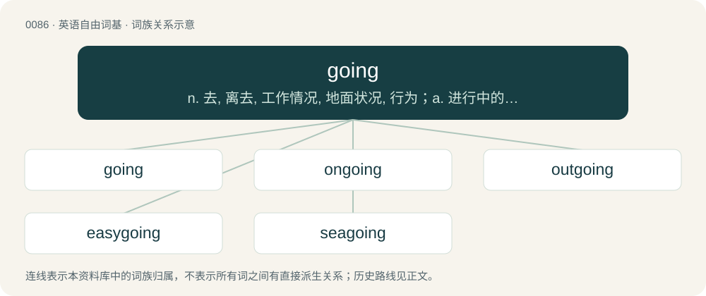

# 0088 · going — n. 去, 离去, 工作情况, 地面状况, 行为；a. 进行中的, 流行的, 成功的, 现存的

[总目录](../00_总目录_按常用程度.md)

**类型**：英语自由词基　｜　**来源语言**：见词源记录

## 核心含义与来源

- 核心含义：n. 去, 离去, 工作情况, 地面状况, 行为；a. 进行中的, 流行的, 成功的, 现存的
- 英文含义：Attending or visiting (a stated event, place, etc.) habitually or regularly.
- 词形：going

**来源记录 1**（动词；Attending or visiting (a stated event, place, etc.) habitually or regularly.）

Verb form from Middle English goinge, goynge, gayng, variants of gonde, goonde, gaand, from Old English gānde, from Proto-Germanic \*gēndz, present participle of Proto-Germanic \*gēną, \*gāną (“to go”), equivalent to go + -ing. Cognate with West Frisian geanend (“going”), Dutch gaand (“going”), German gehend (“going”), Danish gående (“going”), Swedish gående (“going”). Noun and adjective from Middle English going, goyng, gaing, gayng, equivalent to go + -ing. Compare German Gehung, Old English gang (“a going”). More at gang.

## 词族图

## 单词速览（常用到不常用）

| 单词 | 音标 | 释义 |
|---|---|---|
| [going](#w-1) | 英 /ˈɡəʊ.ɪŋ/；美 /ˈɡoʊ.ɪŋ/ | n. 去, 离去, 工作情况, 地面状况, 行为；a. 进行中的, 流行的, 成功的, 现存的 |
| [ongoing](#w-2) | 英 /ɒnˈɡəʊ.ɪŋ/；/ɔnˈɡoʊ.ɪŋ/ | a. 前进的, 进行的, 不间断的；n. 前进, 发展 |
| [outgoing](#w-3) | /aʊtˈɡəʊɪŋ/ | n. 外出, 开支, 流出；a. 喜欢外出的, 即将离职的, 乐于助人的 |
| [easygoing](#w-4) | /ˈiːzigəuiŋ/ | a. 脾气随和的, 逍遥自在的, 悠闲的, 懒散的 |
| [seagoing](#w-5) | /ˈsiː.gəuiŋ/ | a. 适于远航的 |

## 逐词详解

### 1. going

**词性**：名词　｜　**音标**：英 /ˈɡəʊ.ɪŋ/；美 /ˈɡoʊ.ɪŋ/

**中文释义**：n. 去, 离去, 工作情况, 地面状况, 行为；a. 进行中的, 流行的, 成功的, 现存的

**英文义项**：A departure. / The suitability of ground for riding, walking etc.

**构词拆分**：go + -ing

**词源与演化**：

Verb form from Middle English goinge, goynge, gayng, variants of gonde, goonde, gaand, from Old English gānde, from Proto-Germanic \*gēndz, present participle of Proto-Germanic \*gēną, \*gāną (“to go”), equivalent to go + -ing. Cognate with West Frisian geanend (“going”), Dutch gaand (“going”), German gehend (“going”), Danish gående (“going”), Swedish gående (“going”). Noun and adjective from Middle English going, goyng, gaing, gayng, equivalent to go + -ing. Compare German Gehung, Old English gang (“a going”). More at gang.

**例句**：

> Not only were the streets not paved with gold, but the going was difficult for an immigrant.

该用例对应义项：Conditions for advancing in any way.

### 2. ongoing

**词性**：形容词　｜　**音标**：英 /ɒnˈɡəʊ.ɪŋ/；/ɔnˈɡoʊ.ɪŋ/

**中文释义**：a. 前进的, 进行的, 不间断的；n. 前进, 发展

**英文义项**：Continuing, permanent, lasting. / Presently or currently happening; being in progress.

**构词拆分**：on + going

**词源与演化**：

From on + going, related to the phrasal verb go on.

**例句**：

> An ongoing economic crisis.

该用例对应义项：currently happening

### 3. outgoing

**词性**：形容词　｜　**音标**：/aʊtˈɡəʊɪŋ/

**中文释义**：n. 外出, 开支, 流出；a. 喜欢外出的, 即将离职的, 乐于助人的

**英文义项**：Extroverted: talkative, friendly, and social, especially with respect to meeting new people easily and comfortably; outgiving. / Going out, on its way out.

**构词拆分**：outgo + -ing；out + going

**词源与演化**：

From outgo + -ing, out + going.

**例句**：

> Tom is very outgoing and enjoys meeting people; his brother, on the other hand, is painfully shy.

该用例对应义项：Extroverted: talkative, friendly, and social, especially with respect to meeting new people easily and comfortably; outgiving.

### 4. easygoing

**词性**：形容词　｜　**音标**：/ˈiːzigəuiŋ/

**中文释义**：a. 脾气随和的, 逍遥自在的, 悠闲的, 懒散的

**英文义项**：Calm, relaxed, casual and informal. / Unhurried.

**构词拆分**：easy + going

**词源与演化**：

From easy + going.

**例句**：

> An easygoing teacher who allowed extra time for assignments.

该用例对应义项：relaxed and informal in attitude or standards

### 5. seagoing

**词性**：形容词　｜　**音标**：/ˈsiː.gəuiŋ/

**中文释义**：a. 适于远航的

**英文义项**：Travelling out to sea. / Made for, fit for sailing on, or used on the high seas.

**构词拆分**：sea + going

**词源与演化**：

From sea + going.

**用法示例／搭配（非完整句）**：

> a seagoing seal

该用例对应义项：Travelling out to sea.
