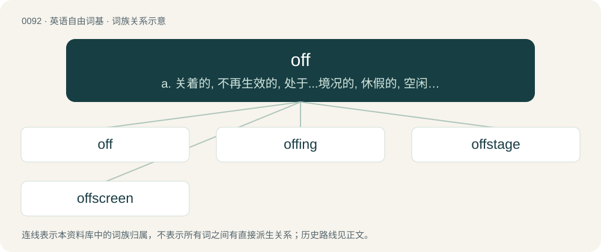

# 0096 · off — a. 关着的, 不再生效的, 处于...境况的, 休假的, 空闲的；adv. 走开, ...掉, ...下, 休息, 出发, 隔断；prep. 离开, 脱落, 不在从事......, 在...之外

[总目录](../00_总目录_按常用程度.md)

**类型**：英语自由词基　｜　**来源语言**：见词源记录

## 核心含义与来源

- 核心含义：a. 关着的, 不再生效的, 处于...境况的, 休假的, 空闲的；adv. 走开, ...掉, ...下, 休息, 出发, 隔断；prep. 离开, 脱落, 不在从事......, 在...之外
- 英文含义：In a direction away from the speaker or other reference point.
- 词形：off

**来源记录 1**（副词；In a direction away from the speaker or other reference point.）

From Middle English of, from Old English of, af, æf (“from, off, away”), from Proto-West Germanic \*ab, from Proto-Germanic \*ab (“from”), from Proto-Indo-European \*h₂epo (“from, off, back”). Doublet of of. Cognates Cognate with Scots aff (“away, off”), Saterland Frisian oawe, ou (“from”), West Frisian ôf (“away, off”), Dutch af (“from, off”), German ab (“from, off”), German Low German, Luxembourgish of (“off”), Yiddish אָפּ (op, “off”), Danish, Icelandic af (“from, off”), Faroese, Norwegian Bokmål and Norwegian Nynorsk av (“off”), Swedish af, av (“off”), Gothic 𐌰𐍆 (af, “of, from”); and with Latin ab (“of, from, by”), Ancient Greek ἀπό (apó, “from”), and others.

## 词族图

## 单词速览（常用到不常用）

| 单词 | 音标 | 释义 |
|---|---|---|
| [off](#w-1) | 英 /ɒf/；美 /ɔf/ | a. 关着的, 不再生效的, 处于...境况的, 休假的, 空闲的；adv. 走开, ...掉, ...下, 休息, 出发, 隔断；prep. 离开, 脱落, 不在从事......, 在...之外 |
| [offing](#w-2) | 英 /ˈɒfɪŋ/；美 /ˈɔfɪŋ/ | n. 海面, 离岸距离 |
| [offstage](#w-3) |  | n. 台后, 幕内；a. 台后的, 幕内的 |
| [offscreen](#w-4) | /uːfskˈriːn/ | a. 画面以外的, 实际生活中的；adv. 在电影摄影机拍摄距离外地 |

## 逐词详解

### 1. off

**词性**：形容词　｜　**音标**：英 /ɒf/；美 /ɔf/

**中文释义**：a. 关着的, 不再生效的, 处于...境况的, 休假的, 空闲的；adv. 走开, ...掉, ...下, 休息, 出发, 隔断；prep. 离开, 脱落, 不在从事......, 在...之外

**英文义项**：Inoperative, disabled. / Cancelled; not happening.

**词源与演化**：

From Middle English of, from Old English of, af, æf (“from, off, away”), from Proto-West Germanic \*ab, from Proto-Germanic \*ab (“from”), from Proto-Indo-European \*h₂epo (“from, off, back”). Doublet of of. Cognates Cognate with Scots aff (“away, off”), Saterland Frisian oawe, ou (“from”), West Frisian ôf (“away, off”), Dutch af (“from, off”), German ab (“from, off”), German Low German, Luxembourgish of (“off”), Yiddish אָפּ (op, “off”), Danish, Icelandic af (“from, off”), Faroese, Norwegian Bokmål and Norwegian Nynorsk av (“off”), Swedish af, av (“off”), Gothic 𐌰𐍆 (af, “of, from”); and with Latin ab (“of, from, by”), Ancient Greek ἀπό (apó, “from”), and others.

**例句**：

> And they're off! Whatsmyname takes an early lead, with Remember The Mane behind by a nose.

该用例对应义项：Started on the way.

### 2. offing

**词性**：名词　｜　**音标**：英 /ˈɒfɪŋ/；美 /ˈɔfɪŋ/

**中文释义**：n. 海面, 离岸距离

**英文义项**：The area of the sea in which a ship can be seen in the distance from land, excluding the parts nearest the shore, and beyond the anchoring ground. / The distance that a ship at sea keeps away from land, often because of navigational dangers, fog and other hazards; a position at a distance from shore.

**构词拆分**：off + -ing

**词源与演化**：

From off + -ing. Attested since before 1600. Early texts also spell the term offin and offen.

**用法示例／搭配（非完整句）**：

> to see (a ship) in the offing

该用例对应义项：The area of the sea in which a ship can be seen in the distance from land, excluding the parts nearest the shore, and beyond the anchoring ground.

### 3. offstage

**词性**：形容词

**中文释义**：n. 台后, 幕内；a. 台后的, 幕内的

**英文义项**：Of or relating to that part of a stage not visible to the audience. / Of or relating to the private life of a celebrity.

**构词拆分**：off + stage

**词源与演化**：

From off + stage.

### 4. offscreen

**词性**：动词　｜　**音标**：/uːfskˈriːn/

**中文释义**：a. 画面以外的, 实际生活中的；adv. 在电影摄影机拍摄距离外地

**英文义项**：To kill a character offscreen.

**构词拆分**：off + screen

**词源与演化**：

From off + screen.

**例句**：

> Yeah, I also hate her. I hope she gets offscreened in the third act low-key.

该用例对应义项：To kill a character offscreen.
