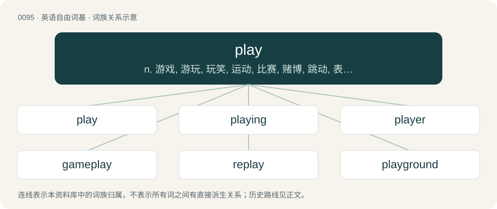

# 0098 · play — n. 游戏, 游玩, 玩笑, 运动, 比赛, 赌博, 跳动, 表演, 剧本；v. 玩, 游戏, 假装, 开玩笑, 比赛, 扮演, 演奏, 演戏, 传摇曳, (使)跳动；\[计\] 播放

[总目录](../00_总目录_按常用程度.md)

**类型**：英语自由词基　｜　**来源语言**：见词源记录

## 核心含义与来源

- 核心含义：n. 游戏, 游玩, 玩笑, 运动, 比赛, 赌博, 跳动, 表演, 剧本；v. 玩, 游戏, 假装, 开玩笑, 比赛, 扮演, 演奏, 演戏, 传摇曳, (使)跳动；\[计\] 播放
- 英文含义：To act in a manner such that one has fun; to engage in activities expressly for the purpose of recreation or entertainment.
- 词形：play

**来源记录 1**（动词；To act in a manner such that one has fun; to engage in activities expressly for the purpose of recreation or entertainment.）

From Middle English pleyen (verb) and Middle English pleye (noun), from Old English plegian and plegan, plagian (“to play, exercise, etc.”), from Proto-West Germanic \*plehan (“to care about, be concerned with”) and Proto-West Germanic \*plegōn (“to engage, move”), of uncertain origin. cognates and related terms Cognate with Scots play (“to act or move briskly, cause to move, stir”), Saterland Frisian pleegje (“to look after, care for, maintain”), West Frisian pleegje, pliigje (“to commit, perform, bedrive”), Middle Dutch pleyen ("to dance, leap for joy, rejoice, be glad"; compare Modern Dutch pleien (“to play a particular children's game”)), Dutch plegen (“to commit, bedrive, practice”), German pflegen (“to care for, be concerned with, attend to, tend”). Related also to Old English plēon (“to risk, endanger”). More at plight, pledge. The noun is from Middle English pleye, from Old English plæġ, plega, plæġa (“play, quick motion, movement, exercise; (athletic) sport, game; festivity, drama; battle; gear for games, an implement for a game; clapping with the hands, applause”), deverbative of plegian (“to play”); see above.

## 词族图

## 单词速览（常用到不常用）

| 单词 | 音标 | 释义 |
|---|---|---|
| [play](#w-1) | 美 /pleɪ̯/ \[pɫ̥eɪ̯ ~ pʰɫeɪ̯\] | n. 游戏, 游玩, 玩笑, 运动, 比赛, 赌博, 跳动, 表演, 剧本；v. 玩, 游戏, 假装, 开玩笑, 比赛, 扮演, 演奏, 演戏, 传摇曳, (使)跳动；\[计\] 播放 |
| [playing](#w-2) | /ˈpleɪ.ɪŋ/ | n. 游戏, 玩耍, 竞技, 比赛, 扮演, 演奏, 赌博 |
| [player](#w-3) | 英 /ˈpleɪ.ə(ɹ)/；美 /ˈpleɪ.ɚ/ | n. 竞赛者, 上场队员, 游戏者, 演员；\[经\] 交易者 |
| [gameplay](#w-4) | /ˈɡeɪmˌpleɪ/ | n. （电脑游戏的）游戏情节设计, 玩法 |
| [replay](#w-5) | /ˈɹiːpleɪ/ | vt. 重新比赛, 重演；n. 重赛 |
| [playground](#w-6) | 英 /ˈpleɪɡɹaʊnd/ | n. 运动场, 操场, 度假胜地, 活动场所 |
| [playlist](#w-7) | /ˈpleɪˌlɪst/ | n. 播放列表；演出剧目表 |
| [playboy](#w-8) | 英 /ˈpleɪbɔɪ/；美 /ˈpleɪˌbɔɪ/ | n. 花花公子, 乖巧的人 |
| [screenplay](#w-9) | 美 /ˈskɹiːnˌpleɪ/ | n. 电影剧本 |
| [playful](#w-10) | /ˈpleɪfl̩/ | a. 爱打趣的, 多趣的, 开玩笑的, 嬉戏的 |
| [playable](#w-11) | /ˈpleɪəbəl/ | a. 可玩的, 可演奏的, 宜玩的, 宜演奏的 |
| [playwright](#w-12) | /ˈpleɪˌɹaɪt/ | n. 剧作家 |
| [playback](#w-13) | /ˈpleɪˌbæk/ | n. (录音)重放, (录音)重放装置；\[计\] 重现 |
| [playbook](#w-14) | /ˈpleɪ.bʊk/ | n. 剧本, 剧本集 |
| [interplay](#w-15) | /ˈɪn.tə(ɹ)ˌpleɪ/ | n. 互相作用, 互相影响；vi. 互相作用 |
| [foreplay](#w-16) | /ˈfɔː(ɹ)pleɪ/ | n. 性交前的爱抚, 前奏, 前戏 |
| [playtime](#w-17) | /ˈpleɪtaɪm/ | n. 游戏时间, 娱乐时间, 演出时间, 开幕时刻 |
| [playmaker](#w-18) | /ˈplei,meikə(r)/ | n. (篮球、 曲棍球等 ) 场上组织进攻的队员 |
| [airplay](#w-19) | /ˈeəplei/ | n. (无线电台上)唱片的播送 |
| [playmate](#w-20) | /ˈpleɪˌmeɪt/ | n. 玩伴, 游伴 |
| [roleplay](#w-21) | 英 /ˈrəʊl.pleɪ/；美 /ˈroʊl.pleɪ/ | n. 角色扮演；v. 扮演…角色；\[网络\] 角色表演；角色扮演角色扮演；角色扮演考试 |
| [wordplay](#w-22) | /ˈwɜːdpleɪ/ | n. 文字游戏, 俏皮话, 双关语 |
| [playthrough](#w-23) | 美 /ˈpleɪˌθɹu/ | 【英文】The act, or a recording, of playing a game from start to finish. |
| [playroom](#w-24) | /ˈpleiruːm/ | n. 游戏室, 娱乐室 |
| [plaything](#w-25) | /ˈpleɪ.θɪŋ/ | n. 玩具, 被玩弄的人, 玩物 |
| [playmaking](#w-26) | /ˈplei,meikiŋ/ | n. 控球后卫；发动机 |
| [playset](#w-27) |  | 玩具套装 |
| [playpen](#w-28) | /ˈpleipen/ | n. 游戏围栏 |
| [gunplay](#w-29) | 美 /ˈɡʌnˌpleɪ/ | n. （美）枪战；射击技巧 |
| [playgroup](#w-30) |  | n. 托儿所 |
| [playwriting](#w-31) | /ˈplei,raitiŋ/ | n. 剧本创作 |
| [playability](#w-32) |  | n. playable（可游戏的, 宜玩的）的变形 |
| [autoplay](#w-33) |  | 自动播放 |
| [playdate](#w-34) | /ˈpleɪˌdeɪt/ | n. (影片等的)上映期 |
| [playbill](#w-35) | /ˈpleɪˌbɪl/ | n. 戏单, 演出海报, 节目单 |
| [playfield](#w-36) | /ˈpleifiːld/ | n. 室外运动场, 球场 |
| [outplay](#w-37) | /aʊtˈpleɪ/ | vt. 技术优于..., 胜过, 打败 |
| [overplay](#w-38) | /,əuvəˈplei/ | vt. 把...做得过分, 过分依赖...的力量, 夸张, 把...演得过火 |
| [playland](#w-39) | /pˈleɪlænd/ | 操场, （儿童）游戏场 |

## 逐词详解

### 1. play

**词性**：动词　｜　**音标**：美 /pleɪ̯/ \[pɫ̥eɪ̯ ~ pʰɫeɪ̯\]

**中文释义**：n. 游戏, 游玩, 玩笑, 运动, 比赛, 赌博, 跳动, 表演, 剧本；v. 玩, 游戏, 假装, 开玩笑, 比赛, 扮演, 演奏, 演戏, 传摇曳, (使)跳动；\[计\] 播放

**英文义项**：To act in a manner such that one has fun; to engage in activities expressly for the purpose of recreation or entertainment. / To toy or trifle; to act with levity or thoughtlessness; to be careless.

**词源与演化**：

From Middle English pleyen (verb) and Middle English pleye (noun), from Old English plegian and plegan, plagian (“to play, exercise, etc.”), from Proto-West Germanic \*plehan (“to care about, be concerned with”) and Proto-West Germanic \*plegōn (“to engage, move”), of uncertain origin. cognates and related terms Cognate with Scots play (“to act or move briskly, cause to move, stir”), Saterland Frisian pleegje (“to look after, care for, maintain”), West Frisian pleegje, pliigje (“to commit, perform, bedrive”), Middle Dutch pleyen ("to dance, leap for joy, rejoice, be glad"; compare Modern Dutch pleien (“to play a particular children's game”)), Dutch plegen (“to commit, bedrive, practice”), German pflegen (“to care for, be concerned with, attend to, tend”). Related also to Old English plēon (“to risk, endanger”). More at plight, pledge. The noun is from Middle English pleye, from Old English plæġ, plega, plæġa (“play, quick motion, movement, exercise; (athletic) sport, game; festivity, drama; battle; gear for games, an implement for a game; clapping with the hands, applause”), deverbative of plegian (“to play”); see above.

**例句**：

> The bank robbers have three hostages inside, so we're going to have to play this very carefully.

该用例对应义项：To handle or deal with (a matter or situation) in a stated way.

### 2. playing

**词性**：名词　｜　**音标**：/ˈpleɪ.ɪŋ/

**中文释义**：n. 游戏, 玩耍, 竞技, 比赛, 扮演, 演奏, 赌博

**英文义项**：An occasion on which something, such as a song or show, is played.

**构词拆分**：play + -ing

**词源与演化**：

From Middle English playing; equivalent to play + -ing.

**例句**：

> What person who understands music could say that his playing is good?

### 3. player

**词性**：名词　｜　**音标**：英 /ˈpleɪ.ə(ɹ)/；美 /ˈpleɪ.ɚ/

**中文释义**：n. 竞赛者, 上场队员, 游戏者, 演员；\[经\] 交易者

**英文义项**：One who plays any game or sport. / An actor in a dramatic play.

**构词拆分**：play + -er

**词源与演化**：

From Middle English pleyer, playere, from Old English pleġere (“player, athlete, wrestler”), from Proto-West Germanic \*plegārī. Equivalent to play + -er.

**例句**：

> He thought he could become a player, at least at the state level.

该用例对应义项：A participant; one involved in something.

### 4. gameplay

**词性**：名词　｜　**音标**：/ˈɡeɪmˌpleɪ/

**中文释义**：n. （电脑游戏的）游戏情节设计, 玩法

**英文义项**：The totality of player experiences during a game, such as the gaming environment and the competitive interaction with other players; often with reference to a video game or a board game.

**构词拆分**：game + play

**词源与演化**：

From game + play.

**例句**：

> Critics praised the game's graphics and storyline, but criticised its gameplay mechanics.

### 5. replay

**词性**：名词　｜　**音标**：/ˈɹiːpleɪ/

**中文释义**：vt. 重新比赛, 重演；n. 重赛

**英文义项**：An act or instance of replaying (of playing something, such as a game, again); a replaying of (something). / A repeat or subsequent playing of some or all of something which was previously broadcast or performed, or a playing of something which was recorded, such as a live event or a television broadcast, the gameplay of a computer game, etc.

**构词拆分**：re- + play

**词源与演化**：

From re- + play.

**例句**：

> Show us that replay one more time.

该用例对应义项：A (video or audio) recording of an action or event that is or can be replayed after being recorded; saved video footage (which is, or can be, replayed) of the gameplay of a computer game, a (portion of a) televised sports match, etc.

### 6. playground

**词性**：名词　｜　**音标**：英 /ˈpleɪɡɹaʊnd/

**中文释义**：n. 运动场, 操场, 度假胜地, 活动场所

**英文义项**：A large open space for children to play in, usually having dedicated play equipment (such as swings and slides). / Any physical or metaphysical space in which a person or organization has free rein to do as they please.

**构词拆分**：play + ground

**词源与演化**：

From play + ground. Compare Middle English playstede (“playground”) from Old English pleġstede.

**例句**：

> The local council have set up a new playground, equipped with slides, swings, and a climbing wall.

该用例对应义项：A large open space for children to play in, usually having dedicated play equipment (such as swings and slides).

### 7. playlist

**词性**：动词　｜　**音标**：/ˈpleɪˌlɪst/

**中文释义**：n. 播放列表；演出剧目表

**英文义项**：To include (a track) on a playlist.

**构词拆分**：play + list

**词源与演化**：

From play + list.

**例句**：

> She achieved success when her first single was playlisted on national radio.

该用例对应义项：To include (a track) on a playlist.

### 8. playboy

**词性**：名词　｜　**音标**：英 /ˈpleɪbɔɪ/；美 /ˈpleɪˌbɔɪ/

**中文释义**：n. 花花公子, 乖巧的人

**英文义项**：A single man, especially a wealthy one, who devotes himself to a life of leisure and pleasure, often sexual, without commitments or responsibilities.

**构词拆分**：play + boy

**词源与演化**：

From play + boy.

**例句**：

> He was the putative playboy of the librarian set.

### 9. screenplay

**词性**：名词　｜　**音标**：美 /ˈskɹiːnˌpleɪ/

**中文释义**：n. 电影剧本

**英文义项**：A script for a movie or (less commonly) a television show.

**构词拆分**：screen + play

**词源与演化**：

From screen + play.

**例句**：

> She became famous after having written the screenplay for that movie.

### 10. playful

**词性**：形容词　｜　**音标**：/ˈpleɪfl̩/

**中文释义**：a. 爱打趣的, 多趣的, 开玩笑的, 嬉戏的

**英文义项**：Enjoying play; sportive; prone to playing frequently, in the manner of a child or young pet (viz. puppy or kitten). / Funny; humorous; jesty; frolicsome; frisky.

**构词拆分**：play + -ful

**词源与演化**：

From Middle English pleiful, equivalent to play + -ful.

**例句**：

> A brainteaser is a playful puzzle posed as a test of intelligence.

该用例对应义项：Fun; recreational; unserious.

### 11. playable

**词性**：形容词　｜　**音标**：/ˈpleɪəbəl/

**中文释义**：a. 可玩的, 可演奏的, 宜玩的, 宜演奏的

**英文义项**：Able to be played. / Of a move, giving a reasonable result; able to be played without losing.

**构词拆分**：play + -able

**词源与演化**：

From play + -able.

**例句**：

> Not all compact discs are playable in car stereos.

该用例对应义项：Able to be played.

### 12. playwright

**词性**：名词　｜　**音标**：/ˈpleɪˌɹaɪt/

**中文释义**：n. 剧作家

**英文义项**：A writer and creator of theatrical plays.

**构词拆分**：play + wright (“builder, craftsman”)

**词源与演化**：

From play + wright (“builder, craftsman”).

**例句**：

> I am determined to make a living as a playwright at all costs.

### 13. playback

**词性**：名词　｜　**音标**：/ˈpleɪˌbæk/

**中文释义**：n. (录音)重放, (录音)重放装置；\[计\] 重现

**英文义项**：The replaying of something previously recorded, especially sound or moving images.

**构词拆分**：play + back

**词源与演化**：

From play + back. Sense 2 is from French playback, a pseudo-anglicism of this term.

**例句**：

> He was allowed to hear the playback of his testimony.

该用例对应义项：the act of reproducing recorded sound

### 14. playbook

**词性**：名词　｜　**音标**：/ˈpleɪ.bʊk/

**中文释义**：n. 剧本, 剧本集

**英文义项**：A book containing the text of a play or plays. / A book of games and amusements for children.

**构词拆分**：play + book

**词源与演化**：

From play + book.

**例句**：

> The 1963 playbook leaves out the whole first scene.

该用例对应义项：a book containing the scripts of one or more dramatic plays

### 15. interplay

**词性**：名词　｜　**音标**：/ˈɪn.tə(ɹ)ˌpleɪ/

**中文释义**：n. 互相作用, 互相影响；vi. 互相作用

**英文义项**：Interaction; reciprocal relationship.

**构词拆分**：inter- + play

**词源与演化**：

From inter- + play.

**例句**：

> My locality is a nexus for occidental and oriental interplay, which is abundant in emotional undulations.

### 16. foreplay

**词性**：名词　｜　**音标**：/ˈfɔː(ɹ)pleɪ/

**中文释义**：n. 性交前的爱抚, 前奏, 前戏

**英文义项**：The acts at the beginning of a (usually human) sexual encounter that serve to build up sexual arousal.

**构词拆分**：From fore- + play.

**词源与演化**：

From fore- + play.

**例句**：

> Do you think that foreplay is an important part of sex?

### 17. playtime

**词性**：名词　｜　**音标**：/ˈpleɪtaɪm/

**中文释义**：n. 游戏时间, 娱乐时间, 演出时间, 开幕时刻

**英文义项**：Time for play or diversion. / A time when children can play outside during the school day.

**构词拆分**：play + time

**词源与演化**：

From play + time.

**例句**：

> I thought I could go easy on you and win, but I suppose playtime is over.

该用例对应义项：A duration of time when one is not as serious or committed as one could be, especially in a conflict of sorts.

### 18. playmaker

**词性**：名词　｜　**音标**：/ˈplei,meikə(r)/

**中文释义**：n. (篮球、 曲棍球等 ) 场上组织进攻的队员

**英文义项**：A playwright. / A sportsman who leads attacks for his team and creates chances to score.

**构词拆分**：play + maker

**词源与演化**：

From play + maker.

### 19. airplay

**词性**：名词　｜　**音标**：/ˈeəplei/

**中文释义**：n. (无线电台上)唱片的播送

**英文义项**：The playing of a particular song, band or genre on the radio, or the frequency with which it is played.

**构词拆分**：air + play

**词源与演化**：

From air + play.

**例句**：

> Country music gets more airplay than heavy metal.

该用例对应义项：The playing of a particular song, band or genre on the radio, or the frequency with which it is played.

### 20. playmate

**词性**：名词　｜　**音标**：/ˈpleɪˌmeɪt/

**中文释义**：n. 玩伴, 游伴

**英文义项**：A companion for someone (especially a child) to play with. / A person's lover.

**构词拆分**：play + mate

**词源与演化**：

From play + mate. Compare earlier playfeer (“playmate”) of similar construction.

### 21. roleplay

**词性**：动词　｜　**音标**：英 /ˈrəʊl.pleɪ/；美 /ˈroʊl.pleɪ/

**中文释义**：n. 角色扮演；v. 扮演…角色；\[网络\] 角色表演；角色扮演角色扮演；角色扮演考试

**英文义项**：To act out a scenario or fantasy with another person or other people. / To act as a character as part of a fantasy, especially with a group.

**构词拆分**：role + play

**词源与演化**：

From role (“expected behavior”) + play (“perform, act”).

**例句**：

> He talks like he's some scrappy bootstrap entrepreneur but he's just some old money rich kid roleplaying.

该用例对应义项：To act out a social role, especially one that one does not truly belong to.

### 22. wordplay

**词性**：名词　｜　**音标**：/ˈwɜːdpleɪ/

**中文释义**：n. 文字游戏, 俏皮话, 双关语

**英文义项**：A humorous play on words; such plays on words collectively. / A witty verbal exchange; such exchanges collectively.

**构词拆分**：word + play

**词源与演化**：

From word + play.

**例句**：

> I found those sentences very funny. The wordplay the author uses is simply brilliant.

### 23. playthrough

**词性**：名词　｜　**音标**：美 /ˈpleɪˌθɹu/

**英文义项**：The act, or a recording, of playing a game from start to finish. / The cumulative monetary amount that must be wagered before an account may be withdrawn, typically stated as a multiple of the initial deposit.

**构词拆分**：play + through

**词源与演化**：

From play + through.

**例句**：

> Mary got the true ending in her very first playthrough.

### 24. playroom

**词性**：名词　｜　**音标**：/ˈpleiruːm/

**中文释义**：n. 游戏室, 娱乐室

**英文义项**：A room, allocated as a children's play area, in which noisy or boisterous activities are tolerated. / A room dedicated to sadomasochistic sexual activity.

**构词拆分**：play + room

**词源与演化**：

From play + room.

**例句**：

> There is a children's playroom. You can take your child there.

### 25. plaything

**词性**：名词　｜　**音标**：/ˈpleɪ.θɪŋ/

**中文释义**：n. 玩具, 被玩弄的人, 玩物

**英文义项**：A thing or person intended for playing with. / A person at the mercy of fate.

**构词拆分**：play + thing

**词源与演化**：

From play + thing.

**例句**：

> So I was just a plaything to you, is that right?

### 26. playmaking

**词性**：名词　｜　**音标**：/ˈplei,meikiŋ/

**中文释义**：n. 控球后卫；发动机

**英文义项**：The initiation of offensive play with the intent of scoring a goal (or the equivalent)

**构词拆分**：play + making

**词源与演化**：

From play + making.

### 27. playset

**词性**：名词

**中文释义**：玩具套装

**英文义项**：A themed collection of similar toys designed to work together to enact some action or event. / A unitary structure for children to play on, typically including a slide, and often swings, ropes to climb on, and other things found as separate structures at public playgrounds.

**构词拆分**：play + set

**词源与演化**：

From play + set.

**例句**：

> I bought a dinosaur playset for my nephew.

### 28. playpen

**词性**：名词　｜　**音标**：/ˈpleipen/

**中文释义**：n. 游戏围栏

**英文义项**：An enclosure in which babies or small children can play. / An area or domain in which a person can exercise their activities or endeavors freely.

**构词拆分**：play + pen

**词源与演化**：

From play + pen.

**例句**：

> Can you put the baby in the playpen?

### 29. gunplay

**词性**：名词　｜　**音标**：美 /ˈɡʌnˌpleɪ/

**中文释义**：n. （美）枪战；射击技巧

**英文义项**：The discharge of firearms, usually with violent intent and in confrontations. / A sexual practice involving the use of a (usually unloaded) firearm for physical and mental stimulation.

**构词拆分**：gun + play

**词源与演化**：

From gun + play.

**例句**：

> In the aftermath of the Iraq War, the streets of Baghdad were sometimes filled with gunplay.

该用例对应义项：The discharge of firearms, usually with violent intent and in confrontations.

### 30. playgroup

**词性**：名词

**中文释义**：n. 托儿所

**英文义项**：A group of children who meet together for supervised play. / A group of gamers who meet together, especially for role-playing games.

**构词拆分**：play + group

**词源与演化**：

From play + group.

**例句**：

> Once a week Mary took her children to playgroup.

### 31. playwriting

**词性**：名词　｜　**音标**：/ˈplei,raitiŋ/

**中文释义**：n. 剧本创作

**英文义项**：The writing of plays.

**构词拆分**：play + writing

**词源与演化**：

From play + writing.

### 32. playability

**词性**：名词

**中文释义**：n. playable（可游戏的, 宜玩的）的变形

**英文义项**：The state or property of being playable. / The quality and enjoyability of a game's gameplay.

**构词拆分**：play + -ability；playable + -ity

**词源与演化**：

From play + -ability or playable + -ity.

**例句**：

> Mutant Chickens from Mars has great graphics, but the playability is lacking.

该用例对应义项：The quality and enjoyability of a game's gameplay.

### 33. autoplay

**词性**：动词

**中文释义**：自动播放

**英文义项**：To play automatically.

**构词拆分**：auto- + play

**词源与演化**：

From auto- + play.

**例句**：

> Users may leave a Web site in frustration if a video autoplays when they visit.

该用例对应义项：To play automatically.

### 34. playdate

**词性**：名词　｜　**音标**：/ˈpleɪˌdeɪt/

**中文释义**：n. (影片等的)上映期

**英文义项**：The occasion of a child having a friend come over to play at their house, traditionally scheduled by both children's parents. / Any scheduled recreation, especially if not scheduled by those directly involved.

**构词拆分**：play + date

**词源与演化**：

From play + date.

**例句**：

> The poodles have regular playdates on weekday mornings.

该用例对应义项：Any scheduled recreation, especially if not scheduled by those directly involved.

### 35. playbill

**词性**：名词　｜　**音标**：/ˈpleɪˌbɪl/

**中文释义**：n. 戏单, 演出海报, 节目单

**英文义项**：A poster advertising a theatrical performance. / A program/programme/pamphlet for a theatrical performance.

**构词拆分**：play + bill

**词源与演化**：

From play + bill.

**例句**：

> He couldn't find her name on the playbill.

该用例对应义项：a theatrical program

### 36. playfield

**词性**：名词　｜　**音标**：/ˈpleifiːld/

**中文释义**：n. 室外运动场, 球场

**英文义项**：A playing field. / The onscreen area within which a game (especially a video game) is played.

**构词拆分**：play + field

**词源与演化**：

From play + field.

**例句**：

> Germany is the playfield of international intelligence agencies.

### 37. outplay

**词性**：动词　｜　**音标**：/aʊtˈpleɪ/

**中文释义**：vt. 技术优于..., 胜过, 打败

**英文义项**：To excel or defeat in a game; to play better than.

**构词拆分**：out- + play

**词源与演化**：

From out- + play.

**例句**：

> We were outplayed at tennis, but we outplayed them at football.

该用例对应义项：To excel or defeat in a game; to play better than.

### 38. overplay

**词性**：动词　｜　**音标**：/,əuvəˈplei/

**中文释义**：vt. 把...做得过分, 过分依赖...的力量, 夸张, 把...演得过火

**英文义项**：To overdo or overact one's effect or role. / To play (a song or record) too frequently, often to the point of causing weariness and annoyance.

**构词拆分**：over- + play

**词源与演化**：

From over- + play.

**例句**：

> The first few shots went wonderfully, but Robin overplayed the last and lost.

该用例对应义项：To accidentally hit (one's golf ball) beyond "the green".

### 39. playland

**词性**：名词　｜　**音标**：/pˈleɪlænd/

**中文释义**：操场, （儿童）游戏场

**英文义项**：An area of free recreation

**构词拆分**：play + land

**词源与演化**：

From play + land.
